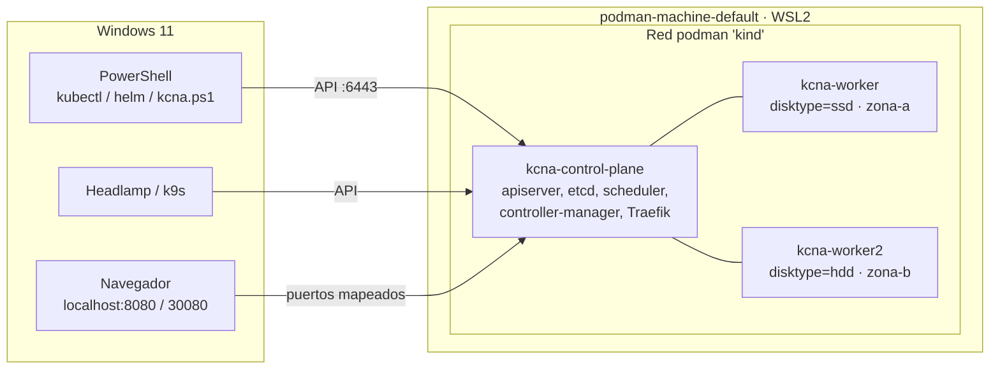

# Módulo 00 — Tu laboratorio de Kubernetes con Podman

> **Dominio KCNA:** transversal (prepara todo lo demás) · **Tiempo:** 45 min · **Prerrequisitos:** ninguno
> **Verificado:** 2026-10-26 contra la documentación oficial (Kubernetes v1.37). Fuentes al final del módulo.

## Objetivos

Al terminar podrás:

- Encender, apagar y reiniciar tu clúster de práctica con un solo comando.
- Entender qué hay "debajo": Windows → máquina de Podman (WSL) → nodos de Kubernetes como contenedores.
- Usar `kubectl` sin riesgo de tocar los clústeres de la empresa.
- Ver el clúster de forma visual con **Headlamp**, **k9s** o **Podman Desktop**.
- Verificar tus retos automáticamente con `.\kcna.ps1 check NN`.

## Cómo está montado

Tu laboratorio usa **kind** (*Kubernetes IN Docker*), un proyecto oficial de Kubernetes (SIG Testing) que crea clústeres donde cada **nodo** es un contenedor. Aquí ese contenedor lo ejecuta **Podman** en lugar de Docker.



| Pieza | Qué es | Dónde se configura |
|---|---|---|
| `cluster/kind-kcna.yaml` | Definición del clúster: 1 control-plane + 2 workers, puertos y labels | Se lee en `.\kcna.ps1 up` |
| `.kube\kcna-config` | **kubeconfig aislado** del laboratorio | Lo genera kind |
| `kcna.ps1` | CLI del curso (clúster, labs, checks, imágenes, UIs) | `.\kcna.ps1 help` |
| `kcna-env.ps1` | Prepara la terminal: `KUBECONFIG`, alias `k`, autocompletado y kubectl v1.37 | `. .\kcna-env.ps1` |
| `.bin\kubectl.exe` | kubectl con la misma versión que el clúster (tu kubectl global v1.35 no se toca) | Lo usa `kcna-env.ps1` |
| Addons | **metrics-server** (`kubectl top`, HPA), **Traefik** (Ingress + Gateway API) | `.\kcna.ps1 addons` |

### ¿Por qué kind y no minikube?

Tienes los dos instalados. Se eligió kind porque crea **varios nodos** muy ligeros (necesarios para practicar scheduling: taints, affinity, DaemonSets) y es lo que usa la propia comunidad de Kubernetes para sus pruebas. minikube también es válido; si algún día quieres probarlo: `minikube start --driver=podman --nodes 2`.

## Seguridad: tu clúster de práctica está aislado

Tu `~/.kube/config` apunta a clústeres OpenShift de la empresa. Para que nunca ejecutes un ejercicio ahí por error:

- El laboratorio usa **otro archivo** de kubeconfig: `.kube\kcna-config` dentro de esta carpeta.
- `kcna.ps1` siempre fija `KUBECONFIG` a ese archivo.
- En tu terminal, `. .\kcna-env.ps1` hace lo mismo **solo en esa ventana** y cambia el prompt a `[kcna:kind-kcna]`.

> Regla de oro: si el prompt no dice `[kcna:kind-kcna]`, no ejecutes comandos de los labs. Abre la terminal en esta carpeta y carga el entorno.

Compruébalo:

```powershell
.\kcna.ps1 doctor
```

```text
==> Aislamiento de kubeconfig
  OK  Lab usa: C:\Users\...\KubernetesLearning\.kube\kcna-config
  OK  Tu kubeconfig por defecto sigue en: <tu contexto de trabajo> (no se usa en los labs)
```

## Las imágenes se precargan (por el proxy corporativo)

La máquina de Podman sale a internet a través de un proxy local de la empresa que solo acepta conexiones de la red por defecto de Podman. Los nodos de kind viven en otra red, así que **no pueden descargar imágenes por sí mismos**. La solución estándar en kind es descargar las imágenes en el host y cargarlas a los nodos:

```powershell
.\kcna.ps1 load nginx:1.27-alpine busybox:1.37   # descarga con podman + kind load
.\kcna.ps1 preload 03                             # carga las imágenes que usa el lab 03
```

`.\kcna.ps1 lab NN` ya precarga lo necesario. Dos consecuencias que también sirven para el examen:

- Usa siempre **tags explícitos** (`nginx:1.27-alpine`), nunca `latest`. Con `latest` (o sin tag) el **imagePullPolicy** por defecto es `Always`: en cada arranque del contenedor el kubelet pide al runtime que consulte el registry (aunque la imagen ya esté en caché, solo se ahorra la descarga de capas), y sin salida a internet eso falla. Con un tag fijo (o un digest `@sha256:...`) el valor por defecto es `IfNotPresent`.
- Si ves `ErrImagePull` / `ImagePullBackOff` con una imagen nueva, cárgala con `.\kcna.ps1 load <imagen>` y borra el pod para que se recree.

En un clúster normal con salida a internet nada de esto hace falta.

## Laboratorio guiado

### 1. Encender el clúster

```powershell
cd $HOME\KubernetesLearning
.\kcna.ps1 up
```

Si el clúster ya existe, solo arranca los nodos y verifica los addons. La primera vez tarda unos minutos.

### 2. Preparar la terminal

```powershell
. .\kcna-env.ps1
k get nodes
```

```text
NAME                 STATUS   ROLES           AGE   VERSION
kcna-control-plane   Ready    control-plane   10m   v1.37.0
kcna-worker          Ready    <none>          10m   v1.37.0
kcna-worker2         Ready    <none>          10m   v1.37.0
```

Qué observar: tres nodos `Ready`. El punto inicial en `. .\kcna-env.ps1` es importante: carga las variables en la terminal actual (*dot-sourcing*).

### 3. Ver los nodos como contenedores de Podman

```powershell
podman ps --filter name=kcna --format "{{.Names}}  {{.Status}}  {{.Ports}}"
```

Qué observar: cada nodo de Kubernetes es un contenedor. El control-plane publica `8080`, `8443` y `30080` hacia Windows.

### 4. Tu primer pod

```powershell
k run hola --image=nginx:1.27-alpine
k get pods -o wide
k port-forward pod/hola 8085:80
```

Abre http://localhost:8085 en el navegador, luego `Ctrl+C` y borra el pod:

```powershell
k delete pod hola
```

### 5. Las herramientas visuales

| Herramienta | Para qué | Cómo abrirla |
|---|---|---|
| **Headlamp** (proyecto oficial de Kubernetes SIG UI) | Ver y editar recursos, logs, terminal dentro de pods, mapa de relaciones | `.\kcna.ps1 ui` |
| **k9s** | UI de terminal muy rápida, ideal para el día a día | `.\kcna.ps1 k9s` |
| **Podman Desktop** (ya lo tenías) | Ver contenedores/imágenes de Podman y recursos de Kubernetes | Ver configuración abajo |
| **App de quiz** | Simulacros tipo examen y flashcards | `.\kcna.ps1 quiz` |

**Headlamp:** `.\kcna.ps1 ui` lo abre con el kubeconfig del laboratorio; elige el clúster `kind-kcna`. Si lo abres desde el menú de Windows no verá el lab; en ese caso usa *Add Cluster → Load from KubeConfig* y selecciona `.kube\kcna-config`.

**Podman Desktop:** en *Settings → Preferences → Kubernetes → Kubeconfig* puedes apuntar a `$HOME\KubernetesLearning\.kube\kcna-config`. Ten en cuenta que esto cambia lo que ve Podman Desktop (dejaría de mostrar tus clústeres de trabajo hasta que lo reviertas).

**k9s** — atajos básicos: `:pods`, `:deploy`, `:svc` para cambiar de vista; `0` todos los namespaces; `d` describe; `l` logs; `s` shell; `Ctrl+d` borrar; `?` ayuda; `:q` salir.

### 6. Cómo estudiar cada módulo

```powershell
.\kcna.ps1 lab 03      # crea el namespace lab-03 y precarga imágenes
# ... sigues el laboratorio guiado del módulo y luego intentas el reto ...
.\kcna.ps1 check 03    # verificación automática del reto
.\kcna.ps1 reset 03    # borra todo para repetirlo cuando quieras
```

Recomendación de ventanas: el módulo abierto en **VS Code** u **Obsidian** (abre esta carpeta como *vault*: los diagramas Mermaid y los bloques `<details>` se ven bien) y la terminal al lado.

### 7. Apagar al terminar el día

```powershell
.\kcna.ps1 stop    # apaga los nodos, libera RAM; no se pierde nada
.\kcna.ps1 start   # al día siguiente
```

`.\kcna.ps1 down` elimina el clúster por completo (y `up` lo recrea desde cero en unos minutos).

## Problemas frecuentes del laboratorio

| Síntoma | Causa probable | Solución |
|---|---|---|
| `ErrImagePull` / `ImagePullBackOff` | Imagen no precargada | `.\kcna.ps1 load <imagen>` y `k delete pod <pod>` |
| `kubectl` responde con un clúster de la empresa | Terminal sin `kcna-env.ps1` | `. .\kcna-env.ps1` |
| `The connection to the server ... was refused` | Nodos apagados o máquina de Podman parada | `.\kcna.ps1 start` (o `podman machine start`) |
| http://localhost:8080 no responde | Traefik no está listo | `k get pods -n traefik` y `.\kcna.ps1 addons` |
| Todo va lento | Poca RAM libre | Cierra apps, `.\kcna.ps1 stop` cuando no estudies |

## Resumen para repasar

- kind = clúster de Kubernetes donde los nodos son contenedores; aquí corren sobre Podman.
- `.\kcna.ps1 up | stop | start | down | status | doctor`.
- `. .\kcna-env.ps1` → kubectl apunta solo al lab (`[kcna:kind-kcna]`).
- Tags explícitos siempre: `latest` implica `imagePullPolicy: Always`.
- Ciclo de estudio: `lab NN` → guía → reto → `check NN` → `reset NN` → preguntas → quiz.

## Fuentes oficiales

- [kind — kind.sigs.k8s.io](https://kind.sigs.k8s.io/): qué es kind (clústeres locales con contenedores como nodos), pensado sobre todo para probar el propio Kubernetes; compatible con Docker, Podman o nerdctl.
- [kind/README — github.com/kubernetes-sigs](https://github.com/kubernetes-sigs/kind): significado "Kubernetes IN Docker" y vínculo con SIG Testing.
- [kind Quick Start — kind.sigs.k8s.io](https://kind.sigs.k8s.io/docs/user/quick-start/): clústeres multinodo con archivo de configuración, `kind load docker-image` / `image-archive`, `KIND_EXPERIMENTAL_PROVIDER=podman` y la nota sobre `:latest` e `imagePullPolicy`.
- [Running kind with Rootless — kind.sigs.k8s.io](https://kind.sigs.k8s.io/docs/user/rootless/): requisitos de Podman rootless (cgroup v2, delegación) y limitaciones.
- [Images — kubernetes.io](https://kubernetes.io/docs/concepts/containers/images/): reglas del `imagePullPolicy` por defecto (`:latest`/sin tag → `Always`; tag fijo o digest → `IfNotPresent`), qué hace `Always`, `ImagePullBackOff` (espera máxima 5 min).
- [Organizing Cluster Access Using kubeconfig Files — kubernetes.io](https://kubernetes.io/docs/concepts/configuration/organize-cluster-access-kubeconfig/): variable `KUBECONFIG`, flag `--kubeconfig` y `$HOME/.kube/config` por defecto.
- [Headlamp — github.com/kubernetes-sigs](https://github.com/kubernetes-sigs/headlamp): Headlamp es un subproyecto de Kubernetes SIG UI (web y app de escritorio).
- [podman(1) — docs.podman.io](https://docs.podman.io/en/latest/markdown/podman.1.html): Podman como motor sin daemon, modo rootless con user namespaces.
