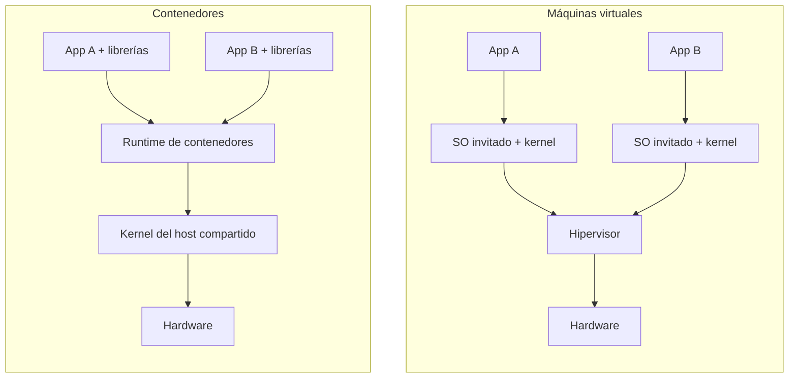
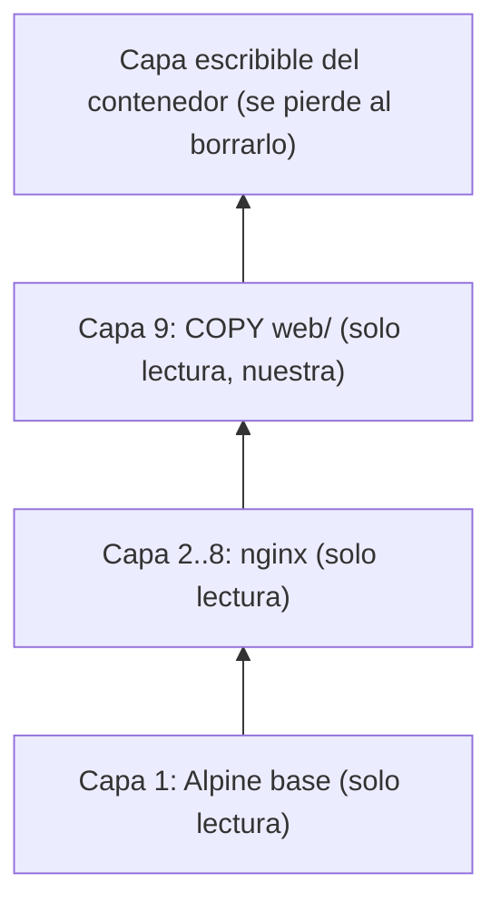
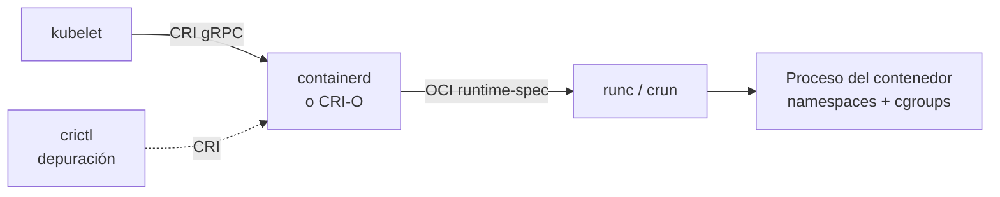

# Módulo 01 — Contenedores y cloud native

> **Dominio KCNA:** Kubernetes Fundamentals (44%) · competencia *Containerization* (y una pincelada de *Cloud Native Architecture*, 12%)
> **Tiempo estimado:** 2 h (1 h teoría + 1 h laboratorio)
> **Prerrequisitos:** Módulo 00 (clúster `kcna` encendido, Podman funcionando)
> **Lecciones equivalentes de KodeKloud:** "What are Containers", "Demo Docker", "Container Orchestration", "Runtime CRI", "Docker vs ContainerD"
> **Verificado:** 2026-10-26 contra la documentación oficial (Kubernetes v1.37). Fuentes al final del módulo.

## Objetivos

Al terminar podrás:

- Explicar qué es un contenedor, en qué se diferencia de una máquina virtual y qué piezas del kernel Linux (**namespaces** y **cgroups**) lo hacen posible.
- Describir una imagen **OCI**: capas, manifiesto, tags, digests y registries.
- Escribir un **Containerfile/Dockerfile** con buenas prácticas (imagen mínima, multi-stage, no root, tags inmutables).
- Distinguir los niveles de runtime: **runc/crun** (bajo nivel), **containerd/CRI-O** (alto nivel), la interfaz **CRI** y el papel de Docker y Podman.
- Construir una imagen con Podman, inspeccionar sus capas y ejecutarla como Pod en Kubernetes.
- Definir *cloud native* según la CNCF y relacionarlo con microservicios y la metodología **12-factor**.

## Conceptos

### 1. El problema que resuelven los contenedores

Antes de los contenedores, desplegar una aplicación significaba instalar en cada servidor el lenguaje, las librerías y la configuración exacta que necesitaba. Si en tu portátil tenías Python 3.12 y en producción 3.9, aparecía el clásico "en mi máquina funciona". Además, dos aplicaciones en el mismo servidor podían pelearse por versiones distintas de la misma librería.

Un **contenedor** empaqueta la aplicación **junto con todo lo que necesita para ejecutarse** (binarios, librerías, archivos de configuración) y la ejecuta aislada del resto del sistema. La analogía clásica es el contenedor de transporte marítimo: da igual lo que haya dentro, el barco, la grúa y el camión saben manejarlo porque el formato exterior es estándar.

### 2. Contenedor vs máquina virtual

Una **máquina virtual (VM)** virtualiza *hardware*: un **hipervisor** (Hyper-V, KVM, VMware) simula CPU, disco y red, y encima arranca un sistema operativo completo con su propio kernel. Un contenedor virtualiza el *sistema operativo*: todos los contenedores de un host **comparten el kernel del host** y solo aíslan procesos.



| Aspecto | Máquina virtual | Contenedor |
|---|---|---|
| Qué aísla | Hardware completo (cada VM tiene su kernel) | Procesos (comparten el kernel del host) |
| Tamaño típico | Gigabytes | Megabytes (nuestro nginx: ~50 MB) |
| Arranque | Minutos | Milisegundos o segundos |
| Aislamiento | Muy fuerte (frontera del hipervisor) | Bueno, pero más débil: un fallo del kernel afecta a todos |
| Sistema operativo | Cualquiera (Windows sobre Linux, etc.) | Mismo tipo de kernel que el host (contenedores Linux necesitan kernel Linux) |
| Densidad | Decenas por servidor | Cientos por servidor |

> En tu laboratorio se combinan ambas cosas: Windows ejecuta una **VM** de WSL2 (la máquina de Podman) y dentro de ella corren los **contenedores**, incluidos los tres nodos de kind. Por eso `uname -r` dentro de un contenedor devuelve el kernel de WSL2, no "Windows".

Las dos tecnologías no compiten: en la nube es muy habitual ejecutar contenedores *dentro* de VMs. Existen además runtimes "sandbox" que mezclan ideas: **Kata Containers** (cada contenedor en una micro-VM ligera) y **gVisor** (un kernel de usuario que intercepta las llamadas al sistema).

### 3. Qué hay dentro: namespaces y cgroups

Un contenedor **no es una entidad del kernel**: es un proceso normal de Linux al que el runtime le aplica dos mecanismos.

**Namespaces → qué puede *ver* el proceso.** Cada namespace le da al proceso su propia "versión" de un recurso global:

| Namespace | Aísla | Efecto que verás en el lab |
|---|---|---|
| `pid` | Árbol de procesos | Dentro del contenedor, nginx es el **PID 1** |
| `net` | Interfaces, IPs, puertos, rutas | Cada contenedor tiene su IP; dos nginx pueden escuchar en el 80 |
| `mnt` | Puntos de montaje / sistema de archivos | Ve el filesystem de la imagen (Alpine), no el del host |
| `uts` | Hostname | El hostname es el ID del contenedor |
| `ipc` | Memoria compartida, colas de mensajes | Sin interferencia entre contenedores |
| `user` | UIDs/GIDs | Permite ser "root" dentro y un usuario sin privilegios fuera (*rootless*) |
| `cgroup` | Vista de la jerarquía de cgroups | El contenedor solo ve sus propios límites |

(Linux tiene además el namespace `time`, para los relojes de arranque y monotónico; es poco habitual en contenedores.)

**Control groups (cgroups) → cuánto puede *usar* el proceso.** Limitan y contabilizan CPU, memoria, número de procesos, E/S. Cuando en Kubernetes escribes `resources.limits.memory: 64Mi`, al final el kubelet y el runtime escriben `67108864` en el archivo `memory.max` del cgroup del contenedor (lo comprobarás en el laboratorio). Si el proceso supera ese límite, el kernel lo mata (**OOMKilled**).

Otras piezas de seguridad del kernel que acompañan a los contenedores: **capabilities** (trocean los poderes de root), **seccomp** (filtra llamadas al sistema) y **SELinux/AppArmor**. Las verás en el módulo de seguridad.

### 4. Imágenes OCI

Una **imagen** es la plantilla de solo lectura a partir de la que se crea un contenedor (como una clase respecto de sus objetos). La **Open Container Initiative (OCI)**, fundada en 2015 bajo la Linux Foundation, estandarizó tres especificaciones:

| Especificación OCI | Qué define |
|---|---|
| **image-spec** | Formato de la imagen: capas, configuración, manifiesto, índice multi-arquitectura |
| **runtime-spec** | Cómo se ejecuta un contenedor a partir de un "bundle" (filesystem + `config.json`) |
| **distribution-spec** | API HTTP para subir y bajar imágenes de un registry |

Gracias a OCI, una imagen construida con Docker funciona con Podman, containerd o CRI-O, y viceversa.

**Capas.** Una imagen es una pila de **capas** de solo lectura; cada capa es un `tar` con los cambios de archivos respecto de la anterior. Las instrucciones que modifican archivos (`RUN`, `COPY`, `ADD`) crean capas nuevas; las de metadatos (`ENV`, `LABEL`, `EXPOSE`, `CMD`) solo cambian la configuración. Al arrancar un contenedor, el runtime monta las capas con un sistema de archivos de unión (**overlayfs**) y añade encima una **capa escribible** propia del contenedor (**copy-on-write**). Cuando el contenedor se borra, esa capa desaparece: por eso los contenedores son **efímeros** y los datos persistentes van en volúmenes.



Las capas se identifican por su hash (**contenido direccionable**): si diez imágenes usan la misma base Alpine, el nodo la descarga y la guarda una sola vez.

**Nombre de una imagen:**

```text
registry.k8s.io/kube-apiserver:v1.37.0
└──── registry ───┘└─ repositorio ─┘└ tag ┘

docker.io/library/nginx@sha256:65645c7b...
                        └──── digest (inmutable) ────┘
```

- Si omites el registry, Docker/containerd asumen `docker.io` (y `library/` para imágenes oficiales). Podman puede preguntar o usar su lista de registries; las imágenes que construyes localmente se llaman `localhost/<nombre>:<tag>`.
- Si omites el tag se usa `latest`, que **no significa "la más nueva"**: es solo un tag por defecto que alguien puede mover en cualquier momento.
- Un **tag** es una etiqueta móvil; un **digest** (`@sha256:...`) identifica exactamente un contenido y nunca cambia. En producción se recomiendan tags inmutables (versión concreta) o directamente digests.

**Registries.** Un **registry** almacena y distribuye imágenes: Docker Hub (`docker.io`), `quay.io`, GitHub (`ghcr.io`), `registry.k8s.io` (imágenes oficiales de Kubernetes), los de cada nube (ECR, ACR, GAR) o uno privado como **Harbor** (proyecto graduado de la CNCF). Operaciones básicas: `pull` (bajar), `push` (subir), `tag` (poner otro nombre), `login`. En Kubernetes, para registries privados se usan **imagePullSecrets**.

### 5. Containerfile / Dockerfile

Un **Dockerfile** (Podman y Buildah aceptan el mismo formato con el nombre **Containerfile**) es la receta para construir una imagen. Instrucciones clave:

| Instrucción | Para qué sirve |
|---|---|
| `FROM imagen:tag [AS nombre]` | Imagen base. Toda imagen empieza aquí (`FROM scratch` = vacía) |
| `RUN comando` | Ejecuta un comando durante el build (instalar paquetes, compilar). Crea capa |
| `COPY origen destino` | Copia archivos del contexto de build a la imagen. Crea capa |
| `ADD` | Como `COPY` pero además descomprime archivos tar locales y acepta URLs remotas. Preferir `COPY` salvo que lo necesites |
| `WORKDIR /ruta` | Directorio de trabajo para las instrucciones siguientes y para el contenedor |
| `ENV CLAVE=valor` | Variable de entorno presente en build y en ejecución |
| `ARG nombre` | Variable solo de build (`--build-arg`) |
| `EXPOSE 80` | Documenta el puerto que escucha la app. **No publica nada** por sí solo |
| `USER 1000` | Usuario con el que corre el proceso (buena práctica: no root) |
| `LABEL clave=valor` | Metadatos (autor, versión, origen). Estándar: `org.opencontainers.image.*` |
| `ENTRYPOINT [...]` | Ejecutable principal del contenedor |
| `CMD [...]` | Argumentos por defecto (o comando por defecto si no hay ENTRYPOINT). Se sobrescribe fácilmente al ejecutar |
| `HEALTHCHECK` | Comprobación de salud (Docker/Podman; Kubernetes la ignora y usa *probes*) |
| `VOLUME /datos` | Declara un punto de montaje para datos |

**ENTRYPOINT vs CMD.** El proceso final es `ENTRYPOINT + CMD`. Si ejecutas `podman run imagen otra-cosa`, reemplazas el `CMD`, no el `ENTRYPOINT`. En Kubernetes, el campo `command` de un contenedor reemplaza el `ENTRYPOINT` y `args` reemplaza el `CMD`. Usa la forma *exec* (`["nginx", "-g", "daemon off;"]`) en lugar de la forma *shell* (`nginx -g 'daemon off;'`) para que tu proceso sea el PID 1 y reciba las señales de parada.

**Caché de capas.** Al reconstruir, se reutilizan las capas cuyas instrucciones y archivos no cambiaron, *hasta la primera que cambie*. Por eso conviene poner primero lo que cambia poco (instalar dependencias) y al final lo que cambia mucho (tu código). Un archivo `.containerignore`/`.dockerignore` evita enviar al build archivos innecesarios (`.git`, `node_modules`, secretos).

**Builds multi-stage.** Permiten usar varias etapas `FROM` en el mismo archivo: una etapa "gorda" con compiladores y herramientas para generar el artefacto, y una etapa final mínima que solo copia el resultado con `COPY --from=etapa`. La imagen final no arrastra el compilador, así que es más pequeña y tiene menos superficie de ataque.

```dockerfile
FROM golang:1.23 AS build          # etapa 1: compila
WORKDIR /src
COPY . .
RUN CGO_ENABLED=0 go build -o /app

FROM gcr.io/distroless/static      # etapa 2: solo el binario
COPY --from=build /app /app
USER 65532
ENTRYPOINT ["/app"]
```

**Buenas prácticas (muy preguntadas):**

- **Imagen base mínima**: `alpine`, `distroless` o `scratch`. Menos paquetes = menos vulnerabilidades y descargas más rápidas.
- **No ejecutar como root**: `USER` con un UID sin privilegios. En Kubernetes se refuerza con `securityContext.runAsNonRoot: true`.
- **Tags inmutables y explícitos** (`nginx:1.27-alpine`, mejor aún un digest). Nunca `latest` en producción.
- **Un proceso/responsabilidad por contenedor**; si necesitas ayudantes, usa varios contenedores en un Pod (módulo 03).
- **Sin secretos en la imagen**: cualquiera con acceso a la imagen puede leer sus capas (`podman history`, `podman save`). Los secretos se inyectan en ejecución.
- **Escanear y firmar**: escáneres como **Trivy**, firmas con **Sigstore/cosign** y **SBOM** (lista de componentes) para la cadena de suministro.
- **Imágenes inmutables**: no se "parchea" un contenedor en marcha; se construye una imagen nueva y se reemplaza.

### 6. Runtimes de contenedores: quién hace qué

"Runtime" se usa para cosas distintas. Conviene separar niveles:

| Nivel | Ejemplos | Qué hace |
|---|---|---|
| **Runtime de bajo nivel** (OCI runtime) | **runc** (el original: Docker lo donó a la OCI en 2015), **crun** (en C, más ligero; el que usa Podman por defecto), Kata Containers, gVisor (`runsc`) | Recibe un bundle OCI y crea el proceso aislado: namespaces, cgroups, montajes. Después del arranque se aparta |
| **Runtime de alto nivel** (gestor de contenedores) | **containerd** (graduado CNCF, 2019), **CRI-O** (graduado CNCF en 2023, hecho para Kubernetes) | Descarga y almacena imágenes, prepara el filesystem, gestiona el ciclo de vida y llama al runtime de bajo nivel |
| **Herramientas/CLI** | Docker CLI + dockerd, Podman, nerdctl, `crictl`, `ctr` | Interfaz para humanos o depuración |

**CRI (Container Runtime Interface).** Es la API gRPC que el **kubelet** usa para hablar con el runtime. Cualquier runtime que implemente CRI sirve para Kubernetes: containerd (con su plugin CRI) y CRI-O son los habituales.



**La historia de Docker y Kubernetes (pregunta clásica).** Al principio Kubernetes hablaba directamente con Docker. Cuando apareció CRI, Docker no lo implementaba, así que Kubernetes mantuvo un adaptador llamado **dockershim**. Ese adaptador se marcó como obsoleto en v1.20 y **se eliminó en Kubernetes v1.24**. Consecuencias:

- Kubernetes ya no usa Docker Engine como runtime (salvo con el adaptador externo `cri-dockerd`).
- **Las imágenes construidas con Docker siguen funcionando perfectamente**, porque son imágenes OCI.
- Docker Engine internamente ya usaba containerd, así que en la práctica se quitó un intermediario: kubelet → containerd → runc.

| | Docker (Docker Engine) | containerd |
|---|---|---|
| Qué es | Plataforma completa: CLI, daemon `dockerd`, build, redes, volúmenes, Compose | Runtime de alto nivel, minimalista, embebible |
| Implementa CRI | No (necesita `cri-dockerd`) | Sí (plugin CRI integrado) |
| Origen | Docker Inc. | Extraído de Docker y donado a la CNCF (graduado en 2019) |
| CLI | `docker` | `ctr` (bajo nivel), `nerdctl` (estilo docker), `crictl` (vista CRI) |
| Uso típico | Desarrollo en el portátil | Nodos de Kubernetes (kind, EKS, GKE, AKS...) |

**Podman** es una alternativa a Docker desarrollada por Red Hat, con CLI compatible (`podman run` ≈ `docker run`) pero dos diferencias clave:

- **Daemonless**: no hay un daemon central con privilegios; cada `podman run` lanza el contenedor directamente (vía `conmon` + `crun`).
- **Rootless**: puede ejecutar contenedores como usuario normal gracias a los *user namespaces*.
- Además entiende el concepto de **pod** (`podman pod create`) y puede generar YAML de Kubernetes (`podman kube generate`). Lo acompañan **Buildah** (construir imágenes) y **Skopeo** (copiar/inspeccionar imágenes entre registries).

En tu laboratorio conviven varios: **Podman** (con **crun**) en la VM de WSL ejecuta los contenedores-nodo de kind; dentro de cada nodo, el kubelet usa **containerd** (con **runc**) para ejecutar tus Pods.

### 7. Orquestación de contenedores

Ejecutar un contenedor en tu portátil es fácil. Ejecutar cientos en decenas de servidores plantea preguntas que un runtime no responde: ¿en qué servidor pongo cada contenedor? ¿Quién lo reinicia si se cae o si muere el servidor? ¿Cómo escalo de 3 a 30 copias? ¿Cómo se encuentran entre sí? ¿Cómo actualizo sin cortar el servicio? Un **orquestador** automatiza todo eso: *scheduling*, autorreparación (*self-healing*), escalado, descubrimiento de servicios y balanceo, despliegues progresivos y rollbacks, gestión de configuración y secretos.

**Kubernetes** (K8s), nacido en Google a partir de más de 15 años de experiencia con su sistema interno Borg, se publicó como código abierto en 2014; fue el proyecto semilla de la CNCF (fundada en 2015; aceptado formalmente en 2016) y el **primer proyecto graduado** de la fundación (2018). Hoy es el estándar de facto. Otras opciones históricas o de nicho: Docker Swarm, HashiCorp Nomad, Apache Mesos.

### 8. ¿Qué significa "cloud native"?

La CNCF lo resume en su definición oficial (versión 1.1, aprobada en 2024; redacción propia): las prácticas cloud native permiten a las organizaciones **desarrollar, construir y desplegar cargas de trabajo** en entornos de cómputo (nubes públicas, privadas e híbridas) **a escala, de forma programática y repetible**. Se caracteriza por sistemas **débilmente acoplados** que interoperan de forma **segura**, **resiliente**, **gestionable**, **sostenible** y **observable**. Sus piezas típicas (lista no exhaustiva) son los **contenedores**, las **service meshes**, la **multi-tenancy**, los **microservicios**, la **infraestructura inmutable**, el **serverless** y las **APIs declarativas**. Combinadas con una **automatización** sólida, permiten hacer cambios de alto impacto con frecuencia, de forma predecible y con un mínimo de trabajo manual (*toil*).

> La versión 1.0 de la definición (la que aún citan muchos cursos) hablaba de "construir y ejecutar aplicaciones escalables en entornos modernos y dinámicos" y listaba contenedores, service meshes, microservicios, infraestructura inmutable y APIs declarativas, con sistemas débilmente acoplados, resilientes, gestionables y observables. La 1.1 conserva todo eso y añade seguridad, sostenibilidad, multi-tenancy y serverless.

Ideas asociadas que el examen da por sabidas:

- **Mascotas vs ganado (*pets vs cattle*)**: un servidor "mascota" se cuida y repara a mano; el "ganado" es intercambiable y se reemplaza cuando falla. Los contenedores son ganado.
- **Infraestructura inmutable**: no se modifica lo que está en marcha; se despliega una versión nueva y se retira la vieja.
- **Declarativo**: describes el estado deseado y el sistema converge hacia él (lo verás en el módulo 02).

**Monolito vs microservicios:**

| | Monolito | Microservicios |
|---|---|---|
| Estructura | Una sola aplicación/despliegue con todos los módulos | Muchos servicios pequeños, cada uno con una responsabilidad |
| Despliegue | Todo a la vez | Cada servicio por separado |
| Escalado | Toda la aplicación | Solo el servicio que lo necesita |
| Fallos | Un error puede tumbar todo | Fallos más aislados (si se diseña bien) |
| Complejidad | Simple al inicio | Más compleja: red, observabilidad, versiones entre servicios |
| Tecnología | Un stack | Cada equipo puede elegir el suyo |

Microservicios no es obligatorio para ser cloud native, pero contenedores + Kubernetes los hacen viables.

**La aplicación de 12 factores (*12-factor app*)**, metodología escrita por Adam Wiggins a partir de la experiencia de la plataforma Heroku, para apps que se ejecutan bien en la nube:

| # | Factor | En una frase |
|---|---|---|
| 1 | Código base | Un repositorio por app, muchos despliegues |
| 2 | Dependencias | Declaradas explícitamente y aisladas (la imagen las incluye) |
| 3 | Configuración | En el entorno, no en el código (ConfigMaps, Secrets, variables) |
| 4 | Servicios de respaldo | BD, colas, caches como recursos conectables por URL |
| 5 | Build, release, run | Etapas separadas: construir la imagen, combinarla con config, ejecutarla |
| 6 | Procesos | Sin estado (*stateless*); el estado va a servicios externos |
| 7 | Asignación de puertos | La app expone su servicio escuchando en un puerto |
| 8 | Concurrencia | Escalar añadiendo procesos (réplicas), no agrandando uno |
| 9 | Desechabilidad | Arranque rápido y parada limpia (manejar SIGTERM) |
| 10 | Paridad dev/prod | Entornos lo más parecidos posible (misma imagen) |
| 11 | Logs | Flujo de eventos a stdout/stderr; otro sistema los recoge |
| 12 | Procesos de administración | Tareas puntuales como procesos aislados (en K8s: Jobs) |

## Comandos clave

| Comando | Qué hace |
|---|---|
| `podman run -d --name web -p 8081:80 nginx:1.27-alpine` | Crea y arranca un contenedor en segundo plano publicando el puerto 80 en el 8081 del host |
| `podman ps` / `podman ps -a` | Lista contenedores en ejecución / todos (incluidos parados) |
| `podman logs web` | Muestra stdout/stderr del contenedor |
| `podman exec -it web sh` | Abre una shell dentro del contenedor en marcha |
| `podman top web` | Procesos del contenedor vistos desde fuera |
| `podman stop web` / `podman rm web` | Para el contenedor / lo elimina |
| `podman build -t nombre:tag .` | Construye una imagen a partir del Containerfile del directorio |
| `podman images` | Lista imágenes locales |
| `podman history imagen` | Muestra las capas y la instrucción que creó cada una |
| `podman image inspect imagen` | Metadatos: capas, labels, env, CMD/ENTRYPOINT, puertos |
| `podman pull` / `podman push` / `podman tag` | Bajar, subir y renombrar imágenes |
| `podman rmi imagen` | Borra una imagen local |
| `crictl ps` / `crictl images` / `crictl pods` | Vista del runtime CRI dentro de un nodo de Kubernetes |
| `.\kcna.ps1 load localhost/img:tag` | Copia una imagen de Podman a los nodos de kind |

Equivalencias: casi todos los comandos `podman ...` funcionan igual con `docker ...`.

## Laboratorio guiado

Este laboratorio se hace sobre todo con **Podman en tu Windows** (no con el clúster); solo al final llevas tu imagen a Kubernetes.

### 1. Preparar el laboratorio

```powershell
cd $HOME\KubernetesLearning
.\kcna.ps1 lab 01
. .\kcna-env.ps1
cd labs\01-contenedores-y-cloud-native
```

```text
  OK  ya cargada: nginx:1.27-alpine
  OK  ya cargada: busybox:1.37
  OK  Namespace listo: lab-01
```

Qué observar: el clúster está detrás del proxy corporativo y sus nodos no pueden descargar imágenes; por eso `kcna.ps1` las baja con Podman y las copia a los nodos (en un clúster normal no hace falta). Esto también deja `nginx:1.27-alpine` y `busybox:1.37` en tu Podman local.

### 2. Tu primer contenedor con Podman

```powershell
podman run -d --name web1 -p 8081:80 nginx:1.27-alpine
podman ps
curl.exe -s http://localhost:8081
```

```text
c90a6331da02240ee6c7ab25...
CONTAINER ID  IMAGE                                COMMAND               CREATED         STATUS         PORTS                 NAMES
c90a6331da02  docker.io/library/nginx:1.27-alpine  nginx -g daemon o...  11 seconds ago  Up 10 seconds  0.0.0.0:8081->80/tcp  web1
<!DOCTYPE html>
<html>
<head>
<title>Welcome to nginx!</title>
```

Qué observar: `-d` lo deja en segundo plano y `-p 8081:80` publica el puerto 80 del contenedor en el 8081 del host. El nombre corto `nginx` se resolvió a `docker.io/library/nginx`. Usa `curl.exe` (en PowerShell 5.1 `curl` a secas es un alias de `Invoke-WebRequest`).

### 3. Logs y procesos

```powershell
podman logs web1
podman top web1
```

```text
/docker-entrypoint.sh: Configuration complete; ready for start up
2026/10/23 15:16:09 [notice] 1#1: nginx/1.27.5
...
10.88.0.1 - - [23/Oct/2026:15:16:22 +0000] "GET / HTTP/1.1" 200 615 "-" "curl/8.21.0" "-"
USER   PID   PPID   %CPU   ELAPSED   TTY   TIME   COMMAND
root   1     0      0.000  3m27s     ?     0s     nginx: master process nginx -g daemon off;
nginx  25    1      0.000  3m26s     ?     0s     nginx: worker process
```

Qué observar: los logs son lo que el proceso escribe en stdout/stderr (factor 11 de 12-factor). Tu petición `curl` aparece en el log de acceso.

### 4. Namespaces: el contenedor tiene su propia "vista"

```powershell
podman exec web1 ps
podman exec web1 hostname
podman exec web1 cat /etc/os-release
podman exec web1 uname -r
```

```text
PID   USER     TIME  COMMAND
    1 root      0:00 nginx: master process nginx -g daemon off;
   25 nginx     0:00 nginx: worker process
   ...
   29 root      0:00 ps
c90a6331da02
NAME="Alpine Linux"
ID=alpine
...
6.6.87.2-microsoft-standard-WSL2
```

Qué observar: gracias al namespace `pid`, nginx es el **PID 1** y no se ven los procesos del host; el namespace `uts` le da como hostname el ID del contenedor; el namespace `mnt` muestra el filesystem de Alpine. Pero el **kernel es el del host** (WSL2): un contenedor no trae kernel propio. Observa también que el proceso maestro corre como `root` y los *workers* como `nginx`.

### 5. cgroups: limitar recursos

```powershell
podman run --rm --memory 64m --cpus 0.5 busybox:1.37 sh -c 'cat /sys/fs/cgroup/memory.max; cat /sys/fs/cgroup/cpu.max; ps'
```

```text
67108864
50000 100000
PID   USER     TIME  COMMAND
    1 root      0:00 ps
```

Qué observar: `--memory 64m` se traduce en `memory.max = 67108864` bytes, y `--cpus 0.5` en `cpu.max = 50000 100000` (50 ms de CPU cada 100 ms). Es exactamente lo que hará Kubernetes con `resources.limits`. `--rm` borra el contenedor al terminar.

### 6. Parar y borrar

```powershell
podman stop web1
podman ps -a --filter name=^web1
podman rm web1
```

```text
web1
CONTAINER ID  IMAGE                                COMMAND               CREATED        STATUS                    PORTS                 NAMES
c90a6331da02  docker.io/library/nginx:1.27-alpine  nginx -g daemon o...  5 minutes ago  Exited (0) 3 seconds ago  0.0.0.0:8081->80/tcp  web1
web1
```

Qué observar: un contenedor parado sigue existiendo (con su capa escribible) hasta que lo borras con `rm`. `podman rm -f` para y borra en un paso.

### 7. Construir tu propia imagen

Abre `Containerfile` y `web\index.html` de la carpeta del lab para ver la receta. Luego:

```powershell
podman build -t kcna-web:1.0 .
podman images kcna-web
```

```text
STEP 1/5: FROM nginx:1.27-alpine
STEP 2/5: LABEL org.opencontainers.image.title="kcna-web" ...
--> fc5e1d2069c5
STEP 3/5: ENV KCNA_MODULO=01
--> eadeaa0a4981
STEP 4/5: COPY web/ /usr/share/nginx/html/
--> b4f5670b2368
STEP 5/5: EXPOSE 80
COMMIT kcna-web:1.0
--> d102d0578661
Successfully tagged localhost/kcna-web:1.0
REPOSITORY          TAG   IMAGE ID      CREATED         SIZE
localhost/kcna-web  1.0   d102d0578661  49 seconds ago  49.7 MB
```

Qué observar: el `.` final es el **contexto de build** (lo que se envía al constructor; de ahí sale `web/`). Podman nombra las imágenes locales como `localhost/<nombre>:<tag>`; ese nombre completo es el que usarás en Kubernetes.

### 8. Ver las capas y los metadatos

```powershell
podman history kcna-web:1.0
podman image inspect nginx:1.27-alpine --format '{{len .RootFS.Layers}}'
podman image inspect kcna-web:1.0 --format '{{len .RootFS.Layers}}'
podman image inspect kcna-web:1.0 --format '{{json .Labels}}'
podman image inspect kcna-web:1.0 --format '{{.Config.Cmd}} {{.Config.Entrypoint}} {{.Config.ExposedPorts}}'
```

```text
ID            CREATED        CREATED BY                                     SIZE   COMMENT
b4f5670b2368  1 minute ago   /bin/sh -c #(nop) EXPOSE 80                    0B
<missing>     1 minute ago   /bin/sh -c #(nop) COPY dir:3060a090c857085...  4.1kB
6769dc3a703c  1 minute ago   /bin/sh -c #(nop) ENV KCNA_MODULO=01           0B
<missing>     1 minute ago   /bin/sh -c #(nop) LABEL org.opencontainers...  0B     FROM docker.io/library/nginx:1.27-alpine
<missing>     18 months ago  RUN /bin/sh -c set -x     && apkArch="$(ca...  37MB   buildkit.dockerfile.v0
...
8
9
{"io.buildah.version":"1.42.2","maintainer":"NGINX Docker Maintainers <docker-maint@nginx.com>","org.opencontainers.image.description":"Pagina estatica del curso KCNA","org.opencontainers.image.title":"kcna-web","org.opencontainers.image.version":"1.0"}
[nginx -g daemon off;] [/docker-entrypoint.sh] map[80/tcp:{}]
```

Qué observar: la base tiene **8 capas** y la tuya **9**: solo `COPY` añadió una capa (4.1 kB); `LABEL`, `ENV` y `EXPOSE` son metadatos (0B). Las capas de nginx se reutilizan, no se copian. `CMD` y `ENTRYPOINT` se heredaron de la imagen base.

> Truco PowerShell 5.1: evita comillas dobles *dentro* de argumentos para programas externos (por ejemplo `{{ index .Labels "clave" }}`); PowerShell 5.1 las elimina al pasarlas. Por eso aquí se usa `{{json .Labels}}`.

### 9. Ejecutar tu imagen localmente

```powershell
podman run -d --name web2 -p 8082:80 kcna-web:1.0
curl.exe -s http://localhost:8082
podman exec web2 printenv KCNA_MODULO
podman rm -f web2
```

```text
<h1>Hola desde mi imagen KCNA v1</h1>
<p>Construida con Podman a partir de nginx:1.27-alpine.</p>
...
01
```

Qué observar: la variable `ENV` del Containerfile está disponible dentro del contenedor.

### 10. (Opcional) Build multi-stage

```powershell
podman build -f Containerfile.multistage -t kcna-web:multi .
podman images --filter reference=kcna-web
podman images --filter reference=busybox
```

```text
[1/2] STEP 1/3: FROM busybox:1.37 AS build
[1/2] STEP 2/3: WORKDIR /out
[1/2] STEP 3/3: RUN echo "<h1>Generado en la etapa build</h1>" > index.html && ...
[2/2] STEP 1/3: FROM nginx:1.27-alpine
[2/2] STEP 2/3: COPY --from=build /out/index.html /usr/share/nginx/html/index.html
[2/2] STEP 3/3: EXPOSE 80
Successfully tagged localhost/kcna-web:multi
REPOSITORY          TAG    IMAGE ID      CREATED         SIZE
localhost/kcna-web  multi  eb477985827d  14 seconds ago  49.7 MB
...
```

Qué observar: la imagen final pesa lo mismo que nginx + tu archivo; nada de la etapa `build` (busybox) viaja en ella. Con un compilador real (Go, Java, Node) la diferencia es de cientos de MB.

### 11. Llevar la imagen a Kubernetes

Tu imagen solo existe en el almacén de Podman. Los nodos de kind tienen su propio almacén (el de containerd), así que hay que copiarla:

```powershell
cd $HOME\KubernetesLearning
.\kcna.ps1 load localhost/kcna-web:1.0
podman exec kcna-worker crictl images | Select-String kcna
```

```text
==> Descargando localhost/kcna-web:1.0
  OK  cargada en el cluster: localhost/kcna-web:1.0
localhost/kcna-web     1.0     d102d05786612     49.7MB
```

Qué observar: el script dice "Descargando" pero, como la imagen ya existe en Podman, solo la exporta (`podman save`) y la importa en los nodos (`kind load image-archive`). `crictl` es la herramienta para hablar con el runtime CRI (containerd) del nodo. En un clúster real harías `podman push` a un registry y los nodos la descargarían.

### 12. Ejecutarla como Pod

```powershell
kubectl apply -f labs\01-contenedores-y-cloud-native\pod-web-propia.yaml
kubectl get pod web-propia -n lab-01 -o wide --show-labels
kubectl exec web-propia -n lab-01 -- wget -qO- http://localhost/
kubectl describe pod web-propia -n lab-01 | Select-String -Pattern 'Pulled|Created|Started'
```

```text
pod/web-propia created
NAME         READY   STATUS    RESTARTS   AGE   IP            NODE          ...   LABELS
web-propia   1/1     Running   0          11s   10.244.2.15   kcna-worker   ...   app=kcna-web,version=v1
<h1>Hola desde mi imagen KCNA v1</h1>
...
  Normal  Pulled   24s  kubelet  spec.containers{web}: Container image "localhost/kcna-web:1.0" already present on machine and can be accessed by the pod
  Normal  Created  24s  kubelet  spec.containers{web}: Container created
  Normal  Started  23s  kubelet  spec.containers{web}: Container started
```

Qué observar: "already present on machine": el kubelet no descargó nada porque la imagen tiene tag fijo (→ `imagePullPolicy: IfNotPresent`) y ya estaba en el nodo. La **misma imagen** corre igual en Podman y en Kubernetes: eso es el estándar OCI.

### 13. Ver el contenedor desde el runtime del nodo

```powershell
podman exec kcna-worker crictl ps --name web
```

```text
CONTAINER       IMAGE           CREATED              STATE     NAME   ATTEMPT   POD ID          POD          NAMESPACE
0cbbf58ecb4e7   d102d05786612   About a minute ago   Running   web    0         d3b17e36fbc15   web-propia   lab-01
```

Qué observar: si el Pod cayó en `kcna-worker2`, cambia el nombre del nodo. Debajo de Kubernetes hay un runtime normal (containerd + runc) ejecutando un contenedor con el ID de tu imagen.

### 14. Provocar el error típico: imagen que el nodo no tiene

```powershell
kubectl run sin-cargar -n lab-01 --image=localhost/kcna-web:9.9
kubectl get pod sin-cargar -n lab-01
kubectl describe pod sin-cargar -n lab-01 | Select-String Failed
kubectl delete pod sin-cargar -n lab-01
```

```text
NAME         READY   STATUS             RESTARTS   AGE
sin-cargar   0/1     ImagePullBackOff   0          23s
  Warning  Failed  ...  Failed to pull image "localhost/kcna-web:9.9": ... failed to do request: Head "https://localhost/v2/kcna-web/manifests/9.9": dial tcp 127.0.0.1:443: connect: connection refused
```

Qué observar: como la imagen no está en el nodo, el kubelet intenta descargarla de un registry llamado `localhost` (que no existe) → `ErrImagePull` y luego `ImagePullBackOff` (reintentos con espera creciente). Este diagnóstico se pregunta mucho.

## Reto

Publica la **versión 2.0** de tu imagen y ejecútala en el clúster:

1. Construye `localhost/kcna-web:2.0` cuya página contenga el texto `v2` y cuya etiqueta OCI `org.opencontainers.image.version` valga `2.0`. Sugerencia: trabaja sobre una **copia** de la carpeta del lab para no tocar los originales.
2. Cárgala en el clúster.
3. Crea en `lab-01` un Pod llamado `web-v2` con esa imagen y los labels `app=kcna-web` y `version=v2`.

Verifica:

```powershell
.\kcna.ps1 check 01
```

<details><summary>Ver solución</summary>

```powershell
cd $HOME\KubernetesLearning
Copy-Item -Recurse labs\01-contenedores-y-cloud-native $env:TEMP\kcna-web-v2
cd $env:TEMP\kcna-web-v2
(Get-Content web\index.html) -replace 'v1', 'v2' | Set-Content web\index.html -Encoding utf8
(Get-Content Containerfile) -replace 'version="1.0"', 'version="2.0"' | Set-Content Containerfile -Encoding utf8
podman build -t kcna-web:2.0 .
(podman image inspect kcna-web:2.0 --format '{{json .Labels}}' | ConvertFrom-Json).'org.opencontainers.image.version'

cd $HOME\KubernetesLearning
.\kcna.ps1 load localhost/kcna-web:2.0
kubectl run web-v2 -n lab-01 --image=localhost/kcna-web:2.0 --labels='app=kcna-web,version=v2'
kubectl wait --for=condition=Ready pod/web-v2 -n lab-01 --timeout=60s
.\kcna.ps1 check 01
```

Alternativa sin editar el Containerfile: `podman build --label org.opencontainers.image.version=2.0 -t kcna-web:2.0 .` (la opción `--label` sobrescribe la del archivo).

Si creaste el Pod antes de cargar la imagen verás `ImagePullBackOff`: carga la imagen, `kubectl delete pod web-v2 -n lab-01` y vuelve a crearlo.

```text
  OK  La imagen localhost/kcna-web:2.0 existe en Podman (podman build -t kcna-web:2.0 .)
  OK  La imagen 2.0 tiene la etiqueta OCI org.opencontainers.image.version=2.0
  OK  Pod 'web-v2' en lab-01 usa la imagen localhost/kcna-web:2.0
  OK  Pod 'web-v2' tiene los labels app=kcna-web y version=v2
  OK  Pod 'web-v2' esta Running y listo (imagen cargada con .\kcna.ps1 load)
  OK  La pagina que sirve 'web-v2' contiene el texto 'v2'

  Lab completado: 6/6
```

</details>

## Preguntas tipo examen

**1.** Which Linux kernel feature limits how much CPU and memory a container can consume?

- A. Namespaces
- B. cgroups
- C. seccomp
- D. chroot

<details><summary>Respuesta</summary>

**B.** Los *control groups* limitan y contabilizan recursos. Los namespaces aíslan lo que el proceso *ve* (PIDs, red, montajes), no cuánto consume. seccomp filtra llamadas al sistema.

</details>

**2.** What is the main difference between a container and a virtual machine?

- A. Containers include a full guest operating system
- B. Containers share the host kernel, while each VM runs its own kernel
- C. Virtual machines start faster than containers
- D. Containers can only run on Kubernetes

<details><summary>Respuesta</summary>

**B.** Los contenedores comparten el kernel del host y aíslan procesos; las VMs virtualizan hardware y llevan su propio kernel. Por eso los contenedores son más ligeros y arrancan más rápido.

</details>

**3.** Which component is a low-level OCI runtime that actually creates the container process?

- A. containerd
- B. kubelet
- C. runc
- D. CRI-O

<details><summary>Respuesta</summary>

**C.** runc (o crun) implementa la *runtime-spec* de OCI y crea el proceso con namespaces y cgroups. containerd y CRI-O son runtimes de alto nivel que lo invocan; el kubelet habla con ellos vía CRI.

</details>

**4.** What does the Container Runtime Interface (CRI) define?

- A. The format of container images stored in a registry
- B. The gRPC API that the kubelet uses to communicate with the container runtime
- C. The network plugin interface for Pods
- D. The storage interface for persistent volumes

<details><summary>Respuesta</summary>

**B.** CRI es la API entre kubelet y runtime. El formato de imagen lo define OCI image-spec; la red la define CNI y el almacenamiento CSI.

</details>

**5.** Kubernetes removed dockershim in version 1.24. What is the impact on images built with `docker build`?

- A. They must be rebuilt with Podman
- B. They can no longer be pulled by Kubernetes nodes
- C. They keep working, because they are OCI-compliant images
- D. They only work if Docker Engine is installed on every node

<details><summary>Respuesta</summary>

**C.** Las imágenes de Docker siguen el estándar OCI, así que containerd o CRI-O las ejecutan sin problema. Lo que se eliminó fue el uso de Docker Engine como runtime del kubelet.

</details>

**6.** Which Dockerfile instruction creates a new filesystem layer?

- A. `ENV`
- B. `EXPOSE`
- C. `LABEL`
- D. `COPY`

<details><summary>Respuesta</summary>

**D.** `COPY`, `ADD` y `RUN` modifican archivos y generan capas. `ENV`, `EXPOSE`, `LABEL`, `CMD` solo cambian metadatos de la imagen (en el lab: 8 capas en la base, 9 en tu imagen).

</details>

**7.** What is the main benefit of a multi-stage build?

- A. It allows running several containers from one image
- B. The final image contains only the artifacts it needs, without build tools, making it smaller and more secure
- C. It builds images for multiple CPU architectures automatically
- D. It enables layer caching

<details><summary>Respuesta</summary>

**B.** Las etapas intermedias (compiladores, dependencias de build) se descartan; la imagen final solo copia el resultado con `COPY --from`. Multi-arquitectura es otra cosa (índices de imagen / `--platform`).

</details>

**8.** Which statement about Podman is correct?

- A. It requires a central daemon running as root
- B. It is daemonless and can run containers rootless
- C. It cannot run OCI images built by Docker
- D. It is the default runtime used by the kubelet

<details><summary>Respuesta</summary>

**B.** Podman no tiene daemon (cada contenedor lo supervisa `conmon`) y soporta modo rootless con user namespaces. Ejecuta cualquier imagen OCI. El kubelet usa containerd o CRI-O.

</details>

**9.** Why is using the `latest` tag discouraged in production?

- A. `latest` images are always larger
- B. `latest` is a mutable tag, so the same name can point to different content over time
- C. Kubernetes rejects images tagged `latest`
- D. `latest` images cannot be scanned for vulnerabilities

<details><summary>Respuesta</summary>

**B.** `latest` es solo el tag por defecto y puede moverse: dos nodos podrían ejecutar versiones distintas. Además, en Kubernetes provoca `imagePullPolicy: Always`. Usa tags de versión o digests.

</details>

**10.** According to the CNCF, which set of technologies best exemplifies a cloud native approach?

- A. Bare-metal servers, manual configuration, monolithic deployments
- B. Containers, service meshes, microservices, immutable infrastructure and declarative APIs
- C. Virtual machines managed only through a web console
- D. Mainframes with batch scheduling

<details><summary>Respuesta</summary>

**B.** Son los ejemplos que da la definición de la CNCF (la versión 1.1 añade multi-tenancy y serverless a esa lista). Cloud native busca sistemas débilmente acoplados, seguros, resilientes, gestionables, sostenibles y observables, con mucha automatización.

</details>

**11.** According to the twelve-factor methodology, where should an application's configuration (such as database URLs) be stored?

- A. Hard-coded in the source code
- B. Inside the container image
- C. In the environment, separate from the code
- D. In the application logs

<details><summary>Respuesta</summary>

**C.** El factor 3 pide separar configuración y código; en Kubernetes eso son variables de entorno, ConfigMaps y Secrets (módulo 03). Así la misma imagen sirve para dev y prod.

</details>

## Resumen para repasar

- Contenedor = proceso aislado que **comparte el kernel**; VM = hardware virtual con kernel propio.
- **Namespaces** (pid, net, mnt, uts, ipc, user, cgroup) aíslan lo que se ve; **cgroups** limitan lo que se consume.
- **OCI**: image-spec, runtime-spec, distribution-spec. Imagen = capas de solo lectura + config; el contenedor añade una capa escribible efímera.
- Solo `RUN`, `COPY` y `ADD` crean capas. Multi-stage = imagen final mínima. `ENTRYPOINT` + `CMD`; en K8s `command` reemplaza ENTRYPOINT y `args` reemplaza CMD.
- Buenas prácticas: base mínima, `USER` no root, tags inmutables/digests, sin secretos en la imagen, escanear (Trivy) y firmar (cosign).
- Bajo nivel: **runc**, **crun**, Kata, gVisor. Alto nivel: **containerd**, **CRI-O**. El kubelet habla **CRI**; `crictl` lo depura.
- **dockershim** se eliminó en **v1.24**; las imágenes de Docker siguen funcionando (son OCI).
- Podman: **daemonless** y **rootless**, CLI compatible con Docker.
- Madurez en la CNCF: **containerd** (2019) y **CRI-O** (2023) son proyectos **graduados**; Kubernetes fue el primer graduado (2018).
- Cloud native (definición CNCF v1.1): cargas a escala de forma programática y repetible; sistemas débilmente acoplados, seguros, resilientes, gestionables, sostenibles y observables; contenedores, service meshes, microservicios, infraestructura inmutable, serverless y APIs declarativas + automatización. 12-factor: config en el entorno, procesos sin estado, logs a stdout.

## Limpieza

```powershell
.\kcna.ps1 reset 01
podman rmi localhost/kcna-web:1.0 localhost/kcna-web:2.0 localhost/kcna-web:multi
Remove-Item -Recurse -Force $env:TEMP\kcna-web-v2 -ErrorAction SilentlyContinue
```

`reset` borra el namespace `lab-01`; las imágenes de Podman se borran aparte porque viven en tu host, no en el clúster.

## Fuentes oficiales

- [Cloud Native Definition v1.1 — github.com/cncf/toc](https://github.com/cncf/toc/blob/main/DEFINITION.md): definición oficial de cloud native (v1.1, 2024): características y lista de tecnologías.
- [About the OCI — opencontainers.org](https://opencontainers.org/about/overview/): fundación de la OCI (2015, Linux Foundation), especificaciones runtime-spec, image-spec y distribution-spec; Docker donó runc (runtime de bajo nivel, ver también [github.com/opencontainers/runc](https://github.com/opencontainers/runc)).
- [Container Runtime Interface (CRI) — kubernetes.io](https://kubernetes.io/docs/concepts/architecture/cri/): CRI como protocolo gRPC entre kubelet y runtime; el kubelet exige la API CRI `v1`.
- [Migrating from dockershim — kubernetes.io](https://kubernetes.io/docs/tasks/administer-cluster/migrating-from-dockershim/): dockershim obsoleto desde 1.20 y eliminado en v1.24.
- [Dockershim FAQ — kubernetes.io/blog](https://kubernetes.io/blog/2022/02/17/dockershim-faq/): las imágenes construidas con Docker siguen funcionando (OCI); cri-dockerd; Docker Engine usa containerd.
- [containerd — cncf.io](https://www.cncf.io/projects/containerd/) y [CRI-O — cncf.io](https://www.cncf.io/projects/cri-o/): ambos graduados (2019 y 2023).
- [Kubernetes, primer proyecto graduado — cncf.io](https://www.cncf.io/announcements/2018/03/06/cloud-native-computing-foundation-announces-kubernetes-first-graduated-project/): Kubernetes, primer proyecto graduado de la CNCF (2018).
- [Overview — kubernetes.io](https://kubernetes.io/docs/concepts/overview/): Google liberó Kubernetes en 2014 a partir de más de 15 años de experiencia.
- [Images — kubernetes.io](https://kubernetes.io/docs/concepts/containers/images/): nombres de imagen, registry por defecto, `latest` por defecto, tags mutables frente a digests inmutables, `imagePullPolicy`.
- [Define a Command and Arguments for a Container — kubernetes.io](https://kubernetes.io/docs/tasks/inject-data-application/define-command-argument-container/): `command` ↔ `ENTRYPOINT`, `args` ↔ `CMD`.
- [Dockerfile reference — docs.docker.com](https://docs.docker.com/reference/dockerfile/): ENTRYPOINT/CMD, forma exec y señales, EXPOSE no publica, ADD (tar locales, URLs), ARG frente a ENV.
- [Storage drivers — docs.docker.com](https://docs.docker.com/engine/storage/drivers/): capas de solo lectura, capa escribible del contenedor, copy-on-write; instrucciones de metadatos (LABEL, CMD) no crean capas.
- [namespaces(7) — man7.org](https://man7.org/linux/man-pages/man7/namespaces.7.html): tipos de namespaces de Linux.
- [podman(1) — docs.podman.io](https://docs.podman.io/en/latest/markdown/podman.1.html): Podman sin daemon, rootless con user namespaces, crun como runtime por defecto.
- [The Twelve-Factor App — 12factor.net](https://12factor.net/): los 12 factores.
