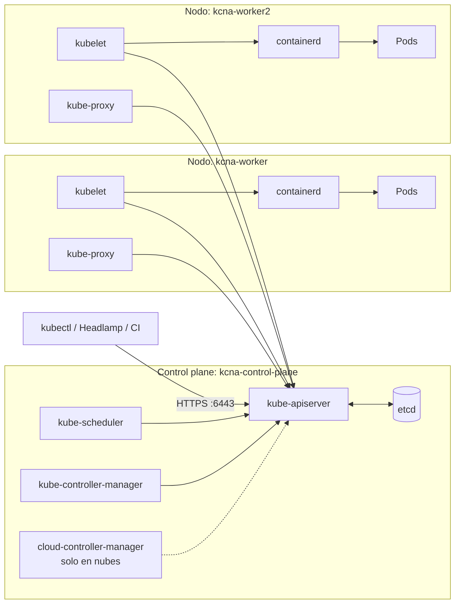
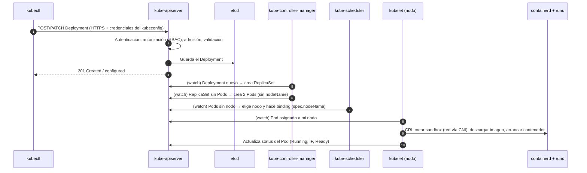
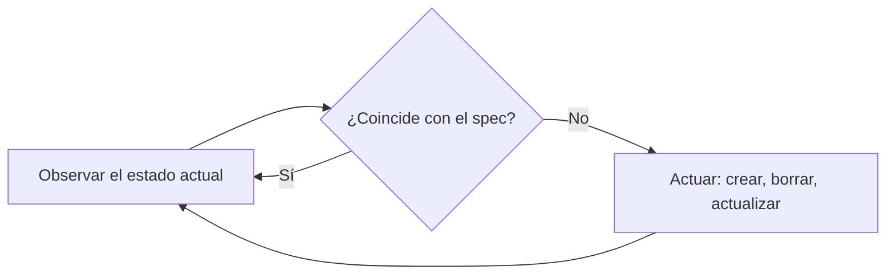

# Módulo 02 — Arquitectura de Kubernetes

> **Dominio KCNA:** Kubernetes Fundamentals (44%) · competencias *Kubernetes Core Concepts* y *Administration*
> **Tiempo estimado:** 2 h 30 min (1 h 15 min teoría + 1 h 15 min laboratorio)
> **Prerrequisitos:** Módulos 00 y 01
> **Lecciones equivalentes de KodeKloud:** "Cluster Architecture", "ETCD For Beginners", "ETCD in Kubernetes", "Kube-API Server", "Kube Controller Manager", "Kube Scheduler", "Kubelet", "Kube Proxy" (y, según la versión del curso, las lecciones sobre API, kubeconfig y static pods)

## Objetivos

Al terminar podrás:

- Nombrar los componentes del **control plane** y de los **nodos**, qué hace cada uno y dónde corren.
- Explicar paso a paso qué ocurre desde un `kubectl apply` hasta que un contenedor está en marcha.
- Describir el modelo **declarativo** y los **bucles de reconciliación**, y distinguir `spec` de `status`.
- Navegar la API: **grupos**, **versiones**, `kubectl api-resources` y `kubectl explain`.
- Leer y modificar un **kubeconfig** (clusters, users, contexts) sin tocar tu configuración de trabajo.
- Identificar **static pods**, **addons** (CoreDNS, CNI) y los endpoints de salud del clúster.

## Conceptos

### 1. Vista general: cerebro y músculo

Un clúster de Kubernetes tiene dos tipos de máquinas (físicas, virtuales o, en tu caso, contenedores de Podman):

- El **plano de control (control plane)**: el "cerebro". Guarda el estado del clúster, toma decisiones (dónde va cada Pod) y reacciona a cambios. En producción suele tener 3 réplicas para alta disponibilidad.
- Los **nodos de trabajo (worker nodes)**: el "músculo". Ejecutan los contenedores de las aplicaciones.



Fíjate en una regla de oro: **todos los componentes hablan con el kube-apiserver y solo él habla con etcd**. Nadie se comunica directamente con nadie más; el API server es el punto central (modelo *hub and spoke*).

### 2. Componentes del control plane

| Componente | Qué hace | Detalle que se pregunta |
|---|---|---|
| **kube-apiserver** | Puerta de entrada de la API REST. Autentica, autoriza, ejecuta los controladores de admisión, valida y guarda en etcd | Único componente que lee/escribe en etcd. Escala horizontalmente. Puerto 6443 |
| **etcd** | Base de datos clave-valor distribuida y consistente que guarda **todo** el estado del clúster | Usa el algoritmo de consenso **Raft**; se despliega en número impar (3, 5) para tener quórum. Hay que hacerle **backups**. Puerto 2379 |
| **kube-scheduler** | Decide **en qué nodo** va cada Pod nuevo sin nodo asignado | Filtra nodos posibles y puntúa los candidatos; solo escribe `spec.nodeName`. **No arranca** el Pod |
| **kube-controller-manager** | Ejecuta los **controladores** integrados: Deployment, ReplicaSet, Node, Job, EndpointSlice, Namespace, ServiceAccount... | Un solo binario con muchos bucles de control |
| **cloud-controller-manager** | Integra con el proveedor de nube: crea balanceadores para Services `LoadBalancer`, detecta nodos borrados, configura rutas | Solo existe en clústeres en la nube; **kind no lo tiene** |

**etcd en dos frases**: guarda objetos como claves del estilo `/registry/pods/lab-02/hola-xxx`. Si pierdes etcd sin backup, pierdes la definición de todo el clúster (los contenedores seguirían corriendo un rato, pero nadie sabría qué debe existir).

### 3. Componentes de cada nodo

| Componente | Qué hace | Cómo corre |
|---|---|---|
| **kubelet** | Agente del nodo: registra el nodo, observa los Pods asignados a él, pide al runtime que los arranque (vía **CRI**), ejecuta las *probes* e informa del estado | Servicio de **systemd** en el nodo, **no** es un Pod. También corre en el control plane |
| **kube-proxy** | Implementa los **Services**: programa reglas (iptables, IPVS o nftables) para que la IP virtual de un Service reparta tráfico entre sus Pods | Normalmente un **DaemonSet** (un Pod por nodo). Algunos CNI (Cilium) pueden reemplazarlo |
| **Container runtime** | Descarga imágenes y ejecuta contenedores | containerd o CRI-O, hablando CRI con el kubelet (módulo 01) |

### 4. Addons

Son componentes que no forman parte del "núcleo" pero casi todo clúster necesita. Se ejecutan como Pods normales, casi siempre en `kube-system`:

| Addon | Para qué | En tu clúster |
|---|---|---|
| **DNS del clúster** | Resolver nombres de Services (`mi-svc.mi-ns.svc.cluster.local`) | **CoreDNS** (Deployment de 2 réplicas, proyecto graduado CNCF) |
| **Plugin CNI** | Dar IP a cada Pod y conectar Pods entre nodos | **kindnet** (DaemonSet). Otros: Calico, Cilium, Flannel |
| **metrics-server** | Métricas de CPU/memoria para `kubectl top` y HPA | Instalado por `kcna.ps1` |
| **Ingress / Gateway controller** | Entrada HTTP desde fuera | **Traefik** (namespace `traefik`) |

**CNI (Container Network Interface)** es a la red lo que CRI es al runtime: una especificación que permite enchufar distintos plugins. El kubelet (a través del runtime) llama al plugin CNI al crear cada Pod.

### 5. Static pods: cómo arranca el propio control plane

Problema del huevo y la gallina: si los Pods se crean a través del API server, ¿quién crea el Pod del API server? La respuesta son los **static pods**: el kubelet vigila un directorio local (por defecto `/etc/kubernetes/manifests`, configurable con `staticPodPath`) y ejecuta directamente cualquier manifiesto de Pod que encuentre ahí, **sin pasar por el scheduler ni por el API server**.

- **kubeadm** (la herramienta que usa kind para montar el clúster) coloca ahí `etcd.yaml`, `kube-apiserver.yaml`, `kube-controller-manager.yaml` y `kube-scheduler.yaml`.
- Para que los veas con `kubectl`, el kubelet crea en la API un **mirror pod** (copia de solo lectura). Su nombre lleva el sufijo del nodo (`etcd-kcna-control-plane`) y su `ownerReference` es el **Node**.
- Si borras el mirror pod con `kubectl delete`, el kubelet lo vuelve a crear. Para eliminar un static pod de verdad hay que **borrar el archivo** del directorio en el nodo.

### 6. Del `kubectl apply` al contenedor en marcha

Este flujo es uno de los temas favoritos del examen. Supón `kubectl apply -f deployment.yaml` con 2 réplicas:



Ideas clave del diagrama:

1. `kubectl` solo habla con el API server; usa la URL y las credenciales del **kubeconfig**.
2. El API server pasa la petición por **autenticación** (¿quién eres?), **autorización** (¿puedes hacerlo? normalmente RBAC) y **control de admisión** (políticas que pueden modificar o rechazar), y la guarda en etcd. En ese momento `kubectl` ya responde: el trabajo real ocurre después, de forma **asíncrona**.
3. Los demás componentes no reciben órdenes: **observan** (*watch*) el API server y reaccionan a los cambios.
4. Cada controlador hace una sola cosa: el de Deployments crea ReplicaSets, el de ReplicaSets crea Pods, el scheduler asigna nodos, el kubelet arranca contenedores.

En el laboratorio verás esta cadena en los **eventos**: `ScalingReplicaSet` (controlador de Deployment) → `SuccessfulCreate` (controlador de ReplicaSet) → `Scheduled` (scheduler) → `Pulled`/`Created`/`Started` (kubelet).

### 7. Modelo declarativo y reconciliación

Kubernetes es **declarativo**: no le dices "arranca 2 contenedores", le dices "quiero que existan 2 réplicas de esta plantilla". Cada objeto tiene:

- **`spec`**: el **estado deseado**, lo escribes tú.
- **`status`**: el **estado actual**, lo escriben los controladores y el kubelet.

Un **controlador** ejecuta sin fin un **bucle de reconciliación** (*reconciliation loop* o *control loop*):



Es como un termostato: no "enciende la calefacción 10 minutos", sino que compara continuamente temperatura deseada y real. Consecuencias: si borras un Pod de un Deployment, aparece otro (**self-healing**); si un nodo muere, sus Pods se recrean en otro; y aplicar el mismo YAML dos veces no cambia nada (es **idempotente**).

### 8. Anatomía de un objeto

Todo objeto de Kubernetes comparte estructura:

```yaml
apiVersion: apps/v1        # grupo/versión de la API
kind: Deployment           # tipo de objeto
metadata:                  # identidad
  name: hola
  namespace: lab-02        # solo en objetos "namespaced"
  labels: { app: hola }    # para seleccionar/agrupar
  annotations: {}          # metadatos libres para herramientas
  # el sistema añade: uid, resourceVersion, generation, creationTimestamp...
spec: {}                   # estado deseado (lo escribes tú)
status: {}                 # estado actual (lo escribe Kubernetes)
```

- Objetos **namespaced** (Pods, Deployments, Services, ConfigMaps...) viven dentro de un namespace; objetos **cluster-scoped** (Nodes, Namespaces, PersistentVolumes, ClusterRoles, StorageClasses) son globales.
- `metadata.generation` sube cada vez que cambias el `spec`; `status.observedGeneration` indica qué versión ya procesó el controlador.

### 9. Grupos y versiones de la API

La API está organizada en **grupos** para poder evolucionar por partes:

| Grupo | Ruta REST | `apiVersion` | Ejemplos |
|---|---|---|---|
| core (grupo vacío, "legacy") | `/api/v1` | `v1` | Pod, Service, ConfigMap, Secret, Namespace, Node, PersistentVolume |
| apps | `/apis/apps/v1` | `apps/v1` | Deployment, ReplicaSet, StatefulSet, DaemonSet |
| batch | `/apis/batch/v1` | `batch/v1` | Job, CronJob |
| networking.k8s.io | `/apis/networking.k8s.io/v1` | `networking.k8s.io/v1` | Ingress, NetworkPolicy |
| rbac.authorization.k8s.io | `/apis/rbac.authorization.k8s.io/v1` | `rbac.authorization.k8s.io/v1` | Role, ClusterRole, RoleBinding |
| autoscaling | `/apis/autoscaling/v2` | `autoscaling/v2` | HorizontalPodAutoscaler |

**Niveles de madurez** de las versiones:

| Nivel | Ejemplo | Significado |
|---|---|---|
| **Alpha** | `v1alpha1` | Experimental, desactivado por defecto, puede desaparecer sin aviso |
| **Beta** | `v1beta1` | Bien probado; los nuevos beta ya no se activan por defecto. Puede cambiar con aviso |
| **Stable (GA)** | `v1`, `v2` | Estable y soportado a largo plazo |

La API se **extiende** con **CustomResourceDefinitions (CRDs)**: en tu clúster Traefik y Gateway API añadieron grupos como `traefik.io/v1alpha1` y `gateway.networking.k8s.io/v1`. Un controlador propio que gestiona esos recursos es lo que se llama un **operador**.

Herramientas para explorar: `kubectl api-resources` (qué tipos existen, sus nombres cortos y si son namespaced), `kubectl api-versions` (grupos/versiones servidos) y `kubectl explain` (documentación de cada campo, sacada del esquema OpenAPI del propio clúster).

### 10. kubeconfig: a qué clúster hablas y como quién

`kubectl` lee un archivo **kubeconfig** con tres listas y un puntero:

| Sección | Contiene | En tu lab |
|---|---|---|
| `clusters` | Nombre, URL del API server y certificado de la CA | `kind-kcna` → `https://127.0.0.1:63817` (el puerto varía) |
| `users` | Credenciales: certificado de cliente, token, plugin de login... | `kind-kcna` (certificado de cliente) |
| `contexts` | Combinación **cluster + user + namespace** por defecto | `kind-kcna` |
| `current-context` | Contexto activo | `kind-kcna` |

Orden de búsqueda: la opción `--kubeconfig`, si no la variable de entorno **`KUBECONFIG`**, y si no `~/.kube/config`. Tu lab usa la variable para apuntar a `.kube\kcna-config` y así no tocar los clústeres de la empresa. Comandos: `kubectl config get-contexts`, `current-context`, `use-context`, `set-context`, `view --minify`.

### 11. Pinceladas de administración

- **kubeadm** inicializa clústeres "a mano" (`kubeadm init` / `join`): genera certificados, escribe los static pods y configura el kubelet. kind lo usa por dentro.
- **Alta disponibilidad**: varios nodos de control plane detrás de un balanceador; etcd con 3 o 5 miembros (tolera 1 o 2 caídas).
- **Versiones**: Kubernetes publica unas 3 versiones menores al año y la comunidad mantiene las 3 más recientes (~14 meses de parches cada una). Política de diferencia de versiones (*version skew*): el API server es el más nuevo; el kubelet puede ir hasta 3 versiones menores por detrás; `kubectl` admite ±1 respecto del API server.
- **Salud**: el API server expone `/livez` (¿está vivo?) y `/readyz` (¿puede atender?), con `?verbose` para ver cada comprobación. `/healthz` y `kubectl get componentstatuses` están obsoletos.
- **Nodos**: `kubectl cordon`/`drain` para mantenimiento (se ve en el módulo de scheduling).

## Comandos clave

| Comando | Qué hace |
|---|---|
| `kubectl get nodes -o wide` | Nodos con versión, IP, sistema operativo y runtime |
| `kubectl get pods -n kube-system -o wide` | Componentes del sistema y en qué nodo corren |
| `kubectl cluster-info` | URL del control plane y de CoreDNS |
| `kubectl get --raw '/readyz?verbose'` | Comprobaciones de salud del API server (también `/livez`) |
| `kubectl get events --sort-by=.lastTimestamp` | Eventos ordenados: muestran qué componente hizo qué |
| `kubectl api-resources` | Tipos de objeto, nombres cortos, grupo, si son namespaced |
| `kubectl api-versions` | Grupos/versiones que sirve el API server |
| `kubectl explain deployment.spec.strategy` | Documentación de un campo (añade `--recursive` para ver el árbol) |
| `kubectl get pods -v=6` | Muestra las peticiones REST que hace kubectl |
| `kubectl config get-contexts` / `current-context` | Contextos del kubeconfig y el activo |
| `kubectl config set-context NOMBRE --cluster=... --user=... --namespace=...` | Crea o modifica un contexto |
| `kubectl config use-context NOMBRE` | Cambia el contexto activo |
| `kubectl config view --minify` | Muestra solo la configuración del contexto actual |
| `podman exec <nodo> crictl ps` | Contenedores vistos por el runtime del nodo (específico de kind) |

## Laboratorio guiado

### 1. Preparar el laboratorio

```powershell
cd $HOME\KubernetesLearning
.\kcna.ps1 lab 02
. .\kcna-env.ps1
```

```text
  OK  ya cargada: nginx:1.27-alpine
  OK  Namespace listo: lab-02
```

Qué observar: las imágenes se precargan porque el clúster está detrás de un proxy (en un clúster normal no hace falta).

### 2. Los nodos y sus versiones

```powershell
kubectl get nodes -o wide
kubectl version
```

```text
NAME                 STATUS   ROLES           AGE   VERSION   INTERNAL-IP   ...   CONTAINER-RUNTIME
kcna-control-plane   Ready    control-plane   81m   v1.37.0   10.89.4.4     ...   containerd://2.3.4
kcna-worker          Ready    <none>          80m   v1.37.0   10.89.4.2     ...   containerd://2.3.4
kcna-worker2         Ready    <none>          80m   v1.37.0   10.89.4.3     ...   containerd://2.3.4
Client Version: v1.37.1
Kustomize Version: v5.8.1
Server Version: v1.37.0
```

Qué observar: el runtime de los nodos es **containerd**. `kcna-env.ps1` pone delante un `kubectl` v1.37 guardado en `.bin\` para que coincida con el clúster. Prueba con tu kubectl global (abre una terminal nueva sin cargar `kcna-env.ps1` y ejecuta `kubectl version --kubeconfig .kube\kcna-config`; es la v1.35): verás un aviso de *version skew*, que es la política de **±1 versión menor** entre kubectl y el API server en acción.

### 3. Los componentes del sistema

```powershell
kubectl get pods -n kube-system -o wide
kubectl get daemonsets,deployments -n kube-system
```

```text
NAME                                         READY   STATUS    ...   NODE
coredns-559f6c778d-dg64b                     1/1     Running   ...   kcna-control-plane
coredns-559f6c778d-lj2qr                     1/1     Running   ...   kcna-control-plane
etcd-kcna-control-plane                      1/1     Running   ...   kcna-control-plane
kindnet-59cjz                                1/1     Running   ...   kcna-worker
kindnet-gqx26                                1/1     Running   ...   kcna-worker2
kindnet-w7lnx                                1/1     Running   ...   kcna-control-plane
kube-apiserver-kcna-control-plane            1/1     Running   ...   kcna-control-plane
kube-controller-manager-kcna-control-plane   1/1     Running   ...   kcna-control-plane
kube-proxy-b4q22                             1/1     Running   ...   kcna-worker2
kube-proxy-mg8bd                             1/1     Running   ...   kcna-worker
kube-proxy-q54fh                             1/1     Running   ...   kcna-control-plane
kube-scheduler-kcna-control-plane            1/1     Running   ...   kcna-control-plane
metrics-server-84c99cb944-v62tf              1/1     Running   ...   kcna-worker2
NAME                        DESIRED   CURRENT   READY   ...   NODE SELECTOR
daemonset.apps/kindnet      3         3         3       ...   kubernetes.io/os=linux
daemonset.apps/kube-proxy   3         3         3       ...   kubernetes.io/os=linux
NAME                             READY   UP-TO-DATE   AVAILABLE
deployment.apps/coredns          2/2     2            2
deployment.apps/metrics-server   1/1     1            1
```

Qué observar: tres "familias" distintas. Los que terminan en `-kcna-control-plane` (etcd, apiserver, controller-manager, scheduler) son **static pods**; `kube-proxy` y `kindnet` (CNI) son **DaemonSets** (uno por nodo); CoreDNS y metrics-server son **Deployments**. No hay ningún Pod "kubelet": el kubelet no es un Pod.

### 4. Static pods y mirror pods

```powershell
podman exec kcna-control-plane ls /etc/kubernetes/manifests
podman exec kcna-control-plane grep staticPodPath /var/lib/kubelet/config.yaml
kubectl get pod etcd-kcna-control-plane -n kube-system -o jsonpath='{.metadata.ownerReferences[0].kind}/{.metadata.ownerReferences[0].name}'
kubectl get pod kube-apiserver-kcna-control-plane -n kube-system -o jsonpath='{.metadata.annotations}'
```

```text
etcd.yaml
kube-apiserver.yaml
kube-controller-manager.yaml
kube-scheduler.yaml
staticPodPath: /etc/kubernetes/manifests
Node/kcna-control-plane
{"kubeadm.kubernetes.io/kube-apiserver.advertise-address.endpoint":"10.89.4.4:6443","kubernetes.io/config.hash":"033e4e30...","kubernetes.io/config.mirror":"033e4e30...","kubernetes.io/config.seen":"...","kubernetes.io/config.source":"file"}
```

Qué observar: `podman exec` entra en el contenedor que hace de nodo (solo posible en kind; en un clúster real usarías SSH). El dueño del Pod es el **Node** y las anotaciones `config.mirror` y `config.source: file` delatan que es un mirror pod creado desde un archivo.

### 5. Cómo está configurado el API server

```powershell
podman exec kcna-control-plane grep -e image: -e etcd-servers -e authorization-mode -e secure-port /etc/kubernetes/manifests/kube-apiserver.yaml
podman exec kcna-control-plane grep -e image: -e data-dir /etc/kubernetes/manifests/etcd.yaml
```

```text
    - --authorization-mode=Node,RBAC
    - --etcd-servers=https://127.0.0.1:2379
    - --secure-port=6443
    image: registry.k8s.io/kube-apiserver:v1.37.0
    - --data-dir=/var/lib/etcd
    image: registry.k8s.io/etcd:3.7.0-0
```

Qué observar: el API server conoce la dirección de etcd (y es el único que la tiene), escucha en el **6443** y autoriza con **RBAC**. etcd guarda sus datos en `/var/lib/etcd` del nodo: eso es lo que hay que respaldar.

### 6. Lo que corre en un nodo

```powershell
podman exec kcna-control-plane systemctl is-active kubelet containerd
podman exec kcna-worker crictl pods --namespace kube-system
```

```text
active
active
POD ID          CREATED       STATE   NAME               NAMESPACE     ATTEMPT   RUNTIME
ba5a4e501ee86   2 hours ago   Ready   kindnet-59cjz      kube-system   0         (default)
cd55453c48c9d   2 hours ago   Ready   kube-proxy-mg8bd   kube-system   0         (default)
```

Qué observar: kubelet y containerd son **servicios de systemd** del nodo. `crictl` habla CRI con containerd y muestra los *sandboxes* de Pod que el kubelet pidió crear.

### 7. Salud del clúster

```powershell
kubectl cluster-info
kubectl get --raw '/readyz?verbose' | Select-String etcd
kubectl get --raw '/livez'
kubectl get componentstatuses
```

```text
Kubernetes control plane is running at https://127.0.0.1:63817
CoreDNS is running at https://127.0.0.1:63817/api/v1/namespaces/kube-system/services/kube-dns:dns/proxy
[+]etcd ok
[+]etcd-readiness ok
ok
Warning: v1 ComponentStatus is deprecated in v1.19+
NAME                 STATUS    MESSAGE   ERROR
controller-manager   Healthy   ok
scheduler            Healthy   ok
etcd-0               Healthy   ok
```

Qué observar: `/readyz` incluye la comprobación de conexión con etcd: si etcd cae, el API server deja de estar listo. `componentstatuses` todavía responde pero está obsoleto; usa `/livez` y `/readyz`.

### 8. La cadena de controladores en acción

```powershell
kubectl create deployment hola -n lab-02 --image=nginx:1.27-alpine --replicas=2
kubectl rollout status deploy/hola -n lab-02
kubectl get events -n lab-02 --sort-by=.lastTimestamp
```

```text
deployment.apps/hola created
deployment "hola" successfully rolled out
LAST SEEN   TYPE     REASON              OBJECT                       MESSAGE
5s          Normal   Scheduled           pod/hola-6ddd88c97d-5hk6d    Successfully assigned lab-02/hola-6ddd88c97d-5hk6d to kcna-worker
5s          Normal   Scheduled           pod/hola-6ddd88c97d-6w5hf    Successfully assigned lab-02/hola-6ddd88c97d-6w5hf to kcna-worker
5s          Normal   SuccessfulCreate    replicaset/hola-6ddd88c97d   Created pod: hola-6ddd88c97d-6w5hf
5s          Normal   SuccessfulCreate    replicaset/hola-6ddd88c97d   Created pod: hola-6ddd88c97d-5hk6d
5s          Normal   ScalingReplicaSet   deployment/hola              Scaled up replica set hola-6ddd88c97d from 0 to 2
3s          Normal   Pulled              pod/hola-6ddd88c97d-5hk6d    Container image "nginx:1.27-alpine" already present on machine ...
3s          Normal   Created             pod/hola-6ddd88c97d-5hk6d    Container created
3s          Normal   Started             pod/hola-6ddd88c97d-5hk6d    Container started
```

Qué observar: los eventos ocurren en el mismo segundo y el orden exacto puede variar, pero identifica a cada actor: `ScalingReplicaSet` (controlador de Deployment), `SuccessfulCreate` (controlador de ReplicaSet), `Scheduled` (kube-scheduler), `Pulled/Created/Started` (kubelet).

### 9. Reconciliación: borra un Pod

```powershell
$p = kubectl get pods -n lab-02 -l app=hola -o name | Select-Object -First 1
kubectl delete $p -n lab-02
kubectl get pods -n lab-02 -l app=hola
kubectl get deploy hola -n lab-02 -o jsonpath='{.spec.replicas} {.status.readyReplicas} {.metadata.generation} {.status.observedGeneration}'
```

```text
pod "hola-6ddd88c97d-5hk6d" deleted from lab-02 namespace
NAME                    READY   STATUS    RESTARTS   AGE
hola-6ddd88c97d-6w5hf   1/1     Running   0          77s
hola-6ddd88c97d-pbgzp   1/1     Running   0          8s
2 2 1 1
```

Qué observar: un Pod nuevo (8s de edad) reemplazó al borrado: el controlador de ReplicaSet vio 1 réplica donde el `spec` pedía 2. `spec.replicas` (deseado) y `status.readyReplicas` (real) vuelven a coincidir; `generation` = `observedGeneration` indica que el controlador procesó el último `spec`.

### 10. kubectl es un cliente REST

```powershell
kubectl get pods -n lab-02 -v=6 2>&1 | ForEach-Object { "$_" } | Select-String 'url='
```

```text
I1023 10:13:31.748296   22252 round_trippers.go:632] "Response" verb="GET" url="https://127.0.0.1:63817/api/v1/namespaces/lab-02/pods?limit=500" status="200 OK" milliseconds=65
```

Qué observar: `kubectl get pods` es un simple `GET /api/v1/namespaces/lab-02/pods` (grupo core → ruta `/api/v1`). Un Deployment iría a `/apis/apps/v1/...`. El `ForEach-Object` convierte la salida de error (donde kubectl escribe los logs) en texto para PowerShell 5.1.

### 11. Explorar la API

```powershell
kubectl api-resources | Select-Object -First 12
kubectl api-resources --api-group=apps
kubectl api-resources --namespaced=false | Select-Object -First 6
kubectl api-versions
kubectl explain deployment.spec.strategy
```

```text
NAME                     SHORTNAMES   APIVERSION   NAMESPACED   KIND
bindings                              v1           true         Binding
componentstatuses        cs           v1           false        ComponentStatus
configmaps               cm           v1           true         ConfigMap
...
pods                     po           v1           true         Pod
NAME                  SHORTNAMES   APIVERSION   NAMESPACED   KIND
controllerrevisions                apps/v1      true         ControllerRevision
daemonsets            ds           apps/v1      true         DaemonSet
deployments           deploy       apps/v1      true         Deployment
replicasets           rs           apps/v1      true         ReplicaSet
statefulsets          sts          apps/v1      true         StatefulSet
...
apps/v1
autoscaling/v1
autoscaling/v2
batch/v1
...
gateway.networking.k8s.io/v1
traefik.io/v1alpha1
v1
GROUP:      apps
KIND:       Deployment
VERSION:    v1
FIELD: strategy <DeploymentStrategy>
...
  type	<string>
  enum: Recreate, RollingUpdate
```

Qué observar: los nombres cortos (`cm`, `po`, `deploy`, `ds`, `sts`) sirven en cualquier comando. Nodes, Namespaces y PersistentVolumes no son namespaced. Los grupos `gateway.networking.k8s.io` y `traefik.io` vienen de **CRDs** instalados, no del núcleo. `explain` lee el esquema del propio clúster, así que siempre coincide con tu versión.

### 12. El kubeconfig (sin tocar el tuyo)

```powershell
kubectl config view --minify
kubectl config get-contexts
$tmp = "$env:TEMP\kcna-copia.yaml"
Copy-Item $env:KUBECONFIG $tmp
kubectl config set-context practica --cluster=kind-kcna --user=kind-kcna --namespace=lab-02 --kubeconfig $tmp
kubectl config use-context practica --kubeconfig $tmp
kubectl config get-contexts --kubeconfig $tmp
kubectl get pods --kubeconfig $tmp
Remove-Item $tmp
```

```text
apiVersion: v1
clusters:
- cluster:
    certificate-authority-data: DATA+OMITTED
    server: https://127.0.0.1:63817
  name: kind-kcna
contexts:
- context:
    cluster: kind-kcna
    namespace: default
    user: kind-kcna
  name: kind-kcna
current-context: kind-kcna
...
Context "practica" created.
Switched to context "practica".
CURRENT   NAME        CLUSTER     AUTHINFO    NAMESPACE
          kind-kcna   kind-kcna   kind-kcna   default
*         practica    kind-kcna   kind-kcna   lab-02
NAME                    READY   STATUS    RESTARTS   AGE
hola-6ddd88c97d-6w5hf   1/1     Running   0          7m3s
hola-6ddd88c97d-pbgzp   1/1     Running   0          5m54s
```

Qué observar: `--minify` oculta los secretos (`DATA+OMITTED`). En la copia, el contexto `practica` apunta al mismo clúster y usuario pero con namespace `lab-02` por defecto, por eso `get pods` funciona sin `-n`. Has practicado `use-context` sin cambiar el contexto activo de tu terminal.

## Reto

Documenta la arquitectura **real** de tu clúster y prepara un contexto de trabajo:

1. Crea en `lab-02` un ConfigMap llamado `arquitectura` con estas claves, rellenando los valores que **descubras con comandos** (no los adivines):
   - `etcd-node`: nombre del nodo donde corre etcd.
   - `apiserver-image`: imagen completa (registry/nombre:tag) del kube-apiserver.
   - `static-pods`: cuántos manifiestos hay en el directorio de static pods del control plane.
   - `coredns-replicas`: réplicas deseadas del Deployment de CoreDNS.
   - `deployment-api`: el `apiVersion` que se usa para un Deployment.
2. Añade al kubeconfig del lab un contexto llamado `lab02` que use el cluster `kind-kcna`, el usuario `kind-kcna` y el namespace `lab-02`. **No cambies el contexto activo.**

```powershell
.\kcna.ps1 check 02
```

<details><summary>Ver solución</summary>

```powershell
$etcdNode = kubectl get pods -n kube-system -l component=etcd -o jsonpath='{.items[0].spec.nodeName}'
$apiImg   = kubectl get pods -n kube-system -l component=kube-apiserver -o jsonpath='{.items[0].spec.containers[0].image}'
$static   = (podman exec kcna-control-plane ls /etc/kubernetes/manifests | Measure-Object).Count
$dns      = kubectl get deploy coredns -n kube-system -o jsonpath='{.spec.replicas}'
kubectl api-resources --api-group=apps | Select-String deployments   # -> apps/v1

kubectl create configmap arquitectura -n lab-02 `
  --from-literal=etcd-node=$etcdNode `
  --from-literal=apiserver-image=$apiImg `
  --from-literal=static-pods=$static `
  --from-literal=coredns-replicas=$dns `
  --from-literal=deployment-api=apps/v1

kubectl get configmap arquitectura -n lab-02 -o yaml

kubectl config set-context lab02 --cluster=kind-kcna --user=kind-kcna --namespace=lab-02
kubectl config get-contexts
.\kcna.ps1 check 02
```

```text
data:
  apiserver-image: registry.k8s.io/kube-apiserver:v1.37.0
  coredns-replicas: "2"
  deployment-api: apps/v1
  etcd-node: kcna-control-plane
  static-pods: "4"
...
CURRENT   NAME        CLUSTER     AUTHINFO    NAMESPACE
*         kind-kcna   kind-kcna   kind-kcna   default
          lab02       kind-kcna   kind-kcna   lab-02

  Lab completado: 6/6
```

Para usar el contexto nuevo harías `kubectl config use-context lab02` (y volver con `kubectl config use-context kind-kcna`). `.\kcna.ps1 reset 02` lo borra.

</details>

## Preguntas tipo examen

**1.** Which control plane component is the only one that communicates directly with etcd?

- A. kube-scheduler
- B. kube-controller-manager
- C. kube-apiserver
- D. kubelet

<details><summary>Respuesta</summary>

**C.** Todos los demás componentes leen y escriben el estado a través del API server; solo él habla con etcd.

</details>

**2.** What is the responsibility of the kube-scheduler?

- A. Starting containers on the selected node
- B. Assigning newly created Pods to suitable nodes
- C. Restarting failed containers
- D. Storing the cluster state

<details><summary>Respuesta</summary>

**B.** El scheduler solo decide el nodo (escribe `spec.nodeName`). Quien arranca y reinicia contenedores es el kubelet; el estado se guarda en etcd.

</details>

**3.** Which component runs on every node and ensures that the containers described in PodSpecs are running and healthy?

- A. kube-proxy
- B. kubelet
- C. containerd
- D. cloud-controller-manager

<details><summary>Respuesta</summary>

**B.** El kubelet es el agente del nodo: recibe los Pods asignados, se los pide al runtime vía CRI, ejecuta las probes y reporta estado. containerd ejecuta contenedores pero no conoce los PodSpecs.

</details>

**4.** What does kube-proxy do?

- A. It authenticates users to the API server
- B. It maintains network rules on nodes so that traffic to a Service reaches its Pods
- C. It assigns IP addresses to Pods
- D. It proxies kubectl requests to etcd

<details><summary>Respuesta</summary>

**B.** kube-proxy programa iptables/IPVS/nftables para implementar Services. Las IPs de los Pods las asigna el plugin CNI.

</details>

**5.** etcd is best described as:

- A. A container runtime
- B. A consistent, distributed key-value store used as Kubernetes' backing store for all cluster data
- C. A DNS server for Services
- D. A metrics database

<details><summary>Respuesta</summary>

**B.** etcd guarda todo el estado del clúster usando consenso Raft; por eso se despliega con un número impar de miembros y se respalda.

</details>

**6.** Which component manages cloud-specific resources such as load balancers for Services of type LoadBalancer?

- A. kube-controller-manager
- B. cloud-controller-manager
- C. kube-proxy
- D. kubelet

<details><summary>Respuesta</summary>

**B.** El cloud-controller-manager separa la lógica específica de cada proveedor (balanceadores, rutas, ciclo de vida de nodos). No existe en clústeres locales como kind.

</details>

**7.** How are the control plane components typically run in a cluster created with kubeadm?

- A. As Deployments in the default namespace
- B. As static Pods whose manifests are in /etc/kubernetes/manifests
- C. As DaemonSets
- D. As systemd services only, invisible to kubectl

<details><summary>Respuesta</summary>

**B.** kubeadm escribe los manifiestos en el directorio de static pods; el kubelet los ejecuta y publica mirror pods para verlos con kubectl. El kubelet en sí sí es un servicio de systemd.

</details>

**8.** In a Kubernetes object, which field describes the desired state and which is written by the system?

- A. `metadata` is desired, `spec` is written by the system
- B. `spec` is desired, `status` is written by the system
- C. `status` is desired, `spec` is written by the system
- D. `kind` is desired, `metadata` is written by the system

<details><summary>Respuesta</summary>

**B.** Tú declaras `spec`; los controladores y el kubelet actualizan `status`. La reconciliación consiste en acercar `status` a `spec`.

</details>

**9.** What is the correct `apiVersion` for a Deployment?

- A. `v1`
- B. `apps/v1`
- C. `extensions/v1beta1`
- D. `core/v1`

<details><summary>Respuesta</summary>

**B.** Deployment pertenece al grupo `apps`, versión `v1`. `v1` a secas es el grupo core (Pods, Services...). `extensions/v1beta1` es una versión antigua ya eliminada.

</details>

**10.** Which command shows the documentation of the fields of a resource directly from the cluster's API schema?

- A. `kubectl describe`
- B. `kubectl explain`
- C. `kubectl api-versions`
- D. `kubectl get --help`

<details><summary>Respuesta</summary>

**B.** `kubectl explain pod.spec.containers` muestra la descripción y el tipo de cada campo. `describe` muestra el estado de objetos concretos.

</details>

**11.** A kubeconfig context is a combination of:

- A. A cluster, a user and (optionally) a namespace
- B. A node, a Pod and a container
- C. A registry, an image and a tag
- D. A Deployment, a ReplicaSet and a Service

<details><summary>Respuesta</summary>

**A.** Un contexto une un cluster (URL + CA), un usuario (credenciales) y un namespace por defecto. `kubectl config use-context` cambia entre ellos.

</details>

**12.** In which order does the API server process a write request?

- A. Admission control → Authentication → Authorization
- B. Authorization → Authentication → Admission control
- C. Authentication → Authorization → Admission control
- D. Admission control → Authorization → Authentication

<details><summary>Respuesta</summary>

**C.** Primero ¿quién eres? (authn), luego ¿puedes hacerlo? (authz, normalmente RBAC) y por último las políticas de admisión (que pueden modificar o rechazar) antes de guardar en etcd.

</details>

## Resumen para repasar

- Control plane: **kube-apiserver** (puerta única, solo él habla con etcd), **etcd** (estado, Raft, número impar, backups), **kube-scheduler** (elige nodo), **kube-controller-manager** (controladores), **cloud-controller-manager** (integración con la nube).
- Nodo: **kubelet** (agente, servicio systemd, habla CRI), **kube-proxy** (Services; DaemonSet), **runtime** (containerd/CRI-O).
- Addons: **CoreDNS**, plugin **CNI** (kindnet, Calico, Cilium), metrics-server, Ingress controller.
- **Static pods**: el kubelet ejecuta los manifiestos de `/etc/kubernetes/manifests`; así arranca kubeadm el control plane. Mirror pod con sufijo del nodo.
- Flujo: kubectl → apiserver (authn → authz → admission → etcd) → controladores → scheduler → kubelet → runtime. Todo por *watch*, asíncrono.
- Declarativo: `spec` (deseado) vs `status` (real); los controladores reconcilian en bucle → self-healing.
- API: core en `/api/v1` (`v1`), resto en `/apis/<grupo>/<versión>` (`apps/v1`, `batch/v1`). Alpha → Beta → GA. CRDs extienden la API.
- kubeconfig = clusters + users + contexts + current-context; prioridad `--kubeconfig` > `KUBECONFIG` > `~/.kube/config`.
- Salud: `/livez`, `/readyz` (`componentstatuses` y `/healthz` obsoletos). Skew: kubectl ±1, kubelet hasta 3 menores por detrás.

## Limpieza

```powershell
.\kcna.ps1 reset 02
```

Borra el namespace `lab-02` y el contexto `lab02` del kubeconfig del lab.
