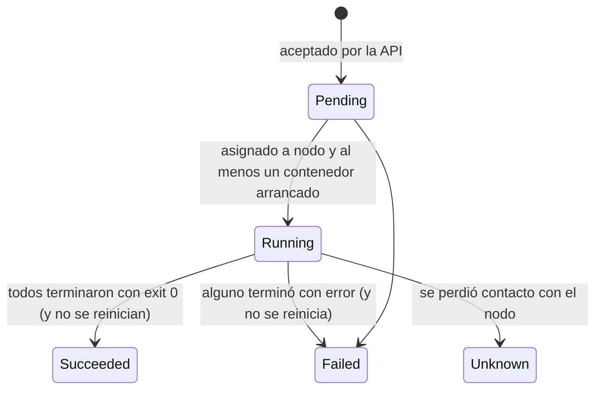
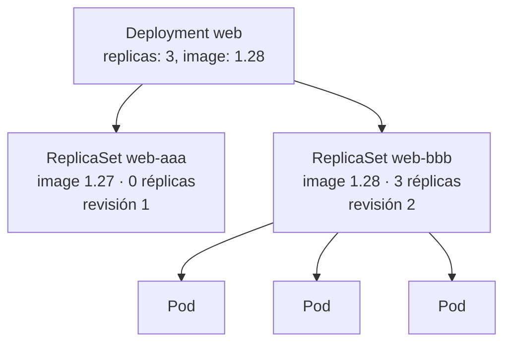

# Módulo 03 — Workloads: Pods, Deployments y configuración

> **Dominio KCNA:** Kubernetes Fundamentals (44%) · competencias *Kubernetes Core Concepts* y *Administration* (con un adelanto de *Application Delivery*)
> **Tiempo estimado:** 3 h 30 min (1 h 30 min teoría + 2 h laboratorio)
> **Prerrequisitos:** Módulos 00, 01 y 02
> **Lecciones equivalentes de KodeKloud:** de "Recap Pods" hasta "Kubernetes Namespaces" (Pods, Pods with YAML, ReplicaSets, Deployments, Deployments – Update and Rollback, Namespaces)
> **Verificado:** 2026-10-26 contra la documentación oficial (Kubernetes v1.37). Fuentes al final del módulo.

## Objetivos

Al terminar podrás:

- Escribir y leer el YAML de un **Pod**, incluidos Pods multi-contenedor e **init containers**, y explicar sus fases y la **restartPolicy**.
- Explicar la relación **Deployment → ReplicaSet → Pod** y hacer **rolling updates** y **rollbacks** controlando `maxSurge` y `maxUnavailable`.
- Elegir entre el estilo **imperativo** (`run`, `create`, `expose`) y el **declarativo** (`apply`), y generar YAML con `--dry-run=client -o yaml`.
- Organizar recursos con **namespaces**, **labels**, **selectors** y **annotations**.
- Inyectar configuración con **ConfigMaps** y **Secrets** (como variables y como volúmenes) sabiendo que base64 no es cifrado.
- Reconocer cuándo usar **Job**, **CronJob**, **StatefulSet** y **DaemonSet**.

## Conceptos

### 1. El Pod: la unidad mínima

Kubernetes no ejecuta contenedores sueltos: ejecuta **Pods**. Un Pod es un envoltorio para **uno o más contenedores** que:

- Comparten **red**: una sola IP para el Pod; entre ellos se hablan por `localhost` (por eso dos contenedores del mismo Pod no pueden usar el mismo puerto).
- Pueden compartir **volúmenes** (por ejemplo un `emptyDir`).
- Se planifican **juntos** en el mismo nodo y viven y mueren juntos.

Analogía: si un contenedor es un proceso, el Pod es una "máquina lógica" pequeña donde viven procesos muy acoplados.

Los Pods son **efímeros**: si mueren no se "reparan", se reemplazan por otros nuevos con **otro nombre y otra IP**. Por eso casi nunca se crean Pods sueltos en producción; se crean a través de controladores (Deployment, Job...) y se accede a ellos mediante Services (módulo de networking).

**Patrones multi-contenedor** (la mayoría de Pods tienen un solo contenedor; usa varios solo si están muy acoplados):

| Patrón | Idea | Ejemplo |
|---|---|---|
| **Sidecar** | Ayudante que extiende al principal | Agente de logs, proxy de service mesh (Envoy) |
| **Ambassador** | Proxy hacia el exterior | Contenedor que gestiona la conexión a una BD remota |
| **Adapter** | Normaliza la salida del principal | Convierte métricas a formato Prometheus |
| **Init container** | Se ejecuta **antes** y **hasta terminar**, en orden, antes de arrancar los contenedores principales | Esperar a que exista una BD, generar configuración, migraciones |

Existen además los **sidecars nativos**: init containers con `restartPolicy: Always`, que arrancan antes que los principales y siguen corriendo junto a ellos (alpha en 1.28, beta activada por defecto desde 1.29 y **estable (GA) desde 1.33**).

**YAML de un Pod (mínimo):**

```yaml
apiVersion: v1             # Pod es del grupo core
kind: Pod
metadata:
  name: nginx
  labels:
    app: nginx
spec:
  containers:              # lista: puede haber varios
    - name: nginx
      image: nginx:1.27-alpine
      ports:
        - containerPort: 80   # informativo
      resources:
        requests: { cpu: 50m, memory: 32Mi }   # lo que el scheduler reserva
        limits:   { cpu: 100m, memory: 64Mi }  # el máximo (cgroups)
```

### 2. Ciclo de vida del Pod

**Fases** (`status.phase`), un resumen de alto nivel:



| Fase | Significado |
|---|---|
| **Pending** | Aceptado, pero aún sin nodo o descargando imágenes / ejecutando init containers |
| **Running** | Asignado a un nodo y al menos un contenedor está corriendo (o arrancando/reiniciando) |
| **Succeeded** | Todos los contenedores terminaron bien y no se van a reiniciar |
| **Failed** | Todos terminaron y al menos uno falló |
| **Unknown** | No se puede obtener el estado (normalmente, nodo inaccesible) |

Cada **contenedor** tiene además su propio estado: `Waiting`, `Running` o `Terminated`. La columna `STATUS` de `kubectl get pods` mezcla fase y motivos: `ContainerCreating`, `Init:0/1`, `Completed`, `Error`, `CrashLoopBackOff`, `ImagePullBackOff`, `OOMKilled`...

**restartPolicy** (a nivel de Pod) decide qué hace el kubelet cuando un contenedor termina:

| Valor | Comportamiento | Uso típico |
|---|---|---|
| `Always` (por defecto) | Reinicia siempre, aunque termine con exit 0 | Servicios (Deployments) |
| `OnFailure` | Reinicia solo si termina con error | Jobs |
| `Never` | No reinicia nunca | Jobs, tareas puntuales |

Los reinicios usan una espera exponencial (10 s, 20 s, 40 s... hasta 5 min; se reinicia el contador si el contenedor aguanta 10 min sin fallar): eso es el famoso **CrashLoopBackOff**. Los sidecars nativos ignoran la `restartPolicy` del Pod (siempre se reinician) y, desde v1.35, la funcionalidad `ContainerRestartRules` (beta, activada por defecto) permite además fijar `restartPolicy` en contenedores concretos; para el examen, lo clásico es el campo del Pod. El kubelet reinicia el contenedor **en el mismo nodo**; no mueve el Pod. Las **probes** (liveness, readiness, startup) permiten al kubelet detectar contenedores colgados o no listos; las verás en el módulo de troubleshooting.

### 3. ReplicaSet: mantener N copias

Un **ReplicaSet** garantiza que haya en todo momento un número de Pods idénticos. Tiene tres partes: `replicas` (cuántos), `selector` (qué Pods cuentan como suyos, por labels) y `template` (cómo crear Pods nuevos). Si sobran, borra; si faltan, crea.

Detalle importante: el ReplicaSet **reconoce a sus Pods por labels**. Si creas a mano un Pod con labels que coinciden con su selector, lo "adopta" y, si sobra, lo borra (lo verás en el lab). Su antecesor, el **ReplicationController**, es una API heredada (*legacy*): lo recomendado es un Deployment que gestione ReplicaSets. En la práctica **no se crean ReplicaSets a mano**: los gestiona un Deployment.

### 4. Deployment: versiones y actualizaciones sin corte

Un **Deployment** gestiona ReplicaSets para ofrecer actualizaciones declarativas: cambias la plantilla (por ejemplo la imagen) y el Deployment crea un **ReplicaSet nuevo** y va pasando réplicas del viejo al nuevo. El ReplicaSet viejo se conserva con 0 réplicas para poder volver atrás (`revisionHistoryLimit`, 10 por defecto).



Solo los cambios en `spec.template` crean una revisión nueva; cambiar `replicas` (escalar) no.

**Estrategias:**

| Estrategia | Cómo actualiza | Ventaja / inconveniente |
|---|---|---|
| **RollingUpdate** (por defecto) | Sustituye Pods poco a poco | Sin corte de servicio; conviven dos versiones un rato |
| **Recreate** | Borra todos los Pods viejos y luego crea los nuevos | Hay corte; útil si dos versiones no pueden coexistir |

Parámetros de **RollingUpdate** (número o porcentaje, por defecto **25%** ambos):

- **`maxSurge`**: cuántos Pods **extra** sobre `replicas` se permiten durante la actualización (redondea hacia arriba).
- **`maxUnavailable`**: cuántos Pods pueden **faltar** respecto de `replicas` (redondea hacia abajo).

Con 3 réplicas y valores por defecto: surge = 1 (0,75 → 1) y unavailable = 0 (0,75 → 0), así que se crea 1 nuevo, se espera a que esté listo, se borra 1 viejo, y así. `maxSurge: 1, maxUnavailable: 0` es la combinación "nunca bajes de capacidad"; `maxSurge: 0, maxUnavailable: 1` ahorra recursos a costa de capacidad.

**Gestión del rollout:** `kubectl rollout status` (seguir el progreso), `history` (revisiones), `undo` (volver a la anterior o a `--to-revision=N`), `pause`/`resume` y `restart` (recrea los Pods sin cambiar la imagen). Si un rollout no avanza durante `progressDeadlineSeconds` (600 s por defecto), el Deployment marca la condición `Progressing=False` con razón `ProgressDeadlineExceeded` y `kubectl rollout status` termina con error; Kubernetes **no** revierte solo, el rollback lo decide una persona o el pipeline. La anotación `kubernetes.io/change-cause` rellena la columna CHANGE-CAUSE del historial (el antiguo flag `--record` está obsoleto). Estrategias avanzadas como **blue/green** y **canary** se ven en el módulo de entrega de aplicaciones.

### 5. Otros controladores de workloads

| Controlador | Para qué | Rasgo distintivo |
|---|---|---|
| **Deployment** | Apps sin estado (web, APIs) | Réplicas intercambiables, rolling updates |
| **StatefulSet** | Apps con estado (bases de datos, Kafka, etcd) | Identidad estable (`db-0`, `db-1`), orden de arranque/parada, un volumen propio por réplica (`volumeClaimTemplates`), requiere un Service *headless* |
| **DaemonSet** | Un Pod **por nodo** (o por nodo seleccionado) | Agentes de logs/monitorización, CNI, kube-proxy. Se ve a fondo en el módulo 04 |
| **Job** | Tarea que debe **terminar** con éxito | `completions`, `parallelism`, `backoffLimit`; restartPolicy `Never`/`OnFailure` |
| **CronJob** | Jobs periódicos | `schedule` en formato cron, `concurrencyPolicy` (Allow/Forbid/Replace) |

**Job en detalle:** crea Pods hasta conseguir `completions` ejecuciones exitosas, con hasta `parallelism` a la vez; si fallan más de `backoffLimit` veces, el Job se marca fallido. `activeDeadlineSeconds` pone un tiempo máximo y `ttlSecondsAfterFinished` lo borra solo al terminar.

**CronJob:** `schedule: "*/5 * * * *"` = cada 5 minutos (minuto, hora, día del mes, mes, día de la semana). Cada disparo crea un Job; `successfulJobsHistoryLimit` y `failedJobsHistoryLimit` limitan cuántos se conservan.

### 6. Imperativo vs declarativo

| Estilo | Ejemplos | Pros | Contras |
|---|---|---|---|
| **Comandos imperativos** | `kubectl run`, `create deployment`, `expose`, `scale`, `set image`, `edit`, `delete` | Rapidísimo para probar | No queda registro; difícil de repetir y revisar |
| **Configuración imperativa de objetos** | `kubectl create -f x.yaml`, `replace -f`, `delete -f` | Hay archivo | `create` falla si ya existe; `replace` pisa todo |
| **Configuración declarativa** | `kubectl apply -f x.yaml` (o una carpeta entera) | Idempotente, versionable en Git, base de **GitOps** | Hay que entender cómo fusiona cambios |

**Truco clave para generar YAML** sin escribirlo de cero: añade `--dry-run=client -o yaml` a un comando imperativo. No crea nada; imprime el manifiesto.

```powershell
kubectl create deployment web --image=nginx:1.27-alpine --replicas=3 --dry-run=client -o yaml > web.yaml
```

**¿Cómo fusiona `apply`?** El `kubectl apply` clásico (*client-side*) guarda lo que aplicaste en la anotación `kubectl.kubernetes.io/last-applied-configuration` y hace una **fusión a tres bandas**: lo que aplicas ahora, lo que aplicaste la vez anterior y lo que hay en vivo. Así sabe qué campos borraste de tu archivo y respeta los que añadieron otros (por ejemplo `status` o réplicas cambiadas por un HPA). **Server-side apply** (`kubectl apply --server-side`) mueve esa lógica al API server: cada campo tiene un **dueño** (*field manager*, visible en `metadata.managedFields`) y si dos dueños quieren cambiar el mismo campo se produce un **conflicto** explícito. `kubectl diff -f` muestra qué cambiaría antes de aplicar.

### 7. Namespaces

Un **namespace** es una partición lógica del clúster: agrupa recursos y da un ámbito a los nombres (puede haber un Deployment `web` en `lab-03` y otro en `lab-04`). Sirven para separar equipos, entornos o aplicaciones y son la unidad a la que se aplican **RBAC**, **ResourceQuota** (topes de recursos) y **LimitRange** (valores por defecto).

| Namespace inicial | Contenido |
|---|---|
| `default` | Donde va todo si no indicas namespace |
| `kube-system` | Componentes del sistema (módulo 02) |
| `kube-public` | Legible por todos, incluso sin autenticar (casi vacío) |
| `kube-node-lease` | Objetos *Lease* con los latidos (*heartbeats*) de los nodos |

Puntos de examen: no todos los objetos son namespaced (Nodes, PersistentVolumes, Namespaces, ClusterRoles no lo son); un namespace **no aísla la red** por defecto (para eso están las **NetworkPolicies**); desde otro namespace se llega a un Service con `servicio.namespace` o `servicio.namespace.svc.cluster.local`; borrar un namespace borra todo lo que contiene (así funciona `.\kcna.ps1 reset`).

### 8. Labels, selectors y annotations

- **Labels**: pares clave/valor para **identificar y seleccionar** objetos (`app=web`, `tier=frontend`, `env=prod`). Son la "pegamento" de Kubernetes: un ReplicaSet encuentra sus Pods por labels, un Service sus endpoints, un `nodeSelector` sus nodos.
- **Selectors**: de igualdad (`app=web`, `env!=prod`) o de conjunto (`env in (dev,qa)`, `!canary`). En YAML: `matchLabels` y `matchExpressions`.
- **Annotations**: metadatos **no identificativos** para herramientas y personas (`kubernetes.io/change-cause`, configuración de un Ingress controller, el último YAML aplicado...). No se pueden usar para seleccionar.
- Labels recomendadas: `app.kubernetes.io/name`, `app.kubernetes.io/version`, `app.kubernetes.io/component`, `app.kubernetes.io/part-of`, `app.kubernetes.io/managed-by`.

### 9. ConfigMaps y Secrets

Siguiendo el factor 3 de 12-factor, la configuración se separa de la imagen:

- **ConfigMap**: datos de configuración no confidenciales (variables, archivos de configuración).
- **Secret**: datos sensibles (contraseñas, tokens, certificados).

Ambos se consumen igual:

| Forma | YAML | Se actualiza si cambias el ConfigMap/Secret |
|---|---|---|
| Una clave como variable | `env[].valueFrom.configMapKeyRef` / `secretKeyRef` | No (hay que reiniciar el Pod) |
| Todas las claves como variables | `envFrom[].configMapRef` / `secretRef` | No |
| Como archivos en un volumen | `volumes[].configMap` / `secret` (cada clave = un archivo) | Sí, al cabo de un rato (salvo `subPath`) |

**Secrets: base64 NO es cifrado.** Los valores de `.data` solo están codificados en base64 para poder guardar binarios; cualquiera que pueda leer el Secret puede decodificarlo en un segundo (lo harás en el lab). Medidas reales de protección: limitar quién puede leer Secrets con **RBAC**, activar el **cifrado en reposo** de etcd (`EncryptionConfiguration`, idealmente con un KMS), no subir Secrets a Git en claro (Sealed Secrets, SOPS) o usar gestores externos (**HashiCorp Vault**, **External Secrets Operator**). Tipos de Secret habituales: `Opaque` (genérico), `kubernetes.io/tls`, `kubernetes.io/dockerconfigjson` (credenciales de registry para `imagePullSecrets`). En YAML puedes usar `stringData` (texto plano) y Kubernetes lo guarda codificado en `data`.

Otros detalles: tamaño máximo 1 MiB por objeto; pueden marcarse `immutable: true`; un Pod solo puede usar ConfigMaps/Secrets de **su mismo namespace**.

## Comandos clave

| Comando | Qué hace |
|---|---|
| `kubectl run nginx --image=nginx:1.27-alpine --labels=app=nginx` | Crea un Pod (imperativo) |
| `kubectl create deployment web --image=nginx:1.27-alpine --replicas=3` | Crea un Deployment (imperativo) |
| `kubectl expose deployment web --port=80` | Crea un Service para el Deployment |
| `... --dry-run=client -o yaml > archivo.yaml` | Genera el YAML sin crear nada |
| `kubectl apply -f archivo.yaml` | Crea o actualiza declarativamente (`--server-side` para SSA) |
| `kubectl explain pod.spec.containers` | Documentación de campos |
| `kubectl get pods -o wide --show-labels` / `-L app` / `-l app=web` | Ver nodo e IP / labels / columna de label / filtrar |
| `kubectl label` / `kubectl annotate` | Añadir o cambiar labels / annotations |
| `kubectl logs POD -c CONTENEDOR` / `--previous` | Logs de un contenedor / de la ejecución anterior |
| `kubectl exec POD -c CONTENEDOR -- comando` | Ejecuta un comando dentro de un contenedor |
| `kubectl scale deploy web --replicas=5` | Escala |
| `kubectl set image deploy/web nginx=nginx:1.28-alpine` | Cambia la imagen (lanza un rollout) |
| `kubectl rollout status / history / undo / restart deploy/web` | Gestiona el rollout |
| `kubectl create configmap NOMBRE --from-literal=k=v --from-file=archivo` | Crea un ConfigMap |
| `kubectl create secret generic NOMBRE --from-literal=k=v` | Crea un Secret Opaque |
| `kubectl create job` / `kubectl create cronjob NOMBRE --schedule="*/5 * * * *"` | Crea Jobs y CronJobs |
| `kubectl get all -n NS` | Lista los workloads y Services de un namespace |

## Laboratorio guiado

En todo el laboratorio se usa `-n lab-03` explícito. Si prefieres no escribirlo, puedes fijar el namespace por defecto con `kubectl config set-context --current --namespace=lab-03` (y `reset` lo devuelve a `default`).

### 1. Preparar el laboratorio

```powershell
cd $HOME\KubernetesLearning
.\kcna.ps1 lab 03
. .\kcna-env.ps1
```

```text
  OK  ya cargada: nginx:1.27-alpine
  OK  ya cargada: nginx:1.28-alpine
  OK  ya cargada: busybox:1.37
  OK  Namespace listo: lab-03
```

Qué observar: las imágenes se precargan porque el clúster está detrás de un proxy (en un clúster normal no hace falta).

### 2. Un Pod imperativo y su YAML

```powershell
kubectl run nginx --image=nginx:1.27-alpine -n lab-03 --labels='app=nginx,tier=web' --dry-run=client -o yaml
kubectl run nginx --image=nginx:1.27-alpine -n lab-03 --labels='app=nginx,tier=web'
kubectl get pod nginx -n lab-03 -o wide --show-labels
kubectl get pod nginx -n lab-03 -o jsonpath='{.status.phase} {.status.qosClass} {.spec.restartPolicy}'
```

```text
apiVersion: v1
kind: Pod
metadata:
  labels:
    app: nginx
    tier: web
  name: nginx
  namespace: lab-03
spec:
  containers:
  - image: nginx:1.27-alpine
    name: nginx
    resources: {}
  dnsPolicy: ClusterFirst
  restartPolicy: Always
status: {}
pod/nginx created
NAME    READY   STATUS    RESTARTS   AGE   IP            NODE          ...   LABELS
nginx   1/1     Running   0          7s    10.244.2.89   kcna-worker   ...   app=nginx,tier=web
Running BestEffort Always
```

Qué observar: el `--dry-run=client -o yaml` te da un manifiesto listo para guardar y editar. Sin `resources` el Pod es de clase QoS **BestEffort** (lo primero que se expulsa si falta memoria) y la `restartPolicy` por defecto es `Always`.

### 3. Labels, selectors y annotations

```powershell
kubectl label pod nginx env=dev -n lab-03
kubectl annotate pod nginx responsable=equipo-web -n lab-03
kubectl get pods -n lab-03 -l 'tier=web,env=dev'
kubectl get pods -n lab-03 -L env,tier
kubectl delete pod nginx -n lab-03
```

```text
pod/nginx labeled
pod/nginx annotated
NAME    READY   STATUS    RESTARTS   AGE
nginx   1/1     Running   0          98s
NAME    READY   STATUS    RESTARTS   AGE    ENV   TIER
nginx   1/1     Running   0          101s   dev   web
```

Qué observar: `-l` filtra por labels (varias condiciones separadas por coma = AND) y `-L` las muestra como columnas. La annotation no sirve para filtrar; mírala con `kubectl describe pod nginx -n lab-03`.

### 4. Pod multi-contenedor con init container

Abre `labs\03-workloads-pods-deployments\pod-multi.yaml` y luego:

```powershell
kubectl apply -f labs\03-workloads-pods-deployments\pod-multi.yaml
kubectl get pod multi -n lab-03
kubectl wait --for=condition=Ready pod/multi -n lab-03 --timeout=60s
kubectl get pod multi -n lab-03
kubectl logs multi -c sidecar -n lab-03 --tail=2
kubectl exec multi -c sidecar -n lab-03 -- wget -qO- http://localhost/
```

```text
pod/multi created
NAME    READY   STATUS     RESTARTS   AGE
multi   0/2     Init:0/1   0          7s
pod/multi condition met
NAME    READY   STATUS    RESTARTS   AGE
multi   2/2     Running   0          32s
wget: can't connect to remote host (127.0.0.1): Connection refused
<h1>Pagina creada por el init container</h1>
<h1>Pagina creada por el init container</h1>
```

Qué observar: `Init:0/1` mientras corre el init container; después `2/2` (dos contenedores principales). El sidecar llega a nginx por **localhost** porque comparten la red del Pod, y nginx sirve el archivo que escribió el init container en el `emptyDir` compartido. La primera línea del log (`Connection refused`) muestra que **los contenedores principales arrancan a la vez, sin orden**: el sidecar preguntó antes de que nginx estuviera listo.

### 5. Fases y restartPolicy

```powershell
kubectl apply -f labs\03-workloads-pods-deployments\pods-ciclo-vida.yaml
# espera ~45 segundos
kubectl get pods -n lab-03 termina-ok termina-error reinicia-siempre
kubectl get pods -n lab-03 termina-ok termina-error reinicia-siempre -o custom-columns='NAME:.metadata.name,PHASE:.status.phase,RESTARTS:.status.containerStatuses[0].restartCount,EXIT:.status.containerStatuses[0].state.terminated.exitCode'
kubectl logs termina-error -n lab-03
kubectl describe pod reinicia-siempre -n lab-03 | Select-String -Pattern 'State:|Reason:|Exit Code|Back-off'
```

```text
NAME               READY   STATUS      RESTARTS      AGE
termina-ok         0/1     Completed   0             51s
termina-error      0/1     Error       0             50s
reinicia-siempre   1/1     Running     3 (27s ago)   50s
NAME               PHASE       RESTARTS   EXIT
termina-ok         Succeeded   0          0
termina-error      Failed      0          1
reinicia-siempre   Running     3          1
algo salio mal
    State:          Terminated
      Reason:       Error
      Exit Code:    1
  Warning  BackOff  15s (x3 over 55s)  kubelet  spec.containers{tarea}: Back-off restarting failed container tarea in pod reinicia-siempre_lab-03(...)
```

Qué observar: con `Never`, exit 0 → fase **Succeeded** (STATUS `Completed`) y exit 1 → **Failed** (STATUS `Error`). Con `Always`, el mismo fallo produce reinicios: RESTARTS sube, la fase sigue siendo `Running` y el STATUS va alternando entre `Running`, `Error` y `CrashLoopBackOff` según el momento; el evento `Back-off restarting failed container` confirma la espera exponencial. Limpia:

```powershell
kubectl delete -f labs\03-workloads-pods-deployments\pods-ciclo-vida.yaml
```

### 6. ReplicaSet: autorreparación y labels

```powershell
kubectl apply -f labs\03-workloads-pods-deployments\replicaset.yaml
kubectl get rs rs-demo -n lab-03
kubectl get pods -n lab-03 -l app=rs-demo
$p = kubectl get pods -n lab-03 -l app=rs-demo -o name | Select-Object -First 1
kubectl delete $p -n lab-03
kubectl get pods -n lab-03 -l app=rs-demo
kubectl run intruso --image=nginx:1.27-alpine --labels=app=rs-demo -n lab-03
kubectl get pods -n lab-03 -l app=rs-demo
```

```text
replicaset.apps/rs-demo created
NAME      DESIRED   CURRENT   READY   AGE
rs-demo   3         3         3       8s
NAME            READY   STATUS    RESTARTS   AGE
rs-demo-bmmtr   1/1     Running   0          8s
rs-demo-sdkw2   1/1     Running   0          8s
rs-demo-x48cz   1/1     Running   0          8s
pod "rs-demo-bmmtr" deleted from lab-03 namespace
NAME            READY   STATUS    RESTARTS   AGE
rs-demo-n7kkp   1/1     Running   0          9s
rs-demo-sdkw2   1/1     Running   0          25s
rs-demo-x48cz   1/1     Running   0          25s
pod/intruso created
NAME            READY   STATUS        RESTARTS   AGE
intruso         1/1     Terminating   0          9s
rs-demo-n7kkp   1/1     Running       0          24s
...
```

Qué observar: al borrar un Pod aparece otro (`rs-demo-n7kkp`). El Pod `intruso`, creado a mano, tiene el label `app=rs-demo`: el ReplicaSet lo cuenta como suyo, ve 4 donde quiere 3 y **borra el sobrante**. Los labels son el vínculo entre controladores y Pods. Ahora escala y mira el dueño:

```powershell
kubectl scale rs rs-demo --replicas=1 -n lab-03
kubectl get pods -n lab-03 -l app=rs-demo
kubectl get pod -n lab-03 -l app=rs-demo -o jsonpath='{.items[0].metadata.ownerReferences[0].kind}/{.items[0].metadata.ownerReferences[0].name}'
kubectl delete rs rs-demo -n lab-03
```

```text
replicaset.apps/rs-demo scaled
NAME            READY   STATUS    RESTARTS   AGE
rs-demo-sdkw2   1/1     Running   0          52s
ReplicaSet/rs-demo
```

Qué observar: el campo `ownerReferences` enlaza cada Pod con su ReplicaSet; al borrar el ReplicaSet, el **recolector de basura** borra sus Pods.

### 7. Deployment: creación

```powershell
kubectl create deployment frontend --image=nginx:1.27-alpine --replicas=3 -n lab-03
kubectl rollout status deploy/frontend -n lab-03
kubectl get deploy,rs,pods -n lab-03 -l app=frontend
kubectl annotate deploy frontend -n lab-03 kubernetes.io/change-cause='version inicial 1.27'
kubectl get deploy frontend -n lab-03 -o jsonpath='{.spec.strategy}'
```

```text
deployment.apps/frontend created
deployment "frontend" successfully rolled out
NAME                       READY   UP-TO-DATE   AVAILABLE   AGE
deployment.apps/frontend   3/3     3            3           7s

NAME                                  DESIRED   CURRENT   READY   AGE
replicaset.apps/frontend-8558b67b76   3         3         3       7s

NAME                            READY   STATUS    RESTARTS   AGE
pod/frontend-8558b67b76-5dwkf   1/1     Running   0          7s
pod/frontend-8558b67b76-h578z   1/1     Running   0          7s
pod/frontend-8558b67b76-zrpnm   1/1     Running   0          7s
deployment.apps/frontend annotated
{"rollingUpdate":{"maxSurge":"25%","maxUnavailable":"25%"},"type":"RollingUpdate"}
```

Qué observar: la cadena de nombres `frontend` → `frontend-8558b67b76` (hash de la plantilla) → `frontend-8558b67b76-5dwkf`. La estrategia por defecto es RollingUpdate con 25%/25%.

### 8. Rolling update

```powershell
kubectl set image deploy/frontend nginx=nginx:1.28-alpine -n lab-03
kubectl annotate deploy frontend -n lab-03 kubernetes.io/change-cause='actualizo a 1.28' --overwrite
kubectl rollout status deploy/frontend -n lab-03
kubectl get rs -n lab-03 -l app=frontend
kubectl rollout history deploy/frontend -n lab-03
kubectl get events -n lab-03 --field-selector involvedObject.kind=Deployment --sort-by=.lastTimestamp
```

```text
deployment.apps/frontend image updated
deployment.apps/frontend annotated
Waiting for deployment "frontend" rollout to finish: 1 old replicas are pending termination...
deployment "frontend" successfully rolled out
NAME                  DESIRED   CURRENT   READY   AGE
frontend-75b9789595   3         3         3       19s
frontend-8558b67b76   0         0         0       94s
REVISION  CHANGE-CAUSE
1         version inicial 1.27
2         actualizo a 1.28
LAST SEEN   TYPE     REASON              OBJECT                MESSAGE
114s        Normal   ScalingReplicaSet   deployment/frontend   Scaled up replica set frontend-8558b67b76 from 0 to 3
39s         Normal   ScalingReplicaSet   deployment/frontend   Scaled up replica set frontend-75b9789595 from 0 to 1
35s         Normal   ScalingReplicaSet   deployment/frontend   Scaled down replica set frontend-8558b67b76 from 3 to 2
35s         Normal   ScalingReplicaSet   deployment/frontend   Scaled up replica set frontend-75b9789595 from 1 to 2
31s         Normal   ScalingReplicaSet   deployment/frontend   Scaled down replica set frontend-8558b67b76 from 2 to 1
31s         Normal   ScalingReplicaSet   deployment/frontend   Scaled up replica set frontend-75b9789595 from 2 to 3
26s         Normal   ScalingReplicaSet   deployment/frontend   Scaled down replica set frontend-8558b67b76 from 1 to 0
```

Qué observar: los eventos muestran el baile **+1 nuevo / −1 viejo** (surge 1, unavailable 0 con 3 réplicas). El ReplicaSet viejo queda con 0 réplicas: es lo que permite el rollback.

### 9. Una actualización rota y el rollback

```powershell
kubectl set image deploy/frontend nginx=nginx:9.9-noexiste -n lab-03
kubectl annotate deploy frontend -n lab-03 kubernetes.io/change-cause='version rota' --overwrite
kubectl rollout status deploy/frontend -n lab-03 --timeout=25s
kubectl get pods -n lab-03 -l app=frontend
kubectl rollout undo deploy/frontend -n lab-03
kubectl rollout status deploy/frontend -n lab-03
kubectl rollout history deploy/frontend -n lab-03
```

```text
Waiting for deployment "frontend" rollout to finish: 1 out of 3 new replicas have been updated...
error: timed out waiting for the condition
NAME                        READY   STATUS             RESTARTS   AGE
frontend-6d8fbd8996-mrmp9   0/1     ImagePullBackOff   0          43s
frontend-75b9789595-f9cns   1/1     Running            0          2m41s
frontend-75b9789595-v7zbj   1/1     Running            0          2m37s
frontend-75b9789595-w5c98   1/1     Running            0          2m33s
deployment.apps/frontend rolled back
deployment "frontend" successfully rolled out
REVISION  CHANGE-CAUSE
1         version inicial 1.27
3         version rota
4         actualizo a 1.28
```

Qué observar: el rolling update **se detiene solo**: el Pod nuevo no está listo, así que nunca se borran los viejos y el servicio sigue funcionando con 3 Pods 1.28. `rollout undo` vuelve a la plantilla anterior, que pasa a ser la **revisión 4** (la 2 desaparece porque es la misma plantilla). Para ir a una revisión concreta: `kubectl rollout undo deploy/frontend --to-revision=1 -n lab-03`.

### 10. Declarativo con `apply`

```powershell
kubectl create deployment api --image=nginx:1.27-alpine --replicas=2 -n lab-03 --dry-run=client -o yaml > $env:TEMP\api.yaml
kubectl apply -f $env:TEMP\api.yaml
kubectl get deploy api -n lab-03 -o jsonpath='{.metadata.annotations.kubectl\.kubernetes\.io/last-applied-configuration}'
(Get-Content $env:TEMP\api.yaml) -replace 'replicas: 2', 'replicas: 4' | Set-Content $env:TEMP\api.yaml
kubectl apply -f $env:TEMP\api.yaml
kubectl apply -f $env:TEMP\api.yaml
kubectl get deploy api -n lab-03
kubectl apply --server-side --force-conflicts -f $env:TEMP\api.yaml
kubectl delete -f $env:TEMP\api.yaml
```

```text
deployment.apps/api created
{"apiVersion":"apps/v1","kind":"Deployment","metadata":{"annotations":{},"labels":{"app":"api"},"name":"api","namespace":"lab-03"},"spec":{"replicas":2,...}}
deployment.apps/api configured
deployment.apps/api unchanged
NAME   READY   UP-TO-DATE   AVAILABLE   AGE
api    4/4     4            4           21s
deployment.apps/api serverside-applied
deployment.apps "api" deleted from lab-03 namespace
```

Qué observar: el primer `apply` crea, el segundo detecta el cambio (`configured`) y el tercero no hace nada (`unchanged`): **idempotencia**. La anotación `last-applied-configuration` es la memoria del apply clásico. Con `--server-side` el resultado es `serverside-applied` y la propiedad de cada campo queda en `metadata.managedFields` (`--force-conflicts` toma la propiedad de los campos que gestionaba el apply clásico). En PowerShell 5.1 el `>` guarda en UTF-16, y `kubectl` lo lee sin problema.

### 11. ConfigMaps y Secrets

Abre `labs\03-workloads-pods-deployments\config.yaml` y luego:

```powershell
kubectl apply -f labs\03-workloads-pods-deployments\config.yaml
kubectl wait --for=condition=Ready pod/consume-config -n lab-03 --timeout=60s
kubectl exec consume-config -n lab-03 -- env | Select-String -Pattern 'COLOR|APP_|DB_'
kubectl exec consume-config -n lab-03 -- ls /etc/app /etc/secreto
kubectl exec consume-config -n lab-03 -- cat /etc/app/app.properties
kubectl get secret app-secret -n lab-03 -o jsonpath='{.data.DB_PASSWORD}'
$b = kubectl get secret app-secret -n lab-03 -o jsonpath='{.data.DB_PASSWORD}'
[Text.Encoding]::UTF8.GetString([Convert]::FromBase64String($b))
```

```text
configmap/app-config created
secret/app-secret created
pod/consume-config created
DB_PASSWORD=S3cr3t0-de-lab
APP_COLOR=azul
APP_MODE=desarrollo
COLOR=azul
/etc/app:
APP_COLOR
APP_MODE
app.properties

/etc/secreto:
DB_PASSWORD
DB_USER
idioma=es
reintentos=3
UzNjcjN0MC1kZS1sYWI=
S3cr3t0-de-lab
```

Qué observar: `COLOR` viene de una clave concreta (`configMapKeyRef`), `APP_COLOR`/`APP_MODE` de `envFrom`, y en el volumen **cada clave es un archivo**. El Secret se escribió en texto plano con `stringData` y se guarda en base64: lo decodificaste con una línea de PowerShell. **base64 es codificación, no cifrado.**

### 12. Jobs y CronJobs

```powershell
kubectl apply -f labs\03-workloads-pods-deployments\jobs.yaml
kubectl wait --for=condition=Complete job/calculo -n lab-03 --timeout=90s
kubectl get jobs,pods -n lab-03 -l batch.kubernetes.io/job-name=calculo
kubectl logs job/calculo -n lab-03
# espera 1-2 minutos para que el CronJob dispare
kubectl get cronjob,jobs -n lab-03
kubectl delete cronjob reporte -n lab-03
```

```text
job.batch/calculo created
cronjob.batch/reporte created
job.batch/calculo condition met
NAME                STATUS     COMPLETIONS   DURATION   AGE
job.batch/calculo   Complete   3/3           23s        28s
NAME                READY   STATUS      RESTARTS   AGE
pod/calculo-8t4sz   0/1     Completed   0          27s
pod/calculo-ps5wz   0/1     Completed   0          15s
pod/calculo-qqwfs   0/1     Completed   0          27s
Found 3 pods, using pod/calculo-8t4sz
calculando en calculo-8t4sz
listo
NAME                    SCHEDULE      TIMEZONE   SUSPEND   ACTIVE   LAST SCHEDULE   AGE
cronjob.batch/reporte   */1 * * * *   <none>     False     0        19s             2m29s
NAME                         STATUS     COMPLETIONS   DURATION   AGE
job.batch/calculo            Complete   3/3           23s        2m30s
job.batch/reporte-29879576   Complete   1/1           20s        79s
job.batch/reporte-29879577   Complete   1/1           8s         19s
```

Qué observar: el Job necesitaba 3 completados con paralelismo 2: dos Pods arrancaron a la vez (27s) y el tercero después (15s). Los Pods terminados quedan en `Completed` para que puedas ver sus logs. El CronJob crea un Job por minuto con un sufijo numérico.

### 13. Namespaces y el resto de controladores

```powershell
kubectl get ns
kubectl get deploy -A
kubectl get ds -A
kubectl get sts -A
```

```text
NAME                 STATUS   AGE
default              Active   140m
kube-node-lease      Active   140m
kube-public          Active   140m
kube-system          Active   140m
lab-03               Active   27m
local-path-storage   Active   139m
traefik              Active   122m
NAMESPACE     NAME         READY   UP-TO-DATE   AVAILABLE   AGE
kube-system   coredns      2/2     2            2           140m
lab-03        frontend     3/3     3            3           12m
...
NAMESPACE     NAME         DESIRED   CURRENT   READY   ...   NODE SELECTOR
kube-system   kindnet      3         3         3       ...   kubernetes.io/os=linux
kube-system   kube-proxy   3         3         3       ...   kubernetes.io/os=linux
No resources found
```

Qué observar: `-A` (`--all-namespaces`) recorre todos los namespaces. Los DaemonSets del sistema tienen DESIRED = 3 porque hay 3 nodos. Puede que aún no haya StatefulSets (o que veas los de otros labs que ya hiciste); los usarás en el módulo de almacenamiento.

## Reto

En `lab-03`, construye la siguiente aplicación:

1. Un ConfigMap `web-config` con una clave `index.html` (contenido HTML a tu gusto).
2. Un Secret `web-secret` con una clave `api-token`.
3. Un Deployment `web` con 3 réplicas, label `app=web`, estrategia RollingUpdate con `maxSurge: 1` y `maxUnavailable: 0`, que:
   - monte `web-config` en `/usr/share/nginx/html` (nginx servirá tu `index.html`),
   - exponga el Secret como variable de entorno `API_TOKEN` (con `secretKeyRef`),
   - se cree primero con `nginx:1.27-alpine` y después se **actualice** a `nginx:1.28-alpine` (el historial debe tener al menos 2 revisiones).

Pistas: genera la base con `kubectl create deployment ... --dry-run=client -o yaml` y complétala con `kubectl explain deployment.spec.strategy.rollingUpdate` y `kubectl explain pod.spec.volumes.configMap`.

```powershell
.\kcna.ps1 check 03
```

<details><summary>Ver solución</summary>

Crea la configuración:

```powershell
kubectl create configmap web-config -n lab-03 --from-literal=index.html='<h1>Reto KCNA modulo 03</h1>'
kubectl create secret generic web-secret -n lab-03 --from-literal=api-token=token-de-prueba-123
```

Guarda esto como `web.yaml` (por ejemplo en `$env:TEMP`):

```yaml
apiVersion: apps/v1
kind: Deployment
metadata:
  name: web
  namespace: lab-03
  labels:
    app: web
spec:
  replicas: 3
  selector:
    matchLabels:
      app: web
  strategy:
    type: RollingUpdate
    rollingUpdate:
      maxSurge: 1
      maxUnavailable: 0
  template:
    metadata:
      labels:
        app: web
    spec:
      containers:
        - name: nginx
          image: nginx:1.27-alpine
          ports:
            - containerPort: 80
          env:
            - name: API_TOKEN
              valueFrom:
                secretKeyRef:
                  name: web-secret
                  key: api-token
          volumeMounts:
            - name: html
              mountPath: /usr/share/nginx/html
          resources:
            requests: { cpu: 10m, memory: 16Mi }
            limits: { cpu: 100m, memory: 64Mi }
      volumes:
        - name: html
          configMap:
            name: web-config
```

Aplica, actualiza y verifica:

```powershell
kubectl apply -f $env:TEMP\web.yaml
kubectl rollout status deploy/web -n lab-03
kubectl set image deploy/web nginx=nginx:1.28-alpine -n lab-03
kubectl rollout status deploy/web -n lab-03
kubectl rollout history deploy/web -n lab-03
kubectl exec deploy/web -n lab-03 -- wget -qO- http://localhost/
.\kcna.ps1 check 03
```

```text
REVISION  CHANGE-CAUSE
1         <none>
2         <none>
<h1>Reto KCNA modulo 03</h1>
  OK  Deployment 'web' en lab-03 con 3 replicas listas
  OK  Deployment 'web' usa nginx:1.28-alpine y las 3 replicas estan actualizadas
  OK  Deployment 'web' tiene al menos 2 revisiones (se creo con 1.27 y luego se actualizo)
  OK  Estrategia RollingUpdate con maxSurge=1 y maxUnavailable=0
  OK  ConfigMap 'web-config' montado en /usr/share/nginx/html (la pagina servida es su index.html)
  OK  Variable API_TOKEN del contenedor viene del Secret 'web-secret' (clave api-token)

  Lab completado: 6/6
```

Alternativa declarativa pura para la actualización: cambia `image:` a `nginx:1.28-alpine` en `web.yaml` y vuelve a hacer `kubectl apply -f`.

</details>

## Preguntas tipo examen

**1.** What is the smallest deployable unit of computing that you can create and manage in Kubernetes?

- A. Container
- B. Pod
- C. Deployment
- D. Node

<details><summary>Respuesta</summary>

**B.** Kubernetes programa Pods, no contenedores sueltos. Un Pod agrupa uno o más contenedores que comparten red y volúmenes.

</details>

**2.** Two containers in the same Pod need to communicate. Which address can they use?

- A. The node's external IP
- B. `localhost`
- C. The Service ClusterIP only
- D. They cannot communicate directly

<details><summary>Respuesta</summary>

**B.** Los contenedores de un Pod comparten el namespace de red (misma IP), así que se hablan por `localhost` en puertos distintos. Lo viste con el sidecar del lab.

</details>

**3.** What is the purpose of an init container?

- A. To run alongside the main container for the whole Pod lifetime
- B. To run to completion before the app containers start, for setup tasks
- C. To restart the main container when it fails
- D. To collect logs from the node

<details><summary>Respuesta</summary>

**B.** Los init containers se ejecutan en orden y deben terminar con éxito antes de que arranquen los contenedores principales (estado `Init:0/1` en el lab). La opción A describe un sidecar: los sidecars nativos se declaran en `initContainers` con `restartPolicy: Always`, pero precisamente por eso no terminan y no son init containers "clásicos".

</details>

**4.** A Pod has `restartPolicy: Never` and its only container exits with code 0. What is the Pod phase?

- A. Running
- B. Failed
- C. Succeeded
- D. CrashLoopBackOff

<details><summary>Respuesta</summary>

**C.** Todos los contenedores terminaron bien y no se reinician → `Succeeded` (STATUS `Completed`). `CrashLoopBackOff` no es una fase, es un motivo de espera de un contenedor.

</details>

**5.** Which object does a Deployment create and manage directly to run Pods?

- A. StatefulSet
- B. ReplicationController
- C. ReplicaSet
- D. DaemonSet

<details><summary>Respuesta</summary>

**C.** Deployment → ReplicaSet → Pods. Cada cambio de plantilla crea un ReplicaSet nuevo; los viejos se guardan para el rollback.

</details>

**6.** A Deployment has 4 replicas with `maxSurge: 1` and `maxUnavailable: 0`. During a rolling update, what is the maximum number of Pods that can exist?

- A. 3
- B. 4
- C. 5
- D. 8

<details><summary>Respuesta</summary>

**C.** Se permite 1 Pod por encima de las 4 réplicas deseadas (surge) y ninguno por debajo, así que el máximo es 5 y nunca bajan de 4 disponibles.

</details>

**7.** Which command reverts a Deployment to its previous revision?

- A. `kubectl rollout restart deployment/web`
- B. `kubectl rollout undo deployment/web`
- C. `kubectl rollback deployment/web`
- D. `kubectl delete rs --last`

<details><summary>Respuesta</summary>

**B.** `rollout undo` vuelve a la revisión anterior (o a `--to-revision=N`). `rollout restart` recrea los Pods con la misma plantilla. `kubectl rollback` no existe.

</details>

**8.** Which Deployment strategy terminates all existing Pods before creating new ones?

- A. RollingUpdate
- B. Recreate
- C. BlueGreen
- D. Canary

<details><summary>Respuesta</summary>

**B.** `Recreate` provoca un corte pero evita que convivan dos versiones. Blue/green y canary no son valores de `strategy.type`; se implementan con varias piezas (Services, Ingress, herramientas como Argo Rollouts).

</details>

**9.** How can you quickly generate a YAML manifest for a Deployment without creating it in the cluster?

- A. `kubectl create deployment web --image=nginx --output-only`
- B. `kubectl create deployment web --image=nginx --dry-run=client -o yaml`
- C. `kubectl get deployment web --template`
- D. `kubectl apply --generate deployment`

<details><summary>Respuesta</summary>

**B.** `--dry-run=client -o yaml` imprime el objeto sin enviarlo al clúster; es la forma estándar de obtener una plantilla.

</details>

**10.** Which statement about Kubernetes Secrets is true by default?

- A. Secret values are encrypted with AES in the object
- B. Secret values are only base64-encoded, so anyone with read access can decode them
- C. Secrets cannot be mounted as volumes
- D. Secrets are shared across all namespaces

<details><summary>Respuesta</summary>

**B.** base64 es una codificación reversible. La protección real viene de RBAC, el cifrado en reposo de etcd y gestores externos. Los Secrets se pueden montar como volúmenes y son namespaced.

</details>

**11.** Which workload resource should you use to run a batch task that must complete successfully a fixed number of times?

- A. Deployment
- B. DaemonSet
- C. Job
- D. StatefulSet

<details><summary>Respuesta</summary>

**C.** Un Job crea Pods hasta alcanzar `completions` éxitos (con `parallelism` y `backoffLimit`). Para repetirlo según un horario se usa un CronJob.

</details>

**12.** A database requires stable network identities and a dedicated persistent volume for each replica. Which controller fits best?

- A. Deployment
- B. ReplicaSet
- C. StatefulSet
- D. Job

<details><summary>Respuesta</summary>

**C.** StatefulSet da nombres estables (`db-0`, `db-1`), orden de arranque y un PVC por réplica mediante `volumeClaimTemplates`.

</details>

**13.** What is the difference between labels and annotations?

- A. Labels are for non-identifying metadata; annotations are used by selectors
- B. Labels identify and select objects; annotations hold non-identifying metadata for tools and people
- C. They are identical; annotations are just the older name
- D. Annotations can only be set on Pods

<details><summary>Respuesta</summary>

**B.** Los selectores (ReplicaSet, Service, `-l`) solo trabajan con labels. Las annotations guardan información extra como `kubernetes.io/change-cause` o el último YAML aplicado.

</details>

## Resumen para repasar

- **Pod** = unidad mínima; contenedores que comparten IP (`localhost`) y volúmenes; efímero (nueva IP al recrearse). Patrones: sidecar, ambassador, adapter, **init containers** (antes y en orden).
- Fases: **Pending, Running, Succeeded, Failed, Unknown**. `CrashLoopBackOff`, `ImagePullBackOff`, `Completed` son motivos, no fases. `restartPolicy`: **Always** (defecto), OnFailure, Never.
- **ReplicaSet** mantiene N Pods por **labels**; **Deployment** gestiona ReplicaSets y da rolling updates y rollbacks (`rollout status/history/undo/restart`).
- RollingUpdate: **maxSurge** (extra, redondea arriba) y **maxUnavailable** (faltantes, redondea abajo), ambos 25% por defecto. **Recreate** = corte.
- Imperativo (`run`, `create`, `expose`, `scale`, `set image`) vs declarativo (`apply`). `--dry-run=client -o yaml` para generar YAML. Apply clásico usa `last-applied-configuration`; **server-side apply** usa `managedFields` y conflictos.
- **Namespaces**: ámbito de nombres, RBAC y cuotas; no aíslan la red. Iniciales: default, kube-system, kube-public, kube-node-lease. Hay objetos cluster-scoped.
- **Labels** seleccionan; **annotations** describen.
- **ConfigMap** (no sensible) y **Secret** (sensible, **base64 ≠ cifrado**); se consumen como env (`valueFrom`, `envFrom`) o volúmenes (cada clave = archivo; se actualizan solos).
- **Job** (termina), **CronJob** (horario), **StatefulSet** (identidad y volumen estables), **DaemonSet** (uno por nodo).

## Limpieza

```powershell
.\kcna.ps1 reset 03
Remove-Item $env:TEMP\web.yaml, $env:TEMP\api.yaml -ErrorAction SilentlyContinue
```

## Fuentes oficiales

- [Pods — kubernetes.io](https://kubernetes.io/docs/concepts/workloads/pods/): el Pod como unidad desplegable más pequeña, contenedores muy acoplados que comparten red y almacenamiento, Pods efímeros.
- [Pod Lifecycle — kubernetes.io](https://kubernetes.io/docs/concepts/workloads/pods/pod-lifecycle/): fases Pending/Running/Succeeded/Failed/Unknown, estados de contenedor, `restartPolicy` y backoff 10 s → 5 min, `ContainerRestartRules`.
- [Init Containers — kubernetes.io](https://kubernetes.io/docs/concepts/workloads/pods/init-containers/): se ejecutan en orden y hasta completarse antes de los contenedores de la app.
- [Sidecar Containers — kubernetes.io](https://kubernetes.io/docs/concepts/workloads/pods/sidecar-containers/): sidecars nativos como init containers con `restartPolicy: Always` (activados por defecto desde v1.29).
- [Feature gates — kubernetes.io](https://kubernetes.io/docs/reference/command-line-tools-reference/feature-gates/): `SidecarContainers` estable desde 1.33; `ContainerRestartRules` beta desde 1.35.
- [ReplicationController — kubernetes.io](https://kubernetes.io/docs/concepts/workloads/controllers/replicationcontroller/): API heredada; se recomienda Deployment + ReplicaSet.
- [Deployments — kubernetes.io](https://kubernetes.io/docs/concepts/workloads/controllers/deployment/): `maxSurge` (redondeo arriba) y `maxUnavailable` (redondeo abajo) 25% por defecto, `revisionHistoryLimit` 10, `--record` obsoleto, rollback, `progressDeadlineSeconds` (600 s) y `ProgressDeadlineExceeded`.
- [StatefulSets — kubernetes.io](https://kubernetes.io/docs/concepts/workloads/controllers/statefulset/): identidad estable, `volumeClaimTemplates`, Service headless obligatorio.
- [Jobs — kubernetes.io](https://kubernetes.io/docs/concepts/workloads/controllers/job/) y [CronJob — kubernetes.io](https://kubernetes.io/docs/concepts/workloads/controllers/cron-jobs/): `completions`, `parallelism`, `backoffLimit` (6 por defecto), `activeDeadlineSeconds`; `concurrencyPolicy` Allow/Forbid/Replace y límites de historial.
- [Declarative Management with Configuration Files — kubernetes.io](https://kubernetes.io/docs/tasks/manage-kubernetes-objects/declarative-config/) y [Server-Side Apply — kubernetes.io](https://kubernetes.io/docs/reference/using-api/server-side-apply/): anotación `last-applied-configuration`, `kubectl diff`, `managedFields`, conflictos y `--force-conflicts`.
- [Namespaces — kubernetes.io](https://kubernetes.io/docs/concepts/overview/working-with-objects/namespaces/): los cuatro namespaces iniciales y para qué sirven.
- [Labels and Selectors — kubernetes.io](https://kubernetes.io/docs/concepts/overview/working-with-objects/labels/): selectores de igualdad y de conjunto, `matchLabels`/`matchExpressions`.
- [ConfigMaps — kubernetes.io](https://kubernetes.io/docs/concepts/configuration/configmap/): límite 1 MiB, volúmenes que se actualizan solos, variables de entorno y `subPath` que no.
- [Secrets — kubernetes.io](https://kubernetes.io/docs/concepts/configuration/secret/): sin cifrar por defecto en etcd, base64, tipos, `stringData`, 1 MiB, `immutable`, mismo namespace.
- [Encrypting Confidential Data at Rest — kubernetes.io](https://kubernetes.io/docs/tasks/administer-cluster/encrypt-data/): `EncryptionConfiguration`, proveedores (KMS) y que `identity` no cifra.
