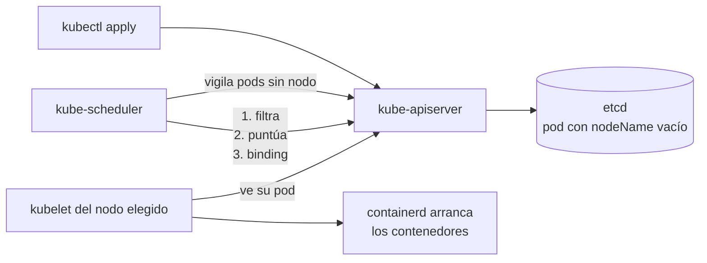
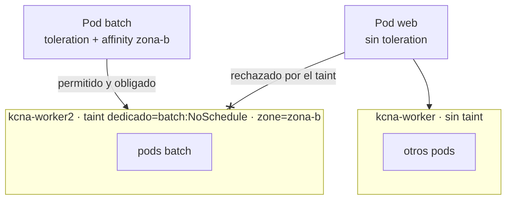
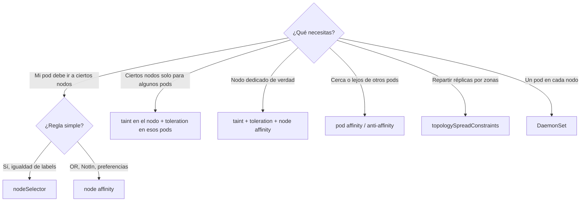

# Módulo 04 — Scheduling: cómo decide Kubernetes dónde corre cada pod

> **Dominio KCNA:** Kubernetes Fundamentals (44%) · competencia *Scheduling* · **Tiempo:** 2,5-3 h · **Prerrequisitos:** módulos 02 (arquitectura) y 03 (pods y Deployments)
>
> **Lecciones equivalentes de KodeKloud:** Manual Scheduling · Labels and Selectors · Taints and Tolerations · Node Selectors · Node Affinity · Taints and Tolerations vs Node Affinity · Resource Requirements and Limits · DaemonSets · Static Pods · Multiple Schedulers · Configuring Kubernetes Scheduler Profiles

## Objetivos

Al terminar podrás:

- Explicar las dos fases con las que **kube-scheduler** elige nodo (filtrado y puntuación) y qué pasa cuando ningún nodo sirve.
- Dirigir pods a ciertos nodos con **nodeName**, **nodeSelector** y **node affinity**, y apartarlos con **taints** y **tolerations**.
- Diagnosticar un pod `Pending` leyendo `kubectl describe` y los eventos `FailedScheduling`.
- Distinguir las tres **QoS classes** (Guaranteed, Burstable, BestEffort) a partir de `requests` y `limits`, y limitar un namespace con **LimitRange** y **ResourceQuota**.
- Reconocer cuándo usar un **DaemonSet**, qué es un **static pod** y para qué sirven los schedulers múltiples, los **scheduler profiles**, la **PriorityClass** y los **topologySpreadConstraints**.

## Conceptos

### El trabajo del scheduler

Cuando creas un pod, el API server lo guarda en etcd con el campo `spec.nodeName` **vacío**. Ese pod "sin casa" es lo que vigila el planificador (**kube-scheduler**), un componente del control plane. Su único trabajo es escribir un nombre de nodo en ese campo (a esa operación se le llama **binding**). No arranca contenedores: eso lo hace el **kubelet** del nodo elegido cuando ve que le asignaron un pod.

Piensa en el scheduler como el recepcionista de un hotel: no limpia habitaciones ni sube maletas, solo decide en qué habitación va cada huésped según las reglas (habitación para fumadores, cama doble, planta baja...) y la ocupación actual.



La decisión tiene dos fases principales:

| Fase | Pregunta | Ejemplos de reglas (plugins) | Si falla... |
|---|---|---|---|
| **Filtrado** (*filtering*) | ¿En qué nodos **puede** correr? | Recursos libres suficientes (`requests`), `nodeSelector`/affinity, taints no tolerados, puertos del host ocupados, anti-affinity | Si no queda ningún nodo, el pod queda **Pending** con un evento `FailedScheduling` |
| **Puntuación** (*scoring*) | De los que pueden, ¿cuál es **el mejor**? | Afinidad *preferred*, reparto equilibrado de recursos, spreading de réplicas, imagen ya presente en el nodo | Se elige el de mayor puntuación (empates al azar) |

Detalles importantes para el examen:

- El scheduler decide **una sola vez**, al crear el pod. Si después cambian las labels o los taints de un nodo, los pods que ya están corriendo **no se mueven** (con la excepción del efecto `NoExecute`, que veremos). Rebalancear pods ya colocados es trabajo de herramientas externas como el **descheduler**.
- El scheduler mira los **requests**, no el consumo real. Un nodo puede estar al 5% de CPU y aun así no aceptar pods si la suma de requests ya llegó a su capacidad asignable (**allocatable**).
- Si ningún nodo pasa el filtro, el scheduler intenta la **preemption** (desalojar pods de menor prioridad) y si tampoco sirve, reintenta más tarde. El pod no falla: se queda `Pending` indefinidamente.

### Manual scheduling: `nodeName`

Si escribes tú mismo `spec.nodeName` en el manifiesto, el scheduler ignora el pod (ya tiene nodo) y el kubelet de ese nodo lo arranca directamente. Es la forma más primitiva de "planificar":

```yaml
spec:
  nodeName: kcna-worker2
```

- No hay evento `Scheduled` porque el scheduler nunca participó.
- Se salta todas las reglas del scheduler, **incluidos los taints `NoSchedule`** (lo comprobarás: un pod con `nodeName: kcna-control-plane` arranca en el control plane aunque tenga taint).
- Si el nodo no existe o no tiene recursos, el pod falla en lugar de esperar a otro nodo.
- `nodeName` solo se puede fijar al crear el pod. Para mover un pod ya creado hay que borrarlo y recrearlo (internamente el scheduler usa un objeto **Binding**, pero eso no es algo que hagas a mano en el día a día).

Uso real: casi ninguno en producción; sirve para entender el mecanismo y para depurar.

### Labels y selectors: el pegamento de Kubernetes

Una **label** es un par clave=valor que pegas a cualquier objeto (`app=web`, `tier=frontend`, `zone=zona-a`). Un **selector** es una consulta sobre labels. Kubernetes las usa para casi todo: un Service encuentra sus pods por selector, un Deployment reconoce sus réplicas por selector, y el scheduler encuentra nodos por selector.

| Tipo de selector | Sintaxis en `kubectl -l` | Significado |
|---|---|---|
| Igualdad (*equality-based*) | `app=web`, `tier!=frontend` | igual / distinto |
| Conjuntos (*set-based*) | `tier in (frontend,backend)`, `zone notin (zona-c)` | pertenece / no pertenece a una lista |
| Existencia | `gpu`, `!gpu` | tiene / no tiene la clave (cualquier valor) |

En YAML, los objetos nuevos (Deployment, DaemonSet, NetworkPolicy...) usan `matchLabels` (igualdad) y `matchExpressions` (operadores `In`, `NotIn`, `Exists`, `DoesNotExist`). Los Services y los ReplicationController antiguos solo admiten igualdad.

No confundas labels con **annotations**: las anotaciones también son clave=valor, pero **no se pueden usar en selectores**; sirven para metadatos informativos o para configurar herramientas (ej. la causa de un rollout, opciones de un Ingress Controller).

### nodeSelector: la forma simple de elegir nodo

`nodeSelector` es un mapa de labels que el nodo **debe** tener, todas a la vez (AND):

```yaml
spec:
  nodeSelector:
    disktype: ssd
```

Es fácil de leer, pero limitado: no permite "ssd **o** nvme", ni "cualquier zona menos la C", ni preferencias suaves. Para eso existe node affinity.

### Node affinity: reglas expresivas sobre nodos

**Node affinity** vive en `spec.affinity.nodeAffinity` y tiene dos sabores con nombres largos pero muy descriptivos:

| Tipo | Fase | Comportamiento |
|---|---|---|
| `requiredDuringSchedulingIgnoredDuringExecution` | Filtrado | **Obligatorio**. Si ningún nodo cumple, el pod queda Pending. |
| `preferredDuringSchedulingIgnoredDuringExecution` | Puntuación | **Preferencia** con un peso (`weight` 1-100). Si nadie cumple, se coloca igual en otro nodo. |

La parte `IgnoredDuringExecution` significa que, si las labels del nodo cambian después, el pod que ya corre allí **no se desaloja**.

```yaml
affinity:
  nodeAffinity:
    requiredDuringSchedulingIgnoredDuringExecution:
      nodeSelectorTerms:            # varios terms = OR
        - matchExpressions:         # varias expresiones dentro de un term = AND
            - key: zone
              operator: In
              values: ["zona-a", "zona-b"]
    preferredDuringSchedulingIgnoredDuringExecution:
      - weight: 100
        preference:
          matchExpressions:
            - key: disktype
              operator: In
              values: ["hdd"]
```

Operadores disponibles: `In`, `NotIn`, `Exists`, `DoesNotExist`, `Gt`, `Lt`. Con `NotIn` y `DoesNotExist` se consigue **anti-afinidad de nodo** ("nunca en nodos con X").

### Pod affinity y anti-affinity (breve)

Mientras node affinity mira las labels de los **nodos**, **pod affinity** y **pod anti-affinity** miran qué **otros pods** corren ya en un "dominio de topología" (un nodo, una zona...), definido con `topologyKey`:

- **podAffinity**: "colócame cerca de los pods con `app=cache`" (ej. una app junto a su caché para reducir latencia).
- **podAntiAffinity**: "no me pongas donde ya haya un pod con `app=cache`" (ej. réplicas de una base de datos en nodos distintos para sobrevivir a la caída de uno).

`topologyKey: kubernetes.io/hostname` significa "por nodo"; `topologyKey: topology.kubernetes.io/zone` significa "por zona". Igual que node affinity, admite variantes `required...` y `preferred...`.

### Taints y tolerations: el "prohibido el paso" de los nodos

Afinidad y nodeSelector son reglas del **pod** ("quiero ir allí"). Los **taints** son lo contrario: una marca que se pone en el **nodo** para **repeler** pods. Solo los pods que tengan una **toleration** que encaje pueden ignorar el taint.

Analogía: el taint es el cartel "solo personal autorizado" en una puerta; la toleration es la credencial. Tener credencial te **permite** entrar, pero no te **obliga** a entrar.

Un taint tiene la forma `clave=valor:efecto`:

```powershell
kubectl taint nodes kcna-worker2 dedicado=batch:NoSchedule     # poner
kubectl taint nodes kcna-worker2 dedicado=batch:NoSchedule-    # quitar (guion final)
```

| Efecto | Pods nuevos sin toleration | Pods que ya corren en el nodo sin toleration |
|---|---|---|
| `NoSchedule` | No se programan allí | Se quedan |
| `PreferNoSchedule` | El scheduler **intenta** evitarlo, pero lo usa si no hay otro sitio | Se quedan |
| `NoExecute` | No se programan allí | **Se desalojan** (salvo que toleren, opcionalmente durante `tolerationSeconds`) |

La toleration correspondiente en el pod:

```yaml
tolerations:
  - key: dedicado
    operator: Equal      # o Exists (entonces no se indica value)
    value: batch
    effect: NoSchedule
```

Taints que debes reconocer:

- `node-role.kubernetes.io/control-plane:NoSchedule`: lo ponen kubeadm y kind en los nodos de control plane para que tus aplicaciones no compitan con el API server o etcd. Por eso en tu clúster ningún pod "normal" cae en `kcna-control-plane`.
- `node.kubernetes.io/not-ready:NoExecute` y `node.kubernetes.io/unreachable:NoExecute`: los pone automáticamente el control plane cuando un nodo deja de responder. Kubernetes añade a cada pod tolerations a estos taints con `tolerationSeconds: 300`, por eso los pods de un nodo caído se reemplazan unos 5 minutos después.
- Otros taints automáticos por presión del nodo: `memory-pressure`, `disk-pressure`, `pid-pressure`, `unschedulable` (este último lo pone `kubectl cordon`).

### Taints vs node affinity: ¿cuándo combinarlos?

Es una de las preguntas favoritas. Cada mecanismo resuelve **la mitad** del problema de "nodos dedicados":

| Mecanismo | Lo que garantiza | Lo que NO garantiza |
|---|---|---|
| Taint + toleration | Los pods **ajenos** no entran al nodo | Que tus pods vayan a ese nodo (pueden caer en cualquier otro) |
| Node affinity / nodeSelector | Tus pods van **solo** a esos nodos | Que otros pods no ocupen esos nodos |
| **Ambos combinados** | Nodo dedicado de verdad: solo tus pods, y tus pods solo allí | — |



### Requests, limits y QoS classes

Cada contenedor puede declarar:

- **requests**: lo que el contenedor **reserva**. El scheduler suma requests para decidir si un pod cabe en un nodo. Es una garantía mínima.
- **limits**: el **techo** en tiempo de ejecución. Si se supera el límite de **CPU**, el contenedor se **ralentiza** (*throttling*), no muere. Si se supera el de **memoria**, el kernel lo mata (**OOMKilled**).

Unidades: CPU en núcleos o milinúcleos (`500m` = medio núcleo), memoria en bytes con sufijos binarios (`64Mi`, `1Gi`).

A partir de requests y limits, Kubernetes asigna automáticamente una **QoS class** a cada pod (campo `status.qosClass`). Decide quién muere primero cuando el **nodo** se queda sin memoria (*node-pressure eviction*):

| QoS class | Regla | Prioridad al desalojar |
|---|---|---|
| **Guaranteed** | **Todos** los contenedores tienen requests y limits de CPU **y** memoria, y `requests == limits` | Los últimos en ser desalojados |
| **Burstable** | Al menos un contenedor tiene algún request o limit, pero no cumple Guaranteed | Intermedio |
| **BestEffort** | Ningún contenedor declara requests ni limits | Los primeros en ser desalojados |

Truco de memoria: si solo declaras `limits`, Kubernetes copia ese valor como request, así que un pod con solo limits de CPU y memoria también resulta Guaranteed.

### LimitRange y ResourceQuota

Dos objetos *namespaced* que ponen orden en un namespace compartido. Los aplica el **admission controller** al crear los pods (rechazan o modifican el pod antes de guardarlo):

| | **LimitRange** | **ResourceQuota** |
|---|---|---|
| Ámbito | **Por contenedor/pod** | **Total del namespace** |
| Hace | Pone valores por defecto (`default`, `defaultRequest`) y mínimos/máximos | Pone un techo a la suma de requests/limits y al número de objetos (pods, services, secrets, PVCs...) |
| Ejemplo | "Si no declaras requests, te pongo 25m/32Mi; nadie pide más de 500m" | "Este namespace no puede pasar de 6 pods ni de 500m de CPU pedida en total" |
| Si se viola | El pod se rechaza con `Forbidden` | La creación se rechaza con `exceeded quota` |

Ojo: si una ResourceQuota limita `requests.cpu` o `limits.memory`, **todo pod nuevo debe declarar esos valores** o será rechazado. Por eso suelen ir juntas: el LimitRange rellena los valores por defecto y la quota controla el total.

### DaemonSets: un pod por nodo

Un **DaemonSet** garantiza que corre **una copia de un pod en cada nodo** (o en cada nodo que cumpla un selector). Si añades un nodo al clúster, el DaemonSet le crea su pod automáticamente; si quitas el nodo, el pod desaparece.

Casos típicos: agentes de logs (Fluent Bit), de monitorización (node-exporter), el plugin de red (**kindnet** en tu clúster, Calico o Cilium en otros) y **kube-proxy**.

Desde hace años, los pods de un DaemonSet los coloca el scheduler normal (el controlador les añade una node affinity al nodo concreto). Por eso **sí respetan taints**: para que un DaemonSet llegue también al control plane necesita la toleration correspondiente.

### Static pods

Un **static pod** lo gestiona directamente el **kubelet** de un nodo a partir de un archivo YAML en una carpeta local (`staticPodPath`, normalmente `/etc/kubernetes/manifests`). No intervienen ni el scheduler ni el controller-manager.

- El kubelet lo arranca, lo reinicia si muere y lo borra si eliminas el archivo.
- Para que lo veas con `kubectl`, el kubelet crea en el API server un **mirror pod** de solo lectura, con el nombre del nodo como sufijo (`kube-apiserver-kcna-control-plane`). Si borras el mirror pod con kubectl, el kubelet lo vuelve a crear: solo se elimina borrando el archivo.
- Así arranca kubeadm (y kind) el propio control plane: `etcd`, `kube-apiserver`, `kube-controller-manager` y `kube-scheduler` son static pods. Resuelve el problema del huevo y la gallina: no puedes pedirle al API server que cree el API server.

| | DaemonSet | Static pod |
|---|---|---|
| Lo crea | El controlador de DaemonSet vía API server | El kubelet desde un archivo local |
| Lo coloca | kube-scheduler | Nadie: va en el nodo donde está el archivo |
| Uso típico | Agentes en todos los nodos | Componentes del control plane |
| Se gestiona con | `kubectl` | Editando archivos en el nodo |

### Múltiples schedulers y scheduler profiles (conceptual)

Puedes desplegar schedulers adicionales (por ejemplo uno con lógica propia para cargas de IA o batch) que convivan con el de por defecto. Cada pod elige quién lo planifica con `spec.schedulerName`; si no lo indica, se usa `default-scheduler`. Si pones un nombre que ningún scheduler atiende, el pod se queda `Pending` **sin eventos**: nadie lo está mirando.

Mantener varios binarios de scheduler es costoso y pueden pisarse (dos schedulers que no se ven pueden asignar el mismo hueco). La alternativa moderna son los **scheduler profiles**: un único kube-scheduler con varios perfiles en su `KubeSchedulerConfiguration`, cada uno con su propio `schedulerName` y su propia combinación de **plugins**. El ciclo de planificación está dividido en **extension points** (`queueSort`, `preFilter`, `filter`, `postFilter`, `preScore`, `score`, `reserve`, `permit`, `bind`...) y cada perfil activa, desactiva o pondera plugins en cada punto (por ejemplo, un perfil que desactiva el plugin de reparto y prefiere llenar nodos para ahorrar costes).

### PriorityClass y preemption (breve)

Una **PriorityClass** (objeto cluster-scoped) asigna un número de prioridad a los pods que la referencian con `priorityClassName`. Tiene dos efectos:

1. Los pods de mayor prioridad se sacan antes de la cola del scheduler.
2. **Preemption**: si un pod importante no cabe en ningún nodo, el scheduler puede **desalojar** pods de menor prioridad para hacerle sitio (salvo que la PriorityClass tenga `preemptionPolicy: Never`).

Kubernetes trae dos clases reservadas para el sistema: `system-cluster-critical` y `system-node-critical` (las usan CoreDNS, kindnet, kube-proxy...).

No confundas prioridad con QoS: la **prioridad** decide quién entra al clúster cuando está lleno (scheduler); la **QoS class** decide a quién mata el kubelet cuando un nodo se queda sin memoria.

### topologySpreadConstraints (breve)

Permiten repartir réplicas de forma equilibrada entre dominios (nodos, zonas, regiones) para tolerar fallos:

```yaml
topologySpreadConstraints:
  - maxSkew: 1                       # diferencia máxima de réplicas entre dominios
    topologyKey: zone                # dominio = valor de la label "zone" del nodo
    whenUnsatisfiable: DoNotSchedule # o ScheduleAnyway (preferencia)
    labelSelector:
      matchLabels:
        app: web-repartida
```

Es más flexible que la pod anti-affinity: anti-affinity dice "como máximo uno por dominio", spread dice "repártelos con una diferencia máxima de N".

### Resumen visual: ¿qué herramienta uso?



## Comandos clave

| Comando | Qué hace |
|---|---|
| `kubectl get pods -o wide` | Muestra en qué nodo corre cada pod (columna `NODE`) |
| `kubectl get nodes -L disktype,zone` | Lista nodos con esas labels como columnas |
| `kubectl get nodes --show-labels` | Lista todas las labels de los nodos |
| `kubectl label node <nodo> clave=valor` / `clave-` | Añade / quita una label |
| `kubectl get pods -l 'tier in (frontend,backend)'` | Filtra por selector de conjuntos |
| `kubectl taint nodes <nodo> k=v:NoSchedule` / `...NoSchedule-` | Pone / quita un taint |
| `kubectl describe node <nodo>` | Taints, labels, capacidad, `Allocated resources` |
| `kubectl describe pod <pod>` | Sección `Events` con el motivo de `FailedScheduling` |
| `kubectl get events --field-selector reason=FailedScheduling` | Eventos de pods que no encuentran nodo |
| `kubectl get pod <pod> -o jsonpath='{.status.qosClass}'` | QoS class del pod |
| `kubectl describe limitrange` / `kubectl describe resourcequota` | Valores por defecto y uso de la cuota |
| `kubectl get ds -A` | DaemonSets del clúster (DESIRED = nº de nodos elegibles) |
| `kubectl get priorityclass` | Clases de prioridad disponibles |
| `kubectl top pod` / `kubectl top node` | Consumo real (vía metrics-server), no requests |

## Laboratorio guiado

Recuerda: los nodos de tu clúster no salen a internet (están detrás del proxy de la empresa), por eso `.\kcna.ps1 lab 04` precarga las imágenes `nginx:1.27-alpine` y `busybox:1.37`. En un clúster normal ese paso no hace falta.

En todo el lab se usa `-n lab-04` explícito. Los taints y labels que pongas en nodos llevan el prefijo `lab-04` para que `.\kcna.ps1 reset 04` pueda limpiarlos.

### Paso 1 — Preparar el entorno

```powershell
.\kcna.ps1 lab 04
. .\kcna-env.ps1
```

```text
  OK  ya cargada: nginx:1.27-alpine
  OK  ya cargada: busybox:1.37
  OK  Namespace listo: lab-04
Entorno KCNA cargado. KUBECONFIG=C:\Users\...\KubernetesLearning\.kube\kcna-config
```

Qué observar: el namespace `lab-04` existe y las imágenes ya están dentro de los nodos.

### Paso 2 — Conocer los nodos: labels y taints

```powershell
kubectl get nodes -L disktype,zone
kubectl get nodes -o custom-columns='NODO:.metadata.name,TAINTS:.spec.taints[*].key'
kubectl describe node kcna-control-plane | Select-String Taints
```

```text
NAME                 STATUS   ROLES           AGE   VERSION   DISKTYPE   ZONE
kcna-control-plane   Ready    control-plane   61m   v1.37.0
kcna-worker          Ready    <none>          60m   v1.37.0   ssd        zona-a
kcna-worker2         Ready    <none>          60m   v1.37.0   hdd        zona-b

NODO                 TAINTS
kcna-control-plane   node-role.kubernetes.io/control-plane
kcna-worker          <none>
kcna-worker2         <none>

Taints:             node-role.kubernetes.io/control-plane:NoSchedule
```

Qué observar: los workers tienen labels distintas (`ssd`/`zona-a` y `hdd`/`zona-b`) y el control plane tiene un taint `NoSchedule`. Con esto ya puedes predecir dónde caerá cada pod.

### Paso 3 — Scheduling libre y manual (`nodeName`)

```powershell
kubectl apply -f labs\04-scheduling\01-web-libre.yaml
kubectl apply -f labs\04-scheduling\02-pod-manual.yaml
kubectl rollout status deploy/web-libre -n lab-04
kubectl get pods -n lab-04 -o wide
```

```text
NAME                         READY   STATUS    RESTARTS   AGE   IP            NODE
manual                       1/1     Running   0          7s    10.244.1.9    kcna-worker2
web-libre-578fcc8d4b-58nx6   1/1     Running   0          13s   10.244.2.14   kcna-worker
web-libre-578fcc8d4b-qnv5q   1/1     Running   0          13s   10.244.1.7    kcna-worker2
web-libre-578fcc8d4b-trd2l   1/1     Running   0          13s   10.244.1.8    kcna-worker2
web-libre-578fcc8d4b-v5kcz   1/1     Running   0          13s   10.244.2.13   kcna-worker
```

Ahora compara quién decidió cada caso:

```powershell
kubectl get events -n lab-04 --field-selector reason=Scheduled
kubectl get events -n lab-04 --field-selector involvedObject.name=manual
```

```text
REASON      OBJECT                           MESSAGE
Scheduled   pod/web-libre-578fcc8d4b-58nx6   Successfully assigned lab-04/web-libre-578fcc8d4b-58nx6 to kcna-worker
...
REASON    OBJECT       MESSAGE
Pulled    pod/manual   Container image "nginx:1.27-alpine" already present on machine ...
Created   pod/manual   Container created
Started   pod/manual   Container started
```

Qué observar: las 4 réplicas se reparten entre los dos workers (ninguna en el control plane por el taint) y cada una tiene un evento `Scheduled` del `default-scheduler`. El pod `manual` **no tiene evento `Scheduled`**: el scheduler nunca intervino porque ya traía `nodeName`.

### Paso 4 — Labels y selectors

```powershell
kubectl get pods -n lab-04 --show-labels
kubectl get pods -n lab-04 -l tier=frontend
kubectl get pods -n lab-04 -l 'tier in (frontend,backend)'
kubectl get pods -n lab-04 -l 'tier!=frontend'
kubectl get nodes -l '!node-role.kubernetes.io/control-plane'
```

```text
NAME                         READY   STATUS    RESTARTS   AGE   LABELS
manual                       1/1     Running   0          79s   app=manual,tier=backend
web-libre-578fcc8d4b-58nx6   1/1     Running   0          85s   app=web-libre,pod-template-hash=578fcc8d4b,tier=frontend
...
(-l tier=frontend          -> solo los 4 web-libre)
(-l 'tier in (...)'        -> los 5 pods)
(-l 'tier!=frontend'       -> solo manual)
NAME           STATUS   ROLES    AGE   VERSION
kcna-worker    Ready    <none>   62m   v1.37.0
kcna-worker2   Ready    <none>   62m   v1.37.0
```

Prueba también a poner y quitar una label en un nodo:

```powershell
kubectl label node kcna-worker2 lab-04-gpu=true
kubectl get nodes -l lab-04-gpu
kubectl label node kcna-worker2 lab-04-gpu-
```

```text
node/kcna-worker2 labeled
NAME           STATUS   ROLES    AGE   VERSION
kcna-worker2   Ready    <none>   62m   v1.37.0
node/kcna-worker2 unlabeled
```

Qué observar: el Deployment añadió por su cuenta la label `pod-template-hash` (la usa para distinguir ReplicaSets). El selector de existencia `!clave` sirve para excluir el control plane.

### Paso 5 — nodeSelector y un pod Pending imposible

```powershell
kubectl delete deploy web-libre -n lab-04
kubectl delete pod manual -n lab-04
kubectl apply -f labs\04-scheduling\03-web-ssd.yaml
kubectl apply -f labs\04-scheduling\04-pod-imposible.yaml
kubectl get pods -n lab-04 -o wide
```

```text
NAME                       READY   STATUS    RESTARTS   AGE   IP            NODE
imposible                  0/1     Pending   0          4s    <none>        <none>
web-ssd-845b59c46c-hlnlm   1/1     Running   0          9s    10.244.2.18   kcna-worker
web-ssd-845b59c46c-jfx7h   1/1     Running   0          9s    10.244.2.17   kcna-worker
web-ssd-845b59c46c-wb59t   1/1     Running   0          9s    10.244.2.19   kcna-worker
```

Diagnostica el pod Pending como lo harías en un clúster real:

```powershell
kubectl describe pod imposible -n lab-04 | Select-Object -Last 8
kubectl get events -n lab-04 --field-selector reason=FailedScheduling
```

```text
Node-Selectors:              disktype=nvme
...
Events:
  Type     Reason            Age   From               Message
  ----     ------            ----  ----               -------
  Warning  FailedScheduling  7s    default-scheduler  0/3 nodes are available: 1 node(s) had untolerated taint(s), 2 node(s) didn't match Pod's node affinity/selector. preemption: 0/3 nodes are available: 3 Preemption is not helpful for scheduling.
```

Qué observar: las 3 réplicas de `web-ssd` cayeron en `kcna-worker` (el único `disktype=ssd`). El mensaje de `FailedScheduling` es un resumen del **filtrado**: de 3 nodos, 1 descartado por taint (control plane) y 2 por no cumplir el selector. "Preemption is not helpful" significa que desalojar otros pods no arreglaría nada. Las soluciones serían corregir el `nodeSelector` del pod (borrarlo y recrearlo) o etiquetar algún nodo con `disktype=nvme`.

### Paso 6 — Node affinity y pod anti-affinity

```powershell
kubectl delete deploy web-ssd -n lab-04
kubectl delete pod imposible -n lab-04
kubectl apply -f labs\04-scheduling\05-web-afinidad.yaml
kubectl apply -f labs\04-scheduling\06-cache-anti-afinidad.yaml
kubectl get pods -n lab-04 -o wide
```

```text
NAME                            READY   STATUS    RESTARTS   AGE   IP            NODE
cache-56cb56479b-fbdjk          1/1     Running   0          10s   10.244.1.16   kcna-worker2
cache-56cb56479b-sbhm8          1/1     Running   0          10s   10.244.2.21   kcna-worker
cache-56cb56479b-zhqxz          0/1     Pending   0          10s   <none>        <none>
web-afinidad-5c547587d9-4ctg8   1/1     Running   0          14s   10.244.1.15   kcna-worker2
web-afinidad-5c547587d9-f4fv4   1/1     Running   0          14s   10.244.1.13   kcna-worker2
web-afinidad-5c547587d9-gf4d9   1/1     Running   0          14s   10.244.1.14   kcna-worker2
web-afinidad-5c547587d9-hqf2k   1/1     Running   0          14s   10.244.1.12   kcna-worker2
```

```powershell
kubectl get events -n lab-04 --field-selector reason=FailedScheduling
```

```text
pod/cache-56cb56479b-zhqxz   0/3 nodes are available: 1 node(s) had untolerated taint(s), 2 node(s) didn't match pod anti-affinity rules. ...
```

Qué observar: `web-afinidad` podía ir a ambos workers (los dos cumplen la regla *required* de zona), pero la preferencia `disktype=hdd` con peso 100 hizo que el scheduler puntuara más alto a `kcna-worker2`. Con `cache`, la anti-affinity por `kubernetes.io/hostname` impide dos réplicas en el mismo nodo: como solo hay 2 workers disponibles, la tercera queda Pending. Así se protege una app con estado frente a la caída de un nodo.

### Paso 7 — Taints y tolerations

```powershell
kubectl delete deploy web-afinidad cache -n lab-04
kubectl taint nodes kcna-worker2 lab-04-dedicado=batch:NoSchedule
kubectl describe node kcna-worker2 | Select-String Taints
kubectl apply -f labs\04-scheduling\07-web-sin-tolerancia.yaml
kubectl apply -f labs\04-scheduling\08-batch-tolerante.yaml
kubectl get pods -n lab-04 -o wide --sort-by=.spec.nodeName
```

```text
node/kcna-worker2 tainted
Taints:             lab-04-dedicado=batch:NoSchedule

NAME                           READY   STATUS    RESTARTS   AGE   IP            NODE
batch-6f7d8cbffc-jm8j8         1/1     Running   0          13s   10.244.2.27   kcna-worker
batch-6f7d8cbffc-rtblq         1/1     Running   0          12s   10.244.2.28   kcna-worker
web-sin-tol-698f8449d5-5klw5   1/1     Running   0          15s   10.244.2.26   kcna-worker
web-sin-tol-698f8449d5-845d2   1/1     Running   0          15s   10.244.2.25   kcna-worker
web-sin-tol-698f8449d5-8m9mb   1/1     Running   0          14s   10.244.2.24   kcna-worker
web-sin-tol-698f8449d5-qqc6n   1/1     Running   0          15s   10.244.2.23   kcna-worker
batch-6f7d8cbffc-stpmf         1/1     Running   0          12s   10.244.1.18   kcna-worker2
batch-6f7d8cbffc-zqvtw         1/1     Running   0          12s   10.244.1.17   kcna-worker2
```

Qué observar: **todas** las réplicas de `web-sin-tol` están en `kcna-worker` (el taint las expulsa de worker2). Pero `batch`, que sí tolera el taint, se repartió entre **ambos** workers: la toleration permite entrar, no obliga.

Ahora conviértelo en un nodo dedicado de verdad, añadiendo node affinity a `batch`:

```powershell
kubectl apply -f labs\04-scheduling\09-batch-dedicado.yaml
kubectl rollout status deploy/batch -n lab-04
kubectl get pods -n lab-04 -l app=batch -o wide
```

```text
NAME                     READY   STATUS    RESTARTS   AGE   IP            NODE
batch-764d454f97-2mbg2   1/1     Running   0          15s   10.244.1.22   kcna-worker2
batch-764d454f97-9s5tz   1/1     Running   0          16s   10.244.1.21   kcna-worker2
batch-764d454f97-qsjbt   1/1     Running   0          20s   10.244.1.20   kcna-worker2
batch-764d454f97-rhznk   1/1     Running   0          22s   10.244.1.19   kcna-worker2
```

Quita el taint (fíjate en el guion final) y mira qué pasa con los pods existentes:

```powershell
kubectl taint nodes kcna-worker2 lab-04-dedicado=batch:NoSchedule-
kubectl get pods -n lab-04 -o wide --sort-by=.spec.nodeName
```

```text
node/kcna-worker2 untainted
(web-sin-tol sigue entero en kcna-worker; batch sigue en kcna-worker2)
```

Qué observar: toleration + affinity = nodo dedicado. Y al quitar el taint, **nada se mueve**: el scheduler solo decide al crear el pod. (Con un taint `NoExecute` los pods sin toleration sí habrían sido desalojados al ponerlo; no lo probamos aquí porque afectaría a otros pods del clúster.)

### Paso 8 — Requests, limits y QoS classes

```powershell
kubectl delete deploy web-sin-tol batch -n lab-04
kubectl apply -f labs\04-scheduling\10-qos.yaml
kubectl get pod qos-guaranteed -n lab-04 -o jsonpath='{.status.qosClass}'
kubectl get pods -n lab-04 -o custom-columns='POD:.metadata.name,QOS:.status.qosClass,NODO:.spec.nodeName'
```

```text
Guaranteed
POD              QOS          NODO
qos-besteffort   BestEffort   kcna-worker2
qos-burstable    Burstable    kcna-worker2
qos-guaranteed   Guaranteed   kcna-worker2
```

Mira cuánto ha reservado el nodo (requests) frente a lo que se consume de verdad:

```powershell
kubectl describe node kcna-worker2 | Select-String 'Allocated resources' -Context 0,6
kubectl top pod -n lab-04
```

```text
> Allocated resources:
    (Total limits may be over 100 percent, i.e., overcommitted.)
    Resource           Requests    Limits
    --------           --------    ------
    cpu                420m (10%)  550m (13%)
    memory             442Mi (5%)  544Mi (6%)
NAME             CPU(cores)   MEMORY(bytes)
qos-besteffort   0m           0Mi
qos-burstable    0m           0Mi
qos-guaranteed   6m           0Mi
```

Qué observar: la QoS class no se declara, **se deduce** de requests y limits (abre `10-qos.yaml` y compara). `Allocated resources` suma los requests de todos los pods del nodo, que es lo que el scheduler usa para decidir; `kubectl top` muestra el consumo real (tus números variarán porque otros labs comparten el clúster).

### Paso 9 — LimitRange y ResourceQuota

```powershell
kubectl delete pod --all -n lab-04
kubectl apply -f labs\04-scheduling\11-limitrange.yaml
kubectl describe limitrange limites-lab -n lab-04
kubectl run sin-recursos --image=busybox:1.37 -n lab-04 -- sleep 3600
kubectl get pod sin-recursos -n lab-04 -o jsonpath='{.spec.containers[0].resources}'
kubectl get pod sin-recursos -n lab-04 -o jsonpath='{.status.qosClass}'
```

```text
Type        Resource  Min  Max    Default Request  Default Limit  Max Limit/Request Ratio
----        --------  ---  ---    ---------------  -------------  -----------------------
Container   cpu       -    500m   25m              100m           -
Container   memory    -    256Mi  32Mi             64Mi           -
pod/sin-recursos created
{"limits":{"cpu":"100m","memory":"64Mi"},"requests":{"cpu":"25m","memory":"32Mi"}}
Burstable
```

Intenta crear un pod que pide más del máximo:

```powershell
kubectl apply -f labs\04-scheduling\13-pod-gloton.yaml
```

```text
Error from server (Forbidden): error when creating "labs\\04-scheduling\\13-pod-gloton.yaml": pods "gloton" is forbidden: maximum cpu usage per Container is 500m, but limit is 800m
```

Ahora la cuota del namespace (máximo 6 pods) y un Deployment que pide 8:

```powershell
kubectl apply -f labs\04-scheduling\12-quota.yaml
kubectl describe resourcequota cuota-lab -n lab-04
kubectl create deployment relleno --image=busybox:1.37 --replicas=8 -n lab-04 -- sleep 3600
kubectl get deploy relleno -n lab-04
kubectl get events -n lab-04 --field-selector reason=FailedCreate
```

```text
Resource         Used  Hard
--------         ----  ----
limits.cpu       100m  1
limits.memory    64Mi  1Gi
pods             1     6
requests.cpu     25m   500m
requests.memory  32Mi  512Mi

NAME      READY   UP-TO-DATE   AVAILABLE   AGE
relleno   5/8     5            5           10s

Warning   FailedCreate   replicaset/relleno-647bf94d45   Error creating: pods "relleno-647bf94d45-hgggm" is forbidden: exceeded quota: cuota-lab, requested: pods=1, used: pods=6, limited: pods=6
```

Qué observar: el pod sin `resources` recibió los valores por defecto del LimitRange (por eso es Burstable y no BestEffort). El pod glotón ni siquiera se crea: lo rechaza el admission controller antes de llegar al scheduler. Con la cuota, el Deployment se queda en 5/8 (5 + `sin-recursos` = 6 pods) y el error aparece en los eventos del **ReplicaSet**, no del Deployment: una pista clásica de troubleshooting.

Limpia antes de seguir (la cuota y el LimitRange afectarían a los pasos siguientes):

```powershell
kubectl delete deploy relleno -n lab-04
kubectl delete pod sin-recursos -n lab-04
kubectl delete resourcequota cuota-lab -n lab-04
kubectl delete limitrange limites-lab -n lab-04
```

### Paso 10 — DaemonSet

```powershell
kubectl get ds -n kube-system
kubectl apply -f labs\04-scheduling\14-daemonset.yaml
kubectl rollout status ds/agente -n lab-04
kubectl get ds agente -n lab-04
kubectl get pods -n lab-04 -l app=agente -o wide
```

```text
NAME         DESIRED   CURRENT   READY   UP-TO-DATE   AVAILABLE   NODE SELECTOR            AGE
kindnet      3         3         3       3            3           kubernetes.io/os=linux   75m
kube-proxy   3         3         3       3            3           kubernetes.io/os=linux   76m

NAME     DESIRED   CURRENT   READY   UP-TO-DATE   AVAILABLE   NODE SELECTOR   AGE
agente   3         3         3       3            3           <none>          13s

NAME           READY   STATUS    RESTARTS   AGE   IP            NODE
agente-bhkv4   1/1     Running   0          17s   10.244.1.39   kcna-worker2
agente-gr7gl   1/1     Running   0          17s   10.244.0.7    kcna-control-plane
agente-tqjv4   1/1     Running   0          17s   10.244.2.43   kcna-worker
```

Qué observar: un pod por nodo, **incluido el control plane**, gracias a la toleration `node-role.kubernetes.io/control-plane` del manifiesto. Sin ella, `DESIRED` sería 2. `kindnet` (red) y `kube-proxy` son DaemonSets del propio clúster.

### Paso 11 — Static pods

Mira los static pods del control plane y crea uno tuyo en `kcna-worker2` copiando un archivo dentro del nodo (recuerda que cada nodo de kind es un contenedor de Podman):

```powershell
kubectl delete ds agente -n lab-04
podman exec kcna-control-plane ls /etc/kubernetes/manifests
podman cp labs\04-scheduling\15-static-pod.yaml kcna-worker2:/etc/kubernetes/manifests/lab-04-estatico.yaml
Start-Sleep 15
kubectl get pods -n lab-04 -o wide
kubectl get pod estatico-kcna-worker2 -n lab-04 -o jsonpath='{.metadata.ownerReferences[0].kind}/{.metadata.ownerReferences[0].name}'
```

```text
etcd.yaml
kube-apiserver.yaml
kube-controller-manager.yaml
kube-scheduler.yaml
NAME                    READY   STATUS    RESTARTS   AGE   IP            NODE
estatico-kcna-worker2   1/1     Running   0          17s   10.244.1.41   kcna-worker2
Node/kcna-worker2
```

Intenta borrarlo con kubectl y luego bórralo "de verdad":

```powershell
kubectl delete pod estatico-kcna-worker2 -n lab-04
Start-Sleep 5
kubectl get pods -n lab-04
podman exec kcna-worker2 rm /etc/kubernetes/manifests/lab-04-estatico.yaml
Start-Sleep 10
kubectl get pods -n lab-04
```

```text
pod "estatico-kcna-worker2" deleted from lab-04 namespace
NAME                    READY   STATUS    RESTARTS   AGE
estatico-kcna-worker2   1/1     Running   0          7s
No resources found in lab-04 namespace.
```

Qué observar: el nombre lleva el sufijo del nodo y su "dueño" es el **Node**, no un ReplicaSet. Al borrarlo con kubectl reaparece al instante (solo borraste el mirror pod); desaparece al eliminar el archivo. Así funcionan etcd, el API server y el scheduler de tu clúster.

### Paso 12 — Quién planifica: schedulerName y PriorityClass

```powershell
kubectl get pods -n kube-system -l component=kube-scheduler
kubectl apply -f labs\04-scheduling\16-otro-scheduler.yaml
kubectl get pod otro-scheduler -n lab-04 -o wide
kubectl get events -n lab-04 --field-selector involvedObject.name=otro-scheduler
```

```text
NAME                                READY   STATUS    RESTARTS   AGE
kube-scheduler-kcna-control-plane   1/1     Running   0          82m
NAME             READY   STATUS    RESTARTS   AGE   IP       NODE
otro-scheduler   0/1     Pending   0          9s    <none>   <none>
No resources found in lab-04 namespace.
```

Qué observar: el pod pide `schedulerName: mi-scheduler`, que no existe. A diferencia del pod `imposible`, este Pending **no tiene ningún evento**: nadie lo está atendiendo. Esa ausencia de eventos es la pista.

Ahora una PriorityClass (cluster-scoped, por eso el prefijo `lab-04-`):

```powershell
kubectl delete pod otro-scheduler -n lab-04
kubectl apply -f labs\04-scheduling\17-prioridad.yaml
kubectl get priorityclass
kubectl get pod critico -n lab-04 -o jsonpath='{.spec.priorityClassName} {.spec.priority}'
kubectl get pods -n kube-system -o custom-columns='POD:.metadata.name,PRIORIDAD:.spec.priorityClassName'
```

```text
NAME                      VALUE        GLOBAL-DEFAULT   AGE   PREEMPTIONPOLICY
lab-04-alta               100000       false            2s    PreemptLowerPriority
system-cluster-critical   2000000000   false            81m   PreemptLowerPriority
system-node-critical      2000001000   false            81m   PreemptLowerPriority
lab-04-alta 100000
POD                          PRIORIDAD
coredns-559f6c778d-dg64b     system-cluster-critical
etcd-kcna-control-plane      system-node-critical
kindnet-59cjz                system-node-critical
...
```

Qué observar: el admission controller tradujo el nombre de la clase a un número (`spec.priority`). Los componentes críticos del clúster usan las clases `system-*`, con valores muy por encima de cualquier clase de usuario.

### Paso 13 — Repartir réplicas por zonas

```powershell
kubectl delete pod critico -n lab-04
kubectl delete priorityclass lab-04-alta
kubectl apply -f labs\04-scheduling\18-spread.yaml
kubectl scale deploy web-repartida -n lab-04 --replicas=5
kubectl get pods -n lab-04 -o custom-columns='POD:.metadata.name,NODO:.spec.nodeName'
```

```text
POD                             NODO
web-repartida-f79c69c74-7crgz   kcna-worker
web-repartida-f79c69c74-cffdf   kcna-worker2
web-repartida-f79c69c74-jcgb4   kcna-worker
web-repartida-f79c69c74-q2fbk   kcna-worker2
web-repartida-f79c69c74-v6pdm   kcna-worker
```

Qué observar: con `maxSkew: 1` las réplicas quedan 3/2 entre `zona-a` y `zona-b`; nunca 4/1. Limpia con `kubectl delete deploy web-repartida -n lab-04`.

## Reto

Sin mirar la solución, deja el namespace `lab-04` y los nodos así:

1. El nodo `kcna-worker2` tiene el taint `lab-04-reto=gpu:NoSchedule` (imagina que es el nodo con GPU).
2. Un pod llamado `entrenamiento` (imagen `nginx:1.27-alpine`) que **tolere** ese taint y que vaya **obligatoriamente** a `kcna-worker2` usando su label `zone=zona-b` (prohibido usar `nodeName`).
3. Un Deployment `api` (imagen `nginx:1.27-alpine`, pods con label `app=api`) con 2 réplicas que solo puedan correr en nodos `disktype=ssd`, y cuyos pods tengan QoS class **Guaranteed** (usa valores pequeños, ej. 50m y 32Mi).
4. Un DaemonSet `monitor` (imagen `busybox:1.37`, comando `sleep 86400`) con un pod listo en **los 3 nodos**. Pista: piensa en todos los taints que hay ahora en el clúster.
5. Una ResourceQuota `cuota` que limite `lab-04` a 10 pods.

Verifica con:

```powershell
.\kcna.ps1 check 04
```

```text
==> Verificando 04-scheduling
  OK  Nodo kcna-worker2 tiene el taint lab-04-reto=gpu:NoSchedule
  OK  Pod 'entrenamiento' Running en kcna-worker2, tolera lab-04-reto y usa zone=zona-b (no nodeName)
  OK  Deployment 'api' con 2 replicas listas, todas en el nodo disktype=ssd (kcna-worker)
  OK  Los pods de 'api' tienen QoS class Guaranteed
  OK  DaemonSet 'monitor' con un pod listo en cada uno de los 3 nodos
  OK  ResourceQuota 'cuota' en lab-04 limita el namespace a 10 pods

  Lab completado: 6/6
```

<details><summary>Ver solución</summary>

Taint del nodo:

```powershell
kubectl taint nodes kcna-worker2 lab-04-reto=gpu:NoSchedule
```

Guarda esto como `reto04.yaml` (en cualquier carpeta) y aplícalo con `kubectl apply -f reto04.yaml`:

```yaml
apiVersion: v1
kind: Pod
metadata:
  name: entrenamiento
  namespace: lab-04
spec:
  nodeSelector:            # obliga a ir a zona-b (kcna-worker2)
    zone: zona-b
  tolerations:             # permite entrar pese al taint
    - key: lab-04-reto
      operator: Equal
      value: gpu
      effect: NoSchedule
  containers:
    - name: nginx
      image: nginx:1.27-alpine
      resources:
        requests: { cpu: 10m, memory: 16Mi }
---
apiVersion: apps/v1
kind: Deployment
metadata:
  name: api
  namespace: lab-04
spec:
  replicas: 2
  selector:
    matchLabels: { app: api }
  template:
    metadata:
      labels: { app: api }
    spec:
      affinity:            # también valdría nodeSelector: {disktype: ssd}
        nodeAffinity:
          requiredDuringSchedulingIgnoredDuringExecution:
            nodeSelectorTerms:
              - matchExpressions:
                  - key: disktype
                    operator: In
                    values: ["ssd"]
      containers:
        - name: nginx
          image: nginx:1.27-alpine
          resources:       # requests == limits en CPU y memoria -> Guaranteed
            requests: { cpu: 50m, memory: 32Mi }
            limits:   { cpu: 50m, memory: 32Mi }
---
apiVersion: apps/v1
kind: DaemonSet
metadata:
  name: monitor
  namespace: lab-04
spec:
  selector:
    matchLabels: { app: monitor }
  template:
    metadata:
      labels: { app: monitor }
    spec:
      tolerations:         # dos taints que superar: control plane y el del reto
        - key: node-role.kubernetes.io/control-plane
          operator: Exists
          effect: NoSchedule
        - key: lab-04-reto
          operator: Exists
          effect: NoSchedule
      containers:
        - name: monitor
          image: busybox:1.37
          command: ["sleep", "86400"]
          resources:
            requests: { cpu: 10m, memory: 16Mi }
            limits:   { cpu: 50m, memory: 32Mi }
---
apiVersion: v1
kind: ResourceQuota
metadata:
  name: cuota
  namespace: lab-04
spec:
  hard:
    pods: "10"
```

La trampa del DaemonSet: con solo la toleration del control plane te quedarías con 2 pods (`kcna-worker2` tiene ahora el taint del reto). Una alternativa válida es una única toleration `- operator: Exists` sin `key`, que tolera **cualquier** taint (así lo hacen muchos agentes de red y logs).

</details>

## Preguntas tipo examen

**1.** Which Kubernetes component is responsible for assigning a Pod to a Node?

- A) kubelet
- B) kube-controller-manager
- C) kube-scheduler
- D) kube-proxy

<details><summary>Respuesta</summary>

**C.** kube-scheduler elige el nodo y escribe `spec.nodeName` (binding). El kubelet solo arranca los contenedores de los pods que ya tienen su nodo asignado; el controller-manager crea pods (vía ReplicaSets, etc.) pero no los coloca.

</details>

**2.** A Pod remains in the `Pending` state. `kubectl describe pod` shows: `0/3 nodes are available: 3 node(s) didn't match Pod's node affinity/selector`. What is the most likely cause?

- A) The container image cannot be pulled
- B) No node has the labels required by the Pod's nodeSelector or node affinity
- C) The Pod exceeded its memory limit
- D) The kubelet on all nodes is down

<details><summary>Respuesta</summary>

**B.** El mensaje viene del filtrado del scheduler: ningún nodo tiene las labels pedidas. Un problema de imagen daría `ErrImagePull`/`ImagePullBackOff` (el pod ya tendría nodo) y superar el límite de memoria daría `OOMKilled`.

</details>

**3.** A node has the taint `env=prod:NoSchedule`. What does a Pod need in order to be scheduled on that node?

- A) A nodeSelector with `env: prod`
- B) A matching toleration
- C) A label `env=prod` on the Pod
- D) A PriorityClass higher than 1000

<details><summary>Respuesta</summary>

**B.** Solo una toleration que encaje permite superar un taint. El nodeSelector o una label en el pod no tienen ningún efecto sobre los taints.

</details>

**4.** Which taint effect evicts Pods that are already running on the node and do not tolerate the taint?

- A) NoSchedule
- B) PreferNoSchedule
- C) NoExecute
- D) NoEvict

<details><summary>Respuesta</summary>

**C.** `NoExecute` afecta también a los pods en ejecución (opcionalmente tras `tolerationSeconds`). `NoSchedule` solo impide programar pods nuevos y `PreferNoSchedule` es una preferencia suave. `NoEvict` no existe.

</details>

**5.** You want certain nodes to run ONLY the Pods of team A, and team A's Pods to run ONLY on those nodes. What is the best approach?

- A) Taints and tolerations only
- B) Node affinity only
- C) A combination of taints/tolerations and node affinity
- D) A ResourceQuota per namespace

<details><summary>Respuesta</summary>

**C.** El taint mantiene fuera a los demás pods; la node affinity obliga a los pods del equipo A a ir a esos nodos. Cada mecanismo por separado deja un hueco: con solo tolerations los pods de A pueden ir a otros nodos, y con solo affinity otros pods pueden ocupar los nodos de A.

</details>

**6.** A Pod has one container with `requests: cpu=200m, memory=256Mi` and `limits: cpu=200m, memory=256Mi`. What QoS class is assigned?

- A) BestEffort
- B) Burstable
- C) Guaranteed
- D) Critical

<details><summary>Respuesta</summary>

**C.** Todos los contenedores tienen requests y limits de CPU y memoria y son iguales: Guaranteed. Si faltara un valor o fueran distintos sería Burstable; sin nada, BestEffort. "Critical" no es una QoS class.

</details>

**7.** Which object ensures that a copy of a Pod runs on every (eligible) node of the cluster, such as a log collection agent?

- A) Deployment
- B) StatefulSet
- C) DaemonSet
- D) ReplicaSet

<details><summary>Respuesta</summary>

**C.** El DaemonSet crea un pod por nodo y lo añade automáticamente a nodos nuevos. Deployment y ReplicaSet mantienen un número de réplicas sin importar el nodo; StatefulSet da identidad estable a cada réplica.

</details>

**8.** How are static Pods created?

- A) By the kube-scheduler from a ConfigMap
- B) By the kubelet from manifest files in a local directory on the node
- C) By the kube-controller-manager from a DaemonSet
- D) By etcd directly

<details><summary>Respuesta</summary>

**B.** El kubelet lee la carpeta `staticPodPath` (habitualmente `/etc/kubernetes/manifests`) y arranca esos pods sin pasar por el scheduler. En el API server aparece un mirror pod de solo lectura. kubeadm usa este mecanismo para el control plane.

</details>

**9.** A namespace has a ResourceQuota that limits `requests.cpu`. A user creates a Pod without any CPU request and there is no LimitRange. What happens?

- A) The Pod is created with BestEffort QoS
- B) The Pod is rejected
- C) The Pod is created but stays Pending
- D) The scheduler assigns a default request of 100m

<details><summary>Respuesta</summary>

**B.** Cuando una cuota controla un recurso de cómputo, todo pod nuevo debe declararlo; si no, el admission controller lo rechaza. Por eso se suele acompañar de un LimitRange que pone valores por defecto.

</details>

**10.** Which field in the Pod spec selects a scheduler other than the default one?

- A) `spec.nodeName`
- B) `spec.schedulerName`
- C) `spec.priorityClassName`
- D) `metadata.annotations.scheduler`

<details><summary>Respuesta</summary>

**B.** `schedulerName` indica qué scheduler (o qué scheduler profile) debe atender el pod; por defecto es `default-scheduler`. `nodeName` se salta el scheduler por completo y `priorityClassName` asigna prioridad.

</details>

**11.** What happens when a high-priority Pod cannot be scheduled because the cluster is full?

- A) It is rejected by the API server
- B) The scheduler may preempt (evict) lower-priority Pods to make room
- C) The kubelet kills BestEffort Pods on all nodes
- D) A new node is always created automatically

<details><summary>Respuesta</summary>

**B.** Eso es la preemption, ligada a las PriorityClass. El desalojo por QoS lo hace el kubelet solo cuando el nodo sufre presión de recursos, y crear nodos nuevos requiere un autoscaler de clúster (no ocurre "siempre").

</details>

**12.** Which statement about `requiredDuringSchedulingIgnoredDuringExecution` node affinity is correct?

- A) It is a soft preference with a weight
- B) If the node labels change after scheduling, the Pod is evicted
- C) It is a hard rule at scheduling time; running Pods are not affected by later label changes
- D) It only works with the `Gt` and `Lt` operators

<details><summary>Respuesta</summary>

**C.** *Required* es una regla obligatoria en el filtrado; *IgnoredDuringExecution* significa que no se reevalúa con el pod en marcha. La preferencia con peso es la variante `preferred...`. Admite todos los operadores.

</details>

## Resumen para repasar

- **kube-scheduler** solo decide el nodo (filtrado → puntuación → binding); el **kubelet** arranca los contenedores. Decide una vez: cambiar labels o taints no mueve pods ya colocados (salvo `NoExecute`).
- Pod **Pending** + evento `FailedScheduling` = ningún nodo pasó el filtro; lee el mensaje "0/N nodes are available: ..." en `kubectl describe pod`. Pending **sin eventos** = puede que pida un `schedulerName` inexistente.
- `nodeName` = scheduling manual: se salta el scheduler (y los taints `NoSchedule`).
- **nodeSelector** = igualdad simple; **node affinity** = `In/NotIn/Exists/DoesNotExist/Gt/Lt`, `required` (obligatorio) y `preferred` (con peso).
- **Taint** en el nodo repele; **toleration** en el pod permite (no atrae). Efectos: `NoSchedule`, `PreferNoSchedule`, `NoExecute` (desaloja). El control plane tiene `node-role.kubernetes.io/control-plane:NoSchedule`.
- Nodo dedicado = **taint + toleration + node affinity**.
- **requests** = reserva (las usa el scheduler); **limits** = techo (CPU → throttling, memoria → OOMKilled). QoS: **Guaranteed** (requests = limits en todo), **Burstable** (algo declarado), **BestEffort** (nada; se desaloja primero).
- **LimitRange** = defaults y máximos por contenedor; **ResourceQuota** = techo total del namespace. Ambos actúan en admisión.
- **DaemonSet** = un pod por nodo (respeta taints); **static pod** = lo crea el kubelet desde `/etc/kubernetes/manifests` (así arranca el control plane).
- **PriorityClass** + preemption deciden quién entra cuando no hay sitio; **scheduler profiles** = varios comportamientos en un solo scheduler; **topologySpreadConstraints** = reparto con `maxSkew`.

## Limpieza

```powershell
.\kcna.ps1 reset 04
```

Borra el namespace `lab-04` y, mediante `labs\04-scheduling\reset.ps1`, quita de los nodos cualquier taint o label que empiece por `lab-04`, la PriorityClass `lab-04-alta` y el static pod de `kcna-worker2` si quedó. Comprueba que los nodos quedaron limpios:

```powershell
kubectl get nodes -o custom-columns='NODO:.metadata.name,TAINTS:.spec.taints[*].key'
```

```text
NODO                 TAINTS
kcna-control-plane   node-role.kubernetes.io/control-plane
kcna-worker          <none>
kcna-worker2         <none>
```
