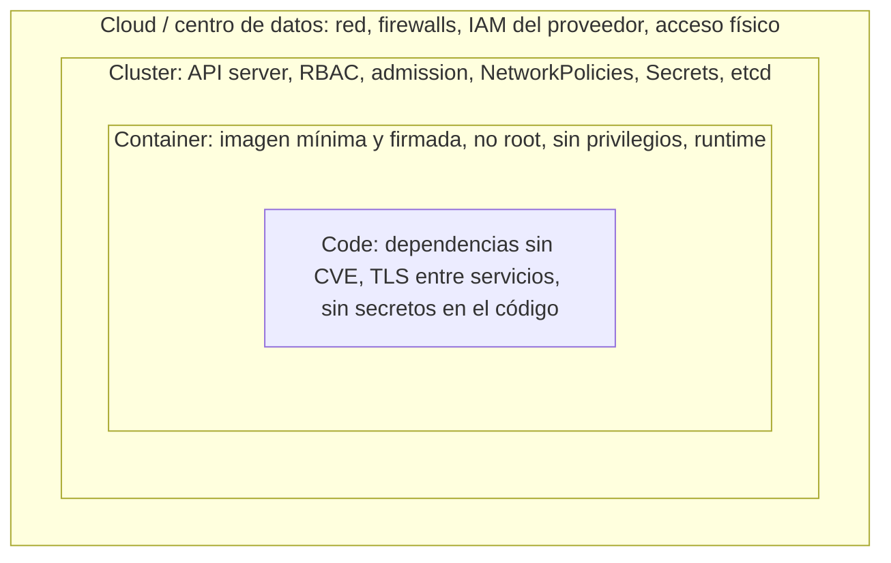
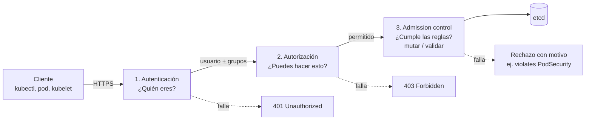
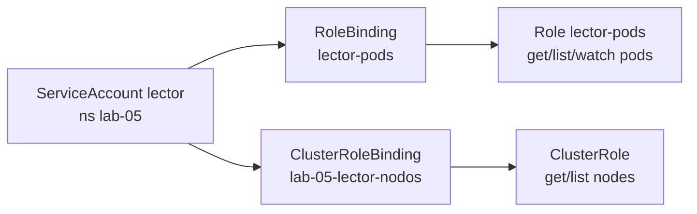

# Módulo 05 — Seguridad en Kubernetes

> **Dominio KCNA:** Container Orchestration (28%) · competencia *Security* · **Tiempo:** 3 h · **Prerrequisitos:** módulos 02 (arquitectura), 03 (pods y Deployments) y 04 (scheduling)
>
> **Lecciones equivalentes de KodeKloud:** Security Kubernetes Security Primitives · Authentication · TLS Introduction · TLS in Kubernetes · KubeConfig · API Groups · Authorization · Role Based Access Controls · Cluster Roles and Role Bindings · Service Accounts · Image Security · Security Contexts · Network Policies

## Objetivos

Al terminar podrás:

- Explicar el modelo de las **4C** de la seguridad cloud native y en qué capa actúa cada control de Kubernetes.
- Describir el recorrido de una petición al API server: **autenticación → autorización → admission control**, y qué papel juegan los certificados, los tokens y el kubeconfig.
- Crear **ServiceAccounts**, **Roles**, **ClusterRoles** y sus **bindings**, y comprobar permisos con `kubectl auth can-i --as`.
- Endurecer pods con **securityContext** y hacer cumplir mínimos con **Pod Security Admission** (privileged / baseline / restricted).
- Aislar tráfico entre pods con **NetworkPolicies** (default deny + reglas de permiso) y saber qué protege y qué no un **Secret**.

## Conceptos

### Las 4C de la seguridad cloud native

La documentación de Kubernetes propone pensar la seguridad como capas concéntricas: **Cloud**, **Cluster**, **Container** y **Code**. Cada capa depende de la de fuera: un código impecable no sirve de nada si alguien tiene acceso root al servidor donde corre.

Analogía: un banco. La **nube** es el edificio y la calle (vigilancia, cerraduras de la puerta principal); el **clúster** es la oficina y quién tiene llave de cada sala; el **contenedor** es la caja fuerte; el **código** es lo que guardas dentro y cómo lo manejas.



| Capa | Ejemplos de controles | ¿Quién suele encargarse? |
|---|---|---|
| **Cloud** | Firewalls/security groups, acceso al API server solo desde redes de confianza, cifrado de discos, IAM | Proveedor cloud + equipo de plataforma |
| **Cluster** | Autenticación, **RBAC**, **admission controllers**, **NetworkPolicies**, cifrado de Secrets en etcd, auditoría | Administradores de Kubernetes |
| **Container** | Imágenes de registries de confianza, escaneo de vulnerabilidades, **securityContext**, no ejecutar como root | Desarrolladores + plataforma |
| **Code** | Análisis estático, dependencias actualizadas, TLS/mTLS, gestión correcta de credenciales | Desarrolladores |

### Primitivas de seguridad: el viaje de una petición

Todo en Kubernetes pasa por el **kube-apiserver**: tú con kubectl, el scheduler, el kubelet, los controladores. Por eso proteger el API server es la primera línea de defensa. Cada petición atraviesa tres controles en orden:



### Autenticación: ¿quién eres?

Idea clave para el examen: **Kubernetes no gestiona usuarios humanos**. No existe un objeto `User` ni un `kubectl create user`. El API server confía en mecanismos externos y solo extrae de cada petición un **nombre de usuario** y una lista de **grupos**.

| Mecanismo | Cómo funciona | Uso típico |
|---|---|---|
| **Certificados X.509 de cliente** | El cliente presenta un certificado firmado por la **CA del clúster**. El `CN` es el usuario y cada `O` es un grupo | Administradores, componentes del control plane, kubelets |
| **Tokens de ServiceAccount** (JWT) | Token firmado por el propio clúster, enviado como `Authorization: Bearer` | Aplicaciones que corren dentro del clúster |
| **OIDC** (OpenID Connect) | Un proveedor de identidad externo (Entra ID, Keycloak, Okta, Google...) emite un ID token que el API server valida | Usuarios humanos en clústeres corporativos |
| Webhook de tokens, proxy de autenticación | El API server delega la validación en un servicio externo | Integraciones especiales |

Las identidades de **aplicaciones** sí son objetos de Kubernetes: las **ServiceAccounts** (las veremos enseguida). Su nombre de usuario tiene la forma `system:serviceaccount:<namespace>:<nombre>`.

Los mecanismos antiguos de archivo estático de contraseñas o tokens (`--basic-auth-file`, `--token-auth-file`) están obsoletos o eliminados; si aparecen en una pregunta, la respuesta es que no se recomiendan.

### TLS en Kubernetes (conceptual)

Toda la comunicación del control plane va cifrada con **TLS** y, en casi todos los casos, con autenticación **mutua** (cada lado presenta un certificado). La raíz de confianza es la **CA del clúster** (`/etc/kubernetes/pki/ca.crt` en clústeres kubeadm/kind): todo certificado firmado por ella es "de la casa".

| Conexión | Servidor presenta | Cliente presenta |
|---|---|---|
| kubectl → kube-apiserver | `apiserver.crt` | Certificado de admin (o token/OIDC) |
| scheduler / controller-manager → kube-apiserver | `apiserver.crt` | Su propio certificado de cliente |
| kubelet → kube-apiserver | `apiserver.crt` | Certificado del nodo (`system:node:<nombre>`) |
| kube-apiserver → kubelet (logs, exec) | Certificado del kubelet | `apiserver-kubelet-client.crt` |
| kube-apiserver → etcd | Certificado de etcd (con **su propia CA**) | `apiserver-etcd-client.crt` |
| Pods → kube-apiserver | `apiserver.crt` | Token de ServiceAccount; verifican al servidor con el `ca.crt` montado en el pod |

Recuerda: solo el API server habla con etcd. Ni el scheduler ni los kubelets acceden a etcd directamente.

### kubeconfig: tu "llavero"

El archivo **kubeconfig** (por defecto `~/.kube/config`; en este curso `.kube\kcna-config`) agrupa tres listas:

- **clusters**: dirección del API server + CA para verificarlo.
- **users**: credenciales (certificado y clave, token, o un plugin `exec` para OIDC/cloud).
- **contexts**: combinaciones *cluster + user + namespace por defecto*. `current-context` indica cuál se usa.

kubectl elige el archivo con este orden: `--kubeconfig` > variable `KUBECONFIG` > `~/.kube/config`. Eso es justo lo que hace `kcna-env.ps1` para aislarte de los clústeres de la empresa.

### API groups

La API de Kubernetes está organizada en **grupos** y versiones, y RBAC los usa para dar permisos:

| Grupo | Ruta | Ejemplos de recursos |
|---|---|---|
| core (grupo vacío `""`) | `/api/v1` | pods, services, configmaps, secrets, namespaces, nodes, serviceaccounts |
| `apps` | `/apis/apps/v1` | deployments, replicasets, statefulsets, daemonsets |
| `rbac.authorization.k8s.io` | `/apis/rbac.authorization.k8s.io/v1` | roles, rolebindings, clusterroles, clusterrolebindings |
| `networking.k8s.io` | `/apis/networking.k8s.io/v1` | networkpolicies, ingresses |
| `batch`, `autoscaling`, `storage.k8s.io`... | `/apis/<grupo>/<versión>` | jobs, HPA, storageclasses... |

Cada recurso admite **verbos** (`get`, `list`, `watch`, `create`, `update`, `patch`, `delete`, `deletecollection`) y algunos tienen **subrecursos** (`pods/log`, `pods/exec`, `deployments/scale`).

### Autorización: ¿puedes hacer esto?

Una vez autenticado, el API server consulta a los **autorizadores** configurados en `--authorization-mode` (en tu clúster: `Node,RBAC`). Se evalúan en orden; el primero que da una opinión decide. Si ninguno permite, la respuesta es **403 Forbidden**.

| Modo | Qué hace |
|---|---|
| **Node** | Autorizador especial para kubelets: cada nodo solo puede leer/escribir lo relacionado con sus propios pods |
| **RBAC** | Permisos basados en roles definidos como objetos de la API. El estándar de facto |
| **ABAC** | Políticas en un archivo JSON en el control plane; cambiar algo exige editar el archivo y reiniciar el API server. Prácticamente en desuso |
| **Webhook** | Delega la decisión en un servicio externo (ej. Open Policy Agent) |
| `AlwaysAllow` / `AlwaysDeny` | Solo para pruebas |

### RBAC: Role, ClusterRole y sus bindings

RBAC se basa en **sumar permisos**: no hay reglas de "denegar". Todo lo que no está explícitamente permitido está prohibido.

- Un **Role** define permisos (reglas `apiGroups` + `resources` + `verbs`) **dentro de un namespace**.
- Un **ClusterRole** define permisos **sin namespace**: sirve para recursos cluster-scoped (nodes, namespaces, PVs), para URLs como `/healthz`, o como plantilla reutilizable en muchos namespaces.
- Un **RoleBinding** concede un Role (o un ClusterRole) a unos **subjects** (usuarios, grupos o ServiceAccounts) **en un namespace**.
- Un **ClusterRoleBinding** concede un ClusterRole en **todo el clúster**.

| Combinación | Resultado |
|---|---|
| Role + RoleBinding | Permisos en ese namespace |
| ClusterRole + RoleBinding | Los permisos del ClusterRole, pero **solo en el namespace del RoleBinding** (patrón de reutilización) |
| ClusterRole + ClusterRoleBinding | Permisos en todos los namespaces y en recursos cluster-scoped |
| Role + ClusterRoleBinding | **No es posible** |



ClusterRoles predefinidos que conviene reconocer: `cluster-admin` (todo), `admin` (todo dentro de un namespace, incluido RBAC), `edit` (modificar casi todo excepto RBAC), `view` (solo lectura, sin Secrets).

Para comprobar permisos sin adivinar: `kubectl auth can-i <verbo> <recurso> [-n ns] [--as=usuario]`. Con `--as` te haces pasar por otro sujeto (requiere permiso de *impersonate*, que tiene el admin). Para una ServiceAccount: `--as=system:serviceaccount:<ns>:<nombre>`.

### ServiceAccounts y tokens proyectados

Una **ServiceAccount** es la identidad de un proceso que corre en un pod. Cada namespace tiene una llamada `default`, que se usa si el pod no indica otra con `spec.serviceAccountName`.

Desde Kubernetes 1.24 los tokens funcionan así:

- El kubelet pide al API server un token de corta duración (por defecto ~1 hora, se renueva solo) ligado al pod, y lo **proyecta** como volumen en `/var/run/secrets/kubernetes.io/serviceaccount/` junto con `ca.crt` y `namespace`. A esto se le llama **projected service account token** (obtenido vía la API **TokenRequest**).
- Ya **no** se crea automáticamente un Secret con un token eterno por cada ServiceAccount. Si necesitas un token puntual para pruebas: `kubectl create token <sa> --duration=10m`.
- Si una app no necesita hablar con la API, lo mejor es no montar el token: `automountServiceAccountToken: false` (en el pod o en la ServiceAccount).
- Buenas prácticas: una ServiceAccount por aplicación, con el mínimo permiso necesario; nunca dar permisos a la ServiceAccount `default`.

### Admission controllers

Tras autorizar la petición, pasa por los **admission controllers**: plugins del API server que pueden **mutar** (modificar el objeto, ej. añadir valores por defecto) o **validar** (rechazarlo). Primero se ejecutan los de mutación y luego los de validación. Algunos que ya conoces o conocerás:

| Admission controller | Qué hace |
|---|---|
| `NamespaceLifecycle` | Impide crear objetos en namespaces que no existen o se están borrando |
| `LimitRanger` / `ResourceQuota` | Aplican LimitRange y ResourceQuota (módulo 04) |
| `ServiceAccount` | Asigna la ServiceAccount `default` y monta el token |
| `NodeRestriction` | Limita lo que cada kubelet puede modificar |
| `PodSecurity` | Aplica **Pod Security Admission** |
| `MutatingAdmissionWebhook` / `ValidatingAdmissionWebhook` | Llaman a servicios externos (OPA Gatekeeper, Kyverno) para políticas propias |

También existe **ValidatingAdmissionPolicy**, que permite escribir reglas de validación en CEL dentro del propio clúster, sin webhook.

### Pod Security Admission y los Pod Security Standards

Los **Pod Security Standards** definen tres perfiles acumulativos:

| Perfil | Filosofía | Ejemplos de lo que prohíbe |
|---|---|---|
| **privileged** | Sin restricciones | Nada |
| **baseline** | Evita escaladas de privilegios conocidas, compatible con la mayoría de apps | `privileged: true`, `hostNetwork`, `hostPID`, `hostPath`, añadir capabilities peligrosas |
| **restricted** | Buenas prácticas estrictas de endurecimiento | Todo lo de baseline + exige `runAsNonRoot: true`, `allowPrivilegeEscalation: false`, `capabilities.drop: ["ALL"]` y `seccompProfile` `RuntimeDefault` o `Localhost` |

**Pod Security Admission** (PSA) es el admission controller integrado que los aplica. Sustituyó a **PodSecurityPolicy**, eliminada en Kubernetes 1.25 (pregunta clásica). Se configura con **labels en el namespace**, con tres modos que se pueden combinar:

| Label | Efecto |
|---|---|
| `pod-security.kubernetes.io/enforce=<perfil>` | **Rechaza** los pods que lo violan |
| `pod-security.kubernetes.io/warn=<perfil>` | Los admite pero muestra un aviso al usuario |
| `pod-security.kubernetes.io/audit=<perfil>` | Los admite y lo anota en el log de auditoría |

Detalle práctico: PSA evalúa **pods**. Si creas un Deployment que viola la política, el Deployment se crea (con un aviso), pero su ReplicaSet no logra crear ningún pod. El error aparece en los eventos del ReplicaSet.

### securityContext: endurecer el contenedor

El campo `securityContext` existe a nivel de **pod** (aplica a todos los contenedores) y de **contenedor** (tiene prioridad). Los campos que debes conocer:

| Campo | Efecto |
|---|---|
| `runAsUser` / `runAsGroup` | UID/GID con el que corre el proceso |
| `runAsNonRoot: true` | El kubelet se niega a arrancar el contenedor si fuera a ejecutarse como UID 0 |
| `fsGroup` (solo pod) | Grupo propietario de los volúmenes montados |
| `readOnlyRootFilesystem: true` | El sistema de archivos del contenedor es de solo lectura (se usan volúmenes `emptyDir` para lo que deba escribirse) |
| `allowPrivilegeEscalation: false` | Un proceso no puede ganar más privilegios que su padre (activa `no_new_privs`) |
| `capabilities` (`add` / `drop`) | Quita o añade **capabilities** de Linux (fragmentos del poder de root, como `NET_ADMIN` o `SYS_TIME`) |
| `privileged: true` | El contenedor obtiene casi todo el poder del nodo. Evítalo salvo agentes de sistema muy concretos |
| `seccompProfile` | Filtra las llamadas al sistema permitidas (`RuntimeDefault` = perfil por defecto del runtime) |

### Seguridad de imágenes

- Usa **registries de confianza** y fija versiones con tag concreto o, mejor aún, por **digest** (`imagen@sha256:...`), que es inmutable.
- Para registries privados, guarda las credenciales en un Secret de tipo `kubernetes.io/dockerconfigjson` y referéncialo desde el pod con **imagePullSecrets** (o asócialo a la ServiceAccount para que lo hereden todos sus pods):

  ```yaml
  # kubectl create secret docker-registry regcred --docker-server=registry.empresa.com --docker-username=... --docker-password=...
  spec:
    imagePullSecrets:
      - name: regcred
    containers:
      - name: app
        image: registry.empresa.com/equipo/app:2.3.1
  ```

- **Escaneo de vulnerabilidades** (ej. Trivy, Grype) en el pipeline de CI y en el registry.
- **Firma y verificación** de imágenes (ej. Sigstore **cosign**), comprobada en admisión con políticas (Kyverno, Gatekeeper o similares) para que solo entren imágenes firmadas por tu organización.
- Imágenes mínimas (distroless, alpine, scratch): menos paquetes, menos superficie de ataque.

### NetworkPolicies: un firewall entre pods

Por defecto, en Kubernetes **todos los pods pueden hablar con todos los pods** de cualquier namespace. Una **NetworkPolicy** restringe ese tráfico usando labels:

- `podSelector`: a qué pods del namespace se aplica la política (`{}` = a todos).
- `policyTypes`: `Ingress` (tráfico entrante), `Egress` (saliente) o ambos.
- Reglas `ingress.from` / `egress.to` con `podSelector`, `namespaceSelector` y/o `ipBlock`, más `ports`.

Reglas de funcionamiento que el examen pregunta:

1. Un pod que **no** está seleccionado por ninguna política acepta todo el tráfico.
2. En cuanto una política selecciona un pod para `Ingress` (o `Egress`), ese pod pasa a **denegar por defecto** en esa dirección; solo se permite lo que alguna política autorice. Las políticas se **suman** (unión); no hay reglas de denegar.
3. Las NetworkPolicies las aplica el **plugin de red (CNI)**, no Kubernetes. Si el CNI no las soporta, puedes crear políticas y **no pasará nada**, sin ningún error. Calico, Cilium, Antrea y, desde kind 0.24, **kindnet** las soportan; Flannel por sí solo no.
4. Patrón recomendado: una política **default deny** por namespace y luego políticas específicas que abran lo necesario. Si haces default deny de **egress**, recuerda permitir DNS (puerto 53 UDP/TCP hacia CoreDNS) o nada resolverá nombres.

> En este clúster **sí se aplican**: kindnet trae soporte de NetworkPolicy y lo comprobarás en el laboratorio con `wget` entre pods.

### Secrets y cifrado en reposo

Un **Secret** guarda datos sensibles (contraseñas, tokens, certificados) separados de la imagen y del manifiesto de la app. Pero ojo:

- Los valores están en **base64**, que es una **codificación, no un cifrado**: cualquiera que pueda leer el Secret lo decodifica en un segundo.
- Por defecto, el API server los guarda en etcd **sin cifrar**. Para cifrarlos en reposo se configura una `EncryptionConfiguration` en el API server (`--encryption-provider-config`) con proveedores como `aescbc`, `aesgcm`, `secretbox` o, mejor, **KMS** (la clave maestra vive en un servicio externo como AWS KMS, Azure Key Vault o Vault).
- Protégelos con **RBAC** (pocos sujetos con `get`/`list` sobre secrets; recuerda que quien puede crear pods en un namespace puede montar cualquier Secret de ese namespace), habilita el cifrado en reposo y considera gestores externos (External Secrets Operator, Vault, Sealed Secrets para GitOps).

## Comandos clave

| Comando | Qué hace |
|---|---|
| `kubectl auth whoami` | Muestra con qué usuario y grupos te autentica el API server |
| `kubectl config get-contexts` / `kubectl config view --minify` | Contextos del kubeconfig / configuración activa (sin secretos) |
| `kubectl api-resources --api-group=apps` | Recursos de un API group (y si son namespaced) |
| `kubectl create serviceaccount <sa> -n <ns>` | Crea una ServiceAccount |
| `kubectl create role <r> --verb=get,list --resource=pods -n <ns>` | Crea un Role de forma imperativa |
| `kubectl create rolebinding <rb> --role=<r> --serviceaccount=<ns>:<sa> -n <ns>` | Une un Role con una ServiceAccount |
| `kubectl create clusterrole` / `clusterrolebinding` | Igual, a nivel de clúster |
| `kubectl auth can-i list pods -n <ns> --as=system:serviceaccount:<ns>:<sa>` | Comprueba un permiso haciéndote pasar por la SA |
| `kubectl auth can-i --list -n <ns> --as=...` | Lista todo lo que puede hacer un sujeto |
| `kubectl create token <sa> --duration=10m` | Emite un token temporal para una ServiceAccount |
| `kubectl label ns <ns> pod-security.kubernetes.io/enforce=restricted` | Activa Pod Security Admission en un namespace |
| `kubectl label --dry-run=server ns <ns> pod-security.kubernetes.io/enforce=restricted` | Muestra qué pods existentes violarían el perfil, sin aplicarlo |
| `kubectl get networkpolicy` / `kubectl describe networkpolicy` | Políticas de red del namespace y su lectura en lenguaje natural |
| `kubectl create secret generic <s> --from-literal=k=v` | Crea un Secret |

## Laboratorio guiado

Recuerda: los nodos de tu clúster no salen a internet (proxy de la empresa), por eso `.\kcna.ps1 lab 05` precarga `busybox:1.37` y `curlimages/curl:8.11.1`. En un clúster normal no haría falta.

En todo el lab se usa `-n lab-05` explícito. Los objetos cluster-scoped (ClusterRole, ClusterRoleBinding) llevan el prefijo `lab-05-` y los borra `.\kcna.ps1 reset 05`.

### Paso 1 — Preparar el entorno

```powershell
.\kcna.ps1 lab 05
. .\kcna-env.ps1
```

```text
  OK  ya cargada: busybox:1.37
  OK  ya cargada: curlimages/curl:8.11.1
  OK  Namespace listo: lab-05
```

Qué observar: el namespace `lab-05` existe y las imágenes están en los nodos.

### Paso 2 — ¿Quién soy? Certificados y kubeconfig

```powershell
kubectl auth whoami
kubectl config view --minify
```

```text
ATTRIBUTE                                           VALUE
Username                                            kubernetes-admin
Groups                                              [kubeadm:cluster-admins system:authenticated]
Extra: authentication.kubernetes.io/credential-id   [X509SHA256=c13abae9...]

clusters:
- cluster:
    certificate-authority-data: DATA+OMITTED
    server: https://127.0.0.1:63817
  name: kind-kcna
contexts:
- context:
    cluster: kind-kcna
    namespace: default
    user: kind-kcna
  name: kind-kcna
current-context: kind-kcna
users:
- name: kind-kcna
  user:
    client-certificate-data: DATA+OMITTED
    client-key-data: DATA+OMITTED
```

Abre tu certificado de cliente con .NET (sin instalar nada) para ver de dónde salen ese usuario y ese grupo:

```powershell
$b64 = kubectl config view --raw --minify -o jsonpath='{.users[0].user.client-certificate-data}'
$cert = [System.Security.Cryptography.X509Certificates.X509Certificate2]::new([Convert]::FromBase64String($b64))
$cert | Format-List Subject, Issuer, NotAfter
```

```text
Subject  : CN=kubernetes-admin, O=kubeadm:cluster-admins
Issuer   : CN=kubernetes
NotAfter : 23/10/2027 08:36:58 a. m.
```

Qué observar: el `CN` del certificado es tu **usuario** y el `O` tu **grupo**; lo firmó la CA del clúster (`CN=kubernetes`). No hay ningún objeto "User" en Kubernetes: el API server se fía del certificado. El puerto del `server` y las fechas serán distintos en tu equipo.

### Paso 3 — La CA del clúster y quién habla con quién

```powershell
podman exec kcna-control-plane ls /etc/kubernetes/pki
podman exec kcna-control-plane openssl x509 -in /etc/kubernetes/pki/apiserver.crt -noout -subject -issuer -ext subjectAltName
podman exec kcna-control-plane sh -c "grep -E 'authorization-mode|admission-plugins|client-ca-file' /etc/kubernetes/manifests/kube-apiserver.yaml"
```

```text
apiserver-etcd-client.crt   apiserver-kubelet-client.crt   apiserver.crt   ca.crt   ca.key
etcd   front-proxy-ca.crt   front-proxy-client.crt   sa.key   sa.pub   ...

subject=CN=kube-apiserver
issuer=CN=kubernetes
X509v3 Subject Alternative Name:
    DNS:kcna-control-plane, DNS:kubernetes, DNS:kubernetes.default, DNS:kubernetes.default.svc,
    DNS:kubernetes.default.svc.cluster.local, DNS:localhost, IP Address:10.96.0.1, IP Address:10.89.4.4, IP Address:127.0.0.1

    - --authorization-mode=Node,RBAC
    - --client-ca-file=/etc/kubernetes/pki/ca.crt
    - --enable-admission-plugins=NodeRestriction
    - --requestheader-client-ca-file=/etc/kubernetes/pki/front-proxy-ca.crt
```

Qué observar: `ca.crt`/`ca.key` son la raíz de confianza; `apiserver-etcd-client` y `apiserver-kubelet-client` son los certificados con los que el API server actúa como **cliente** de etcd y de los kubelets; `sa.key`/`sa.pub` firman y verifican los tokens de ServiceAccount; etcd tiene su propia CA en la carpeta `etcd`. Los SAN del certificado del API server incluyen `kubernetes.default.svc`, el nombre que usan los pods para llegar a él. La autorización está en modo `Node,RBAC`. (`NodeRestriction` es el único plugin añadido explícitamente; los de por defecto, como `PodSecurity`, `LimitRanger` o `ServiceAccount`, ya vienen activados.)

### Paso 4 — API groups

```powershell
kubectl api-resources --api-group=rbac.authorization.k8s.io
kubectl api-versions
```

```text
NAME                  SHORTNAMES   APIVERSION                     NAMESPACED   KIND
clusterrolebindings                rbac.authorization.k8s.io/v1   false        ClusterRoleBinding
clusterroles                       rbac.authorization.k8s.io/v1   false        ClusterRole
rolebindings                       rbac.authorization.k8s.io/v1   true         RoleBinding
roles                              rbac.authorization.k8s.io/v1   true         Role

admissionregistration.k8s.io/v1
apps/v1
authentication.k8s.io/v1
authorization.k8s.io/v1
...
networking.k8s.io/v1
policy/v1
rbac.authorization.k8s.io/v1
...
v1
```

Qué observar: Role y RoleBinding son *namespaced*; ClusterRole y ClusterRoleBinding no. El grupo core aparece simplemente como `v1`. Verás además grupos de addons instalados (Gateway API, Traefik...), que añaden sus propios recursos mediante CRDs.

### Paso 5 — ServiceAccount + Role + RoleBinding

Primero comprueba que la ServiceAccount aún no puede nada (ni existe), y después créala con su Role y su RoleBinding:

```powershell
kubectl auth can-i list pods -n lab-05 --as=system:serviceaccount:lab-05:lector
kubectl apply -f labs\05-seguridad\01-sa-lector.yaml
kubectl auth can-i list pods -n lab-05 --as=system:serviceaccount:lab-05:lector
kubectl auth can-i get pods --subresource=log -n lab-05 --as=system:serviceaccount:lab-05:lector
kubectl auth can-i delete pods -n lab-05 --as=system:serviceaccount:lab-05:lector
kubectl auth can-i list pods -n default --as=system:serviceaccount:lab-05:lector
kubectl auth can-i get secrets -n lab-05 --as=system:serviceaccount:lab-05:lector
```

```text
no
serviceaccount/lector created
role.rbac.authorization.k8s.io/lector-pods created
rolebinding.rbac.authorization.k8s.io/lector-pods created
yes
yes
no
no
no
```

```powershell
kubectl auth can-i --list -n lab-05 --as=system:serviceaccount:lab-05:lector
kubectl get secrets -n lab-05 --as=system:serviceaccount:lab-05:lector
```

```text
Resources                                       Non-Resource URLs   Resource Names   Verbs
selfsubjectreviews.authentication.k8s.io        []                  []               [create]
selfsubjectaccessreviews.authorization.k8s.io   []                  []               [create]
selfsubjectrulesreviews.authorization.k8s.io    []                  []               [create]
pods/log                                        []                  []               [get list watch]
pods                                            []                  []               [get list watch]
...
Error from server (Forbidden): secrets is forbidden: User "system:serviceaccount:lab-05:lector" cannot list resource "secrets" in API group "" in the namespace "lab-05"
```

Qué observar: los permisos son exactamente los del Role, solo en `lab-05` (en `default`, "no"). El mensaje `Forbidden` (403) dice el usuario, el verbo, el recurso, el grupo y el namespace: es la forma de saber qué regla falta. Los permisos `selfsubject...` y las URLs como `/healthz` o `/version` los tiene cualquier usuario autenticado.

### Paso 6 — ClusterRole + ClusterRoleBinding

```powershell
kubectl auth can-i list nodes --as=system:serviceaccount:lab-05:lector
kubectl apply -f labs\05-seguridad\02-clusterrole-nodos.yaml
kubectl auth can-i list nodes --as=system:serviceaccount:lab-05:lector
kubectl auth can-i delete nodes --as=system:serviceaccount:lab-05:lector
```

```text
Warning: resource 'nodes' is not namespace scoped
no
clusterrole.rbac.authorization.k8s.io/lab-05-lector-nodos created
clusterrolebinding.rbac.authorization.k8s.io/lab-05-lector-nodos created
Warning: resource 'nodes' is not namespace scoped
yes
Warning: resource 'nodes' is not namespace scoped
no
```

Qué observar: los nodos son cluster-scoped, así que un Role nunca podría dar acceso a ellos: hace falta ClusterRole + ClusterRoleBinding. El aviso `not namespace scoped` aparece porque tu contexto tiene un namespace por defecto; es inofensivo.

### Paso 7 — El token proyectado, desde dentro de un pod

El pod `cliente-api` usa `serviceAccountName: lector` y tiene `curl`:

```powershell
kubectl apply -f labs\05-seguridad\03-pod-cliente-api.yaml
kubectl wait --for=condition=Ready pod/cliente-api -n lab-05 --timeout=60s
kubectl get pod cliente-api -n lab-05 -o jsonpath='{.spec.volumes[0].projected.sources[0]}'
kubectl exec -n lab-05 cliente-api -- ls /var/run/secrets/kubernetes.io/serviceaccount
```

```text
{"serviceAccountToken":{"expirationSeconds":3607,"path":"token"}}
ca.crt
namespace
token
```

Usa ese token para llamar a la API (la variable `SA` está definida en el pod y apunta a esa carpeta):

```powershell
kubectl exec -n lab-05 cliente-api -- sh -c 'curl -s -o /dev/null -w %{http_code} --cacert $SA/ca.crt --oauth2-bearer $(cat $SA/token) https://kubernetes.default.svc/api/v1/namespaces/lab-05/pods'
kubectl exec -n lab-05 cliente-api -- sh -c 'curl -s --cacert $SA/ca.crt --oauth2-bearer $(cat $SA/token) https://kubernetes.default.svc/api/v1/namespaces/lab-05/secrets'
kubectl exec -n lab-05 cliente-api -- sh -c 'curl -s https://kubernetes.default.svc/version'
```

```text
200
{
  "kind": "Status",
  "apiVersion": "v1",
  "status": "Failure",
  "message": "secrets is forbidden: User \"system:serviceaccount:lab-05:lector\" cannot list resource \"secrets\" in API group \"\" in the namespace \"lab-05\"",
  "reason": "Forbidden",
  "code": 403
}
command terminated with exit code 60
```

Por último, mira qué lleva dentro un token (es un JWT: tres partes en base64 separadas por puntos):

```powershell
$t = kubectl create token lector -n lab-05 --duration=10m
$p = $t.Split('.')[1].Replace('-','+').Replace('_','/'); while ($p.Length % 4) { $p += '=' }
[Text.Encoding]::UTF8.GetString([Convert]::FromBase64String($p))
kubectl get secrets -n lab-05
```

```text
{"aud":["https://kubernetes.default.svc.cluster.local"],"exp":1792774211,"iat":1792773611,"iss":"https://kubernetes.default.svc.cluster.local",...,"kubernetes.io":{"namespace":"lab-05","serviceaccount":{"name":"lector",...}},...,"sub":"system:serviceaccount:lab-05:lector"}
No resources found in lab-05 namespace.
```

Qué observar: el pod llega al API server con el token montado automáticamente y RBAC le da `200` para pods y `403` para secrets. Sin `--cacert`, curl falla con el código 60: no puede verificar el certificado del servidor; el `ca.crt` montado es justo la CA del clúster. El token tiene emisor (`iss`), sujeto (`sub`), audiencia y caducidad (`exp`). Y no hay ningún Secret con tokens en el namespace: desde 1.24 ya no se crean.

### Paso 8 — securityContext: root frente a endurecido

```powershell
kubectl apply -f labs\05-seguridad\04-pod-root.yaml
kubectl apply -f labs\05-seguridad\05-pod-seguro.yaml
kubectl wait --for=condition=Ready pod/pod-root pod/pod-seguro -n lab-05 --timeout=60s
kubectl exec -n lab-05 pod-root -- id
kubectl exec -n lab-05 pod-root -- sh -c 'touch /prueba && echo escritura-ok'
kubectl exec -n lab-05 pod-root -- grep CapEff /proc/1/status
```

```text
uid=0(root) gid=0(root) groups=0(root),10(wheel)
escritura-ok
CapEff:	00000000a80425fb
```

```powershell
kubectl exec -n lab-05 pod-seguro -- id
kubectl exec -n lab-05 pod-seguro -- touch /prueba
kubectl exec -n lab-05 pod-seguro -- sh -c 'touch /tmp/prueba && ls -l /tmp/prueba'
kubectl exec -n lab-05 pod-seguro -- grep -E 'CapEff|NoNewPrivs' /proc/1/status
```

```text
uid=1000 gid=3000 groups=2000,3000
touch: /prueba: Read-only file system
command terminated with exit code 1
-rw-r--r--    1 1000     2000             0 Oct 23 16:42 /tmp/prueba
NoNewPrivs:	1
CapEff:	0000000000000000
```

Qué observar: sin `securityContext`, el contenedor es root, puede escribir en su sistema de archivos y tiene un conjunto de capabilities (`a80425fb`). El pod endurecido corre como UID 1000 (grupo 3000 y grupo suplementario 2000 por `fsGroup`), no puede escribir salvo en el `emptyDir` de `/tmp`, tiene **cero** capabilities y `NoNewPrivs: 1` gracias a `allowPrivilegeEscalation: false`.

### Paso 9 — Pod Security Admission: namespace `restricted`

Antes de aplicar el perfil, pregunta al servidor qué pasaría (sin cambiar nada):

```powershell
kubectl label --dry-run=server --overwrite ns lab-05 pod-security.kubernetes.io/enforce=restricted
```

```text
Warning: existing pods in namespace "lab-05" violate the new PodSecurity enforce level "restricted:latest"
Warning: pod-root: allowPrivilegeEscalation != false, unrestricted capabilities, runAsNonRoot != true, seccompProfile
namespace/lab-05 labeled (server dry run)
```

Aplícalo de verdad (enforce + warn) e intenta crear pods inseguros:

```powershell
kubectl label --overwrite ns lab-05 pod-security.kubernetes.io/enforce=restricted pod-security.kubernetes.io/warn=restricted
kubectl get pods -n lab-05
kubectl apply -f labs\05-seguridad\06-pod-privilegiado.yaml
kubectl run nginx-normal --image=nginx:1.27-alpine -n lab-05
```

```text
namespace/lab-05 labeled
NAME          READY   STATUS    RESTARTS   AGE
cliente-api   1/1     Running   0          6m38s
pod-root      1/1     Running   0          3m9s
pod-seguro    1/1     Running   0          2m58s

Error from server (Forbidden): error when creating "labs\\05-seguridad\\06-pod-privilegiado.yaml": pods "pod-privilegiado" is forbidden: violates PodSecurity "restricted:latest": privileged (container "app" must not set securityContext.privileged=true), allowPrivilegeEscalation != false (...), unrestricted capabilities (...), runAsNonRoot != true (...), seccompProfile (...)

Error from server (Forbidden): pods "nginx-normal" is forbidden: violates PodSecurity "restricted:latest": allowPrivilegeEscalation != false (container "nginx-normal" must set securityContext.allowPrivilegeEscalation=false), unrestricted capabilities (container "nginx-normal" must set securityContext.capabilities.drop=["ALL"]), runAsNonRoot != true (...), seccompProfile (...)
```

Ahora con un Deployment:

```powershell
kubectl create deployment web-inseguro --image=nginx:1.27-alpine -n lab-05
kubectl get deploy web-inseguro -n lab-05
kubectl get events -n lab-05 --field-selector reason=FailedCreate
```

```text
Warning: would violate PodSecurity "restricted:latest": allowPrivilegeEscalation != false (...), ...
deployment.apps/web-inseguro created
NAME           READY   UP-TO-DATE   AVAILABLE   AGE
web-inseguro   0/1     0            0           9s
Warning   FailedCreate   replicaset/web-inseguro-67dbcd589   Error creating: pods "web-inseguro-67dbcd589-klrnx" is forbidden: violates PodSecurity "restricted:latest": ...
```

Limpia lo que sobra:

```powershell
kubectl delete deploy web-inseguro -n lab-05
kubectl delete pod pod-root -n lab-05
```

Qué observar: PSA **no toca los pods que ya existían** (`pod-root` sigue corriendo; solo avisa). Los pods nuevos que violan el perfil se rechazan con una lista exacta de lo que falta: es la mejor guía para endurecer un manifiesto. Con un Deployment, el objeto se crea pero queda en `0/1`, y el motivo aparece en los eventos del ReplicaSet. `pod-seguro` y `cliente-api` cumplen `restricted` porque ya llevaban todo lo necesario.

### Paso 10 — NetworkPolicies: default deny y permitir por labels

El escenario: un servidor `api` (app=api, sirve una página en el puerto 8080 con su Service `api` en el 80), un cliente `frontend` (role=frontend) y un cliente `intruso` (role=otro). Todos cumplen el perfil `restricted`.

```powershell
kubectl apply -f labs\05-seguridad\07-np-app.yaml
kubectl wait --for=condition=Ready pod/api pod/frontend pod/intruso -n lab-05 --timeout=60s
kubectl exec -n lab-05 frontend -- wget -qO- -T 3 http://api
kubectl exec -n lab-05 intruso -- wget -qO- -T 3 http://api
```

```text
hola-desde-api
hola-desde-api
```

Sin políticas, todo el mundo entra. Aplica el **default deny** de entrada:

```powershell
kubectl apply -f labs\05-seguridad\08-np-default-deny.yaml
kubectl exec -n lab-05 frontend -- wget -qO- -T 3 http://api
kubectl exec -n lab-05 intruso -- wget -qO- -T 3 http://api
```

```text
networkpolicy.networking.k8s.io/default-deny-ingress created
wget: download timed out
command terminated with exit code 1
wget: download timed out
command terminated with exit code 1
```

Abre el hueco solo para `role=frontend`:

```powershell
kubectl apply -f labs\05-seguridad\09-np-permitir-frontend.yaml
kubectl exec -n lab-05 frontend -- wget -qO- -T 3 http://api
kubectl exec -n lab-05 intruso -- wget -qO- -T 3 http://api
kubectl describe networkpolicy permitir-frontend -n lab-05
```

```text
networkpolicy.networking.k8s.io/permitir-frontend created
hola-desde-api
wget: download timed out
command terminated with exit code 1

Name:         permitir-frontend
Namespace:    lab-05
Spec:
  PodSelector:     app=api
  Allowing ingress traffic:
    To Port: 8080/TCP
    From:
      PodSelector: role=frontend
  Not affecting egress traffic
  Policy Types: Ingress
```

Qué observar: **en este clúster las NetworkPolicies se aplican de verdad** (kindnet las implementa). Con el default deny, el tráfico no se rechaza con error: los paquetes se descartan y el cliente agota el tiempo (*timed out*). Las dos políticas se suman: el default deny cierra todo y `permitir-frontend` abre solo `frontend → api:8080`. El puerto de la política es el del **contenedor** (8080), no el del Service (80). La resolución DNS de `api` siguió funcionando porque solo restringimos *ingress*.

### Paso 11 — Secrets: base64 no es cifrado

```powershell
kubectl create secret generic db-cred --from-literal=usuario=app --from-literal=password=NoSoyCifrado123 -n lab-05
kubectl get secret db-cred -n lab-05 -o jsonpath='{.data.password}'
$enc = kubectl get secret db-cred -n lab-05 -o jsonpath='{.data.password}'
[Text.Encoding]::UTF8.GetString([Convert]::FromBase64String($enc))
kubectl auth can-i get secrets -n lab-05 --as=system:serviceaccount:lab-05:lector
```

```text
secret/db-cred created
Tm9Tb3lDaWZyYWRvMTIz
NoSoyCifrado123
no
```

Para curiosos: mira cómo queda guardado en etcd (este clúster no tiene cifrado en reposo configurado):

```powershell
kubectl exec -n kube-system etcd-kcna-control-plane -- etcdctl --endpoints=https://127.0.0.1:2379 --cacert=/etc/kubernetes/pki/etcd/ca.crt --cert=/etc/kubernetes/pki/etcd/server.crt --key=/etc/kubernetes/pki/etcd/server.key get /registry/secrets/lab-05/db-cred --print-value-only | Select-String NoSoyCifrado
```

```text
...passwordNoSoyCifrado123...
```

Qué observar: decodificar base64 es inmediato, así que la protección real de un Secret es **RBAC** (la SA `lector` no puede leerlo) y el **cifrado en reposo**. En etcd el valor aparece en claro: quien tenga acceso a etcd o a sus backups tiene tus secretos. En producción se configura `EncryptionConfiguration` (idealmente con KMS).

## Reto

Partiendo del estado en que dejaste `lab-05` (namespace con PSA `restricted`), consigue lo siguiente sin mirar la solución:

1. Una ServiceAccount `despliegues` en `lab-05` que pueda **gestionar Deployments** (get, list, watch, create, update, patch, delete) **solo** en `lab-05`, mediante un Role `gestor-deploy` y un RoleBinding `gestor-deploy`. No debe poder leer Secrets.
2. Que esa misma ServiceAccount pueda **listar nodos** (pero no borrarlos) mediante un ClusterRole `lab-05-ver-nodos` y un ClusterRoleBinding `lab-05-despliegues-nodos`.
3. El namespace `lab-05` debe seguir con `pod-security.kubernetes.io/enforce=restricted`.
4. Un pod `app-segura` (imagen `busybox:1.37`, comando `sleep 3600`) que corra como **UID 2000** con **sistema de archivos raíz de solo lectura**. Tendrás que satisfacer también el resto de requisitos de `restricted`.
5. Una NetworkPolicy `db-solo-api` que proteja a los pods `app=db`: solo pueden recibir tráfico de pods `app=api` en el puerto **TCP 6379**.

Comprueba tus permisos con `kubectl auth can-i ... --as=system:serviceaccount:lab-05:despliegues` antes de verificar:

```powershell
.\kcna.ps1 check 05
```

```text
==> Verificando 05-seguridad
  OK  ServiceAccount 'despliegues' existe y puede crear y borrar deployments en lab-05
  OK  'despliegues' NO puede leer secrets ni crear deployments fuera de lab-05 (minimo privilegio)
  OK  'despliegues' puede listar nodos (pero no borrarlos) via un ClusterRoleBinding lab-05-*
  OK  Namespace lab-05 aplica Pod Security Admission 'restricted' (enforce)
  OK  Pod 'app-segura' Running con runAsUser 2000 y readOnlyRootFilesystem
  OK  NetworkPolicy 'db-solo-api': a los pods app=db solo entran pods app=api por TCP 6379

  Lab completado: 6/6
```

<details><summary>Ver solución</summary>

Opción imperativa para la parte de RBAC:

```powershell
kubectl create serviceaccount despliegues -n lab-05
kubectl create role gestor-deploy --verb=get,list,watch,create,update,patch,delete --resource=deployments.apps -n lab-05
kubectl create rolebinding gestor-deploy --role=gestor-deploy --serviceaccount=lab-05:despliegues -n lab-05
kubectl create clusterrole lab-05-ver-nodos --verb=get,list,watch --resource=nodes
kubectl create clusterrolebinding lab-05-despliegues-nodos --clusterrole=lab-05-ver-nodos --serviceaccount=lab-05:despliegues
kubectl label --overwrite ns lab-05 pod-security.kubernetes.io/enforce=restricted
```

Y el resto en un archivo `reto05.yaml` (aplícalo con `kubectl apply -f reto05.yaml`):

```yaml
apiVersion: v1
kind: Pod
metadata:
  name: app-segura
  namespace: lab-05
spec:
  securityContext:
    runAsNonRoot: true
    runAsUser: 2000
    seccompProfile:
      type: RuntimeDefault
  containers:
    - name: app
      image: busybox:1.37
      command: ["sleep", "3600"]
      securityContext:
        allowPrivilegeEscalation: false
        readOnlyRootFilesystem: true
        capabilities:
          drop: ["ALL"]
      resources:
        requests: { cpu: 10m, memory: 16Mi }
        limits:   { cpu: 50m, memory: 32Mi }
---
apiVersion: networking.k8s.io/v1
kind: NetworkPolicy
metadata:
  name: db-solo-api
  namespace: lab-05
spec:
  podSelector:
    matchLabels:
      app: db
  policyTypes:
    - Ingress
  ingress:
    - from:
        - podSelector:
            matchLabels:
              app: api
      ports:
        - protocol: TCP
          port: 6379
```

Comprobaciones útiles:

```powershell
kubectl auth can-i create deployments -n lab-05 --as=system:serviceaccount:lab-05:despliegues   # yes
kubectl auth can-i get secrets -n lab-05 --as=system:serviceaccount:lab-05:despliegues          # no
kubectl auth can-i list nodes --as=system:serviceaccount:lab-05:despliegues                     # yes
kubectl exec -n lab-05 app-segura -- id                                                          # uid=2000
```

Fíjate en que el Role usa el grupo `apps` (los Deployments no están en el grupo core). Si pones `apiGroups: [""]` con `deployments`, `can-i` responderá "no".

</details>

## Preguntas tipo examen

**1.** In the 4C's model of cloud native security, which layer is the outermost?

- A) Code
- B) Container
- C) Cluster
- D) Cloud

<details><summary>Respuesta</summary>

**D.** El orden de fuera hacia dentro es Cloud → Cluster → Container → Code. Cada capa depende de la seguridad de la capa que la contiene.

</details>

**2.** How does Kubernetes manage human user accounts?

- A) With the `User` object stored in etcd
- B) It does not; users are managed by external mechanisms such as certificates or an OIDC identity provider
- C) With ServiceAccounts in the `kube-system` namespace
- D) With the `kubectl create user` command

<details><summary>Respuesta</summary>

**B.** Kubernetes no tiene objetos de usuario. Delega en certificados X.509, OIDC, webhooks, etc. Las ServiceAccounts son identidades para procesos dentro del clúster, no para personas.

</details>

**3.** In what order does the kube-apiserver process a request?

- A) Authorization → Authentication → Admission control
- B) Admission control → Authentication → Authorization
- C) Authentication → Authorization → Admission control
- D) Authentication → Admission control → Authorization

<details><summary>Respuesta</summary>

**C.** Primero "¿quién eres?" (autenticación), luego "¿puedes hacerlo?" (autorización) y por último los admission controllers mutan o validan el objeto antes de guardarlo en etcd.

</details>

**4.** You need to grant read access to Pods in a single namespace to a ServiceAccount. Which objects should you create?

- A) ClusterRole and ClusterRoleBinding
- B) Role and RoleBinding
- C) Role and ClusterRoleBinding
- D) NetworkPolicy and Role

<details><summary>Respuesta</summary>

**B.** Para permisos dentro de un namespace: Role + RoleBinding. ClusterRoleBinding daría permisos en todo el clúster, y un ClusterRoleBinding no puede referenciar un Role.

</details>

**5.** Which command checks whether the ServiceAccount `ci` in namespace `build` can create Deployments in that namespace?

- A) `kubectl auth can-i create deployments -n build --as=ci`
- B) `kubectl auth can-i create deployments -n build --as=system:serviceaccount:build:ci`
- C) `kubectl get rolebinding ci -n build --check`
- D) `kubectl auth whoami --serviceaccount=build:ci`

<details><summary>Respuesta</summary>

**B.** Para hacerse pasar por una ServiceAccount hay que usar su nombre completo de usuario, `system:serviceaccount:<namespace>:<nombre>`. Con `--as=ci` estarías preguntando por un usuario humano llamado "ci".

</details>

**6.** Which authorization mode is specifically designed to authorize API requests made by kubelets?

- A) RBAC
- B) ABAC
- C) Node
- D) Webhook

<details><summary>Respuesta</summary>

**C.** El autorizador Node limita a cada kubelet a los objetos relacionados con sus propios pods; suele combinarse con el admission plugin NodeRestriction. Por eso los clústeres kubeadm usan `--authorization-mode=Node,RBAC`.

</details>

**7.** Which built-in admission controller replaced PodSecurityPolicy (removed in Kubernetes 1.25)?

- A) Pod Security Admission
- B) NodeRestriction
- C) LimitRanger
- D) AlwaysPullImages

<details><summary>Respuesta</summary>

**A.** Pod Security Admission aplica los Pod Security Standards (privileged, baseline, restricted) mediante labels en los namespaces (`pod-security.kubernetes.io/enforce`, `warn`, `audit`).

</details>

**8.** A namespace has the label `pod-security.kubernetes.io/enforce=restricted`. Which Pod will be accepted?

- A) A Pod with `securityContext.privileged: true`
- B) A Pod that runs as root with default capabilities
- C) A Pod with `runAsNonRoot: true`, `allowPrivilegeEscalation: false`, `capabilities.drop: ["ALL"]` and `seccompProfile.type: RuntimeDefault`
- D) A Pod using `hostNetwork: true`

<details><summary>Respuesta</summary>

**C.** Son exactamente los requisitos del perfil restricted. Privileged y hostNetwork ya están prohibidos en baseline, y ejecutar como root sin quitar capabilities viola restricted.

</details>

**9.** Which `securityContext` setting prevents a container from writing to its own root filesystem?

- A) `runAsNonRoot: true`
- B) `readOnlyRootFilesystem: true`
- C) `allowPrivilegeEscalation: false`
- D) `fsGroup: 2000`

<details><summary>Respuesta</summary>

**B.** `readOnlyRootFilesystem` monta el sistema de archivos del contenedor en solo lectura; lo que deba escribirse va a volúmenes (ej. emptyDir). Las otras opciones controlan el usuario, la escalada de privilegios y el grupo de los volúmenes.

</details>

**10.** A NetworkPolicy has `podSelector: {}` and `policyTypes: [Ingress]` with no ingress rules. What is the effect?

- A) All ingress traffic to all Pods in the namespace is allowed
- B) All ingress traffic to all Pods in the namespace is denied
- C) Only traffic from the same namespace is allowed
- D) It has no effect because no rules are defined

<details><summary>Respuesta</summary>

**B.** Es la política "default deny ingress": selecciona todos los pods del namespace y no permite ningún origen. Después se añaden políticas que abren tráfico concreto.

</details>

**11.** You created NetworkPolicies but traffic between Pods is not restricted at all. What is the most likely reason?

- A) NetworkPolicies only work with Services of type LoadBalancer
- B) The CNI plugin in use does not support NetworkPolicies
- C) kube-proxy must be restarted after creating policies
- D) NetworkPolicies require a ServiceAccount

<details><summary>Respuesta</summary>

**B.** Las NetworkPolicies las aplica el plugin de red. Si el CNI no las implementa (ej. Flannel solo), los objetos se crean sin error pero no tienen ningún efecto.

</details>

**12.** Which statement about Kubernetes Secrets is true by default?

- A) Secret values are encrypted with AES in etcd
- B) Secret values are base64-encoded and stored unencrypted in etcd unless encryption at rest is configured
- C) Secrets can only be read by cluster-admin
- D) Secrets are stored only in the memory of the kube-apiserver

<details><summary>Respuesta</summary>

**B.** Base64 es solo una codificación. Para cifrar en reposo hay que configurar una `EncryptionConfiguration` (idealmente con KMS) en el API server, y proteger el acceso con RBAC.

</details>

## Resumen para repasar

- **4C**: Cloud → Cluster → Container → Code (de fuera hacia dentro); cada capa depende de la exterior.
- Cada petición al API server: **autenticación** (401 si falla) → **autorización** (403) → **admission control** (mutar y validar).
- Kubernetes **no gestiona usuarios**: certificados X.509 (CN = usuario, O = grupo), OIDC, webhooks. Las **ServiceAccounts** son identidades de apps: `system:serviceaccount:<ns>:<sa>`.
- Todo va por **TLS** con la **CA del clúster**; solo el API server habla con etcd (que tiene su propia CA). El **kubeconfig** agrupa clusters, users y contexts.
- Autorización: `--authorization-mode=Node,RBAC` es lo habitual; ABAC en desuso; Webhook delega fuera.
- **RBAC** solo suma permisos. Role/RoleBinding = namespace; ClusterRole/ClusterRoleBinding = clúster; ClusterRole + RoleBinding = reutilizar en un namespace. Compruébalo con `kubectl auth can-i ... --as=`.
- Tokens de SA **proyectados**, de corta duración, montados en `/var/run/secrets/kubernetes.io/serviceaccount`; desde 1.24 ya no hay Secrets de token automáticos; `kubectl create token` para pruebas.
- **Pod Security Admission** (sustituye a PodSecurityPolicy, eliminada en 1.25): perfiles **privileged / baseline / restricted**, modos **enforce / warn / audit** vía labels del namespace.
- **securityContext**: `runAsNonRoot`, `runAsUser`, `readOnlyRootFilesystem`, `allowPrivilegeEscalation: false`, `capabilities.drop: ["ALL"]`, evitar `privileged`.
- **NetworkPolicy**: sin políticas todo está abierto; un pod seleccionado pasa a deny por defecto en esa dirección; las políticas se suman; las aplica el **CNI** (en este clúster, kindnet sí). **Secrets** = base64, no cifrado: RBAC + cifrado en reposo (KMS).

## Limpieza

```powershell
.\kcna.ps1 reset 05
```

Borra el namespace `lab-05` (con sus ServiceAccounts, Roles, RoleBindings, pods, Secrets y NetworkPolicies) y, mediante `labs\05-seguridad\reset.ps1`, los ClusterRoles y ClusterRoleBindings cuyo nombre empieza por `lab-05-`. Compruébalo:

```powershell
kubectl get clusterrole,clusterrolebinding -o name | Select-String lab-05
```

Si no aparece nada, quedó limpio.
