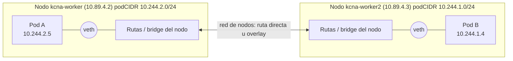
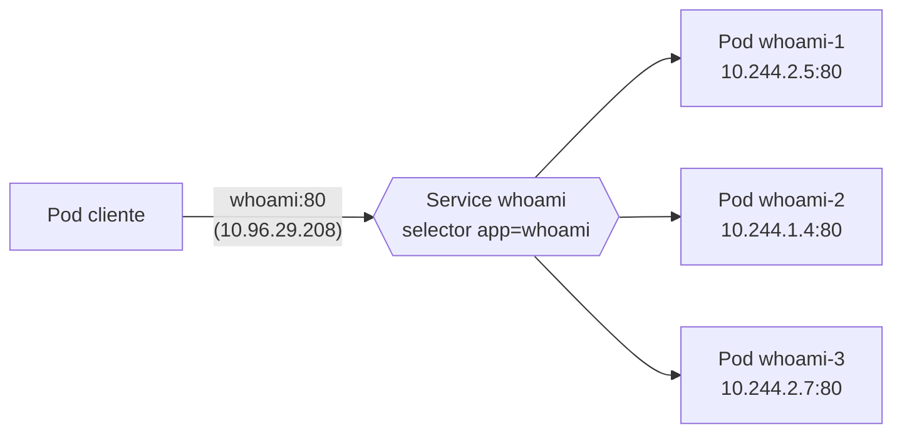
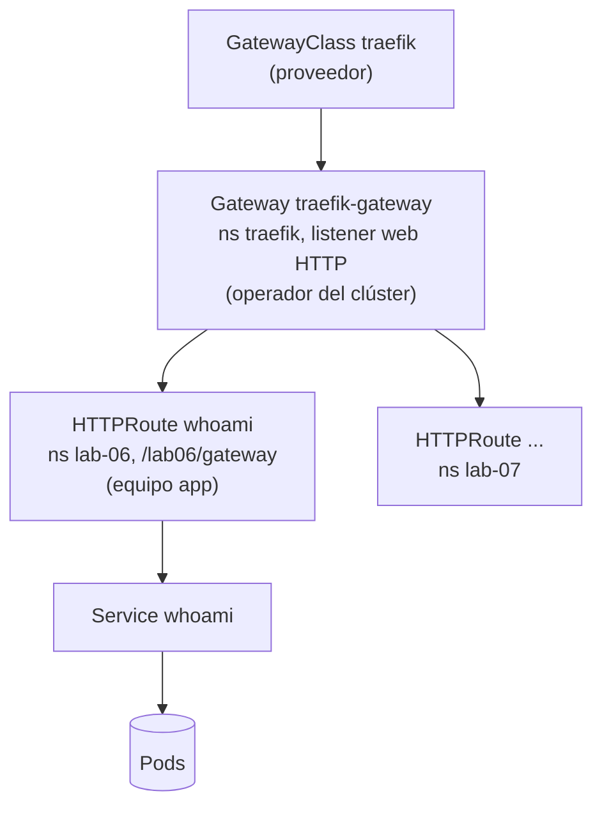
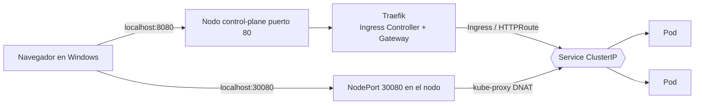

# Módulo 06 — Networking: red de pods, Services, DNS, Ingress y Gateway API

> **Dominio KCNA:** Container Orchestration (28%) → competencia *Networking*
> **Tiempo estimado:** 2 h 30 min (1 h teoría + 1 h 30 min laboratorio)
> **Prerrequisitos:** módulos de fundamentos y workloads (Pods, Deployments, labels/selectors). Clúster `kcna` levantado (`.\kcna.ps1 status`).
> **Lecciones equivalentes en KodeKloud:** "Cluster Networking", "Pod Networking", "CNI in Kubernetes", "DNS in kubernetes", "Ingress", "Kubernetes Services".
> **Verificado:** 2026-10-26 contra la documentación oficial (Kubernetes v1.37). Fuentes al final del módulo.

## Objetivos

Al terminar podrás...

- Explicar el modelo de red de Kubernetes (una IP por pod, sin NAT entre pods) y qué papel juega el **CNI**.
- Distinguir los tipos de Service (**ClusterIP**, **NodePort**, **LoadBalancer**, **ExternalName**, **headless**) y saber cuándo usar cada uno.
- Describir cómo **kube-proxy** (iptables, IPVS, nftables) o un dataplane **eBPF** convierten un Service en tráfico real hacia los pods, y qué son los **EndpointSlices**.
- Resolver nombres con el DNS del clúster (**CoreDNS**) usando el formato `<svc>.<ns>.svc.cluster.local`.
- Exponer HTTP hacia fuera del clúster con **Ingress** y con **Gateway API** (GatewayClass, Gateway, HTTPRoute), y explicar por qué Gateway API es el sucesor.

## Conceptos

### 1. Tres redes distintas en un clúster

Cuando se habla de "la red de Kubernetes" en realidad hay tres planos que conviene no mezclar:

| Plano | Quién asigna las IPs | Ejemplo en nuestro clúster kind |
|---|---|---|
| **Red de nodos** | La infraestructura (VMs, cloud, aquí: Podman) | `10.89.4.2`, `10.89.4.3`, `10.89.4.4` |
| **Red de pods** | El plugin CNI (a partir del `podCIDR` de cada nodo) | `10.244.0.0/24`, `10.244.1.0/24`, `10.244.2.0/24` |
| **Red de Services** | El API server (rango `--service-cluster-ip-range`) | `10.96.0.0/12` (ej. `kube-dns` = `10.96.0.10`) |

Las IPs de Services son **virtuales**: no pertenecen a ninguna interfaz de red, no responden a ping. Existen solo como reglas que programa kube-proxy en cada nodo.

**Networking de nodos (Cluster Networking):** cada nodo necesita al menos una interfaz con conectividad hacia los demás nodos y hacia el plano de control. Algunos puertos que conviene reconocer: API server `6443`, etcd `2379-2380`, kubelet `10250`, rango de NodePort `30000-32767`.

### 2. El modelo de red de Kubernetes

Kubernetes no implementa la red de pods él mismo; define unas **reglas** que cualquier solución debe cumplir:

1. Cada pod tiene **su propia IP** (todos los contenedores de un pod comparten esa IP y se ven entre sí por `localhost`).
2. Un pod puede comunicarse con **cualquier otro pod** del clúster, en cualquier nodo, **sin NAT**: la IP de origen que ve el destino es la IP real del pod.
3. Los agentes del nodo (kubelet, etc.) pueden hablar con todos los pods de ese nodo.

Analogía: el clúster es un edificio de oficinas. Cada pod es una oficina con su extensión telefónica propia (su IP) y puede marcar directamente a cualquier otra extensión del edificio, aunque esté en otra planta (otro nodo), sin pasar por una centralita que cambie el número (sin NAT).

**¿Cómo se consigue? (Pod Networking)** Cada nodo recibe un rango (`podCIDR`). Al crear un pod, el runtime crea un *network namespace* y llama al plugin CNI, que:

- crea un par de interfaces virtuales (**veth pair**): un extremo dentro del pod (`eth0`) y otro en el nodo;
- asigna una IP libre del rango del nodo (**IPAM**);
- configura rutas para que el tráfico hacia pods de otros nodos llegue a su destino, ya sea por **enrutamiento directo** (L3, BGP) o por un **overlay** que encapsula paquetes (VXLAN, Geneve, IP-in-IP).



### 3. CNI: Container Network Interface

**CNI** es una **especificación** de la CNCF (más un conjunto de plugins de referencia) que define cómo un runtime de contenedores pide a un plugin que conecte o desconecte un contenedor de la red. El contrato es sencillo:

- El runtime (containerd, CRI-O) ejecuta un binario del plugin (en `/opt/cni/bin`) pasándole la operación (`ADD`, `DEL`, `CHECK`, `VERSION`; la spec 1.1 añade `STATUS` y `GC`) por variables de entorno y la configuración JSON por stdin.
- La configuración vive en `/etc/cni/net.d/` en cada nodo.
- El plugin devuelve en JSON la IP asignada, rutas, etc.

Gracias a esta interfaz común, Kubernetes puede funcionar con muchos proveedores de red intercambiables:

| Plugin | Idea clave | NetworkPolicy |
|---|---|---|
| **Flannel** | Muy simple, overlay VXLAN. Ideal para aprender o clústeres pequeños | No (por sí solo) |
| **Calico** | Enrutamiento L3 con BGP (o overlay), dataplane iptables o eBPF | Sí, muy completo |
| **Cilium** | Basado en **eBPF**; puede reemplazar a kube-proxy, observabilidad L7 (Hubble), proyecto *graduated* de la CNCF | Sí (incluye L7) |
| **Weave Net** | Overlay en malla; el proyecto ya no se mantiene | Sí |
| **kindnet** | El CNI mínimo de kind (el de este clúster): rutas directas entre nodos (plugin `ptp` + `host-local`) | Sí, desde kind v0.24 (vía kube-network-policies) |

> En el examen: "CNI es una especificación, no un producto". Kubernetes no trae red de pods propia: sin un plugin CNI los nodos aparecen `NotReady` y los pods se quedan en `ContainerCreating`.

**NetworkPolicy** (se ve en el módulo de seguridad) es el firewall de pods de Kubernetes, pero **solo funciona si el CNI la implementa**.

### 4. Services: una dirección estable para un grupo cambiante de pods

Los pods son efímeros: mueren, se reprograman en otro nodo y cambian de IP. Un **Service** da a un conjunto de pods (elegidos por **selector de labels**) una identidad estable: una IP virtual (*ClusterIP*), un nombre DNS y un puerto, y reparte las conexiones entre los pods sanos.



Campos importantes de los puertos: `port` (el del Service, el que usa el cliente), `targetPort` (el del contenedor, número o nombre) y, en NodePort, `nodePort`.

| Tipo | Accesible desde | Cómo funciona | Uso típico |
|---|---|---|---|
| **ClusterIP** (defecto) | Solo dentro del clúster | IP virtual + DNS | Comunicación interna entre microservicios |
| **NodePort** | Fuera: `<IP-de-cualquier-nodo>:<30000-32767>` | ClusterIP + un puerto abierto en **todos** los nodos | Pruebas, entornos sin balanceador |
| **LoadBalancer** | Fuera: IP pública/externa | NodePort + pide un balanceador al proveedor cloud (vía cloud-controller-manager) o a MetalLB/kube-vip on-premises | Exponer un servicio en la nube |
| **ExternalName** | Dentro del clúster | Solo un registro DNS **CNAME** hacia un nombre externo. Sin selector, sin IP, sin proxy | Alias para una base de datos externa |
| **Headless** (`clusterIP: None`) | Dentro del clúster | Sin IP virtual ni balanceo: el DNS devuelve **las IPs de los pods** | StatefulSets, clientes que eligen el pod |

Los tipos se "apilan": un LoadBalancer también tiene NodePort y ClusterIP; un NodePort también tiene ClusterIP.

### 5. Endpoints y EndpointSlices

¿Cómo sabe un Service a qué pods enviar el tráfico? El controlador de EndpointSlices observa los pods que cumplen el selector **y están Ready** (readiness probe superada) y guarda sus IPs en objetos **EndpointSlice** (`discovery.k8s.io/v1`), etiquetados con `kubernetes.io/service-name=<svc>`.

- El objeto antiguo **Endpoints** (una sola lista gigante por Service) escalaba mal: en un Service con miles de pods, cada cambio reescribía y redistribuía el objeto entero a todos los nodos. Está marcado como **obsoleto desde v1.33** (verás un *Warning* al consultarlo).
- Los EndpointSlices dividen la lista en trozos (por defecto hasta 100 endpoints cada uno) e incluyen información extra (zona, nodo, condiciones `ready/serving/terminating`).
- Un pod que no pasa su readiness probe **sale** de los endpoints: así el Service deja de mandarle tráfico sin matarlo.
- Un Service **sin selector** no genera endpoints automáticos (puedes crearlos a mano para apuntar a IPs externas).

### 6. kube-proxy y eBPF: de la IP virtual al pod real

**kube-proxy** corre en cada nodo (normalmente como DaemonSet), observa Services y EndpointSlices y programa el kernel para que el tráfico dirigido a `ClusterIP:port` (o a `nodo:nodePort`) se traduzca (DNAT) a `IPdelPod:targetPort`. No está en la ruta del paquete: solo escribe reglas.

| Modo | Cómo funciona | Notas |
|---|---|---|
| **iptables** | Cadenas de reglas NAT; el backend se elige al azar por conexión | Sigue siendo el modo por defecto en Linux en v1.37 (el de este clúster); una versión futura cambiará el defecto a nftables |
| **IPVS** | Balanceador L4 del kernel con tablas hash y varios algoritmos (rr, lc...) | Escalaba mejor que iptables; **obsoleto desde v1.35** (se desactivará por defecto en v1.40 y se eliminará en v1.43) |
| **nftables** | Sucesor de iptables en el kernel, reglas más eficientes (requiere kernel 5.13+) | GA desde v1.33; sustituto recomendado de iptables e IPVS |
| **kernelspace** | Modo de kube-proxy en nodos **Windows** (reglas en la *Virtual Filtering Platform* del vSwitch de Windows) | Único modo disponible en Windows; los tres anteriores son solo de Linux |
| (sin kube-proxy) **eBPF** | Un CNI como Cilium (o Calico eBPF) carga programas eBPF en el kernel que hacen el balanceo directamente | Menos latencia, mejor visibilidad; reemplaza a kube-proxy |

**eBPF** (*extended Berkeley Packet Filter*) permite ejecutar pequeños programas verificados dentro del kernel Linux sin modificarlo, enganchados a eventos de red, llamadas al sistema, etc. Es la base de Cilium, de herramientas de observabilidad y seguridad (Falco, Pixie, Tetragon) y de algunos service mesh.

Detalle importante: el balanceo de kube-proxy es **por conexión**, no por petición HTTP. Si un cliente reutiliza la conexión TCP (*keep-alive*), todas sus peticiones van al mismo pod. Lo comprobarás en el laboratorio.

### 7. DNS en Kubernetes: CoreDNS

**CoreDNS** (proyecto *graduated* de la CNCF) es el servidor DNS del clúster. Corre como Deployment en `kube-system` detrás de un Service que, por compatibilidad histórica, se llama **`kube-dns`** (aquí `10.96.0.10`). Su configuración es el **Corefile** (ConfigMap `coredns`), donde el plugin `kubernetes` responde por la zona `cluster.local` y `forward` reenvía el resto al DNS del nodo.

Registros que crea:

| Objeto | Nombre DNS | Respuesta |
|---|---|---|
| Service normal | `<svc>.<ns>.svc.cluster.local` | Registro A con la ClusterIP |
| Service headless | `<svc>.<ns>.svc.cluster.local` | Varios registros A: las IPs de los pods |
| Pod de un StatefulSet con headless | `<pod>.<svc>.<ns>.svc.cluster.local` | La IP de ese pod concreto |
| Service ExternalName | `<svc>.<ns>.svc.cluster.local` | CNAME al nombre externo |
| Pod (opcional) | `10-244-2-5.<ns>.pod.cluster.local` | IP del pod con guiones |

El kubelet escribe el `/etc/resolv.conf` de cada pod (política `dnsPolicy: ClusterFirst` por defecto):

```text
search lab-06.svc.cluster.local svc.cluster.local cluster.local
nameserver 10.96.0.10
options ndots:5
```

- `nameserver`: la IP del Service `kube-dns`.
- `search`: por eso desde un pod de `lab-06` basta con escribir `whoami`; desde otro namespace hay que escribir al menos `whoami.lab-06`.
- `ndots:5`: si el nombre tiene menos de 5 puntos, se prueban primero los dominios de `search`.

### 8. Ingress e Ingress Controller

Un Service LoadBalancer por cada aplicación sale caro (una IP/balanceador por app) y no entiende HTTP. **Ingress** es un objeto de la API que describe **reglas HTTP/HTTPS**: "las peticiones a `tienda.ejemplo.com/api` van al Service `api`, puerto 80", con terminación TLS opcional.

- El objeto Ingress por sí solo **no hace nada**. Necesita un **Ingress Controller**: un proxy inverso (Traefik, HAProxy, Contour, NGINX de F5, Kong...) que observa los Ingress y se configura solo. Kubernetes **no trae ninguno** instalado.
- **IngressClass** indica qué controlador atiende cada Ingress (`spec.ingressClassName`); una puede marcarse como predeterminada. En este clúster: `traefik`.
- `pathType`: `Prefix`, `Exact` o `ImplementationSpecific`.
- Limitaciones: solo HTTP/HTTPS, y las funciones avanzadas (reescrituras, cabeceras, pesos) dependen de **anotaciones** propias de cada controlador, nada portables.

> Noticia relevante: el controlador comunitario **ingress-nginx** (el más usado durante años) fue **retirado en marzo de 2026**; ya no recibe versiones ni parches de seguridad. La recomendación oficial es migrar a otro controlador o, mejor, a Gateway API. La API Ingress sigue existiendo y es estable, pero está "congelada": no recibe nuevas funciones.

### 9. Gateway API: el sucesor de Ingress

**Gateway API** (`gateway.networking.k8s.io`, GA desde 2023; este clúster usa la v1.6) es un conjunto de CRDs mantenido por SIG Network que separa responsabilidades por **roles**:

| Recurso | Lo gestiona | Qué define |
|---|---|---|
| **GatewayClass** | Proveedor de infraestructura | Qué controlador implementa los Gateways (ej. `traefik`) — análogo a IngressClass |
| **Gateway** | Operador del clúster | Un punto de entrada concreto: listeners (puerto, protocolo, TLS) y qué namespaces pueden colgar rutas |
| **HTTPRoute** (y GRPCRoute, TLSRoute...) | Equipo de la aplicación | Reglas de enrutamiento hacia Services: paths, cabeceras, métodos, **pesos**, redirecciones, reescrituras |



Por qué reemplaza a Ingress:

- **Expresivo y portable**: división de tráfico por pesos, coincidencia por cabeceras, espejado, timeouts... están en la especificación, no en anotaciones.
- **Orientado a roles**: el operador controla el Gateway y decide desde qué namespaces se le pueden enganchar rutas (`allowedRoutes` en cada listener); los equipos solo crean rutas en su namespace. Si una ruta quiere apuntar a un objeto de **otro** namespace (un Service, un Secret de TLS), el dueño de ese namespace debe permitirlo con un **ReferenceGrant**.
- **Multiprotocolo**: HTTP, gRPC, TLS, TCP/UDP.
- **También para service mesh** (iniciativa GAMMA, módulo 07).

### 10. port-forward: un túnel para depurar

`kubectl port-forward svc/whoami 9006:80` abre un túnel desde tu PC, a través del API server y el kubelet, hasta un pod del Service. Es solo para depuración: no balancea (elige un pod) y muere al cerrar la terminal. No es una forma de exponer aplicaciones.

### Resumen visual: cómo llega una petición desde fuera



## Comandos clave

| Comando | Qué hace |
|---|---|
| `kubectl get pods -o wide` | Muestra la IP de cada pod y su nodo |
| `kubectl get nodes -o custom-columns='NODO:.metadata.name,POD_CIDR:.spec.podCIDR'` | Rango de IPs de pods de cada nodo |
| `kubectl expose deployment web --port=80 --target-port=8080` | Crea un Service ClusterIP para un Deployment |
| `kubectl expose deployment web --type=NodePort --port=80` | Crea un Service NodePort (puerto asignado al azar) |
| `kubectl create service externalname db --external-name=db.ejemplo.com` | Crea un Service ExternalName |
| `kubectl get svc` / `kubectl describe svc web` | Lista Services / muestra selector, IPs y endpoints |
| `kubectl get endpointslices -l kubernetes.io/service-name=web` | EndpointSlices (IPs de pods) detrás de un Service |
| `kubectl exec cliente -- nslookup web.lab-06.svc.cluster.local` | Prueba el DNS desde dentro de un pod |
| `kubectl exec cliente -- cat /etc/resolv.conf` | Muestra la configuración DNS del pod |
| `kubectl create ingress web --rule="/ruta*=web:80"` | Crea un Ingress (el `*` indica `pathType: Prefix`) |
| `kubectl get ingress` / `kubectl get ingressclass` | Lista Ingress / controladores disponibles |
| `kubectl get gatewayclass,gateway -A` / `kubectl get httproute` | Recursos de Gateway API |
| `kubectl port-forward svc/web 9000:80` | Túnel temporal desde tu PC a un Service |
| `kubectl get cm kube-proxy -n kube-system -o yaml` | Configuración de kube-proxy (modo) |

## Laboratorio guiado

Vas a desplegar `traefik/whoami` (un servidor web diminuto que responde con el nombre e IP del pod que atendió la petición), y a alcanzarlo de todas las formas posibles: por ClusterIP y DNS desde dentro, por NodePort, Ingress y HTTPRoute desde Windows.

> Nota: los nodos de nuestro clúster no tienen salida a internet (están detrás del proxy corporativo), por eso `.\kcna.ps1 lab 06` precarga las imágenes (`traefik/whoami:v1.11`, `busybox:1.37`). En un clúster normal no hace falta: el nodo las descarga solo.

### Paso 1 — Preparar el laboratorio

```powershell
.\kcna.ps1 lab 06
. .\kcna-env.ps1
cd labs\06-networking-services
```

```text
  OK  ya cargada: traefik/whoami:v1.11
  OK  ya cargada: busybox:1.37
  OK  Namespace listo: lab-06
```

Qué observar: el namespace `lab-06` existe. En este módulo todos los comandos llevan `-n lab-06` explícito.

### Paso 2 — Mirar la red de nodos y de pods

```powershell
kubectl get nodes -o custom-columns='NODO:.metadata.name,POD_CIDR:.spec.podCIDR,IP:.status.addresses[0].address'
kubectl get pods -n kube-system -o wide | Select-String 'kindnet|kube-proxy|coredns'
kubectl get cm kube-proxy -n kube-system -o jsonpath='{.data.config\.conf}' | Select-String '^mode'
```

```text
NODO                 POD_CIDR        IP
kcna-control-plane   10.244.0.0/24   10.89.4.4
kcna-worker          10.244.2.0/24   10.89.4.2
kcna-worker2         10.244.1.0/24   10.89.4.3

kindnet-59cjz      1/1  Running ... kcna-worker
kube-proxy-mg8bd   1/1  Running ... kcna-worker
coredns-559f6c778d-dg64b 1/1 Running ... kcna-control-plane
...
mode: iptables
```

Qué observar: cada nodo tiene su propio rango `/24` de pods; `kindnet` (el CNI) y `kube-proxy` corren en **todos** los nodos (son DaemonSets); kube-proxy está en modo `iptables`.

Opcional — ver la configuración CNI dentro de un nodo (los nodos de kind son contenedores de Podman):

```powershell
podman exec kcna-worker cat /etc/cni/net.d/10-kindnet.conflist
```

```text
  "name": "kindnet",
  "plugins": [ { "type": "ptp", ... "ipam": { "type": "host-local", ... "subnet": "10.244.2.0/24" ...
```

Qué observar: es justo lo que describe la especificación CNI: un archivo JSON en `/etc/cni/net.d` que nombra plugins (`ptp` crea el veth, `host-local` hace el IPAM).

### Paso 3 — Desplegar whoami (3 réplicas) y su Service ClusterIP

```powershell
kubectl apply -f 01-whoami-deploy.yaml -f 02-svc-clusterip.yaml -f 03-cliente.yaml
kubectl rollout status deploy/whoami -n lab-06
kubectl get pods -n lab-06 -o wide
kubectl get svc -n lab-06
```

```text
NAME                      READY   STATUS    IP           NODE
cliente                   1/1     Running   10.244.2.6   kcna-worker
whoami-6bb7cb8689-6kg4c   1/1     Running   10.244.2.7   kcna-worker
whoami-6bb7cb8689-hr2rj   1/1     Running   10.244.1.4   kcna-worker2
whoami-6bb7cb8689-rlrjv   1/1     Running   10.244.2.5   kcna-worker

NAME     TYPE        CLUSTER-IP     EXTERNAL-IP   PORT(S)   AGE
whoami   ClusterIP   10.96.29.208   <none>        80/TCP    20s
```

Qué observar: las IPs de los pods salen del `podCIDR` del nodo donde corren; la ClusterIP sale de otro rango (`10.96.x.x`).

### Paso 4 — DNS desde dentro de un pod

```powershell
kubectl exec -n lab-06 cliente -- cat /etc/resolv.conf
kubectl exec -n lab-06 cliente -- nslookup whoami.lab-06.svc.cluster.local
```

```text
search lab-06.svc.cluster.local svc.cluster.local cluster.local dns.podman ...
nameserver 10.96.0.10
options ndots:5

Server:    10.96.0.10
Address:   10.96.0.10:53

Name:   whoami.lab-06.svc.cluster.local
Address: 10.96.29.208
```

Qué observar: `nameserver` es la IP del Service `kube-dns` (CoreDNS) y el nombre completo resuelve a la ClusterIP. Al final del `search` aparecen dominios heredados del host (`dns.podman`, el de tu red): kubelet los copia del nodo.

Prueba ahora el nombre corto:

```powershell
kubectl exec -n lab-06 cliente -- nslookup whoami
```

```text
** server can't find whoami.svc.cluster.local: NXDOMAIN
Name:   whoami.lab-06.svc.cluster.local
Address: 10.96.29.208
** server can't find whoami.cluster.local: NXDOMAIN
...
```

Qué observar: el `nslookup` de busybox prueba **todos** los dominios del `search` (efecto de `ndots:5`) y muestra un NXDOMAIN por cada intento fallido, pero el que importa (`whoami.lab-06.svc.cluster.local`) responde. Por eso dentro del mismo namespace basta con `whoami`.

### Paso 5 — Balanceo del Service ClusterIP

```powershell
kubectl exec -n lab-06 cliente -- sh -c 'for i in 1 2 3 4 5 6; do wget -qO- http://whoami | grep Hostname; done'
```

```text
Hostname: whoami-6bb7cb8689-6kg4c
Hostname: whoami-6bb7cb8689-rlrjv
Hostname: whoami-6bb7cb8689-rlrjv
Hostname: whoami-6bb7cb8689-6kg4c
Hostname: whoami-6bb7cb8689-6kg4c
Hostname: whoami-6bb7cb8689-hr2rj
```

Qué observar: cada `wget` abre una conexión nueva y kube-proxy elige un pod **al azar** (no es round-robin estricto). Los nombres que veas serán otros.

### Paso 6 — EndpointSlices y escalado

```powershell
kubectl get endpointslices -n lab-06 -l kubernetes.io/service-name=whoami
kubectl scale deploy whoami -n lab-06 --replicas=5
kubectl rollout status deploy/whoami -n lab-06
kubectl get endpointslices -n lab-06 -l kubernetes.io/service-name=whoami
kubectl get endpoints whoami -n lab-06
```

```text
NAME           ADDRESSTYPE   PORTS   ENDPOINTS                          AGE
whoami-mwpbl   IPv4          80      10.244.2.5,10.244.1.4,10.244.2.7   12m
deployment.apps/whoami scaled
NAME           ADDRESSTYPE   PORTS   ENDPOINTS                                      AGE
whoami-mwpbl   IPv4          80      10.244.2.5,10.244.1.4,10.244.2.7 + 2 more...   13m
Warning: v1 Endpoints is deprecated in v1.33+; use discovery.k8s.io/v1 EndpointSlice
NAME     ENDPOINTS                                                 AGE
whoami   10.244.1.10:80,10.244.1.4:80,10.244.2.16:80 + 2 more...   13m
```

Qué observar: al escalar, el controlador añade las nuevas IPs al EndpointSlice sin que toques el Service. El objeto `Endpoints` antiguo sigue existiendo, pero el API avisa de que está obsoleto. Opcional: mira las reglas que kube-proxy generó en un nodo:

```powershell
podman exec kcna-worker sh -c 'iptables-save -t nat | grep "lab-06/whoami:http" | grep DNAT'
```

```text
-A KUBE-SEP-2MOBOHLTD3VI34EG -p tcp -m comment --comment "lab-06/whoami:http" -m tcp -j DNAT --to-destination 10.244.2.7:80
...
```

Vuelve a 3 réplicas:

```powershell
kubectl scale deploy whoami -n lab-06 --replicas=3
```

### Paso 7 — Services headless y ExternalName

```powershell
kubectl apply -f 07-svc-headless.yaml -f 08-svc-externalname.yaml
kubectl get svc -n lab-06
kubectl exec -n lab-06 cliente -- nslookup whoami-headless.lab-06.svc.cluster.local
kubectl exec -n lab-06 cliente -- nslookup buscador.lab-06.svc.cluster.local
```

```text
NAME              TYPE           CLUSTER-IP     EXTERNAL-IP       PORT(S)
buscador          ExternalName   <none>         www.example.com   <none>
whoami            ClusterIP      10.96.29.208   <none>            80/TCP
whoami-headless   ClusterIP      None           <none>            80/TCP

Name:   whoami-headless.lab-06.svc.cluster.local
Address: 10.244.2.7
Name:   whoami-headless.lab-06.svc.cluster.local
Address: 10.244.1.4
Name:   whoami-headless.lab-06.svc.cluster.local
Address: 10.244.2.5

buscador.lab-06.svc.cluster.local   canonical name = www.example.com
Name:   www.example.com
Address: ...
```

Qué observar: el headless no tiene ClusterIP y su nombre devuelve **las IPs de los pods**; el ExternalName es solo un **CNAME** (CoreDNS reenvía la resolución del nombre externo al DNS del nodo).

### Paso 8 — NodePort 30080 desde Windows

```powershell
kubectl apply -f 04-svc-nodeport.yaml
kubectl get svc whoami-nodeport -n lab-06
1..4 | ForEach-Object { (Invoke-WebRequest http://localhost:30080 -UseBasicParsing).Content -split "`n" | Select-String Hostname }
```

```text
NAME              TYPE       CLUSTER-IP     EXTERNAL-IP   PORT(S)        AGE
whoami-nodeport   NodePort   10.96.65.206   <none>        80:30080/TCP   3s

Hostname: whoami-6bb7cb8689-hr2rj
Hostname: whoami-6bb7cb8689-hr2rj
Hostname: whoami-6bb7cb8689-hr2rj
Hostname: whoami-6bb7cb8689-hr2rj
```

Qué observar: ¡siempre el mismo pod! `Invoke-WebRequest` reutiliza la conexión TCP (*keep-alive*) y kube-proxy balancea **por conexión**. Repite forzando conexiones nuevas:

```powershell
1..4 | ForEach-Object { (Invoke-WebRequest http://localhost:30080 -UseBasicParsing -DisableKeepAlive).Content -split "`n" | Select-String Hostname }
```

```text
Hostname: whoami-6bb7cb8689-hr2rj
Hostname: whoami-6bb7cb8689-hr2rj
Hostname: whoami-6bb7cb8689-6kg4c
Hostname: whoami-6bb7cb8689-rlrjv
```

Qué observar: ahora sí se reparte. (kind mapea el puerto 30080 del nodo control-plane a `localhost:30080`; en un clúster real usarías la IP de cualquier nodo.) También puedes abrir `http://localhost:30080` en el navegador.

### Paso 9 — Ingress por path (Traefik)

```powershell
kubectl get ingressclass
kubectl apply -f 05-ingress.yaml
kubectl get ingress -n lab-06
1..3 | ForEach-Object { (Invoke-WebRequest http://localhost:8080/lab06/ingress -UseBasicParsing).Content -split "`n" | Select-String Hostname }
```

```text
NAME                CONTROLLER                      PARAMETERS   AGE
traefik (default)   traefik.io/ingress-controller   <none>       9m

NAME     CLASS     HOSTS   ADDRESS   PORTS   AGE
whoami   traefik   *                 80      5s

Hostname: whoami-6bb7cb8689-rlrjv
Hostname: whoami-6bb7cb8689-hr2rj
Hostname: whoami-6bb7cb8689-6kg4c
```

Qué observar: aquí el reparto es por **petición** aunque haya keep-alive, porque Traefik es un proxy L7 que abre sus propias conexiones a los pods (usa los EndpointSlices directamente, sin pasar por la ClusterIP). Prueba también `http://localhost:8080/otra-cosa`: Traefik responde `404 page not found` porque ninguna regla coincide (en PowerShell, `Invoke-WebRequest` lo muestra como error `(404) No se encontró`).

### Paso 10 — HTTPRoute con Gateway API

```powershell
kubectl get gatewayclass
kubectl get gateway -n traefik
kubectl apply -f 06-httproute.yaml
kubectl get httproute -n lab-06
kubectl get httproute whoami -n lab-06 -o jsonpath='{range .status.parents[0].conditions[*]}{.type}={.status} {end}'
1..3 | ForEach-Object { (Invoke-WebRequest http://localhost:8080/lab06/gateway -UseBasicParsing).Content -split "`n" | Select-String Hostname }
```

```text
NAME      CONTROLLER                      ACCEPTED   AGE
traefik   traefik.io/gateway-controller   True       43m

NAME              CLASS     ADDRESS   PROGRAMMED   AGE
traefik-gateway   traefik             True         43m

NAME     HOSTNAMES   AGE
whoami               8s

Accepted=True ResolvedRefs=True

Hostname: whoami-6bb7cb8689-rlrjv
Hostname: whoami-6bb7cb8689-hr2rj
Hostname: whoami-6bb7cb8689-6kg4c
```

Qué observar: la ruta vive en **tu** namespace (`lab-06`) pero se engancha (`parentRefs`) a un Gateway de **otro** namespace (`traefik`), que lo permite con `allowedRoutes.namespaces.from: All`. `Accepted=True` significa que el Gateway aceptó la ruta; `ResolvedRefs=True`, que el Service de destino existe.

### Paso 11 — port-forward

```powershell
Start-Process kubectl -ArgumentList 'port-forward','-n','lab-06','svc/whoami','9006:80' -WindowStyle Minimized
Start-Sleep 3   # da tiempo a que el tunel se abra
(Invoke-WebRequest http://localhost:9006 -UseBasicParsing).Content -split "`n" | Select-String Hostname
```

```text
Hostname: whoami-6bb7cb8689-rlrjv
```

Qué observar: el túnel funciona sin Service NodePort ni Ingress. Cierra la ventana minimizada de kubectl para terminarlo (o `Get-Process kubectl | Stop-Process` si no tienes otro kubectl abierto).

## Reto

En el namespace `lab-06`, publica una nueva aplicación "tienda" de tres formas a la vez:

1. Un Deployment **`tienda`** con la imagen `traefik/whoami:v1.11` y **2 réplicas** (label `app=tienda`).
2. Un Service **`tienda`** de tipo ClusterIP que escuche en el puerto **8080** y envíe al puerto 80 de los pods.
3. Un Service headless **`tienda-headless`** que seleccione los mismos pods.
4. Un Ingress que publique la tienda en **`http://localhost:8080/lab06/tienda`** (a través del Service `tienda`).
5. Una HTTPRoute colgada de `traefik-gateway` que la publique en **`http://localhost:8080/lab06/gw-tienda`**.

Comprueba desde la raíz del proyecto:

```powershell
cd ..\..        # si sigues dentro de labs\06-networking-services
.\kcna.ps1 check 06
```

<details><summary>Ver solución</summary>

```powershell
kubectl create deployment tienda --image=traefik/whoami:v1.11 --replicas=2 -n lab-06
kubectl expose deployment tienda --name=tienda --port=8080 --target-port=80 -n lab-06
kubectl expose deployment tienda --name=tienda-headless --cluster-ip=None --port=80 -n lab-06
kubectl create ingress tienda -n lab-06 --rule="/lab06/tienda*=tienda:8080"
```

`kubectl expose` copia el selector del Deployment (`app=tienda`); en `create ingress` el `*` final indica `pathType: Prefix`.

Para la HTTPRoute crea un archivo `reto-httproute.yaml` (en cualquier carpeta):

```yaml
apiVersion: gateway.networking.k8s.io/v1
kind: HTTPRoute
metadata:
  name: tienda
  namespace: lab-06
spec:
  parentRefs:
    - name: traefik-gateway
      namespace: traefik
  rules:
    - matches:
        - path:
            type: PathPrefix
            value: /lab06/gw-tienda
      backendRefs:
        - name: tienda
          port: 8080
```

```powershell
kubectl apply -f reto-httproute.yaml
kubectl rollout status deploy/tienda -n lab-06
.\kcna.ps1 check 06
```

```text
  OK  Deployment 'tienda' en lab-06 con 2 replicas listas
  OK  Service 'tienda' (ClusterIP, puerto 8080 -> 80) con 2 endpoints en su EndpointSlice
  OK  Service headless 'tienda-headless' (clusterIP: None) que selecciona app=tienda
  OK  Ingress: http://localhost:8080/lab06/tienda responde un pod tienda-*
  OK  HTTPRoute (Gateway API): http://localhost:8080/lab06/gw-tienda responde un pod tienda-*

  Lab completado: 5/5
```

</details>

## Preguntas tipo examen

**1. Which statement best describes the Kubernetes networking model?**

- A) Pods on different nodes communicate through NAT performed by kube-proxy
- B) Every Pod gets its own IP address and can reach any other Pod without NAT
- C) Containers in the same Pod each receive a different IP address
- D) Pods can only communicate with Pods on the same node

<details><summary>Respuesta</summary>

**B.** Es la regla base: una IP por pod y comunicación pod a pod sin NAT. Los contenedores del mismo pod comparten IP (C es falsa) y kube-proxy solo traduce el tráfico dirigido a Services, no el tráfico pod a pod.
</details>

**2. What is CNI?**

- A) A Kubernetes controller that assigns ClusterIPs to Services
- B) A specification and set of libraries for configuring network interfaces in Linux containers, implemented by plugins such as Calico or Cilium
- C) The default DNS server in Kubernetes
- D) A command-line tool to debug network policies

<details><summary>Respuesta</summary>

**B.** CNI (Container Network Interface) es una especificación de la CNCF; los plugins (Calico, Cilium, Flannel, kindnet...) la implementan y el runtime los invoca al crear o borrar un pod.
</details>

**3. Which Service type only creates a DNS CNAME record pointing to an external hostname?**

- A) ClusterIP
- B) NodePort
- C) ExternalName
- D) LoadBalancer

<details><summary>Respuesta</summary>

**C.** ExternalName no tiene selector, IP ni proxy: CoreDNS responde con un CNAME hacia `spec.externalName`.
</details>

**4. A developer needs DNS queries for a Service to return the IP addresses of the individual Pods instead of a single virtual IP. What should be configured?**

- A) `type: NodePort`
- B) `clusterIP: None` (headless Service)
- C) `externalTrafficPolicy: Local`
- D) `sessionAffinity: ClientIP`

<details><summary>Respuesta</summary>

**B.** Un Service headless no recibe ClusterIP y su registro DNS devuelve directamente las IPs de los pods Ready. Es lo que usan los StatefulSets para dar nombre estable a cada pod.
</details>

**5. What is the fully qualified domain name of a Service named `api` in the namespace `shop`, using the default cluster domain?**

- A) `api.shop.cluster.local`
- B) `shop.api.svc.cluster.local`
- C) `api.shop.svc.cluster.local`
- D) `api.svc.shop.cluster.local`

<details><summary>Respuesta</summary>

**C.** Formato `<servicio>.<namespace>.svc.<dominio-del-cluster>`; el dominio por defecto es `cluster.local`.
</details>

**6. Which component watches Services and EndpointSlices and programs iptables, IPVS or nftables rules on every node?**

- A) kubelet
- B) kube-proxy
- C) CoreDNS
- D) kube-controller-manager

<details><summary>Respuesta</summary>

**B.** kube-proxy corre en cada nodo y traduce las ClusterIP/NodePort a IPs de pods. El controller-manager crea los EndpointSlices, pero no programa el kernel de los nodos.
</details>

**7. Why were EndpointSlices introduced to replace the original Endpoints API?**

- A) To provide TLS termination for Services
- B) To allow Services to select Pods across clusters
- C) To improve scalability by splitting endpoints of large Services into multiple smaller objects
- D) To replace kube-proxy

<details><summary>Respuesta</summary>

**C.** Un único objeto Endpoints con miles de IPs se reescribía y redistribuía completo en cada cambio. Los EndpointSlices dividen la lista (hasta 100 por defecto) y añaden información como zona y estado.
</details>

**8. You created an Ingress resource, but no traffic is being routed. The cluster has no other networking add-ons installed. What is the most likely cause?**

- A) The Service type must be LoadBalancer
- B) No Ingress controller is running in the cluster
- C) Ingress requires a headless Service
- D) CoreDNS is not configured for Ingress

<details><summary>Respuesta</summary>

**B.** El objeto Ingress solo describe reglas; necesita un Ingress Controller (Traefik, HAProxy, Contour...) que las aplique. Kubernetes no instala ninguno por defecto.
</details>

**9. In Gateway API, which resource is typically managed by application developers to define routing rules to their Services?**

- A) GatewayClass
- B) Gateway
- C) HTTPRoute
- D) IngressClass

<details><summary>Respuesta</summary>

**C.** GatewayClass es del proveedor de infraestructura, Gateway del operador del clúster y las rutas (HTTPRoute, GRPCRoute...) de los equipos de aplicación. Este modelo por roles es una de las ventajas frente a Ingress.
</details>

**10. Which technology allows projects like Cilium to replace kube-proxy by running sandboxed programs inside the Linux kernel?**

- A) iptables
- B) eBPF
- C) VXLAN
- D) IPVS

<details><summary>Respuesta</summary>

**B.** eBPF permite cargar programas verificados en el kernel enganchados a eventos de red; Cilium lo usa para balancear Services sin kube-proxy y para observabilidad.
</details>

**11. Which DNS server is the default in Kubernetes clusters and is a CNCF graduated project?**

- A) BIND
- B) kube-dns
- C) CoreDNS
- D) dnsmasq

<details><summary>Respuesta</summary>

**C.** CoreDNS es el DNS por defecto desde v1.13. Ojo con la trampa: el **Service** que lo expone se sigue llamando `kube-dns` por compatibilidad, pero el software es CoreDNS.
</details>

## Resumen para repasar

- Modelo de red: **una IP por pod**, pod a pod **sin NAT**, contenedores del mismo pod comparten IP (`localhost`).
- **CNI** = especificación; plugins: Flannel (simple, sin NetworkPolicy), Calico (BGP, políticas), Cilium (eBPF), kindnet (kind). Sin CNI → nodos `NotReady`.
- Service = IP virtual + DNS + balanceo por **selector de labels**. Tipos: ClusterIP (defecto, interno), NodePort (30000-32767 en todos los nodos), LoadBalancer (balanceador externo del cloud), ExternalName (CNAME), headless (`clusterIP: None`, DNS devuelve IPs de pods).
- **EndpointSlices** guardan las IPs de los pods Ready; sustituyen a Endpoints (obsoleto desde v1.33).
- **kube-proxy** programa iptables (defecto) / IPVS (obsoleto desde v1.35) / nftables (GA v1.33) en cada nodo; **eBPF** (Cilium) puede reemplazarlo. Balancea por conexión.
- **CoreDNS** (Service `kube-dns`): `<svc>.<ns>.svc.cluster.local`; `resolv.conf` con `search` y `ndots:5`.
- **Ingress** necesita un **Ingress Controller**; solo HTTP/HTTPS; extras por anotaciones. ingress-nginx retirado en marzo de 2026.
- **Gateway API** (GatewayClass → Gateway → HTTPRoute): por roles, portable, pesos/cabeceras en la spec, multiprotocolo; sucesor de Ingress.
- `kubectl port-forward` = túnel de depuración, no exposición.

## Limpieza

```powershell
.\kcna.ps1 reset 06
```

## Fuentes oficiales

- [Services, Load Balancing, and Networking — kubernetes.io](https://kubernetes.io/docs/concepts/services-networking/): modelo de red (IP propia por pod, pod a pod sin NAT, agentes del nodo, `localhost` dentro del pod).
- [Cluster Networking — kubernetes.io](https://kubernetes.io/docs/concepts/cluster-administration/networking/): el plugin de red asigna IPs a los pods y el API server a los Services; uso de CNI por los runtimes.
- [CNI Specification — github.com/containernetworking](https://github.com/containernetworking/cni/blob/main/SPEC.md): operaciones ADD/DEL/CHECK/STATUS/VERSION/GC, variables de entorno, configuración por stdin, versión 1.1.0.
- [Service — kubernetes.io](https://kubernetes.io/docs/concepts/services-networking/service/): tipos de Service, rango NodePort 30000-32767, ExternalName como CNAME, headless, Endpoints obsoleto desde v1.33.
- [EndpointSlices — kubernetes.io](https://kubernetes.io/docs/concepts/services-networking/endpoint-slices/): 100 endpoints por slice por defecto, label `kubernetes.io/service-name`, condiciones ready/serving/terminating.
- [Virtual IPs and Service Proxies — kubernetes.io](https://kubernetes.io/docs/reference/networking/virtual-ips/): modos de kube-proxy, iptables por defecto en v1.37, backend aleatorio, IPVS obsoleto desde v1.35, nftables (kernel 5.13+), `kernelspace` en Windows.
- [Kubernetes v1.33: Octarine — kubernetes.io/blog](https://kubernetes.io/blog/2025/04/23/kubernetes-v1-33-release/): nftables de kube-proxy pasa a estable.
- [DNS for Services and Pods — kubernetes.io](https://kubernetes.io/docs/concepts/services-networking/dns-pod-service/): formato `<svc>.<ns>.svc.cluster.local`, headless, registros de pods, `resolv.conf` con `search` y `ndots:5`.
- [CoreDNS GA for Kubernetes Cluster DNS — kubernetes.io/blog](https://kubernetes.io/blog/2018/07/10/coredns-ga-for-kubernetes-cluster-dns/): CoreDNS GA en v1.11 (por defecto desde v1.13).
- [CNCF Projects — cncf.io](https://www.cncf.io/projects/): CoreDNS y Cilium son proyectos graduados.
- [Ingress — kubernetes.io](https://kubernetes.io/docs/concepts/services-networking/ingress/): necesita un Ingress controller, API congelada, recomendación de usar Gateway API.
- [Ingress NGINX Retirement: What You Need to Know — kubernetes.io/blog](https://kubernetes.io/blog/2025/11/11/ingress-nginx-retirement/): mantenimiento hasta marzo de 2026 y después sin versiones ni parches de seguridad.
- [Gateway API — kubernetes.io](https://kubernetes.io/docs/concepts/services-networking/gateway/): GatewayClass, Gateway, HTTPRoute, GRPCRoute; roles proveedor / operador / desarrollador; add-on de CRDs.
- [Gateway API v1.0: GA Release — kubernetes.io/blog](https://kubernetes.io/blog/2023/10/31/gateway-api-ga/): GA en octubre de 2023.
- [ReferenceGrant — gateway-api.sigs.k8s.io](https://gateway-api.sigs.k8s.io/reference/api-types/referencegrant/): referencias entre namespaces; el enganche ruta → Gateway se controla en el propio Gateway.
