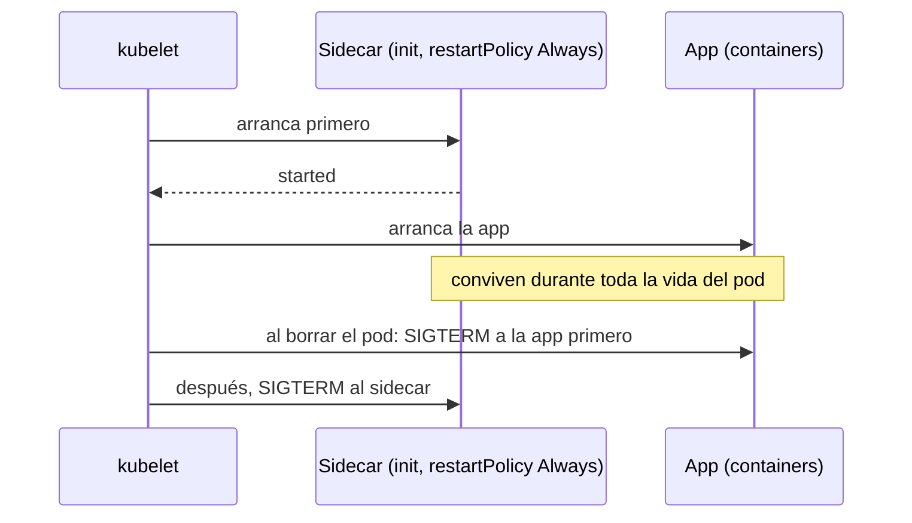
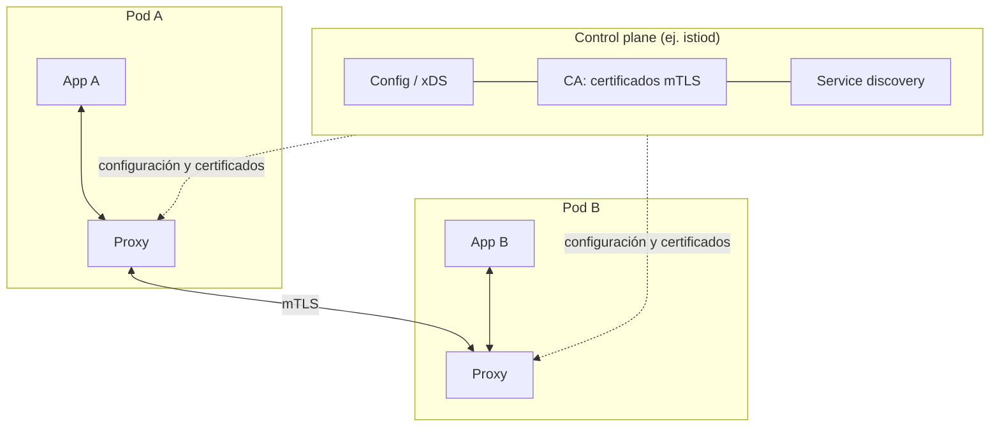
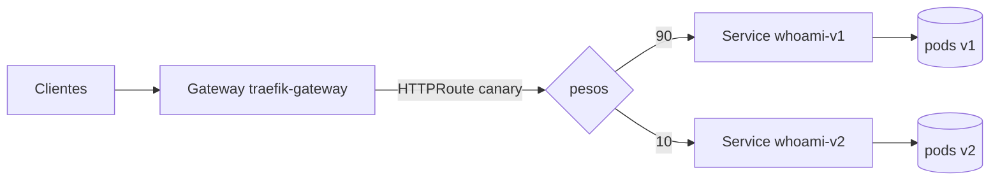

# Módulo 07 — Microservicios, sidecars y Service Mesh

> **Dominios KCNA:** Container Orchestration (28%) → *Networking* (service mesh) · Cloud Native Architecture (12%) → *Cloud Native Ecosystem and Principles*
> **Tiempo estimado:** 2 h (1 h teoría + 1 h laboratorio; la sección opcional de Istio suma 45 min)
> **Prerrequisitos:** módulo 06 (Services, Ingress, Gateway API). Clúster `kcna` levantado.
> **Lecciones equivalentes en KodeKloud:** "Sidecars", "Envoy", "Monoliths amp Microservices", "Service Mesh", "Istio", "Installing Istio", "Deploying our First Application on Istio".

## Objetivos

Al terminar podrás...

- Comparar arquitecturas monolíticas y de microservicios, con sus ventajas y sus costes.
- Explicar el patrón **sidecar** y crear un **native sidecar container** (initContainer con `restartPolicy: Always`).
- Describir qué es **Envoy** y sus conceptos básicos (listeners, routes, clusters, xDS).
- Explicar qué problemas resuelve un **service mesh** (mTLS, observabilidad, gestión de tráfico) y la diferencia entre **data plane** y **control plane**.
- Reconocer **Istio** (istiod, modo sidecar y modo **ambient** con ztunnel/waypoint), **Linkerd** y la evolución **SMI → GAMMA**.
- Hacer un despliegue **canary por pesos** con una HTTPRoute de Gateway API.

## Conceptos

### 1. Monolitos y microservicios

Un **monolito** es una aplicación desplegada como una sola unidad: interfaz, lógica de negocio y acceso a datos en el mismo proceso y el mismo artefacto. Una arquitectura de **microservicios** divide la aplicación en servicios pequeños, cada uno con una responsabilidad de negocio, su propio ciclo de despliegue y, idealmente, sus propios datos, que se comunican por la red (HTTP/REST, gRPC, mensajería).

Analogía: un monolito es un restaurante con un solo cocinero que lo hace todo; si quieres servir el doble de postres, tienes que contratar otro cocinero completo. Con microservicios hay una estación de entrantes, otra de parrilla y otra de postres: puedes añadir pasteleros sin tocar la parrilla, pero ahora necesitas camareros que lleven comandas entre estaciones y alguien que sepa dónde se perdió un pedido.

| Aspecto | Monolito | Microservicios |
|---|---|---|
| Despliegue | Todo junto; un cambio pequeño redespliega todo | Cada servicio por separado, con más frecuencia |
| Escalado | Toda la aplicación a la vez | Solo el servicio que lo necesita |
| Tecnología | Un lenguaje/stack | Cada equipo elige (políglota) |
| Fallos | Un fallo puede tumbar todo | Aislamiento, pero aparecen fallos parciales de red |
| Complejidad | En el código | En la **red y la operación**: descubrimiento, latencia, seguridad entre servicios, trazas distribuidas |
| Equipos | Coordinación fuerte | Equipos autónomos por servicio |

Kubernetes encaja con los microservicios (un Deployment + Service por microservicio), pero la complejidad de red que aparece es justo el problema que intenta resolver un service mesh.

### 2. El patrón sidecar

Un pod puede tener varios contenedores que comparten red (`localhost`) y volúmenes. El patrón **sidecar** añade junto al contenedor principal un contenedor auxiliar que **amplía** su funcionalidad sin modificar su código: enviar logs, refrescar certificados, sincronizar archivos de Git, o actuar como **proxy** de red (el caso del service mesh).

Otros patrones multicontenedor que conviene reconocer: **ambassador** (un proxy que representa a un servicio externo ante la app) y **adapter** (transforma la salida de la app a un formato estándar, por ejemplo métricas).

**Sidecar "clásico" vs. native sidecar.** Durante años un sidecar era simplemente otro contenedor en `containers`. Problemas: no había garantía de que arrancara antes que la app (la app podía intentar usar el proxy antes de que existiera), y en un Job el sidecar nunca terminaba, así que el Job no se completaba. Los **native sidecar containers** (KEP-753, GA en Kubernetes **v1.33**) lo resuelven así:

```yaml
initContainers:
  - name: log-tail
    image: busybox:1.37
    restartPolicy: Always   # <- init container que NO termina: es un sidecar
```

- Se declaran en `initContainers` con `restartPolicy: Always`.
- Arrancan **antes** que los contenedores de la app (en orden) y, a diferencia de un init normal, no bloquean: en cuanto están *started* (o pasan su startupProbe) arranca el siguiente.
- Siguen corriendo toda la vida del pod y se reinician si fallan.
- Al terminar el pod se detienen **después** de la app; en un Job no impiden que se complete.
- Pueden tener probes; su estado aparece en `status.initContainerStatuses`, y cuentan en la columna READY (`2/2`).



### 3. Envoy

**Envoy** es un proxy L4/L7 de alto rendimiento escrito en C++, creado en Lyft y proyecto *graduated* de la CNCF. Es el data plane de Istio (modo sidecar y waypoints) y de muchos API gateways e Ingress/Gateway controllers (Contour, Envoy Gateway, Emissary).

Conceptos a nivel KCNA:

| Concepto | Qué es |
|---|---|
| **Listener** | Dirección y puerto donde Envoy acepta conexiones (ej. `0.0.0.0:15001`) |
| **Filter chain / filtros** | Cadena de procesamiento de cada conexión o petición (HTTP connection manager, router, autorización, rate limit...) |
| **Route** | Reglas L7 que deciden a qué cluster va cada petición (por host, path, cabecera, pesos) |
| **Cluster** | Grupo lógico de destinos equivalentes (≈ un Service), con su política de balanceo, timeouts, circuit breaker |
| **Endpoint** | Cada instancia real (IP:puerto) dentro de un cluster |
| **xDS** | Familia de APIs (LDS, RDS, CDS, EDS, SDS) por las que un **control plane** envía configuración dinámica a Envoy sin reiniciarlo |

Petición → listener → filtros → route → cluster → endpoint. Envoy además emite métricas, logs de acceso y trazas de cada petición: de ahí sale gran parte de la observabilidad de un mesh.

### 4. ¿Qué es un service mesh?

Un **service mesh** es una capa de infraestructura dedicada a la comunicación **servicio a servicio** (tráfico "este-oeste"), que la hace segura, observable y controlable **sin cambiar el código** de las aplicaciones. Lo consigue interceptando todo el tráfico con proxies.

Qué resuelve:

| Área | Funciones |
|---|---|
| **Seguridad** | **mTLS** automático entre servicios (cifrado + identidad de ambos extremos), rotación de certificados, políticas de autorización ("solo `frontend` puede llamar a `pagos`"), base de *zero trust* |
| **Observabilidad** | Métricas "doradas" por servicio (latencia, tráfico, errores, saturación), logs de acceso, **trazas distribuidas**, mapas de dependencias (Kiali) |
| **Gestión de tráfico** | **Reintentos** (*retries*), **timeouts**, **circuit breaking** (dejar de enviar a un destino que falla), división por **pesos** (canary, blue-green), enrutamiento por cabecera, *fault injection*, espejado de tráfico |

Arquitectura en dos planos:

- **Data plane**: los proxies que tocan cada paquete/petición (Envoy como sidecar, ztunnel, linkerd2-proxy...).
- **Control plane**: el cerebro que **no** está en la ruta del tráfico: distribuye configuración a los proxies (xDS), emite certificados (CA) y descubre servicios observando la API de Kubernetes.



¿Por qué no hacerlo en cada aplicación? Se podía (librerías como Netflix Hystrix/Ribbon), pero había que reimplementarlo en cada lenguaje y redesplegar todas las apps para cambiar una política. El mesh lo saca a la infraestructura.

Coste: más componentes que operar, más latencia por salto (dos proxies por llamada en modo sidecar) y más consumo de CPU/RAM. Por eso surgieron los modelos **sin sidecar**.

### 5. Istio

**Istio** (proyecto *graduated* de la CNCF) es el service mesh más extendido.

- **istiod**: su control plane en un único binario (antes eran Pilot, Citadel y Galley por separado): traduce la configuración a xDS para los proxies, actúa como CA que emite los certificados mTLS e inyecta los sidecars.
- **Modo sidecar** (clásico): un Envoy (`istio-proxy`) en cada pod, inyectado automáticamente por un *mutating admission webhook* cuando el namespace tiene la label `istio-injection=enabled`. Las reglas iptables del pod (puestas por un init container o por el plugin CNI de Istio) redirigen todo el tráfico de la app a través de Envoy.
- **Modo ambient** (GA desde Istio 1.24): sin sidecars.
  - **ztunnel**: un proxy por **nodo** (DaemonSet, escrito en Rust) que da mTLS, identidad y telemetría **L4** a todos los pods del nodo.
  - **waypoint proxy**: un Envoy opcional (por namespace o por servicio) que se despliega solo cuando necesitas funciones **L7** (reintentos, pesos por cabecera, autorización HTTP).
  - Se activa con la label `istio.io/dataplane-mode=ambient` en el namespace. Ventajas: menos RAM, no hay que reiniciar pods para entrar o salir del mesh.
- Recursos propios (CRDs): `VirtualService` y `DestinationRule` (tráfico), `PeerAuthentication` (mTLS), `AuthorizationPolicy` (autorización), `Gateway` de Istio. Hoy Istio también entiende **Gateway API** (HTTPRoute) como forma recomendada de configurar el tráfico.
- Herramientas: `istioctl` (instalar, `istioctl analyze` para validar), addons de observabilidad: Kiali, Prometheus, Grafana, Jaeger.

### 6. Linkerd y otros

| Mesh | Rasgos |
|---|---|
| **Istio** | El más completo; Envoy; modos sidecar y ambient; CNCF *graduated* |
| **Linkerd** | El primer "service mesh"; foco en simplicidad y ligereza; proxy propio **linkerd2-proxy** escrito en **Rust** (no Envoy); mTLS por defecto; CNCF *graduated* |
| **Cilium Service Mesh** | Basado en eBPF; mucho trabajo sin sidecar (L4 en el kernel, Envoy por nodo para L7) |
| **Consul (HashiCorp)**, **Kuma / Kong Mesh** | Envoy como data plane; también fuera de Kubernetes (VMs) |

### 7. SMI → GAMMA: estándares para mesh

- **SMI** (*Service Mesh Interface*) fue un intento de la CNCF de definir CRDs comunes para todos los mesh (tráfico, métricas, acceso). Se **archivó en 2023**.
- Su sucesor es **GAMMA** (*Gateway API for Mesh Management and Administration*), una iniciativa dentro de Gateway API: usa los mismos recursos (`HTTPRoute`, `GRPCRoute`) pero con `parentRefs` apuntando a un **Service** en lugar de a un Gateway, para configurar el tráfico este-oeste. Así el mismo idioma sirve para la entrada al clúster ("norte-sur") y para el tráfico interno. Istio, Linkerd, Cilium y Kuma lo implementan.

```yaml
# Ejemplo GAMMA (conceptual): la ruta se cuelga de un Service, no de un Gateway
parentRefs:
  - group: ""
    kind: Service
    name: pagos
```

### 8. Canary con Gateway API (lo que harás en el lab)

Un **despliegue canary** expone una versión nueva a un porcentaje pequeño del tráfico, observa errores y latencia, y va subiendo el porcentaje (10% → 50% → 100%) o hace rollback. Gateway API lo expresa con `weight` en los `backendRefs`, sin depender de anotaciones ni de un mesh:



Un Deployment de Kubernetes, por sí solo, solo consigue un canary aproximado a base de número de réplicas (9 pods v1 + 1 pod v2 detrás del mismo Service); con pesos en la ruta el porcentaje es independiente del número de pods.

## Comandos clave

| Comando | Qué hace |
|---|---|
| `kubectl get pod web -o jsonpath='{.spec.initContainers[*].restartPolicy}'` | Comprueba si un init container es sidecar nativo (`Always`) |
| `kubectl logs web -c log-tail` | Logs de un contenedor concreto (incluido un sidecar) |
| `kubectl exec web -c log-tail -- wget -qO- http://localhost` | Ejecuta un comando en un contenedor concreto del pod |
| `kubectl get events --field-selector involvedObject.name=web` | Eventos de un pod (orden de arranque de contenedores) |
| `kubectl get httproute` / `kubectl describe httproute canary` | Rutas de Gateway API y sus `backendRefs` con pesos |
| `kubectl label ns demo istio-injection=enabled` | (Istio) Activa la inyección automática de sidecars |
| `kubectl label ns demo istio.io/dataplane-mode=ambient` | (Istio) Mete un namespace en el mesh en modo ambient |
| `istioctl install --set profile=demo` / `istioctl analyze` | (Istio) Instala el mesh / valida la configuración |

## Laboratorio guiado

Laboratorio **ligero**: no instalaremos ningún service mesh (consumen mucha RAM). Practicarás las dos piezas que están debajo de cualquier mesh: el patrón sidecar y la división de tráfico por pesos.

> Nota: los nodos de nuestro clúster no tienen salida a internet (están detrás del proxy corporativo), por eso `.\kcna.ps1 lab 07` precarga las imágenes (`nginx:1.27-alpine`, `busybox:1.37`, `traefik/whoami:v1.11`). En un clúster normal no hace falta.

### Paso 1 — Preparar el laboratorio

```powershell
.\kcna.ps1 lab 07
. .\kcna-env.ps1
cd labs\07-service-mesh-microservicios
```

```text
  OK  ya cargada: nginx:1.27-alpine
  OK  ya cargada: busybox:1.37
  OK  ya cargada: traefik/whoami:v1.11
  OK  Namespace listo: lab-07
```

Qué observar: todos los comandos de este módulo usan `-n lab-07`.

### Paso 2 — Un pod con native sidecar

Abre `01-native-sidecar.yaml`: nginx escribe sus logs en un volumen `emptyDir` montado en `/var/log/nginx`; el sidecar `log-tail` (un init container con `restartPolicy: Always`) monta el mismo volumen en solo lectura y hace `tail -F` del log de accesos.

```powershell
kubectl apply -f 01-native-sidecar.yaml
kubectl wait --for=condition=Ready pod/web-con-sidecar -n lab-07 --timeout=90s
kubectl get pod web-con-sidecar -n lab-07
kubectl get pod web-con-sidecar -n lab-07 -o jsonpath='{.spec.initContainers[0].name} restartPolicy={.spec.initContainers[0].restartPolicy}'
```

```text
NAME              READY   STATUS    RESTARTS   AGE
web-con-sidecar   2/2     Running   0          11s
log-tail restartPolicy=Always
```

Qué observar: el pod muestra `2/2` aunque solo hay un contenedor en `containers`: el sidecar nativo cuenta como contenedor en ejecución. Un init container normal habría terminado y el pod mostraría `1/1`.

### Paso 3 — Orden de arranque

```powershell
kubectl get events -n lab-07 --field-selector involvedObject.name=web-con-sidecar --sort-by=.metadata.creationTimestamp -o custom-columns='RAZON:.reason,MENSAJE:.message'
```

```text
RAZON       MENSAJE
Scheduled   Successfully assigned lab-07/web-con-sidecar to kcna-worker2
Pulled      Container image "busybox:1.37" already present on machine ...
Created     Container created
Started     Container started
Pulled      Container image "nginx:1.27-alpine" already present on machine ...
Created     Container created
Started     Container started
```

Qué observar: primero se arranca la imagen `busybox` (el sidecar) y solo después `nginx`. Esa garantía de orden es la que necesita, por ejemplo, un proxy de mesh.

### Paso 4 — El sidecar lee los logs de la app

Genera tráfico desde dentro del pod (el sidecar comparte red con nginx, así que `localhost` es nginx):

```powershell
kubectl exec -n lab-07 web-con-sidecar -c log-tail -- sh -c 'for i in 1 2 3; do wget -qO- http://localhost/ > /dev/null; done; wget -qO- http://localhost/no-existe'
kubectl logs -n lab-07 web-con-sidecar -c log-tail
```

```text
wget: server returned error: HTTP/1.1 404 Not Found
command terminated with exit code 1

sidecar listo, esperando logs...
tail: can't open '/logs/access.log': No such file or directory
tail: /logs/access.log has appeared; following end of new file
127.0.0.1 - - [23/Oct/2026:16:08:10 +0000] "GET / HTTP/1.1" 200 615 "-" "Wget" "-"
127.0.0.1 - - [23/Oct/2026:16:08:10 +0000] "GET / HTTP/1.1" 200 615 "-" "Wget" "-"
127.0.0.1 - - [23/Oct/2026:16:08:10 +0000] "GET / HTTP/1.1" 200 615 "-" "Wget" "-"
127.0.0.1 - - [23/Oct/2026:16:08:10 +0000] "GET /no-existe HTTP/1.1" 404 153 "-" "Wget" "-"
```

Qué observar: el sidecar arrancó antes de que existiera el archivo (de ahí el "can't open") y lo empezó a seguir en cuanto nginx lo creó. Nginx no sabe nada del sidecar: es el patrón en estado puro, ampliar sin modificar la app. Compara con `kubectl logs -n lab-07 web-con-sidecar -c nginx`: ahí no aparecen los accesos, porque ahora van al volumen.

### Paso 5 — Dos versiones de un microservicio

```powershell
kubectl apply -f 02-whoami-v1-v2.yaml
kubectl rollout status deploy/whoami-v1 -n lab-07
kubectl rollout status deploy/whoami-v2 -n lab-07
kubectl get deploy,svc -n lab-07
```

```text
NAME                        READY   UP-TO-DATE   AVAILABLE
deployment.apps/whoami-v1   2/2     2            2
deployment.apps/whoami-v2   1/1     1            1

NAME                TYPE        CLUSTER-IP     PORT(S)
service/whoami-v1   ClusterIP   10.96.x.x      80/TCP
service/whoami-v2   ClusterIP   10.96.x.x      80/TCP
```

Qué observar: v1 tiene 2 réplicas y v2 solo 1. Cada versión tiene su propio Service; la variable `WHOAMI_NAME` hace que cada una se identifique (`Name: v1` / `Name: v2`).

### Paso 6 — Canary 90/10 con HTTPRoute

```powershell
kubectl apply -f 03-httproute-canary.yaml
kubectl get httproute canary -n lab-07 -o jsonpath='{range .spec.rules[0].backendRefs[*]}{.name}={.weight} {end}'
(Invoke-WebRequest http://localhost:8080/lab07/canary -UseBasicParsing).Content
```

```text
whoami-v1=90 whoami-v2=10

Name: v1
Hostname: whoami-v1-6c8df6cbf6-fgnhn
IP: 10.244.2.66
RemoteAddr: 10.244.0.6:35468
GET /lab07/canary HTTP/1.1
Host: localhost:8080
X-Forwarded-For: 10.89.4.1
X-Forwarded-Server: traefik-67dd9f645-bj282
...
```

Qué observar: la petición pasó por Traefik (cabeceras `X-Forwarded-*`). Ahora manda 20 peticiones y cuenta qué versión respondió (cada petición puede tardar hasta un segundo o dos, porque cruza el reenvío de puertos de Podman en Windows):

```powershell
$r = 1..20 | ForEach-Object { ((Invoke-WebRequest http://localhost:8080/lab07/canary -UseBasicParsing).Content -split "`n" | Select-String '^Name:').ToString().Trim() }
$r | Group-Object | Select-Object Name, Count
```

```text
Name     Count
----     -----
Name: v1    18
Name: v2     2
```

Si tienes paciencia, repite con `1..100`: saldrá `90` / `10`.

Qué observar: el reparto sigue los **pesos** de la ruta, no el número de pods (v1 tiene el doble de pods, pero recibe 9 veces más tráfico). Traefik usa *weighted round robin*, por eso sale exacto; otros controladores eligen al azar y verás números cercanos (88/12, 91/9...).

### Paso 7 — Subir el canary al 50%

`04-httproute-canary-50-50.yaml` es la misma ruta (`canary`) con pesos 50/50: `kubectl apply` la actualiza en caliente.

```powershell
kubectl apply -f 04-httproute-canary-50-50.yaml
$r = 1..20 | ForEach-Object { ((Invoke-WebRequest http://localhost:8080/lab07/canary -UseBasicParsing).Content -split "`n" | Select-String '^Name:').ToString().Trim() }
$r | Group-Object | Select-Object Name, Count
```

```text
httproute.gateway.networking.k8s.io/canary configured

Name     Count
----     -----
Name: v1    10
Name: v2    10
```

Qué observar: no se reinició ningún pod; solo cambió la configuración del proxy. Así trabaja un mesh o un gateway: el control plane reprograma el data plane. Para terminar el rollout pondrías `weight: 0` en v1 (o lo quitarías) y luego borrarías el Deployment viejo; para un rollback, al revés.

## Reto

En `lab-07` (con `whoami-v1` y `whoami-v2` del laboratorio desplegados):

1. Crea un pod **`reto-sidecar`** con:
   - un contenedor principal **`app`** (`busybox:1.37`) que cada 3 segundos añada la línea `<fecha> pedido procesado` a `/datos/app.log`;
   - un **sidecar nativo** llamado **`shipper`** (`busybox:1.37`) que haga `tail -F /datos/app.log`;
   - ambos comparten un volumen `emptyDir`.
2. Crea una HTTPRoute **`reto-canary`**, colgada de `traefik-gateway`, para el path **`/lab07/reto`** que:
   - envíe **siempre a v2** las peticiones que lleven la cabecera **`x-version: v2`** (para que el equipo de QA pruebe la versión nueva);
   - reparta el resto **80/20** entre `whoami-v1` y `whoami-v2`.

Pistas: en Gateway API una regla puede combinar `path` y `headers` dentro del mismo `matches`; cuando dos reglas coinciden, gana la más específica. En PowerShell: `Invoke-WebRequest <url> -Headers @{ 'x-version' = 'v2' } -UseBasicParsing`.

```powershell
cd ..\..        # si sigues dentro de labs\07-service-mesh-microservicios
.\kcna.ps1 check 07
```

<details><summary>Ver solución</summary>

`reto-sidecar.yaml`:

```yaml
apiVersion: v1
kind: Pod
metadata:
  name: reto-sidecar
  namespace: lab-07
spec:
  terminationGracePeriodSeconds: 5
  volumes:
    - name: datos
      emptyDir: {}
  initContainers:
    - name: shipper
      image: busybox:1.37
      restartPolicy: Always
      command: ["sh", "-c", "tail -F /datos/app.log"]
      volumeMounts:
        - name: datos
          mountPath: /datos
  containers:
    - name: app
      image: busybox:1.37
      command: ["sh", "-c", "while true; do echo \"$(date) pedido procesado\" >> /datos/app.log; sleep 3; done"]
      volumeMounts:
        - name: datos
          mountPath: /datos
```

`reto-httproute.yaml`:

```yaml
apiVersion: gateway.networking.k8s.io/v1
kind: HTTPRoute
metadata:
  name: reto-canary
  namespace: lab-07
spec:
  parentRefs:
    - name: traefik-gateway
      namespace: traefik
  rules:
    - matches:                       # regla 1: QA con cabecera -> 100% v2
        - path:
            type: PathPrefix
            value: /lab07/reto
          headers:
            - name: x-version
              value: v2
      backendRefs:
        - name: whoami-v2
          port: 80
    - matches:                       # regla 2: resto del tráfico -> 80/20
        - path:
            type: PathPrefix
            value: /lab07/reto
      backendRefs:
        - name: whoami-v1
          port: 80
          weight: 80
        - name: whoami-v2
          port: 80
          weight: 20
```

```powershell
kubectl apply -f reto-sidecar.yaml -f reto-httproute.yaml
kubectl logs reto-sidecar -n lab-07 -c shipper --tail=2
1..5 | ForEach-Object { ((Invoke-WebRequest http://localhost:8080/lab07/reto -Headers @{ 'x-version' = 'v2' } -UseBasicParsing).Content -split "`n" | Select-String '^Name:').ToString() }
.\kcna.ps1 check 07
```

```text
Fri Oct 23 16:13:36 UTC 2026 pedido procesado
Fri Oct 23 16:13:39 UTC 2026 pedido procesado
Name: v2
Name: v2
Name: v2
Name: v2
Name: v2
  OK  Pod 'reto-sidecar' en lab-07 esta Ready y tiene un contenedor 'app'
  OK  'shipper' es un sidecar nativo (initContainer con restartPolicy: Always)
  OK  Los logs de 'shipper' muestran lo que escribe 'app' ('pedido procesado')
  OK  HTTPRoute 'reto-canary' tiene una regla que reparte 80/20 entre whoami-v1 y whoami-v2
  OK  Con la cabecera x-version: v2, http://localhost:8080/lab07/reto responde SIEMPRE v2
  OK  Sin cabecera, http://localhost:8080/lab07/reto responde whoami (v1 o v2)

  Lab completado: 6/6
```

Curiosidad: si haces `kubectl get httproute reto-canary -n lab-07 -o yaml` verás que el `backendRef` de la regla 1 tiene `weight: 1`: el API server rellena el valor por defecto.

</details>

## Opcional: instalar Istio en el clúster kind

> **Advertencia de recursos:** Istio en modo sidecar añade istiod (por defecto pide **2 GiB de RAM**, se puede bajar) más un Envoy de 50-100 MiB **por cada pod** del mesh. Nuestro clúster comparte unos 8 GB con todo lo demás. Hazlo solo si te sobra memoria, con el resto de labs reseteados, y desinstálalo al terminar. **No es necesario para el examen**: la KCNA pregunta conceptos, no comandos de Istio.

Recuerda que los nodos no salen a internet: hay que precargar las imágenes de Istio antes de instalarlo. Ejemplo con Helm (ajusta `$v` a la última versión estable que indique istio.io):

```powershell
$v = '1.28.0'   # ejemplo: usa la version estable vigente
helm repo add istio https://istio-release.storage.googleapis.com/charts
helm repo update istio

# 1) Precargar imagenes: las del chart de istiod + el proxy que se inyecta en los pods
.\kcna.ps1 chart-images istiod istio/istiod --version $v -n istio-system
.\kcna.ps1 load "docker.io/istio/proxyv2:$v"

# 2) CRDs y control plane con pocos recursos
helm install istio-base istio/base --version $v -n istio-system --create-namespace
helm install istiod istio/istiod --version $v -n istio-system --set pilot.resources.requests.cpu=100m --set pilot.resources.requests.memory=256Mi --wait

# 3) Un namespace con inyeccion automatica de sidecars
kubectl create namespace mesh-demo
kubectl label namespace mesh-demo istio-injection=enabled
kubectl create deployment web -n mesh-demo --image=traefik/whoami:v1.11
kubectl get pods -n mesh-demo          # READY 2/2: whoami + istio-proxy (Envoy)
```

Qué observar: sin tocar el Deployment, cada pod nuevo aparece con `2/2`, porque el webhook de istiod añadió el contenedor `istio-proxy`. Mira `kubectl get pod -n mesh-demo -o yaml`: según la versión de Istio, `istio-proxy` aparecerá en `containers` (sidecar clásico) o en `initContainers` con `restartPolicy: Always` (native sidecar, que Istio soporta en clústeres modernos). La aplicación de ejemplo clásica de Istio es **Bookinfo** (cuatro microservicios en distintos lenguajes, con tres versiones de `reviews`), útil para practicar pesos con `VirtualService`/`HTTPRoute` y ver el grafo en Kiali; necesita precargar sus imágenes de la misma forma.

Variante ambient (menos RAM, sin sidecars): instala además los charts `istio/cni` y `istio/ztunnel` (con `--set profile=ambient` en `istiod` y `cni`), precarga sus imágenes con `chart-images` y etiqueta el namespace con `istio.io/dataplane-mode=ambient`.

Desinstalar:

```powershell
kubectl delete namespace mesh-demo
helm uninstall istiod -n istio-system
helm uninstall istio-base -n istio-system
kubectl delete namespace istio-system
```

## Preguntas tipo examen

**1. Which statement about microservices compared to a monolithic architecture is correct?**

- A) Microservices eliminate the need for network communication between components
- B) Microservices allow individual components to be deployed and scaled independently
- C) Microservices always use a single shared database for consistency
- D) Monoliths are harder to deploy because they consist of many independent artifacts

<details><summary>Respuesta</summary>

**B.** La gran ventaja es el despliegue y escalado independiente. A cambio aumenta la comunicación por red (A es falsa) y lo recomendable es que cada servicio tenga sus propios datos (C es falsa).
</details>

**2. How is a native sidecar container declared in a Pod spec in recent Kubernetes versions?**

- A) As a regular container with the annotation `sidecar: true`
- B) As an init container with `restartPolicy: Always`
- C) As an ephemeral container added with `kubectl debug`
- D) As a container with `lifecycle.type: Sidecar`

<details><summary>Respuesta</summary>

**B.** Los native sidecars (GA en v1.33) son init containers con `restartPolicy: Always`: arrancan antes que la app, siguen vivos todo el ciclo del pod y se detienen después de ella.
</details>

**3. In a service mesh, what is the role of the data plane?**

- A) It stores the cluster state in a key-value database
- B) It distributes certificates and configuration to proxies
- C) It consists of the proxies that intercept and handle the traffic between services
- D) It schedules Pods onto nodes

<details><summary>Respuesta</summary>

**C.** El data plane son los proxies (Envoy, ztunnel, linkerd2-proxy) por los que pasa el tráfico. Distribuir configuración y certificados (B) es trabajo del control plane.
</details>

**4. Which component is the control plane of Istio?**

- A) Envoy
- B) istiod
- C) ztunnel
- D) Kiali

<details><summary>Respuesta</summary>

**B.** istiod agrupa descubrimiento de servicios, distribución de configuración xDS, CA de certificados e inyección de sidecars. Envoy y ztunnel son data plane; Kiali es una consola de observabilidad.
</details>

**5. What feature of a service mesh encrypts service-to-service traffic and verifies the identity of both the client and the server?**

- A) Circuit breaking
- B) Mutual TLS (mTLS)
- C) Canary deployments
- D) Horizontal Pod Autoscaling

<details><summary>Respuesta</summary>

**B.** En mTLS ambos extremos presentan certificado: hay cifrado y autenticación mutua. El mesh emite y rota esos certificados automáticamente.
</details>

**6. In Istio ambient mode, which component provides L4 features such as mTLS on each node without sidecars?**

- A) waypoint proxy
- B) istio-proxy
- C) ztunnel
- D) kube-proxy

<details><summary>Respuesta</summary>

**C.** ztunnel corre como DaemonSet (uno por nodo) y da mTLS y telemetría L4. El waypoint proxy es opcional y añade funciones L7.
</details>

**7. Envoy receives dynamic configuration from a control plane through which set of APIs?**

- A) CRI
- B) CNI
- C) xDS
- D) CSI

<details><summary>Respuesta</summary>

**C.** xDS (LDS, RDS, CDS, EDS, SDS...) es la familia de APIs de descubrimiento de Envoy. CRI, CNI y CSI son interfaces de Kubernetes para runtime, red y almacenamiento.
</details>

**8. A team wants to send 10% of traffic to a new version of a service and 90% to the current one using Gateway API. What should they configure?**

- A) Two Ingress resources with the same path
- B) An HTTPRoute with two backendRefs using weights 90 and 10
- C) A NodePort Service with `sessionAffinity`
- D) A Deployment with `maxSurge: 10%`

<details><summary>Respuesta</summary>

**B.** Gateway API incluye división de tráfico por pesos en la especificación (`backendRefs[].weight`). `maxSurge` controla cuántos pods extra crea un rolling update, no el reparto del tráfico.
</details>

**9. Which initiative replaced the Service Mesh Interface (SMI) as the standard way to configure service meshes using Kubernetes APIs?**

- A) GAMMA (Gateway API for Mesh Management and Administration)
- B) OpenTelemetry
- C) SPIFFE
- D) CNI

<details><summary>Respuesta</summary>

**A.** SMI se archivó en 2023; GAMMA reutiliza los recursos de Gateway API (HTTPRoute con `parentRefs` a un Service) para el tráfico este-oeste.
</details>

**10. Which service mesh uses its own lightweight proxy written in Rust instead of Envoy?**

- A) Istio
- B) Consul
- C) Linkerd
- D) Kuma

<details><summary>Respuesta</summary>

**C.** Linkerd usa linkerd2-proxy (Rust). Istio, Consul y Kuma usan Envoy como data plane (Istio ambient usa además ztunnel, también en Rust, pero sigue usando Envoy en los waypoints).
</details>

**11. What does circuit breaking do in a service mesh?**

- A) Encrypts traffic between nodes
- B) Stops sending requests to an unhealthy or overloaded destination for a period of time to prevent cascading failures
- C) Splits traffic between two versions
- D) Restarts failed containers

<details><summary>Respuesta</summary>

**B.** Como un interruptor eléctrico: si un destino falla demasiado, se "abre el circuito" y se deja de enviarle tráfico un tiempo, evitando que el fallo se propague. Reiniciar contenedores (D) lo hace el kubelet.
</details>

## Resumen para repasar

- Monolito = una unidad de despliegue; microservicios = servicios pequeños e independientes que hablan por la red (más agilidad, más complejidad operativa).
- **Sidecar** = contenedor auxiliar en el mismo pod que amplía la app sin tocar su código. **Native sidecar** = init container con `restartPolicy: Always` (GA v1.33): arranca antes, vive todo el pod, para después, no bloquea Jobs.
- **Envoy**: proxy L7 de la CNCF; listener → route → cluster → endpoint; configuración dinámica por **xDS**.
- **Service mesh**: mTLS, observabilidad (métricas, trazas), tráfico (retries, timeouts, circuit breaking, canary por pesos) sin cambiar el código.
- **Data plane** = proxies en la ruta del tráfico; **control plane** = configuración, certificados, descubrimiento.
- **Istio**: istiod (control plane); modo sidecar (Envoy por pod, label `istio-injection=enabled`) y modo **ambient** (**ztunnel** L4 por nodo + **waypoint** L7 opcional).
- **Linkerd**: ligero, proxy en Rust, CNCF graduated.
- **SMI** (archivado) → **GAMMA**: Gateway API también para el tráfico este-oeste.

## Limpieza

```powershell
.\kcna.ps1 reset 07
```
