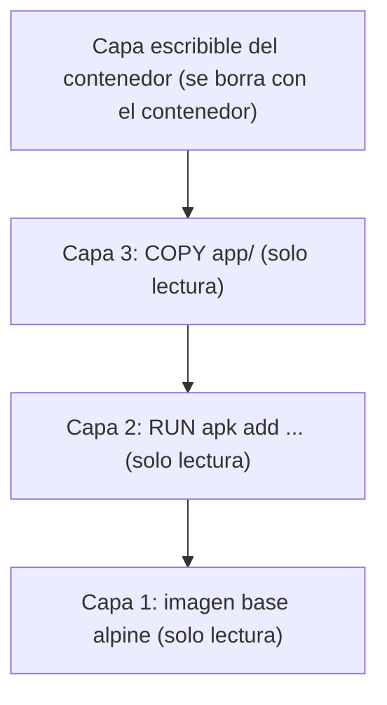
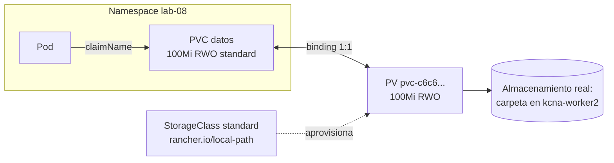

# Módulo 08 — Storage: volúmenes, PV, PVC, StorageClass y CSI

> **Dominio KCNA:** Container Orchestration (28%) → competencia *Storage*
> **Tiempo estimado:** 2 h 15 min (1 h teoría + 1 h 15 min laboratorio)
> **Prerrequisitos:** módulos de fundamentos y workloads (Pods, Deployments, StatefulSets a nivel básico), ConfigMaps/Secrets. Clúster `kcna` levantado.
> **Lecciones equivalentes en KodeKloud:** "Storage Section Introduction", "Introduction to Docker Storage", "Storage in Docker", "Volume Driver Plugins in Docker", "Container Storage Interface (CSI)", "Volumes", "Persistent Volumes", "Persistent Volume Claims", "Using PVCs in PODs", "Storage Class".
> **Verificado:** 2026-10-26 contra la documentación oficial (Kubernetes v1.37). Fuentes al final del módulo.

## Objetivos

Al terminar podrás...

- Explicar por qué el sistema de archivos de un contenedor es **efímero** y cómo lo resuelven los volúmenes en Docker/Podman y en Kubernetes.
- Explicar qué es **CSI** y por qué los drivers de almacenamiento viven fuera del código de Kubernetes (*out-of-tree*).
- Elegir el tipo de volumen adecuado: **emptyDir**, **hostPath**, **configMap/secret**, **projected**, **persistentVolumeClaim**.
- Relacionar **PersistentVolume**, **PersistentVolumeClaim** y **StorageClass**: binding, **access modes**, **reclaim policies**, aprovisionamiento estático y dinámico, **WaitForFirstConsumer**, expansión.
- Usar **StatefulSets** con **volumeClaimTemplates** y reconocer los **VolumeSnapshots**.

## Conceptos

### 1. Por qué los datos de un contenedor se pierden

Una imagen de contenedor está formada por **capas de solo lectura** apiladas (una por instrucción del Dockerfile/Containerfile). Al arrancar un contenedor, el runtime añade encima una **capa escribible** fina, y un sistema de archivos de unión (**overlayfs**) presenta todo como un único árbol de directorios. Si el contenedor modifica un archivo de la imagen, se copia primero a la capa escribible (**copy-on-write**).



Consecuencias:

- La capa escribible **muere con el contenedor**. En Kubernetes los contenedores se reinician y los pods se recrean constantemente: todo lo que no esté en un volumen se pierde.
- Varios contenedores de la misma imagen comparten las capas de solo lectura (ahorro de disco).
- Escribir mucho en la capa escribible es lento; los datos de la app deben ir a volúmenes.

### 2. Volúmenes en Docker y Podman

Los motores de contenedores ofrecen tres formas de sacar datos fuera de la capa escribible:

| Tipo | Ejemplo | Qué es |
|---|---|---|
| **Volumen con nombre** | `podman run -v datos:/var/lib/mysql mysql` | Directorio gestionado por el motor (`/var/lib/containers/storage/volumes/...` en Podman, `/var/lib/docker/volumes/...` en Docker). Sobrevive al contenedor |
| **Bind mount** | `podman run -v C:\proyecto:/app ...` | Monta una carpeta concreta del host |
| **tmpfs** | `podman run --tmpfs /cache ...` | En memoria RAM; desaparece al parar |

Los **volume drivers** (plugins de volúmenes) permiten que un volumen no esté en el disco local sino en NFS, en un disco de la nube o en un sistema distribuido. El **storage driver** es otra cosa: el mecanismo que implementa las capas de la imagen (overlay2, btrfs, zfs...).

### 3. CSI: Container Storage Interface

Al principio, el código para hablar con cada sistema de almacenamiento (discos de AWS, GCE, Azure, Ceph, iSCSI...) estaba **dentro** del código de Kubernetes (**in-tree volume plugins**). Problemas: cada fabricante tenía que contribuir a Kubernetes, sus correcciones esperaban al ciclo de versiones de Kubernetes, y un fallo en un plugin afectaba a todo el binario.

**CSI** es una **especificación estándar** (API gRPC) entre los orquestadores (Kubernetes, Nomad, Mesos, Cloud Foundry...) y los proveedores de almacenamiento. Con CSI:

- Cada proveedor publica un **driver CSI** **out-of-tree**, con su propio ciclo de versiones, que se instala en el clúster como pods.
- Un driver tiene normalmente un **plugin de controlador** (Deployment: crear/borrar/adjuntar/expandir/snapshot de volúmenes, acompañado de sidecars como *external-provisioner*, *external-attacher*, *external-resizer*, *external-snapshotter*) y un **plugin de nodo** (DaemonSet: montar el volumen en el nodo donde corre el pod).
- Los antiguos plugins in-tree se han migrado a sus drivers CSI equivalentes (**CSI migration**) y se han ido eliminando del código.

> Para el examen: CRI (runtime), CNI (red) y CSI (almacenamiento) son las tres interfaces estándar que permiten enchufar implementaciones distintas en Kubernetes.

### 4. Volúmenes en Kubernetes

Un **volume** de Kubernetes se declara en `spec.volumes` del pod y cada contenedor lo monta con `volumeMounts`. Su vida está ligada al **pod**, no al contenedor: si un contenedor se reinicia, el volumen sigue ahí.

| Tipo | Vida de los datos | Uso típico | Cuidado |
|---|---|---|---|
| **emptyDir** | Lo que dure el pod (se crea vacío al programarlo, se borra al eliminarlo) | Caché, archivos temporales, compartir datos entre contenedores del pod (sidecars) | `medium: Memory` usa RAM (cuenta para el límite de memoria); `sizeLimit` |
| **hostPath** | Lo que dure el nodo | Agentes del sistema que necesitan archivos del nodo (logs, `/var/run/containerd`) | **Riesgo de seguridad**: acceso al sistema de archivos del nodo, posible escalada; el pod queda atado a un nodo concreto; prohibido por el perfil *baseline* de Pod Security Standards |
| **configMap / secret** | Lo que dure el objeto | Inyectar archivos de configuración o credenciales | Se montan de solo lectura; se actualizan solos (salvo con `subPath`) |
| **downwardAPI** | — | Exponer labels, anotaciones, nombre del pod como archivos | |
| **projected** | — | Combinar en **un solo directorio** configMap + secret + downwardAPI + token de ServiceAccount | Así se monta el token de la ServiceAccount en cada pod |
| **persistentVolumeClaim** | **Independiente del pod** | Datos de aplicación que deben persistir | Ver PV/PVC |
| **ephemeral** (volumen efímero genérico) | Lo que dure el pod | Espacio temporal aprovisionado por una StorageClass, con las funciones de un PVC (tamaño, snapshots) | El pod es el **dueño** del PVC que se crea: al borrar el pod, el PVC se borra con él |

### 5. PersistentVolume y PersistentVolumeClaim

Kubernetes separa **quién ofrece** almacenamiento de **quién lo consume**:

- **PersistentVolume (PV)**: una pieza de almacenamiento del clúster (un disco de la nube, un export NFS, una carpeta local), con su capacidad, modos de acceso y política de reclamación. Es un recurso **cluster-scoped** (sin namespace). Lo crea el administrador (**estático**) o un aprovisionador (**dinámico**).
- **PersistentVolumeClaim (PVC)**: una **petición** de almacenamiento hecha por un usuario en su **namespace**: "necesito 1Gi, ReadWriteOnce, de la clase `rapida`".
- El pod solo referencia el **PVC** (`persistentVolumeClaim.claimName`); nunca el PV directamente.

Analogía: el PV es una plaza de aparcamiento concreta del edificio; el PVC es tu solicitud de plaza ("coche mediano, con enchufe"). El controlador de volúmenes te asigna una plaza que cumpla los requisitos y desde ese momento es solo tuya (**binding 1:1**). Si pides una plaza mediana y solo queda una grande, te dan la grande (pediste 100Mi y te enlazan un PV de 200Mi).

**Binding**: el controlador busca un PV `Available` que cumpla: misma `storageClassName`, los access modes pedidos, capacidad **≥** la solicitada, y el `selector`/`volumeMode` si los hay. Si no hay ninguno y la clase tiene aprovisionador, se crea uno nuevo. Si no, el PVC se queda en **Pending**.



**Protección en uso**: si borras un PVC que un pod todavía usa, queda en `Terminating` (finalizer `kubernetes.io/pvc-protection`) y no desaparece hasta que ningún pod lo use; lo mismo para un PV enlazado.

Fases de un PV: **Available** (libre) → **Bound** (enlazado a un PVC) → **Released** (el PVC se borró pero los datos siguen y el PV aún recuerda a su antiguo PVC) → (**Failed** si falla la reclamación automática).

### 6. Access modes

| Modo | Abreviatura | Significado |
|---|---|---|
| ReadWriteOnce | **RWO** | Lectura/escritura montado por **un nodo** (varios pods de ese mismo nodo pueden usarlo) |
| ReadOnlyMany | **ROX** | Solo lectura desde muchos nodos |
| ReadWriteMany | **RWX** | Lectura/escritura desde muchos nodos (NFS, CephFS, Azure Files, EFS...) |
| ReadWriteOncePod | **RWOP** | Lectura/escritura por **un único pod** en todo el clúster (GA en v1.29; solo CSI) |

Los modos son lo que el volumen **soporta**; un disco de bloque típico de la nube solo soporta RWO. Pedir RWX a una clase que no lo soporta deja el PVC en Pending.

### 7. Reclaim policies

Qué pasa con el PV (y los datos) cuando se borra su PVC:

| Política | Efecto | Defecto en |
|---|---|---|
| **Retain** | El PV pasa a `Released` y **conserva los datos**. Un administrador debe limpiarlo o reutilizarlo a mano | PVs estáticos creados a mano |
| **Delete** | Se borran el PV **y** el almacenamiento real | PVs dinámicos (es el `reclaimPolicy` por defecto de una StorageClass) |
| ~~Recycle~~ | Borra el contenido (`rm -rf /thevolume/*`) y lo deja disponible | **Obsoleto** (en v1.37 solo lo admiten `nfs` y `hostPath`); usar aprovisionamiento dinámico |

### 8. StorageClass y aprovisionamiento dinámico

Crear PVs a mano no escala. Una **StorageClass** describe un "tipo" de almacenamiento y quién lo crea bajo demanda:

```yaml
apiVersion: storage.k8s.io/v1
kind: StorageClass
metadata:
  name: rapida
provisioner: ebs.csi.aws.com           # driver CSI que crea los volúmenes
parameters:                            # opciones propias del driver
  type: gp3
reclaimPolicy: Delete                  # defecto
volumeBindingMode: WaitForFirstConsumer
allowVolumeExpansion: true
```

- **provisioner**: el driver (CSI) que crea los volúmenes. `kubernetes.io/no-provisioner` = sin aprovisionamiento dinámico (solo agrupa PVs estáticos).
- **Clase por defecto**: anotación `storageclass.kubernetes.io/is-default-class: "true"`. Un PVC sin `storageClassName` usa la clase por defecto; con `storageClassName: ""` pide explícitamente **no** usar ninguna (solo PVs estáticos sin clase).
- **volumeBindingMode**:
  - `Immediate`: el volumen se crea y enlaza en cuanto se crea el PVC, sin saber dónde correrá el pod. Puede crear un disco en una zona donde luego el pod no puede programarse.
  - **`WaitForFirstConsumer`**: el PVC queda **Pending** hasta que un pod lo usa; entonces el scheduler elige nodo teniendo en cuenta los requisitos del pod y el volumen se crea en la zona/nodo correctos. Imprescindible para volúmenes locales y recomendado en clústeres multizona. Es el modo de la clase `standard` de nuestro clúster.
- **allowVolumeExpansion**: permite **ampliar** (nunca reducir) un PVC editando `spec.resources.requests.storage`; el driver hace crecer el volumen y, si hace falta, el sistema de archivos. En nuestro clúster, `standard` (local-path) **no** lo permite: lo comprobarás.
- **VolumeAttributesClass** (GA desde v1.34; verás la columna `VOLUMEATTRIBUTESCLASS` en `kubectl get pvc`): permite cambiar atributos como IOPS de un volumen ya creado. Solo funciona con drivers CSI que implementen la operación `ModifyVolume`.

### 9. StatefulSets y volumeClaimTemplates

Un Deployment con un PVC hace que **todas** las réplicas compartan el mismo volumen (y con RWO, todas deberían caer en el mismo nodo). Las bases de datos y sistemas distribuidos necesitan que **cada réplica tenga su propio disco**. El **StatefulSet** lo resuelve con `volumeClaimTemplates`:

- Crea un PVC por réplica con nombre `<plantilla>-<statefulset>-<ordinal>`: `datos-db-0`, `datos-db-1`.
- Si el pod `db-0` muere, el nuevo `db-0` vuelve a montar **su** PVC `datos-db-0` (identidad estable + almacenamiento estable).
- Al reducir réplicas o borrar el StatefulSet, los PVCs **no se borran** por defecto (para no perder datos). Se puede cambiar con `persistentVolumeClaimRetentionPolicy` (`whenDeleted`/`whenScaled`: `Retain` o `Delete`).
- Se acompaña de un Service **headless** para dar DNS estable a cada pod (`db-0.db.lab-08.svc.cluster.local`).

### 10. Snapshots de volúmenes (conceptual)

Con un driver CSI que lo soporte, Kubernetes puede hacer copias puntuales de un volumen:

| Objeto | Analogía con PV/PVC |
|---|---|
| **VolumeSnapshotClass** | Como una StorageClass, pero para snapshots (qué driver, política de borrado) |
| **VolumeSnapshot** | La petición del usuario, en su namespace (como un PVC) |
| **VolumeSnapshotContent** | El snapshot real, cluster-scoped (como un PV) |

Para restaurar se crea un PVC nuevo con `dataSource` apuntando al VolumeSnapshot. (También se puede **clonar** un PVC usando otro PVC como `dataSource`.) Los CRDs de snapshots y su controlador se instalan aparte; nuestro clúster no los tiene.

## Comandos clave

| Comando | Qué hace |
|---|---|
| `kubectl get sc` | Lista StorageClasses (aprovisionador, reclaim policy, binding mode, expansión) |
| `kubectl get pv` | Lista PersistentVolumes (cluster-scoped) con su estado y PVC |
| `kubectl get pvc -n lab-08` | Lista PersistentVolumeClaims del namespace |
| `kubectl describe pvc datos -n lab-08` | Eventos del PVC (ej. `WaitForFirstConsumer`, errores de aprovisionamiento) |
| `kubectl get pvc datos -o jsonpath='{.spec.volumeName}'` | Qué PV tiene enlazado un PVC |
| `kubectl patch pv <pv> -p '{\"spec\":{\"persistentVolumeReclaimPolicy\":\"Retain\"}}'` | Cambia la reclaim policy de un PV existente |
| `kubectl edit pvc datos` | Editar el tamaño para expandir (si la clase lo permite) |
| `kubectl get pvc -l app=db` / `kubectl get sts` | PVCs y StatefulSets |
| `kubectl exec <pod> -- df -h /ruta` | Comprueba qué está montado en una ruta del contenedor |

## Laboratorio guiado

> Nota: los nodos de nuestro clúster no tienen salida a internet (están detrás del proxy corporativo), por eso `.\kcna.ps1 lab 08` precarga la imagen que usa (`busybox:1.37`). En un clúster normal no hace falta.

El almacenamiento dinámico de este clúster lo da **local-path-provisioner** (StorageClass `standard`): crea cada volumen como una carpeta en el disco del nodo donde corre el pod. No es CSI ni sirve para producción multi-nodo, pero se comporta como cualquier StorageClass para aprender.

### Paso 1 — Preparar el laboratorio

```powershell
.\kcna.ps1 lab 08
. .\kcna-env.ps1
cd labs\08-storage
kubectl get sc
```

```text
  OK  Namespace listo: lab-08
NAME                 PROVISIONER             RECLAIMPOLICY   VOLUMEBINDINGMODE      ALLOWVOLUMEEXPANSION   AGE
standard (default)   rancher.io/local-path   Delete          WaitForFirstConsumer   false                  134m
```

Qué observar: la clase por defecto usa `Delete` (los datos se borran con el PVC), `WaitForFirstConsumer` y **no** permite expansión.

### Paso 2 — emptyDir compartido entre dos contenedores

```powershell
kubectl apply -f 01-emptydir.yaml
kubectl wait --for=condition=Ready pod/compartido -n lab-08 --timeout=60s
Start-Sleep 12
kubectl logs compartido -n lab-08 -c lector
```

```text
16:52:41 escrito por compartido
16:52:47 escrito por compartido
16:52:52 escrito por compartido
```

Qué observar: el contenedor `escritor` escribe en `/cache/log.txt` y `lector` lee el **mismo** archivo en `/compartida/log.txt`: lo que importa es el nombre del volumen, no la ruta de montaje.

Ahora borra el pod y créalo de nuevo:

```powershell
kubectl delete pod compartido -n lab-08
kubectl apply -f 01-emptydir.yaml
kubectl wait --for=condition=Ready pod/compartido -n lab-08 --timeout=60s
Start-Sleep 4
kubectl logs compartido -n lab-08 -c lector
```

```text
16:58:44 escrito por compartido
```

Qué observar: las líneas antiguas han desaparecido. El emptyDir vive lo que vive el pod.

### Paso 3 — Un PVC que se queda en Pending (WaitForFirstConsumer)

```powershell
kubectl apply -f 02-pvc.yaml
kubectl get pvc -n lab-08
kubectl describe pvc datos -n lab-08 | Select-String 'Status|WaitForFirstConsumer'
```

```text
NAME    STATUS    VOLUME   CAPACITY   ACCESS MODES   STORAGECLASS   VOLUMEATTRIBUTESCLASS   AGE
datos   Pending                                      standard       <unset>                 7s

Status:        Pending
  Normal  WaitForFirstConsumer  5s (x2 over 11s)  persistentvolume-controller  waiting for first consumer to be created before binding
```

Qué observar: **no es un error**. No existe todavía ningún PV: se creará cuando un pod use el PVC y el scheduler haya elegido nodo.

### Paso 4 — El pod consume el PVC: aprovisionamiento dinámico

```powershell
kubectl apply -f 03-pod-con-pvc.yaml
kubectl wait --for=condition=Ready pod/app-pvc -n lab-08 --timeout=90s
kubectl get pvc -n lab-08
kubectl get pv
kubectl get pod app-pvc -n lab-08 -o wide
```

```text
NAME    STATUS   VOLUME                                     CAPACITY   ACCESS MODES   STORAGECLASS
datos   Bound    pvc-c6c62a67-d6b3-40d6-bf8f-dac329d21bb7   100Mi      RWO            standard

NAME                                       CAPACITY   ACCESS MODES   RECLAIM POLICY   STATUS   CLAIM          STORAGECLASS
pvc-c6c62a67-d6b3-40d6-bf8f-dac329d21bb7   100Mi      RWO            Delete           Bound    lab-08/datos   standard

NAME      READY   STATUS    RESTARTS   AGE   IP             NODE
app-pvc   1/1     Running   0          27s   10.244.1.102   kcna-worker2
```

Qué observar: el aprovisionador creó un PV llamado `pvc-<uid>` con la reclaim policy de la clase (`Delete`) y lo enlazó al PVC. (Puede que veas PVs de otros labs: los PV no tienen namespace.) ¿Dónde están los datos de verdad?

```powershell
$pv = kubectl get pvc datos -n lab-08 -o jsonpath='{.spec.volumeName}'
kubectl get pv $pv -o jsonpath='{.spec.hostPath.path} -> nodo {.spec.nodeAffinity.required.nodeSelectorTerms[0].matchExpressions[0].values[0]}'
```

```text
/var/local-path-provisioner/pvc-c6c62a67-d6b3-40d6-bf8f-dac329d21bb7_lab-08_datos -> nodo kcna-worker2
```

Qué observar: es una carpeta del nodo, y el PV lleva `nodeAffinity` hacia ese nodo: cualquier pod que use este PVC irá siempre a `kcna-worker2`.

### Paso 5 — Los datos sobreviven al pod

```powershell
kubectl exec app-pvc -n lab-08 -- sh -c 'echo pedido 1001: 3 cafes > /data/pedidos.txt; date >> /data/pedidos.txt; cat /data/pedidos.txt'
kubectl delete pod app-pvc -n lab-08
kubectl get pvc datos -n lab-08
kubectl apply -f 03-pod-con-pvc.yaml
kubectl wait --for=condition=Ready pod/app-pvc -n lab-08 --timeout=90s
kubectl exec app-pvc -n lab-08 -- cat /data/pedidos.txt
```

```text
pedido 1001: 3 cafes
Fri Oct 23 16:57:50 UTC 2026
pod "app-pvc" deleted from lab-08 namespace
NAME    STATUS   VOLUME                                     CAPACITY   ...
datos   Bound    pvc-c6c62a67-d6b3-40d6-bf8f-dac329d21bb7   100Mi      ...
pod/app-pvc created
pod/app-pvc condition met
pedido 1001: 3 cafes
Fri Oct 23 16:57:50 UTC 2026
```

Qué observar: el PVC sigue `Bound` sin pod, y el pod nuevo encuentra los datos. Esa es la diferencia con emptyDir.

### Paso 6 — Intentar expandir el volumen

```powershell
kubectl patch pvc datos -n lab-08 -p '{\"spec\":{\"resources\":{\"requests\":{\"storage\":\"200Mi\"}}}}'
```

```text
Error from server (Forbidden): persistentvolumeclaims "datos" is forbidden: only dynamically provisioned pvc can be resized and the storageclass that provisions the pvc must support resize
```

Qué observar: la expansión necesita `allowVolumeExpansion: true` en la StorageClass (y un driver que la soporte). En PowerShell 5.1 las comillas dobles del JSON se escapan con `\"`.

### Paso 7 — PV estático con hostPath y política Retain

Abre `04-pv-estatico.yaml`: una StorageClass `lab-08-manual` **sin aprovisionador** y con binding `Immediate`, un PV `lab-08-pv-manual` de 200Mi que apunta a la carpeta `/tmp/lab-08-pv` del nodo `kcna-worker` (con `Retain`), y un PVC `claim-manual` que pide 100Mi.

```powershell
kubectl apply -f 04-pv-estatico.yaml
kubectl get sc lab-08-manual
kubectl get pv lab-08-pv-manual
kubectl get pvc claim-manual -n lab-08
```

```text
NAME            PROVISIONER                    RECLAIMPOLICY   VOLUMEBINDINGMODE   ALLOWVOLUMEEXPANSION
lab-08-manual   kubernetes.io/no-provisioner   Retain          Immediate           false

NAME               CAPACITY   ACCESS MODES   RECLAIM POLICY   STATUS   CLAIM                 STORAGECLASS
lab-08-pv-manual   200Mi      RWO            Retain           Bound    lab-08/claim-manual   lab-08-manual

NAME           STATUS   VOLUME             CAPACITY   ACCESS MODES   STORAGECLASS
claim-manual   Bound    lab-08-pv-manual   200Mi      RWO            lab-08-manual
```

Qué observar: con `Immediate` el PVC se enlaza **sin pod**. Pidió 100Mi pero recibe el PV entero de **200Mi** (el binding es 1:1).

```powershell
kubectl apply -f 05-pod-pv-manual.yaml
kubectl wait --for=condition=Ready pod/app-manual -n lab-08 --timeout=90s
kubectl get pod app-manual -n lab-08 -o wide
podman exec kcna-worker cat /tmp/lab-08-pv/saludo.txt
```

```text
NAME         READY   STATUS    RESTARTS   AGE   IP             NODE
app-manual   1/1     Running   0          12s   10.244.2.121   kcna-worker
hola desde app-manual
```

Qué observar: el pod fue a `kcna-worker` por la `nodeAffinity` del PV, y el archivo está literalmente en una carpeta del nodo (los nodos de kind son contenedores de Podman, por eso podemos mirar con `podman exec`). Así de expuesto está el nodo con hostPath.

Borra el pod y el PVC:

```powershell
kubectl delete pod app-manual -n lab-08
kubectl delete pvc claim-manual -n lab-08
kubectl get pv lab-08-pv-manual
podman exec kcna-worker ls /tmp/lab-08-pv
```

```text
NAME               CAPACITY   ACCESS MODES   RECLAIM POLICY   STATUS     CLAIM                 STORAGECLASS
lab-08-pv-manual   200Mi      RWO            Retain           Released   lab-08/claim-manual   lab-08-manual
saludo.txt
```

Qué observar: con `Retain` el PV queda **Released** y los datos siguen en el disco. Si vuelves a crear el PVC, se quedará `Pending`: el PV sigue "recordando" a su antiguo PVC (`claimRef`). El administrador decide qué hacer; para reutilizarlo hay que quitar esa referencia:

```powershell
kubectl apply -f 04-pv-estatico.yaml
kubectl get pvc claim-manual -n lab-08
kubectl patch pv lab-08-pv-manual --type=json -p '[{\"op\":\"remove\",\"path\":\"/spec/claimRef\"}]'
kubectl get pvc claim-manual -n lab-08
```

```text
NAME           STATUS    VOLUME   CAPACITY   ...
claim-manual   Pending                       ...
persistentvolume/lab-08-pv-manual patched
NAME           STATUS   VOLUME             CAPACITY   ...
claim-manual   Bound    lab-08-pv-manual   200Mi      ...
```

(Si el segundo `get` aún muestra `Pending`, espera unos segundos y repite.)

### Paso 8 — StatefulSet con volumeClaimTemplates

```powershell
kubectl apply -f 06-statefulset.yaml
kubectl rollout status sts/db -n lab-08 --timeout=120s
kubectl get pods -n lab-08 -l app=db -o wide
kubectl get pvc -n lab-08
kubectl exec db-0 -n lab-08 -- cat /var/lib/db/arranques.txt
kubectl exec db-1 -n lab-08 -- cat /var/lib/db/arranques.txt
```

```text
NAME   READY   STATUS    RESTARTS   AGE   IP             NODE
db-0   1/1     Running   0          28s   10.244.2.126   kcna-worker
db-1   1/1     Running   0          14s   10.244.1.114   kcna-worker2

NAME           STATUS   VOLUME                                     CAPACITY   ACCESS MODES   STORAGECLASS
claim-manual   Bound    lab-08-pv-manual                           200Mi      RWO            lab-08-manual
datos          Bound    pvc-c6c62a67-d6b3-40d6-bf8f-dac329d21bb7   100Mi      RWO            standard
datos-db-0     Bound    pvc-9691d801-cdf1-4e30-a057-304aff543124   50Mi       RWO            standard
datos-db-1     Bound    pvc-d99fecdb-68bc-4514-8967-ad3ef0b285fc   50Mi       RWO            standard

db-0 arranco a las 17:03:18
db-1 arranco a las 17:03:29
```

Qué observar: los pods se crean **en orden** (db-0 y después db-1) y cada uno tiene **su** PVC (`datos-db-0`, `datos-db-1`) generado desde la plantilla.

Mata `db-0` y mira su archivo cuando vuelva:

```powershell
kubectl delete pod db-0 -n lab-08
kubectl wait --for=condition=Ready pod/db-0 -n lab-08 --timeout=90s
kubectl exec db-0 -n lab-08 -- cat /var/lib/db/arranques.txt
```

```text
db-0 arranco a las 17:03:18
db-0 arranco a las 17:03:53
```

Qué observar: el nuevo `db-0` tiene el mismo nombre y montó el mismo PVC, por eso ve el arranque anterior. Ahora reduce a 1 réplica:

```powershell
kubectl scale sts db -n lab-08 --replicas=1
kubectl get pods,pvc -n lab-08 -l app=db
```

```text
NAME       READY   STATUS    RESTARTS   AGE
pod/db-0   1/1     Running   0          80s

NAME                               STATUS   VOLUME                                     CAPACITY
persistentvolumeclaim/datos-db-0   Bound    pvc-9691d801-cdf1-4e30-a057-304aff543124   50Mi
persistentvolumeclaim/datos-db-1   Bound    pvc-d99fecdb-68bc-4514-8967-ad3ef0b285fc   50Mi
```

Qué observar: `db-1` desapareció pero `datos-db-1` **sigue ahí**: si vuelves a escalar a 2, el nuevo `db-1` recuperará sus datos.

### Paso 9 — Volumen projected (configMap + secret + downwardAPI)

```powershell
kubectl apply -f 07-projected.yaml
kubectl wait --for=condition=Ready pod/proyectado -n lab-08 --timeout=60s
kubectl exec proyectado -n lab-08 -- ls /etc/app
kubectl exec proyectado -n lab-08 -- cat /etc/app/app.properties /etc/app/token /etc/app/etiquetas
kubectl exec proyectado -n lab-08 -- touch /etc/app/nuevo
```

```text
app.properties
etiquetas
token
modo=laboratorio
color=azul
no-es-un-secreto-realequipo="kcna"
touch: /etc/app/nuevo: Read-only file system
command terminated with exit code 1
```

Qué observar: tres fuentes distintas aparecen en un único directorio, de solo lectura. Estos volúmenes no guardan datos de la app: inyectan configuración.

## Reto

En el namespace `lab-08`:

1. Crea una StorageClass **`lab-08-retener`** que use el aprovisionador `rancher.io/local-path`, conserve los datos al borrar el PVC (**Retain**) y espere al primer consumidor para crear el volumen.
2. Crea un PVC **`reto-datos`** de **64Mi**, **ReadWriteOnce**, de esa clase.
3. Crea un pod **`reto-app`** (`busybox:1.37`) que monte ese PVC en **`/datos`** y escriba la palabra `kcna` en **`/datos/hola.txt`**.

```powershell
cd ..\..        # si sigues dentro de labs\08-storage
.\kcna.ps1 check 08
```

<details><summary>Ver solución</summary>

`reto-storage.yaml`:

```yaml
apiVersion: storage.k8s.io/v1
kind: StorageClass
metadata:
  name: lab-08-retener
provisioner: rancher.io/local-path
reclaimPolicy: Retain
volumeBindingMode: WaitForFirstConsumer
---
apiVersion: v1
kind: PersistentVolumeClaim
metadata:
  name: reto-datos
  namespace: lab-08
spec:
  storageClassName: lab-08-retener
  accessModes: ["ReadWriteOnce"]
  resources:
    requests:
      storage: 64Mi
---
apiVersion: v1
kind: Pod
metadata:
  name: reto-app
  namespace: lab-08
spec:
  terminationGracePeriodSeconds: 2
  volumes:
    - name: datos
      persistentVolumeClaim:
        claimName: reto-datos
  containers:
    - name: app
      image: busybox:1.37
      command: ["sh", "-c", "echo kcna > /datos/hola.txt; sleep 36000"]
      volumeMounts:
        - name: datos
          mountPath: /datos
```

```powershell
kubectl apply -f reto-storage.yaml
kubectl wait --for=condition=Ready pod/reto-app -n lab-08 --timeout=90s
kubectl get pvc reto-datos -n lab-08
.\kcna.ps1 check 08
```

```text
  OK  StorageClass 'lab-08-retener' (rancher.io/local-path, Retain, WaitForFirstConsumer)
  OK  PVC 'reto-datos' en lab-08: Bound, 64Mi, ReadWriteOnce, clase lab-08-retener
  OK  El PV aprovisionado para 'reto-datos' tiene reclaimPolicy Retain
  OK  Pod 'reto-app' Running y montando el PVC 'reto-datos'
  OK  Dentro de 'reto-app', /datos/hola.txt contiene 'kcna'

  Lab completado: 5/5
```

La reclaim policy del PV dinámico la hereda de la StorageClass. Si borras el PVC, el PV quedará `Released` con los datos; `.\kcna.ps1 reset 08` lo limpia.

</details>

## Preguntas tipo examen

**1. What happens to data written to a container's writable layer when the container is deleted?**

- A) It is automatically saved to a PersistentVolume
- B) It is lost
- C) It is merged into the image
- D) It is moved to an emptyDir volume

<details><summary>Respuesta</summary>

**B.** La capa escribible es efímera y desaparece con el contenedor. Para conservar datos hay que usar volúmenes.
</details>

**2. Why was the Container Storage Interface (CSI) introduced?**

- A) To replace etcd as the storage backend of the API server
- B) To let storage vendors develop drivers out-of-tree, independent of the Kubernetes release cycle
- C) To provide networking between Pods
- D) To compress container images

<details><summary>Respuesta</summary>

**B.** CSI es una especificación estándar que permite a los proveedores publicar drivers fuera del código de Kubernetes (out-of-tree). Antes, los plugins in-tree acoplaban cada proveedor al ciclo de versiones de Kubernetes.
</details>

**3. Which volume type is created empty when a Pod is assigned to a node and is deleted permanently when the Pod is removed?**

- A) hostPath
- B) persistentVolumeClaim
- C) emptyDir
- D) nfs

<details><summary>Respuesta</summary>

**C.** emptyDir vive lo que vive el pod (sobrevive a reinicios de contenedor, no al borrado del pod). Es ideal para compartir archivos entre contenedores del mismo pod.
</details>

**4. Why is using `hostPath` volumes generally discouraged for application workloads?**

- A) hostPath volumes cannot be written to
- B) They expose the node's filesystem to the Pod, which is a security risk, and tie the Pod's data to a specific node
- C) They are only supported on Windows nodes
- D) They require a CSI driver

<details><summary>Respuesta</summary>

**B.** hostPath da acceso a archivos del nodo (riesgo de escalada) y los datos quedan en un nodo concreto. Pod Security Standards lo prohíbe desde el perfil baseline.
</details>

**5. Which access mode allows a volume to be mounted as read-write by a single Pod only, across the whole cluster?**

- A) ReadWriteOnce
- B) ReadOnlyMany
- C) ReadWriteMany
- D) ReadWriteOncePod

<details><summary>Respuesta</summary>

**D.** RWOP garantiza un único pod. Ojo con la trampa: RWO limita a un único **nodo**, pero varios pods del mismo nodo pueden montarlo.
</details>

**6. A PersistentVolumeClaim using a StorageClass with `volumeBindingMode: WaitForFirstConsumer` stays in `Pending` state. No Pod uses it yet. What is happening?**

- A) The storage backend is broken
- B) This is expected: the volume will be provisioned and bound when a Pod that uses the claim is scheduled
- C) The PVC requested more storage than the cluster has
- D) The StorageClass is missing a reclaim policy

<details><summary>Respuesta</summary>

**B.** Con WaitForFirstConsumer el binding se retrasa hasta que el scheduler elige nodo para un pod que usa el PVC, para crear el volumen en la zona/nodo correctos.
</details>

**7. A PersistentVolume has `persistentVolumeReclaimPolicy: Retain`. Its PVC is deleted. What is the state of the PV?**

- A) Available, ready for a new claim
- B) Deleted together with the data
- C) Released, with its data preserved until an administrator handles it
- D) Pending

<details><summary>Respuesta</summary>

**C.** Con Retain el PV queda `Released` y conserva los datos; no se reasigna automáticamente a otro PVC.
</details>

**8. What is the default reclaim policy for PersistentVolumes created dynamically by a StorageClass if none is specified?**

- A) Retain
- B) Recycle
- C) Delete
- D) Archive

<details><summary>Respuesta</summary>

**C.** El `reclaimPolicy` por defecto de una StorageClass es `Delete`. Recycle está obsoleto y Archive no existe.
</details>

**9. Which StorageClass field must be set to `true` so that users can increase the size of an existing PersistentVolumeClaim?**

- A) `allowVolumeExpansion`
- B) `volumeBindingMode`
- C) `resizePolicy`
- D) `reclaimPolicy`

<details><summary>Respuesta</summary>

**A.** Con `allowVolumeExpansion: true` (y un driver que lo soporte) basta con editar el tamaño solicitado del PVC. Solo se puede ampliar, nunca reducir.
</details>

**10. What does a StatefulSet's `volumeClaimTemplates` field provide?**

- A) A single PVC shared by all replicas
- B) A separate PVC for each replica, which is reattached to the replica with the same ordinal if its Pod is recreated
- C) Automatic backups of volumes
- D) An emptyDir per replica

<details><summary>Respuesta</summary>

**B.** Cada réplica recibe su propio PVC (`<plantilla>-<sts>-<ordinal>`) y lo conserva aunque su pod se recree en otro momento. Por defecto los PVCs no se borran al reducir réplicas.
</details>

**11. Which objects are used to take a point-in-time copy of a volume through a CSI driver?**

- A) PodDisruptionBudget and PriorityClass
- B) VolumeSnapshot, VolumeSnapshotContent and VolumeSnapshotClass
- C) ConfigMap and Secret
- D) Backup and Restore custom resources built into Kubernetes

<details><summary>Respuesta</summary>

**B.** Siguen el mismo patrón que PVC / PV / StorageClass. Para restaurar se crea un PVC con `dataSource` apuntando al VolumeSnapshot.
</details>

## Resumen para repasar

- Capa escribible del contenedor = **efímera** (overlayfs, copy-on-write). Datos importantes → volúmenes.
- **CSI** = interfaz estándar para almacenamiento; drivers **out-of-tree** (controller + node plugin). Junto a CRI y CNI.
- **emptyDir** (vive con el pod, compartir entre contenedores), **hostPath** (archivos del nodo, peligroso), **configMap/secret/downwardAPI/projected** (inyectar configuración), **PVC** (persistente).
- **PV** = almacenamiento (cluster-scoped); **PVC** = petición (namespaced); el pod usa el PVC; binding **1:1**; capacidad ≥ pedida.
- Access modes: **RWO** (un nodo), **ROX**, **RWX** (muchos nodos), **RWOP** (un pod).
- Reclaim: **Retain** (Released, datos conservados), **Delete** (defecto dinámico), Recycle obsoleto.
- **StorageClass**: provisioner, parameters, reclaimPolicy, **volumeBindingMode** (`Immediate` / **`WaitForFirstConsumer`** → PVC Pending hasta que hay pod), **allowVolumeExpansion** (solo crecer). Clase por defecto por anotación.
- **StatefulSet + volumeClaimTemplates**: un PVC por réplica (`datos-db-0`), estable, no se borra al escalar abajo.
- **VolumeSnapshot / VolumeSnapshotContent / VolumeSnapshotClass**: copias puntuales vía CSI.

## Limpieza

```powershell
.\kcna.ps1 reset 08
```

`reset 08` borra también lo que vive fuera del namespace: las StorageClasses `lab-08-*`, los PVs del lab (incluidos los que quedaron `Released` por `Retain`) y las carpetas de datos en los nodos.

## Fuentes oficiales

- [Volumes — kubernetes.io](https://kubernetes.io/docs/concepts/storage/volumes/): emptyDir (ciclo de vida, `medium: Memory`, `sizeLimit`), riesgos de hostPath, configMap de solo lectura y `subPath`, volúmenes CSI efímeros, plugins in-tree migrados a CSI.
- [Projected Volumes — kubernetes.io](https://kubernetes.io/docs/concepts/storage/projected-volumes/): fuentes combinables (secret, configMap, downwardAPI, serviceAccountToken...).
- [Persistent Volumes — kubernetes.io](https://kubernetes.io/docs/concepts/storage/persistent-volumes/): binding 1:1, access modes (RWOP estable desde v1.29, solo CSI), reclaim policies (Recycle obsoleto), fases, expansión sin reducción, `storageClassName: ""`, protección de PVCs en uso (`kubernetes.io/pvc-protection`).
- [Ephemeral Volumes — kubernetes.io](https://kubernetes.io/docs/concepts/storage/ephemeral-volumes/): volúmenes efímeros genéricos; el Pod es dueño del PVC y se borra con él.
- [PersistentVolume API reference — kubernetes.io](https://kubernetes.io/docs/reference/kubernetes-api/config-and-storage-resources/persistent-volume-v1/): Retain por defecto en PVs creados a mano, Delete en dinámicos.
- [Storage Classes — kubernetes.io](https://kubernetes.io/docs/concepts/storage/storage-classes/): `reclaimPolicy` por defecto Delete, `allowVolumeExpansion`, clase por defecto por anotación, `volumeBindingMode`.
- [Volume Attributes Classes — kubernetes.io](https://kubernetes.io/docs/concepts/storage/volume-attributes-classes/): modificar atributos de un volumen existente; solo CSI con `ModifyVolume`; GA en v1.34.
- [Volume Snapshots — kubernetes.io](https://kubernetes.io/docs/concepts/storage/volume-snapshots/): VolumeSnapshot / VolumeSnapshotContent / VolumeSnapshotClass, solo CSI, CRDs y controlador a cargo de la distribución.
- [StatefulSets — kubernetes.io](https://kubernetes.io/docs/concepts/workloads/controllers/statefulset/): `volumeClaimTemplates`, nombres `<plantilla>-<sts>-<ordinal>`, PVCs conservados al escalar o borrar, `persistentVolumeClaimRetentionPolicy`, Service headless.
- [Container Storage Interface (CSI) for Kubernetes GA — kubernetes.io/blog](https://kubernetes.io/blog/2019/01/15/container-storage-interface-ga/): CSI GA en Kubernetes 1.13.
- [CSI Specification — github.com/container-storage-interface](https://github.com/container-storage-interface/spec): especificación estándar adoptada por Kubernetes, Mesos, Nomad y Cloud Foundry.
