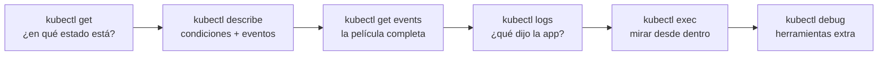
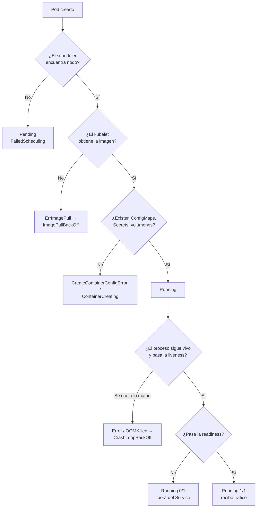
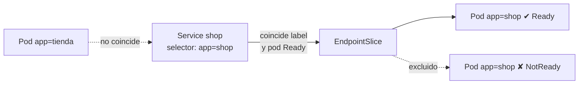

# Módulo 09 — Troubleshooting y debugging en Kubernetes

> **Dominios KCNA:** Container Orchestration (28%) → competencia *Troubleshooting* · Cloud Native Application Delivery (16%) → competencia *Debugging*
> **Tiempo estimado:** 2 h 30 min · **Prerrequisitos:** módulos de workloads, Services, ConfigMaps/Secrets y scheduling
> **Lecciones equivalentes de KodeKloud:** casi no existen (son competencias nuevas del temario 2025); se relaciona con "Application Failure", "Control Plane Failure", "Worker Node Failure" y "Probes" de otros cursos.

## Objetivos

Al terminar podrás:

- Aplicar una metodología ordenada de diagnóstico "de afuera hacia adentro": `get → describe → events → logs → exec → debug`.
- Reconocer a primera vista los estados típicos de un pod (`Pending`, `ImagePullBackOff`, `CrashLoopBackOff`, `OOMKilled`, `CreateContainerConfigError`) y su causa más probable.
- Usar `kubectl logs`, `exec`, `port-forward`, `top` y `debug` (contenedor efímero, copia de pod y depuración de nodo).
- Explicar cómo las sondas **liveness**, **readiness** y **startup** afectan reinicios y tráfico.
- Diagnosticar un Service sin endpoints y revisar la salud de nodos, kubelet y control plane.

## Conceptos

### 1. La metodología: de afuera hacia adentro

Cuando algo falla, la tentación es entrar al contenedor de inmediato. Mala idea: muchas veces el contenedor ni siquiera existe. Piensa como un médico de urgencias: primero miras los signos vitales (¿respira?, ¿tiene pulso?), luego el historial, y solo al final pides pruebas invasivas.



| Paso | Pregunta que responde | Funciona si el contenedor no arrancó |
|---|---|---|
| `get` (`-o wide`, `-o yaml`) | ¿En qué fase/estado está? ¿En qué nodo? ¿Cuántos reinicios? | Sí |
| `describe` | ¿Qué condiciones fallan? ¿Qué eventos recientes hay? | Sí |
| `get events` / `kubectl events` | Secuencia temporal de todo lo que pasó en el namespace | Sí |
| `logs` (`--previous`) | ¿Qué imprimió la aplicación antes de morir? | Solo si llegó a ejecutarse |
| `exec` | ¿Qué ve el proceso? (red, archivos, variables) | No: necesita un contenedor vivo |
| `debug` | Igual que exec, pero con herramientas que la imagen no trae | Copia de pod: sí |

> Regla práctica: si el problema ocurre **antes** de que arranque el contenedor (scheduling, imagen, configuración), la respuesta está en `describe`/eventos. Si ocurre **después**, está en los `logs`.

### 2. El ciclo de vida que estás diagnosticando

Un pod pasa por fases (**phase**): `Pending → Running → Succeeded/Failed` (y `Unknown` si se pierde contacto con el nodo). Pero la columna `STATUS` de `kubectl get pods` muestra algo más fino: el **motivo** (*reason*) del estado de los contenedores.



### 3. Catálogo de estados y causas típicas

| STATUS | Qué significa | Causas típicas | Dónde mirar |
|---|---|---|---|
| `Pending` | El pod no tiene nodo asignado (o espera volumen) | Requests de CPU/memoria imposibles (`Insufficient cpu`), `nodeSelector`/affinity sin nodo que cumpla, taints sin toleration, PVC sin enlazar | `describe pod` → evento `FailedScheduling` |
| `ErrImagePull` → `ImagePullBackOff` | El kubelet no pudo descargar la imagen; reintenta con espera creciente (*back-off*) | Tag o nombre inexistente, registro privado sin `imagePullSecrets`, sin red hacia el registro | Evento `Failed`: lee el mensaje (*not found*, *unauthorized*, *timeout*) |
| `CreateContainerConfigError` | La imagen está, pero no se puede construir la configuración del contenedor | ConfigMap o Secret referenciado que no existe, o una clave que no existe | Evento `Failed: configmap "x" not found` |
| `ContainerCreating` (mucho rato) | Esperando montar volúmenes o red | Volumen/Secret de volumen inexistente, problema de CSI o CNI | Eventos `FailedMount` |
| `Error` / `CrashLoopBackOff` | El contenedor arranca y termina; el kubelet lo reinicia con back-off (10 s, 20 s, 40 s... hasta 5 min) | Comando/argumentos erróneos, falta una variable o archivo, la app falla al iniciar, **liveness mal configurada** | `logs --previous`, `describe` (Last State, Exit Code, eventos `Unhealthy`) |
| `OOMKilled` | El kernel mató el contenedor por superar su `limits.memory` | Límite demasiado bajo o fuga de memoria | `describe` → `Last State: Terminated, Reason: OOMKilled, Exit Code: 137` |
| `Running` pero `0/1` | El contenedor vive pero no está listo | La **readiness** falla (puerto/ruta incorrectos, dependencia caída) | `describe` → eventos `Unhealthy: Readiness probe failed` |
| `Completed` | El proceso terminó con código 0 | Normal en Jobs; en un Deployment indica que el comando no es de larga duración | `logs` |
| `Terminating` (atascado) | Esperando que termine el contenedor o un *finalizer* | Proceso que ignora SIGTERM, finalizers | `get -o yaml` → `metadata.finalizers` |

**Códigos de salida que conviene memorizar:** `0` terminó bien · `1` (u otro bajo) error de la aplicación · `137` = 128 + 9 (**SIGKILL**: OOM o muerte forzada) · `143` = 128 + 15 (**SIGTERM**: apagado ordenado).

### 4. Sondas (probes): quién decide si tu contenedor está sano

| Sonda | Pregunta | Si falla... | Uso típico |
|---|---|---|---|
| **livenessProbe** | ¿Sigue vivo o está colgado? | El kubelet **reinicia** el contenedor | Detectar bloqueos (deadlocks) |
| **readinessProbe** | ¿Puede atender tráfico ahora? | Se **saca de los endpoints** del Service (no se reinicia) | Calentamiento, dependencias caídas |
| **startupProbe** | ¿Ya terminó de arrancar? | Mientras no pase, liveness y readiness **no se ejecutan**; si agota sus intentos, reinicia | Apps de arranque lento (Java, migraciones) |

Mecanismos: `httpGet` (código 200-399 = éxito), `tcpSocket`, `exec` (código 0 = éxito) y `grpc`. Parámetros: `initialDelaySeconds`, `periodSeconds`, `timeoutSeconds`, `failureThreshold`, `successThreshold`.

> Error clásico: una liveness apuntando al puerto equivocado. El contenedor está perfecto, pero el kubelet lo mata cada pocos segundos y termina en `CrashLoopBackOff`. Los logs de la app no muestran nada raro; la pista está en los eventos `Unhealthy` + `Killing`.

### 5. Services sin endpoints

Un Service solo envía tráfico a pods que **coinciden con su `selector`** y están **Ready**. Kubernetes publica esa lista en objetos **EndpointSlice** (el antiguo objeto `Endpoints` está obsoleto desde v1.33, aunque sigue respondiendo con un aviso).



Checklist cuando "el Service no responde":
1. `kubectl get endpointslices -l kubernetes.io/service-name=<svc>` → ¿hay direcciones?
2. Compara `kubectl describe svc` (campo `Selector`) con `kubectl get pods --show-labels`.
3. ¿Los pods están `1/1`? Si no, revisa la readiness.
4. ¿El `targetPort` coincide con el puerto donde escucha el contenedor?
5. Si todo lo anterior está bien: DNS (`nslookup <svc>` desde un pod) y NetworkPolicies.

Síntoma desde un cliente: con selector equivocado verás `Connection refused` al instante (kube-proxy rechaza el tráfico hacia un Service sin endpoints).

### 6. Las herramientas de debugging

- **`kubectl logs`**: lee la salida estándar (stdout/stderr) del contenedor. `-f` sigue en vivo, `--previous` (`-p`) muestra el contenedor **anterior** (imprescindible en CrashLoopBackOff), `-c` elige contenedor, `--all-containers`, `-l app=x` varios pods a la vez (con `--prefix` para saber de quién es cada línea), `--since=10m`, `--tail=20`.
- **`kubectl exec`**: ejecuta un comando en un contenedor **vivo** (`-it ... -- sh` para una shell).
- **`kubectl port-forward`**: túnel desde tu máquina a un pod/Service, sin exponer nada. Ideal para probar una app o una UI interna.
- **`kubectl debug`**, tres modos:
  - **Contenedor efímero** (*ephemeral container*): añade un contenedor temporal a un pod **en ejecución**, con otra imagen (p. ej. con herramientas de red). Con `--target` comparte el espacio de procesos del contenedor objetivo. Perfecto para imágenes *distroless* sin shell. No se puede quitar después (desaparece con el pod).
  - **Copia del pod** (`--copy-to`): crea un pod nuevo igual al original pero cambiando lo que quieras (comando, imagen). Útil cuando el original está en CrashLoopBackOff: arrancas la copia con `sleep`/`sh` y exploras. La copia **no lleva labels**, así que no recibe tráfico ni la adopta el ReplicaSet.
  - **Depuración de nodo** (`kubectl debug node/<nodo>`): lanza un pod privilegiado en ese nodo con el sistema de archivos del host montado en `/host`. Con `chroot /host` ves el nodo como si hubieras entrado por SSH.
- **`kubectl top`**: consumo actual de CPU/memoria de pods y nodos (requiere **metrics-server**). Compáralo con `requests`/`limits`.

`--profile` de `kubectl debug` define los permisos: `general` (por defecto razonable), `baseline`, `restricted`, `netadmin` y `sysadmin` (privilegiado).

### 7. Troubleshooting del clúster

| Componente | Cómo se ejecuta (kubeadm/kind) | Cómo revisarlo |
|---|---|---|
| kube-apiserver, etcd, kube-scheduler, kube-controller-manager | **Static pods**: manifiestos en `/etc/kubernetes/manifests` del control-plane, los arranca el kubelet | `kubectl get pods -n kube-system`, `kubectl get --raw='/readyz?verbose'` |
| kubelet | **Servicio systemd** en cada nodo (no es un pod) | `systemctl status kubelet`, `journalctl -u kubelet` dentro del nodo |
| Runtime de contenedores (containerd/CRI-O) | Servicio systemd | `crictl ps`, `crictl logs` dentro del nodo |
| kube-proxy, CNI (kindnet, Calico, Cilium...) | DaemonSets | `kubectl get ds -n kube-system` |
| CoreDNS | Deployment | `kubectl get deploy coredns -n kube-system` |

- Si **el apiserver** cae, `kubectl` no responde (`connection refused`): hay que ir al nodo y revisar el static pod/contenedor con `crictl`.
- Si **el scheduler** cae, los pods nuevos se quedan `Pending` sin eventos de scheduling.
- Si **el controller-manager** cae, un Deployment no crea ReplicaSets/pods y nadie repone pods borrados.
- Si **el kubelet** de un nodo cae, el nodo pasa a `NotReady` y, tras ~5 minutos, sus pods se reprograman en otros nodos (toleration `node.kubernetes.io/unreachable` por 300 s).
- `kubectl describe node` muestra **Conditions** (`Ready`, `MemoryPressure`, `DiskPressure`, `PIDPressure`) y **Allocated resources** (suma de requests vs capacidad): la clave para entender un `Insufficient cpu`.
- `kubectl get componentstatuses` está obsoleto; usa los endpoints `/livez` y `/readyz` del apiserver.

## Comandos clave

| Comando | Qué hace |
|---|---|
| `kubectl get pods -o wide` | Estado, reinicios, IP y nodo de cada pod |
| `kubectl get pod <p> -o yaml` | Objeto completo, incluido `status.containerStatuses` (state, lastState, exitCode) |
| `kubectl describe pod <p>` | Condiciones, contenedores, Last State y eventos del pod |
| `kubectl get events --sort-by=.lastTimestamp` | Eventos del namespace en orden cronológico |
| `kubectl events --for pod/<p>` | Eventos de un objeto concreto (comando moderno) |
| `kubectl logs <p> --previous` | Logs del contenedor que acaba de morir |
| `kubectl logs -l app=x --prefix --tail=20` | Logs de todos los pods con ese label |
| `kubectl logs <p> -c <cont> -f` | Seguir en vivo un contenedor concreto |
| `kubectl exec -it <p> -- sh` | Shell dentro de un contenedor vivo |
| `kubectl port-forward svc/<svc> 8081:80` | Túnel local hacia un Service |
| `kubectl debug -it <p> --image=busybox:1.37 --target=<cont>` | Contenedor efímero junto al contenedor objetivo |
| `kubectl debug <p> -it --copy-to=<copia> --container=<cont> -- sh` | Copia del pod con otro comando |
| `kubectl debug node/<nodo> -it --image=busybox:1.37` | Pod de depuración en un nodo (host en `/host`) |
| `kubectl top pods --sort-by=memory` / `kubectl top nodes` | Consumo actual de recursos |
| `kubectl get endpointslices -l kubernetes.io/service-name=<svc>` | Endpoints reales de un Service |
| `kubectl describe node <nodo>` | Condiciones y recursos asignados del nodo |
| `kubectl get --raw='/readyz?verbose'` | Chequeos de salud del apiserver |

## Laboratorio guiado

En la carpeta `labs\09-troubleshooting-debugging\rotos\` hay **6 manifiestos rotos**, cada uno con un fallo distinto (el último tiene dos). Los desplegarás todos a la vez, como si heredaras un namespace en llamas. Aquí diagnosticamos juntos el primero y practicamos las herramientas; los demás son tu reto.

> Recordatorio del entorno: las imágenes se precargan con `.\kcna.ps1 lab 09` porque los nodos están detrás de un proxy y no salen a internet. En un clúster normal no hace falta.

### 1. Preparar el lab

```powershell
cd $HOME\KubernetesLearning
.\kcna.ps1 lab 09
. .\kcna-env.ps1
```

```text
  OK  ya cargada: nginx:1.27-alpine
  OK  ya cargada: busybox:1.37
  OK  ya cargada: redis:7.4-alpine
  OK  Namespace listo: lab-09
```

Qué observar: en este módulo escribiremos siempre `-n lab-09` para no depender del namespace por defecto.

### 2. Desplegar el desastre

```powershell
k apply -f labs\09-troubleshooting-debugging\rotos\
```

```text
deployment.apps/frontend created
service/frontend created
deployment.apps/api created
deployment.apps/cache created
deployment.apps/worker created
configmap/report-config created
deployment.apps/reporter created
deployment.apps/shop created
service/shop created
```

Qué observar: `apply` acepta una carpeta completa. Que todo se haya "creado" no significa que funcione: la API solo validó la sintaxis.

### 3. Paso 1 de la metodología: `get`

Espera un minuto y mira el panorama:

```powershell
k get pods -n lab-09 -o wide
```

```text
NAME                        READY   STATUS                       RESTARTS      AGE   IP            NODE
api-5d6c56d657-8tzbk        0/1     Error                        3 (44s ago)   71s   10.244.2.9    kcna-worker
cache-854b994f8f-fw58h      0/1     Pending                      0             70s   <none>        <none>
frontend-56dbbc8bcc-hmzm9   0/1     ImagePullBackOff             0             72s   10.244.1.5    kcna-worker2
frontend-56dbbc8bcc-hrx7n   0/1     ErrImagePull                 0             72s   10.244.2.8    kcna-worker
reporter-54b6b5cfc8-scldj   0/1     CreateContainerConfigError   0             68s   10.244.2.11   kcna-worker
shop-5dc894c86f-dfrxn       1/1     Running                      3 (11s ago)   67s   10.244.2.12   kcna-worker
shop-5dc894c86f-vzqkl       0/1     CrashLoopBackOff             3 (6s ago)    67s   10.244.1.6    kcna-worker2
worker-69c876967-wbrlh      0/1     OOMKilled                    2 (47s ago)   69s   10.244.2.10   kcna-worker
```

Qué observar: casi todo el catálogo de estados en una sola pantalla. Fíjate en `cache`: sin IP ni nodo (nunca fue programado). Y en `shop`: a ratos aparece `1/1 Running`, pero los reinicios suben. Los estados oscilan (`Error` ↔ `CrashLoopBackOff`, `ErrImagePull` ↔ `ImagePullBackOff`) según el momento en que mires.

### 4. Caso 1 guiado — `frontend`: `describe` y eventos

```powershell
k describe pod -n lab-09 -l app=frontend
```

Baja hasta la sección `Events` (resumida):

```text
Events:
  Type     Reason     From               Message
  Normal   Scheduled  default-scheduler  Successfully assigned lab-09/frontend-... to kcna-worker2
  Normal   Pulling    kubelet            Pulling image "nginx:1.27-alpinee"
  Warning  Failed     kubelet            Failed to pull image "nginx:1.27-alpinee": failed to pull and unpack image
                                         "docker.io/library/nginx:1.27-alpinee": failed to resolve reference ...
  Warning  Failed     kubelet            Error: ErrImagePull
  Normal   BackOff    kubelet            Back-off pulling image "nginx:1.27-alpinee"
  Warning  Failed     kubelet            Error: ImagePullBackOff
```

Qué observar: el pod **sí** se programó (`Scheduled`), así que el problema es posterior: la descarga de la imagen. Mira bien el tag: `1.27-alpinee` (sobra una "e"). En un clúster con internet el mensaje terminaría en `not found`; en tu lab verás un error de proxy (`proxyconnect tcp ... connection refused`) porque los nodos no salen a internet. Moraleja doble: **lee el mensaje completo** y, en este lab, cualquier imagen no precargada da `ImagePullBackOff` aunque el tag sea correcto.

La misma información, ordenada en el tiempo para todo el namespace:

```powershell
k get events -n lab-09 --sort-by=.lastTimestamp
```

```text
LAST SEEN   TYPE      REASON      OBJECT                          MESSAGE
...
42s         Warning   Unhealthy   pod/shop-5dc894c86f-vzqkl       Liveness probe failed: Get "http://10.244.1.6:8080/": dial tcp ... connection refused
42s         Normal    Killing     pod/shop-5dc894c86f-vzqkl       Container web failed liveness probe, will be restarted
15s         Warning   BackOff     pod/worker-69c876967-wbrlh      Back-off restarting failed container worker in pod ...
4s          Warning   Failed      pod/reporter-54b6b5cfc8-scldj   Error: configmap "reporter-config" not found
2s          Warning   Failed      pod/frontend-56dbbc8bcc-hmzm9   Error: ImagePullBackOff
```

Qué observar: los eventos ya te están regalando pistas de los otros casos. Guárdalas para el reto. Los eventos se conservan solo ~1 hora.

### 5. Ver el estado "en crudo" con `-o yaml`

```powershell
k get pod -n lab-09 -l app=frontend -o yaml | Select-String -Pattern 'image:|reason:' | Select-Object -First 4
k get pod -n lab-09 -l app=frontend -o jsonpath='{.items[0].status.containerStatuses[0].state.waiting.reason}'
```

```text
    - image: nginx:1.27-alpinee
      reason: ContainersNotReady
      reason: ContainersNotReady
    - image: nginx:1.27-alpinee
ImagePullBackOff
```

Qué observar: en el YAML completo hay dos niveles de "reason": el de las **conditions** del pod (`ContainersNotReady`) y el del contenedor (`status.containerStatuses[].state.waiting.reason`), que es exactamente lo que `get pods` muestra en la columna STATUS. Con jsonpath vas directo al dato.

### 6. Arreglar el caso 1

Dos formas válidas: editar `01-frontend.yaml` y volver a aplicarlo (lo recomendable: el archivo es la fuente de verdad), o corregir en caliente:

```powershell
k set image deployment/frontend nginx=nginx:1.27-alpine -n lab-09
k rollout status deployment/frontend -n lab-09
k get pods -n lab-09 -l app=frontend
```

```text
deployment "frontend" successfully rolled out
NAME                        READY   STATUS    RESTARTS   AGE
frontend-7bb584f994-47mg7   1/1     Running   0          19s
frontend-7bb584f994-hzrdq   1/1     Running   0          13s
```

Comprueba que su Service ya tiene endpoints:

```powershell
k get endpointslices -n lab-09 -l kubernetes.io/service-name=frontend
```

```text
NAME             ADDRESSTYPE   PORTS   ENDPOINTS                 AGE
frontend-bdvtf   IPv4          80      10.244.2.20,10.244.1.11   7m4s
```

Qué observar: `set image` cambió el template del Deployment, así que se creó un ReplicaSet nuevo (el hash del nombre cambió). Si arreglas con `set image`, acuérdate de corregir también el YAML o la próxima vez que lo apliques volverás a romperlo.

### 7. Logs de varios pods a la vez

```powershell
k logs -n lab-09 -l app=frontend --tail=2 --prefix
```

```text
[pod/frontend-7bb584f994-47mg7/nginx] 2026/10/23 15:43:46 [notice] 1#1: start worker process 36
[pod/frontend-7bb584f994-47mg7/nginx] 2026/10/23 15:43:46 [notice] 1#1: start worker process 37
[pod/frontend-7bb584f994-hzrdq/nginx] 2026/10/23 15:43:56 [notice] 1#1: start worker process 36
[pod/frontend-7bb584f994-hzrdq/nginx] 2026/10/23 15:43:56 [notice] 1#1: start worker process 37
```

Prueba también `k logs -n lab-09 deploy/frontend -f` (sigue en vivo; `Ctrl+C` para salir) y, para el reto, recuerda `--previous`.

Qué observar: `-l` evita buscar nombres de pods; `--prefix` indica de qué pod/contenedor viene cada línea.

### 8. `exec` y un pod cliente para probar la red

```powershell
k exec -n lab-09 deploy/frontend -- nginx -v
k run cliente -n lab-09 --image=busybox:1.37 --rm -it --restart=Never -- wget -qO- -T 3 http://shop
```

```text
nginx version: nginx/1.27.5
wget: can't connect to remote host (10.96.126.219): Connection refused
pod "cliente" deleted from lab-09 namespace
```

Qué observar: `exec` contra `deploy/frontend` elige un pod del Deployment por ti. El Service `shop` existe (tiene IP) pero rechaza la conexión: síntoma típico de **Service sin endpoints**. Lo resolverás en el reto. (PowerShell puede mostrar en rojo el aviso "All commands and output... will be recorded": es solo informativo).

### 9. `port-forward`: probar desde Windows sin exponer nada

```powershell
k port-forward -n lab-09 svc/frontend 8081:80
```

Abre http://localhost:8081 (página de bienvenida de nginx) y vuelve con `Ctrl+C`.

Qué observar: el túnel pasa por el apiserver; no crea NodePort ni Ingress. Es la forma rápida de comprobar "¿la app responde?" separando el problema de la app del problema de red/Ingress.

### 10. `kubectl debug`: contenedor efímero

Imagina que la imagen no tuviera shell ni herramientas (algo habitual con imágenes *distroless*). Inyecta un contenedor busybox que comparte procesos con `nginx`:

```powershell
$POD = k get pod -n lab-09 -l app=frontend -o jsonpath='{.items[0].metadata.name}'
k debug -it $POD -n lab-09 --image=busybox:1.37 --target=nginx --profile=general -- sh
```

Dentro de la shell del depurador:

```sh
ps          # ves los procesos de nginx (PID 1 = nginx master)
netstat -tln
exit
```

```text
PID   USER     TIME  COMMAND
    1 root      0:00 nginx: master process nginx -g daemon off;
   34 101       0:00 nginx: worker process
...
tcp        0      0 0.0.0.0:80              0.0.0.0:*               LISTEN
```

Qué observar: el contenedor efímero queda registrado en `spec.ephemeralContainers` del pod (`k get pod $POD -n lab-09 -o jsonpath='{.spec.ephemeralContainers[*].name}'`) y no se puede quitar: desaparece cuando el pod se reemplaza.

### 11. `kubectl debug`: copia de un pod que no para de caerse

El pod de `api` está en CrashLoopBackOff, así que no puedes hacer `exec`. Crea una copia que, en vez de su comando, ejecute una shell:

```powershell
$API = k get pod -n lab-09 -l app=api -o jsonpath='{.items[0].metadata.name}'
k debug $API -n lab-09 -it --copy-to=api-debug --container=api --profile=general -- sh
```

Dentro puedes inspeccionar variables (`env`), archivos, red... Al salir, bórrala:

```powershell
k get pod api-debug -n lab-09 --show-labels
k delete pod api-debug -n lab-09
```

```text
NAME        READY   STATUS    RESTARTS   AGE   LABELS
api-debug   1/1     Running   0          6s    <none>
```

Qué observar: la copia **no tiene labels**: ningún Service le manda tráfico y el ReplicaSet no la cuenta. Es tu "paciente de pruebas".

### 12. `kubectl top`: consumo real

```powershell
k top pods -n lab-09 --sort-by=memory
k top nodes
```

```text
NAME                        CPU(cores)   MEMORY(bytes)
frontend-7bb584f994-hzrdq   1m           11Mi
frontend-7bb584f994-47mg7   7m           5Mi
...
```

Qué observar: solo aparecen pods en ejecución (metrics-server tarda ~1 min en mostrar pods nuevos). Para un `OOMKilled`, compara el pico de memoria esperado con el `limits.memory` del manifiesto.

### 13. Salud de nodos y del control plane

```powershell
k get nodes
k describe node kcna-worker | Select-String -Pattern 'Ready|Pressure|cpu|memory' | Select-Object -First 12
k get pods -n kube-system
k get --raw='/readyz?verbose' | Select-Object -Last 3
```

```text
NAME                                         READY   STATUS    RESTARTS   AGE
etcd-kcna-control-plane                      1/1     Running   0          75m
kube-apiserver-kcna-control-plane            1/1     Running   0          75m
kube-controller-manager-kcna-control-plane   1/1     Running   0          75m
kube-scheduler-kcna-control-plane            1/1     Running   0          75m
...
[+]shutdown ok
readyz check passed
```

Los componentes del control plane son static pods. Compruébalo en el nodo (con kind, cada nodo es un contenedor de Podman):

```powershell
podman exec kcna-control-plane ls /etc/kubernetes/manifests
```

```text
etcd.yaml
kube-apiserver.yaml
kube-controller-manager.yaml
kube-scheduler.yaml
```

Qué observar: si borras uno de esos archivos, el kubelet detiene el componente; si lo restauras, lo vuelve a arrancar. (No lo hagas: el clúster es compartido con el resto del curso).

### 14. El kubelet: un servicio, no un pod

```powershell
podman exec kcna-worker systemctl status kubelet --no-pager
podman exec kcna-worker journalctl -u kubelet --no-pager -n 5
```

```text
● kubelet.service - kubelet: The Kubernetes Node Agent
     Loaded: loaded (/etc/systemd/system/kubelet.service; enabled; preset: enabled)
     Active: active (running) since ...
...
kubelet[208]: E1023 ... "Error syncing pod, skipping" err="failed to \"StartContainer\" for \"reporter\" with
CreateContainerConfigError: \"configmap \\\"reporter-config\\\" not found\"" pod="lab-09/reporter-..."
```

Qué observar: el kubelet registra los mismos errores que ves en los eventos, desde el lado del nodo. En un clúster real entrarías por SSH al nodo; aquí `podman exec` cumple ese papel. Alternativa 100% Kubernetes: un pod de depuración de nodo.

```powershell
k debug node/kcna-worker -n lab-09 -it --image=busybox:1.37 --profile=sysadmin
# dentro:
chroot /host
crictl ps | head -5
exit
```

Luego borra el pod `node-debugger-kcna-worker-xxxxx` que queda en `lab-09` (`k get pods -n lab-09` y `k delete pod <nombre> -n lab-09`).

Qué observar: `crictl` habla directamente con containerd vía **CRI**; ves todos los contenedores del nodo, de todos los namespaces.

## Reto

Arregla los casos 2 a 6 hasta que **todo** el namespace esté sano:

| Caso | Archivo | Síntoma |
|---|---|---|
| 2 | `02-api.yaml` | Se cae al arrancar una y otra vez |
| 3 | `03-cache.yaml` | Nunca llega a arrancar |
| 4 | `04-worker.yaml` | Arranca, carga datos... y muere |
| 5 | `05-reporter.yaml` | Se queda "creando el contenedor" |
| 6 | `06-shop.yaml` | Se reinicia solo **y** su Service no responde (dos fallos) |

Condiciones de éxito (lo que verifica `.\kcna.ps1 check 09`):

- Los 6 Deployments con todas sus réplicas actualizadas y `READY x/x`.
- Ningún pod de las apps en `Pending`, `ImagePullBackOff`, `CrashLoopBackOff` ni `CreateContainerConfigError`.
- `RESTARTS = 0` en todos los pods actuales (si un pod viejo acumuló reinicios antes de tu arreglo, `k rollout restart deployment/<nombre> -n lab-09`).
- El Service `shop` con al menos 2 endpoints listos y respondiendo por HTTP.

Reglas: no cambies las imágenes de busybox/redis/nginx por otras ni toques los nodos (nada de añadir labels o quitar taints). Corrige los manifiestos (edita una copia o el propio archivo y aplica) o usa `kubectl edit`/`set`. Usa la metodología: para cada caso, escribe primero **cuál es la causa y qué comando te la demostró**.

```powershell
.\kcna.ps1 check 09
```

> Pista de PowerShell: para cambios puntuales funcionan bien `k set env`, `k set resources` y `k edit` (abre el Bloc de notas). Evita `kubectl patch` con JSON en línea: PowerShell 5.1 rompe las comillas dobles de los argumentos.

<details><summary>Ver solución</summary>

**Caso 2 — `api` (CrashLoopBackOff por comando que falla).**
Diagnóstico: `k logs -n lab-09 deploy/api --previous`

```text
[api] iniciando...
[api] ERROR: la variable DB_HOST no esta definida. Abortando.
```

`describe` mostraría `Last State: Terminated, Reason: Error, Exit Code: 1`. Arreglo:

```powershell
k set env deployment/api DB_HOST=postgres.lab-09.svc.cluster.local -n lab-09
```

(o añade `env: [{name: DB_HOST, value: ...}]` al contenedor en el YAML).

**Caso 3 — `cache` (Pending por nodeSelector imposible).**
Diagnóstico: `k describe pod -n lab-09 -l app=cache`

```text
Warning  FailedScheduling  default-scheduler  0/3 nodes are available: 1 node(s) had untolerated taint(s),
2 node(s) didn't match Pod's node affinity/selector.
```

El pod pide `disktype: nvme` y ningún nodo tiene ese label (`k get nodes -L disktype`). El control-plane además tiene un taint. Arreglo: en `03-cache.yaml` cambia `disktype: nvme` por `disktype: ssd` (o elimina el `nodeSelector`) y `k apply -f` del archivo.

Variante que verás en otros clústeres: `2 Insufficient cpu` cuando los `requests` superan lo que queda libre en los nodos.

**Caso 4 — `worker` (OOMKilled).**
Diagnóstico: `k describe pod -n lab-09 -l app=worker` → `Last State: Terminated, Reason: OOMKilled, Exit Code: 137`. Los logs (`--previous`) se cortan justo después de `cargando 64 MiB de datos en memoria...`. Necesita más de 64 MiB y su límite es 32Mi. Arreglo:

```powershell
k set resources deployment/worker -c worker --limits=memory=128Mi -n lab-09
```

**Caso 5 — `reporter` (CreateContainerConfigError).**
Diagnóstico: evento `Error: configmap "reporter-config" not found`; `k get configmap -n lab-09` muestra que el que existe se llama `report-config`. Arreglo: en `05-reporter.yaml` cambia `configMapRef.name` a `report-config` y aplica (alternativa válida: crear el ConfigMap con el nombre que espera el Deployment).

**Caso 6 — `shop` (dos fallos).**
1. *Liveness mal configurada.* Eventos: `Liveness probe failed: Get "http://10.244.x.x:8080/": ... connection refused` + `Container web failed liveness probe, will be restarted`. nginx escucha en el 80 y la sonda pregunta al 8080. Los logs de nginx no muestran ningún error: la app estaba bien, la mataba el kubelet.
2. *Service sin endpoints.* `k describe svc shop -n lab-09` → `Selector: app=tienda`, pero los pods tienen `app=shop` (`k get pods -n lab-09 --show-labels`).

Arreglo en `06-shop.yaml`:

```yaml
          livenessProbe:
            httpGet:
              path: /
              port: http        # antes: 8080
...
spec:
  selector:
    app: shop                   # antes: tienda
```

```powershell
k apply -f labs\09-troubleshooting-debugging\rotos\06-shop.yaml
k get endpointslices -n lab-09 -l kubernetes.io/service-name=shop
```

Resultado final de `.\kcna.ps1 check 09`:

```text
  OK  Existen los 6 Deployments del lab (frontend, api, cache, worker, reporter, shop)
  OK  Todos los Deployments tienen todas sus replicas actualizadas y listas (READY x/x)
  OK  Ningun pod de las apps esta Pending / ImagePullBackOff / CrashLoopBackOff / CreateContainerConfigError
  OK  Ningun contenedor de las apps se ha reiniciado (RESTARTS = 0; si arreglaste tarde: kubectl rollout restart)
  OK  El Service 'shop' tiene al menos 2 endpoints listos (selector correcto y pods Ready)
  OK  El Service 'shop' responde por HTTP desde dentro del cluster

  Lab completado: 6/6
```

Si editaste los archivos de `rotos\`, el lab deja de estar "roto" para la próxima vez: restáuralos o trabaja sobre copias.

</details>

## Preguntas tipo examen

**1.** A pod shows the status `CrashLoopBackOff`. Which command is most useful to see why the container failed the last time it ran?

- A. `kubectl get pod <name> -o wide`
- B. `kubectl logs <name> --previous`
- C. `kubectl top pod <name>`
- D. `kubectl port-forward <name> 8080:80`

<details><summary>Respuesta</summary>

**B.** `--previous` muestra los logs de la instancia anterior del contenedor, la que se cayó. Los logs "actuales" pueden estar vacíos porque el contenedor acaba de reiniciarse.
</details>

**2.** A pod remains in `Pending` state. What is the most likely cause?

- A. The container image tag does not exist
- B. The liveness probe is failing
- C. No node satisfies the pod's resource requests or node selector
- D. The application exits with code 1

<details><summary>Respuesta</summary>

**C.** `Pending` significa que el scheduler no ha podido asignarle nodo (o espera un volumen). Una imagen inexistente da `ImagePullBackOff` (el pod ya tiene nodo); una liveness fallida o exit 1 dan `CrashLoopBackOff`.
</details>

**3.** `kubectl describe pod` shows `Last State: Terminated, Reason: OOMKilled, Exit Code: 137`. What should you do?

- A. Increase the container's memory limit or fix the memory leak
- B. Add a readiness probe
- C. Change the image pull policy to `Always`
- D. Increase the CPU request

<details><summary>Respuesta</summary>

**A.** OOMKilled indica que el contenedor superó su `limits.memory` y el kernel lo mató (137 = 128 + SIGKILL). Se corrige ajustando el límite o el consumo de la aplicación.
</details>

**4.** What happens when a container's **readiness** probe fails?

- A. The kubelet restarts the container
- B. The pod is removed from the Service endpoints until the probe succeeds
- C. The pod is rescheduled to another node
- D. The Deployment is rolled back

<details><summary>Respuesta</summary>

**B.** La readiness controla si el pod recibe tráfico. Quien reinicia el contenedor es la **liveness**.
</details>

**5.** Which probe should you use for an application that needs several minutes to start, to prevent the liveness probe from killing it during startup?

- A. readinessProbe
- B. startupProbe
- C. preStop hook
- D. initContainer

<details><summary>Respuesta</summary>

**B.** Mientras la `startupProbe` no tiene éxito, las sondas liveness y readiness no se ejecutan.
</details>

**6.** A Service exists but clients receive "connection refused" and the Service has no endpoints. The pods are Running and Ready. What is the most likely problem?

- A. The Service selector does not match the pod labels
- B. The pods have no CPU limits
- C. CoreDNS is not running
- D. The image is not cached on the node

<details><summary>Respuesta</summary>

**A.** Si los pods están Ready pero no aparecen en los EndpointSlices, el selector del Service no coincide con sus labels. Si CoreDNS fallara, el error sería de resolución de nombres, no "connection refused".
</details>

**7.** Which `kubectl` feature lets you add a temporary container with troubleshooting tools to a running pod whose image has no shell?

- A. `kubectl exec`
- B. `kubectl attach`
- C. Ephemeral containers via `kubectl debug`
- D. Init containers

<details><summary>Respuesta</summary>

**C.** `kubectl debug` añade un contenedor efímero (con `--target` comparte procesos con el contenedor objetivo). `exec` necesita que la imagen tenga el binario que quieres ejecutar.
</details>

**8.** A pod shows `CreateContainerConfigError`. What is a typical cause?

- A. The node is out of disk space
- B. A referenced ConfigMap or Secret does not exist
- C. The container image is too large
- D. The pod has too many replicas

<details><summary>Respuesta</summary>

**B.** La imagen está disponible, pero el kubelet no puede construir la configuración del contenedor porque falta un ConfigMap/Secret (o una clave) referenciado en `env`/`envFrom`.
</details>

**9.** A worker node shows `NotReady`. Which component should you check first on that node?

- A. kube-scheduler
- B. etcd
- C. The kubelet service (for example, with `journalctl -u kubelet`)
- D. The Ingress controller

<details><summary>Respuesta</summary>

**C.** El kubelet es quien reporta el estado del nodo al apiserver. En la mayoría de instalaciones es un servicio systemd, así que se revisa con `systemctl status kubelet` y `journalctl -u kubelet`.
</details>

**10.** In a kubeadm-based cluster, how do the kube-apiserver, kube-scheduler and kube-controller-manager usually run?

- A. As systemd services on every node
- B. As static pods defined in `/etc/kubernetes/manifests` on the control plane node
- C. As a Deployment in the `default` namespace
- D. As DaemonSets on worker nodes

<details><summary>Respuesta</summary>

**B.** El kubelet del control plane lee esa carpeta y arranca los componentes como static pods (por eso aparecen en `kube-system` con el nombre del nodo como sufijo).
</details>

**11.** Which command lists the events of a namespace in chronological order?

- A. `kubectl get events --sort-by=.lastTimestamp`
- B. `kubectl logs --all-namespaces`
- C. `kubectl describe namespace`
- D. `kubectl top events`

<details><summary>Respuesta</summary>

**A.** Los eventos no salen ordenados por defecto; `--sort-by=.lastTimestamp` (o `.metadata.creationTimestamp`) los ordena. También existe `kubectl events`, que los ordena por defecto.
</details>

## Resumen para repasar

- Metodología: `get → describe → events → logs → exec → debug`. Antes de arrancar el contenedor: describe/eventos; después: logs.
- `Pending` = scheduling (requests, nodeSelector/affinity, taints, PVC). `ImagePullBackOff` = imagen (tag, registro, credenciales, red).
- `CrashLoopBackOff` = el contenedor termina una y otra vez: `logs --previous` y `describe` (exit code, eventos de liveness).
- `OOMKilled` + exit code **137** = superó `limits.memory`. `143` = SIGTERM.
- `CreateContainerConfigError` = falta un ConfigMap/Secret o una clave.
- Liveness falla → **reinicia**. Readiness falla → **sale de los endpoints**. Startup → protege arranques lentos.
- Service sin endpoints: selector ≠ labels, pods no Ready o `targetPort` erróneo. Revisa EndpointSlices.
- `kubectl debug`: contenedor efímero (pod vivo), `--copy-to` (pod que se cae), `node/<nodo>` (host en `/host`).
- Control plane = static pods en `/etc/kubernetes/manifests`; kubelet = servicio systemd (`journalctl -u kubelet`).
- `kubectl top` requiere metrics-server; `describe node` muestra Conditions y Allocated resources.

## Limpieza

```powershell
.\kcna.ps1 reset 09
```
