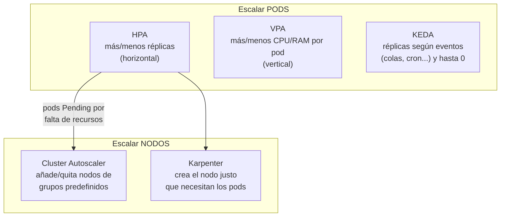
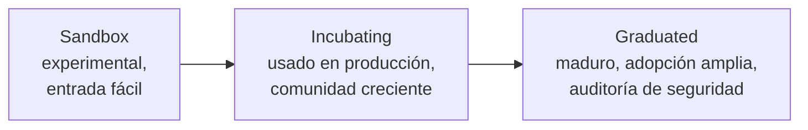

# Módulo 10 — Arquitectura cloud native, autoscaling y comunidad

> **Dominio KCNA:** Cloud Native Architecture (12%) → competencias *Cloud Native Ecosystem and Principles* y *Cloud Native Community and Collaboration* (+ autoscaling, que también aparece en Kubernetes Fundamentals)
> **Tiempo estimado:** 2 h · **Prerrequisitos:** Deployments, Services y `requests`/`limits`; metrics-server funcionando (`kubectl top nodes`)
> **Lecciones equivalentes de KodeKloud:** "Autoscaling", "Serverless", "Community and Governance", "Roles and Personas", "Open Standards"
> **Verificado:** 2026-10-26 contra la documentación oficial (Kubernetes v1.37). Fuentes al final del módulo.

## Objetivos

Al terminar podrás:

- Explicar los principios de una arquitectura cloud native (resiliencia, elasticidad, inmutabilidad, automatización, observabilidad, bajo acoplamiento).
- Distinguir HPA, VPA, Cluster Autoscaler, Karpenter y KEDA, y calcular cuántas réplicas pedirá un HPA.
- Describir serverless en Kubernetes (Knative Serving/Eventing, scale-to-zero, CloudEvents).
- Reconocer los estándares abiertos (OCI, CRI, CNI, CSI, Gateway API/GAMMA, OpenTelemetry) y por qué importan.
- Explicar cómo se gobiernan Kubernetes y la CNCF (KEPs, SIGs, WGs, TOC, TAGs, niveles de madurez) y cómo contribuir.
- Asociar cada rol (SRE, DevOps, Platform Engineer, DevSecOps, FinOps) con sus responsabilidades.

## Conceptos

### 1. ¿Qué significa "cloud native"?

La CNCF lo define (definición v1.1, de 2024), en esencia, como prácticas que permiten desarrollar, construir y desplegar cargas de trabajo en entornos de computación **dinámicos** (nube pública, privada o híbrida) para cubrir las necesidades de la organización **a escala**, de forma **programática y repetible**. Se caracteriza por sistemas **poco acoplados** que interoperan de forma **segura, resiliente, manejable, sostenible y observable**. Las tecnologías típicas combinan contenedores, service meshes, multi-tenancy, microservicios, infraestructura inmutable, serverless y APIs declarativas; con buena automatización permiten cambios frecuentes y predecibles con poco esfuerzo.

Una analogía: una aplicación tradicional es un edificio de concreto (sólido, pero cambiar una pared requiere obra). Una cloud native es un juego de bloques de construcción estandarizados: cambias o multiplicas piezas sin tirar el resto.

| Principio | Qué significa | Cómo lo da Kubernetes |
|---|---|---|
| **Resiliencia** (*resiliency*) | Asumir que todo falla y recuperarse solo | ReplicaSets, probes, reprogramación de pods, PodDisruptionBudgets |
| **Elasticidad** (*elasticity*) / escalabilidad | Ajustar capacidad a la demanda, hacia arriba y hacia abajo | HPA, VPA, Cluster Autoscaler, KEDA |
| **Inmutabilidad** (*immutable infrastructure*) | No se parchea lo que corre: se reemplaza por una versión nueva | Imágenes de contenedor versionadas, rolling updates |
| **Automatización** | Nada manual que se pueda repetir con código | Controladores y *reconciliation loop*, GitOps, CI/CD |
| **Declarativo** | Describes el estado deseado, no los pasos | Manifiestos YAML + `kubectl apply` |
| **Observabilidad** | Entender el estado interno a partir de sus señales | Logs, métricas, trazas (módulo 11) |
| **Bajo acoplamiento** (*loosely coupled*) | Servicios independientes que se comunican por APIs | Microservicios, Services/DNS, colas, eventos |
| **Seguridad desde el diseño** | Mínimo privilegio, cadena de suministro confiable | RBAC, NetworkPolicies, Pod Security, firmas de imágenes |

Relacionado: la metodología **Twelve-Factor App** (configuración en variables de entorno, procesos sin estado, logs a stdout, paridad entre entornos...) describe cómo escribir aplicaciones que encajan en este modelo. **Monolito vs microservicios**: los microservicios permiten escalar y desplegar cada pieza por separado, a cambio de más complejidad de red y operación.

### 2. Autoscaling: las cuatro dimensiones



#### Horizontal Pod Autoscaler (HPA)

- Recurso nativo `autoscaling/v2` (GA desde v1.23). Un controlador dentro de **kube-controller-manager** revisa las métricas cada **15 s** y ajusta `spec.replicas` del Deployment/StatefulSet (no funciona con DaemonSets).
- Las métricas de CPU/memoria las obtiene de la **Metrics API** (`metrics.k8s.io`), que sirve **metrics-server**. Métricas personalizadas o externas requieren un adaptador (p. ej. Prometheus Adapter o KEDA).
- Tipos de métrica en v2: `Resource` (CPU/memoria del pod), `ContainerResource`, `Pods` (métrica por pod, p. ej. peticiones/s), `Object` (métrica de otro objeto, p. ej. un Ingress) y `External` (algo fuera del clúster, p. ej. una cola).
- El porcentaje (`averageUtilization`) se calcula **sobre los `requests`**: sin `requests` de CPU, el HPA muestra `<unknown>` y no escala.

**La fórmula** (pregunta clásica):

```text
réplicas deseadas = ceil( réplicas actuales × valor actual / valor objetivo )
```

Ejemplo: 2 réplicas al 90% de CPU con objetivo 60% → `ceil(2 × 90 / 60) = ceil(3) = 3` réplicas. Si el cociente está dentro de una **tolerancia** del 10% (entre 0,9 y 1,1), no hace nada (evita oscilaciones). Desde v1.37 (estable) la tolerancia se puede ajustar por HPA con `behavior.scaleUp/scaleDown.tolerance`.

**`behavior`** controla la velocidad: por defecto escala hacia arriba de inmediato (sin ventana de estabilización; como mucho el doble de réplicas o +4 pods cada 15 s, lo que sea mayor) y hacia abajo espera una **ventana de estabilización de 300 s** (usa la recomendación más alta de los últimos 5 min para no "bajar y volver a subir").

#### Vertical Pod Autoscaler (VPA)

- No viene con Kubernetes: es un complemento aparte (`kubernetes/autoscaler`) con CRD propia, y necesita metrics-server.
- Observa el consumo histórico y **recomienda o aplica** nuevos `requests`/`limits`. Modos: `Off` (solo recomienda: ideal para *right-sizing*), `Initial` (solo al crear pods), `Recreate` (expulsa pods para aplicar valores) y, en versiones recientes del VPA, `InPlaceOrRecreate` (intenta redimensionar en caliente aprovechando el *in-place pod resize*, estable en Kubernetes desde v1.35, y si no puede expulsa el pod). El antiguo modo `Auto` está obsoleto (equivale a `Recreate`).
- No combines VPA y HPA sobre la **misma métrica** de recurso (CPU o memoria): se pelean. Sí se pueden combinar con métricas distintas (p. ej. VPA para memoria y HPA para CPU).

#### Cluster Autoscaler y Karpenter

- **Cluster Autoscaler** (CA): si hay pods `Pending` porque no caben en ningún nodo, pide al proveedor de nube un nodo más de un **grupo de nodos** predefinido (Auto Scaling Group, VMSS, MIG...). Si un nodo está infrautilizado y sus pods caben en otros, lo vacía y lo elimina.
- **Karpenter** (en `kubernetes-sigs`, patrocinado por SIG Autoscaling junto con el Cluster Autoscaler; no es un proyecto de la CNCF; tiene implementaciones para AWS, Azure, GCP y otros): no depende de grupos predefinidos; a partir de unas restricciones (*NodePools*) mira los pods pendientes y crea directamente las máquinas más adecuadas, y consolida nodos cuando sobran. Más rápido y flexible.
- Ninguno de los dos escala pods: reaccionan a pods que no caben. Por eso se combinan con HPA.

#### KEDA (Kubernetes Event-Driven Autoscaling)

- Proyecto **graduado** de la CNCF. Escala según **eventos** externos: longitud de una cola (Kafka, RabbitMQ, SQS), una consulta de Prometheus, un cron, etc. Tiene decenas de *scalers*.
- Defines un `ScaledObject` (o `ScaledJob`); KEDA crea y alimenta un HPA por debajo (que escala de 1 a N) y su operador se encarga del paso **0 ↔ 1**, así que puede **escalar a cero** con cualquier fuente de eventos. En el HPA nativo, `minReplicas: 0` exige la feature gate `HPAScaleToZero`: estuvo en alpha de v1.16 a v1.36 y en **v1.37 pasó a beta (activada por defecto)**, pero solo funciona con métricas `Object` o `External`, no con CPU/memoria.

### 3. Serverless en Kubernetes

**Serverless** no significa "sin servidores", sino que *tú no los gestionas*: subes código o un contenedor, la plataforma lo ejecuta cuando hay peticiones/eventos y cobra (o consume recursos) solo mientras trabaja. **FaaS** (*Function as a Service*: AWS Lambda, Azure Functions, Google Cloud Run functions, OpenFaaS) es su forma más conocida.

| Característica | Qué implica |
|---|---|
| Escala a cero (*scale-to-zero*) | Sin tráfico no hay pods consumiendo recursos |
| Arranque en frío (*cold start*) | La primera petición tras escalar a cero tarda más |
| Dirigido por eventos | Se ejecuta ante HTTP, mensajes, cambios en almacenamiento, cron... |
| Sin estado | El estado vive fuera (bases de datos, colas, almacenamiento de objetos) |

**Knative** (proyecto **graduado** de la CNCF desde 2025) lleva serverless a cualquier clúster de Kubernetes:

- **Knative Serving**: despliega un contenedor como `Service` de Knative; crea **Revisions** inmutables, reparte tráfico entre ellas (canary, blue/green) y autoescala por concurrencia de peticiones, incluido **scale-to-zero** (el *Activator* retiene la petición mientras arranca el pod).
- **Knative Eventing**: conecta productores y consumidores de eventos con *Brokers* y *Triggers*, usando **CloudEvents**.
- **CloudEvents**: especificación (graduada en la CNCF en 2024) de un formato común para describir eventos (`id`, `source`, `type`, `specversion`...), para que cualquier productor y consumidor se entiendan.

### 4. Estándares abiertos: la razón por la que todo encaja

Kubernetes no implementa todo: define **interfaces** y deja que otros las implementen. Así puedes cambiar de runtime, red o almacenamiento sin tocar Kubernetes.

| Estándar | Qué estandariza | Ejemplos de implementaciones |
|---|---|---|
| **OCI** (*Open Container Initiative*) | Formato de imagen (*image spec*), cómo ejecutar un contenedor (*runtime spec*) y cómo distribuir imágenes (*distribution spec*) | runc, crun, registros como Harbor, Docker Hub |
| **CRI** (*Container Runtime Interface*) | Cómo el kubelet habla con el runtime (gRPC) | containerd, CRI-O (dockershim se eliminó en v1.24) |
| **CNI** (*Container Network Interface*) | Cómo se conecta un pod a la red | Calico, Cilium, Flannel, kindnet |
| **CSI** (*Container Storage Interface*) | Cómo se aprovisionan y montan volúmenes | Drivers de EBS, Azure Disk, Ceph (Rook), Longhorn |
| **SMI** → **Gateway API (GAMMA)** | Interfaz común para service meshes. La CNCF archivó SMI en 2023 y sus mantenedores pasaron a la iniciativa **GAMMA** de Gateway API (SIG Network) | Istio, Linkerd, Cilium |
| **Gateway API** | Evolución de Ingress, orientada a roles | Traefik, Envoy Gateway, NGINX Gateway Fabric |
| **OpenTelemetry** | APIs, SDKs y protocolo (OTLP) para trazas, métricas y logs | Collector de OTel, Jaeger, Prometheus, backends comerciales |
| **CloudEvents** | Formato de eventos | Knative Eventing, Argo Events |

### 5. Gobierno de Kubernetes y de la CNCF

**CNCF** (*Cloud Native Computing Foundation*, parte de la Linux Foundation) es la casa neutral de Kubernetes y cientos de proyectos.

| Órgano | Función |
|---|---|
| **Governing Board** | Presupuesto, marketing, decisiones de negocio de la fundación |
| **TOC** (*Technical Oversight Committee*) | Visión técnica; acepta proyectos y decide sus cambios de nivel de madurez |
| **TAGs** (*Technical Advisory Groups*) | Grupos temáticos que asesoran al TOC y a los proyectos. En 2025 pasaron de 8 a 5 grupos más amplios: Developer Experience, Infrastructure, Operational Resilience (incluye observabilidad), Security and Compliance y Workloads Foundation. La idea es la misma |
| **End User Community** | Empresas usuarias que comparten experiencias y feedback |

**Niveles de madurez de un proyecto CNCF:**



Ejemplos de proyectos **graduados**: Kubernetes (el primero, 2018), Prometheus, Envoy, CoreDNS, containerd, CRI-O, etcd, Helm, Harbor, Fluentd, Jaeger, Argo, Flux, Istio, Linkerd, Cilium, Open Policy Agent (OPA), Kyverno, Falco, Rook, KEDA, Knative, CloudEvents, cert-manager, Dapr, Crossplane, SPIFFE/SPIRE, TUF, Vitess y **OpenTelemetry** (uno de los proyectos más activos de la CNCF; fue incubating de 2021 a 2026 y se graduó en mayo de 2026). Ejemplos de **incubating**: Backstage, CNI, OpenCost, Thanos, Cortex, Tekton. Los niveles cambian con el tiempo: consulta el estado actual en `cncf.io/projects`.

El **CNCF Landscape** (`landscape.cncf.io`) es el mapa interactivo de todo el ecosistema cloud native, organizado por categorías (runtime, orquestación, observabilidad, seguridad...), mostrando proyectos CNCF y productos comerciales.

**Cómo se gobierna Kubernetes:**

- **Steering Committee**: 7 miembros elegidos en elecciones anuales por la comunidad; gobierno general del proyecto (delega todas las responsabilidades técnicas en los SIGs).
- **SIGs** (*Special Interest Groups*): grupos **permanentes** dueños de un área: SIG Node, SIG Network, SIG Storage, SIG Apps, SIG Scheduling, SIG Auth, SIG Autoscaling, SIG CLI, SIG Docs, SIG Release, SIG Architecture, SIG Instrumentation, SIG Security, SIG Contributor Experience... Tienen reuniones públicas y grabadas.
- **WGs** (*Working Groups*): grupos **temporales** entre varios SIGs para un problema concreto; se disuelven al terminar.
- **Committees**: p. ej. Code of Conduct Committee y Security Response Committee (gestiona vulnerabilidades).
- **KEP** (*Kubernetes Enhancement Proposal*): documento de diseño obligatorio para cualquier funcionalidad relevante. Describe motivación, diseño, criterios para pasar de alpha a beta a GA, y lo aprueban los SIGs dueños.

**Ciclo de releases de Kubernetes:**

- Versionado `MAJOR.MINOR.PATCH` (p. ej. v1.37.0). Aproximadamente **tres versiones menores por año** (cada ciclo dura unas 14 semanas, más los periodos entre ciclos).
- Se mantienen las **tres últimas** versiones menores (hoy 1.37, 1.36 y 1.35); la página de releases habla de "aproximadamente 1 año" de parches, y la política de *patch releases* lo detalla como **unos 14 meses**: 12 de periodo estándar + 2 de *maintenance mode* (solo CVEs, dependencias y fallos críticos) antes del fin de vida (EOL). Si te preguntan, "alrededor de un año (hasta ~14 meses)" es la respuesta segura.
- Las funcionalidades maduran por etapas, controladas con **feature gates** (`--feature-gates=Nombre=true`):

| Etapa | Por defecto | Garantías |
|---|---|---|
| **Alpha** | Desactivada | Puede tener bugs, cambiar o desaparecer sin aviso. No para producción |
| **Beta** | Las funcionalidades suelen activarse; las **APIs** beta nuevas vienen desactivadas (desde v1.24) | Bien probada; los detalles aún pueden cambiar |
| **GA / Stable** | Siempre activa | Se mantiene durante muchas versiones; la API sigue la política de deprecación |

Las APIs llevan la etapa en su versión: `v1alpha1`, `v2beta1`, `v1`.

### 6. Cómo participar en la comunidad

- **Slack**: `slack.k8s.io` (Kubernetes) y `slack.cncf.io` (CNCF): canales por SIG y por proyecto.
- **Listas de correo** y **reuniones de los SIGs**: abiertas, con agenda y grabaciones públicas.
- **GitHub**: issues etiquetados `good first issue` y `help wanted`; mejorar documentación (SIG Docs) es una gran puerta de entrada. Se firma el CLA de la CNCF / DCO.
- **Escalera de contribución**: member → reviewer → approver → subproject owner (archivos `OWNERS` en cada repositorio).
- **Eventos**: **KubeCon + CloudNativeCon** (Europa, Norteamérica y ediciones regionales), **Kubernetes Community Days (KCD)**, meetups locales; programa de **CNCF Ambassadors**.
- Todo bajo un **Código de Conducta** común.

### 7. Roles y personas cloud native

| Rol | Se enfoca en | Palabras clave del examen |
|---|---|---|
| **DevOps Engineer** | Unir desarrollo y operación: CI/CD, automatización, cultura | Pipelines, IaC, entregas frecuentes |
| **SRE** (*Site Reliability Engineer*) | Fiabilidad aplicando ingeniería de software a operación | SLI/SLO/SLA, error budget, toil, postmortems sin culpables |
| **Platform Engineer** | Construir una **plataforma interna** (IDP) de autoservicio para los desarrolladores | *Golden paths*, Backstage, abstracciones sobre Kubernetes |
| **Cloud Architect** | Diseño de alto nivel de la arquitectura en la nube | Alta disponibilidad, costos, proveedores |
| **DevSecOps Engineer** | Integrar seguridad en todo el ciclo ("shift left") | Escaneo de imágenes, políticas, SBOM, supply chain |
| **FinOps Engineer** | Gestión financiera de la nube: visibilidad y optimización de costos | Showback/chargeback, right-sizing, OpenCost |
| **Security Engineer** | Seguridad de la infraestructura y respuesta a incidentes | RBAC, NetworkPolicies, runtime security (Falco) |
| **Developer** | Escribir la aplicación y sus manifiestos/charts | Contenedores, Twelve-Factor, observabilidad en el código |
| **Data / ML Engineer** | Pipelines de datos y modelos sobre Kubernetes | Jobs, GPUs, Kubeflow |

## Comandos clave

| Comando | Qué hace |
|---|---|
| `kubectl autoscale deployment <d> --min=2 --max=5 --cpu=50%` | Crea un HPA rápido (imperativo; antes `--cpu-percent=50`) |
| `kubectl get hpa -w` | Observa en vivo métrica actual/objetivo y réplicas |
| `kubectl describe hpa <h>` | Condiciones (`AbleToScale`, `ScalingActive`, `ScalingLimited`) y eventos `SuccessfulRescale` |
| `kubectl explain hpa.spec.behavior --api-version=autoscaling/v2` | Documentación de los campos del HPA |
| `kubectl top pods` / `kubectl top nodes` | Lo que ve metrics-server (la misma fuente que el HPA) |
| `kubectl get --raw /apis/metrics.k8s.io/v1beta1/namespaces/<ns>/pods` | La Metrics API en crudo |
| `kubectl api-versions` | Versiones de API disponibles (alpha/beta/v1) |
| `kubectl version` | Versión del cliente y del servidor (MAJOR.MINOR.PATCH) |

## Laboratorio guiado

Vas a ver un HPA en acción: una app que consume CPU con cada petición, un generador de carga y el HPA reaccionando. Los tiempos están acortados (ventana de bajada de 30 s en lugar de 5 min) para verlo todo en unos 8 minutos.

> Las imágenes se precargan con `.\kcna.ps1 lab 10` porque los nodos de este clúster están detrás de un proxy sin salida a internet; en un clúster normal no hace falta. `registry.k8s.io/hpa-example` solo existe con el tag `latest`, por eso el manifiesto usa `imagePullPolicy: IfNotPresent`.

### 1. Preparar el lab

```powershell
cd $HOME\KubernetesLearning
.\kcna.ps1 lab 10
. .\kcna-env.ps1
k top nodes
```

```text
  OK  ya cargada: registry.k8s.io/hpa-example:latest
  OK  ya cargada: busybox:1.37
  OK  ya cargada: nginx:1.27-alpine
  OK  Namespace listo: lab-10
NAME                 CPU(cores)   CPU(%)   MEMORY(bytes)   MEMORY(%)
kcna-control-plane   398m         9%       836Mi           10%
...
```

Qué observar: si `k top nodes` responde, metrics-server funciona y el HPA podrá leer métricas.

### 2. Desplegar la app y su HPA

Revisa primero `labs\10-arquitectura-cloud-native\01-php-apache.yaml` (fíjate en `requests.cpu: 100m`) y `02-hpa.yaml` (objetivo 50%, entre 1 y 5 réplicas, bloque `behavior`).

```powershell
k apply -f labs\10-arquitectura-cloud-native\01-php-apache.yaml -f labs\10-arquitectura-cloud-native\02-hpa.yaml
k rollout status deployment/php-apache -n lab-10
k get hpa -n lab-10
```

```text
deployment.apps/php-apache created
service/php-apache created
horizontalpodautoscaler.autoscaling/php-apache created
deployment "php-apache" successfully rolled out
NAME         REFERENCE               TARGETS              MINPODS   MAXPODS   REPLICAS   AGE
php-apache   Deployment/php-apache   cpu: <unknown>/50%   1         5         1          11s
```

Qué observar: al principio el objetivo sale `<unknown>`: metrics-server aún no tiene muestras del pod nuevo. En 30-60 s pasará a `cpu: 1%/50%`.

### 3. Abrir el "monitor" en otra terminal

Abre una **segunda** ventana de PowerShell en la carpeta del proyecto y deja corriendo:

```powershell
. .\kcna-env.ps1
k get hpa php-apache -n lab-10 -w
```

Qué observar: `-w` (*watch*) imprime una línea nueva cada vez que cambia el HPA. Déjala a la vista durante los pasos siguientes.

### 4. Generar carga

En la primera terminal:

```powershell
k apply -f labs\10-arquitectura-cloud-native\03-generador-carga.yaml
```

Salida observada en el monitor (la primera línea es justo antes de aplicar la carga):

```text
NAME         REFERENCE               TARGETS         MINPODS   MAXPODS   REPLICAS   AGE
php-apache   Deployment/php-apache   cpu: 1%/50%     1         5         1          2m48s
php-apache   Deployment/php-apache   cpu: 197%/50%   1         5         1          3m7s
php-apache   Deployment/php-apache   cpu: 136%/50%   1         5         4          3m34s
php-apache   Deployment/php-apache   cpu: 88%/50%    1         5         5          3m52s
php-apache   Deployment/php-apache   cpu: 66%/50%    1         5         5          4m10s
php-apache   Deployment/php-apache   cpu: 56%/50%    1         5         5          5m17s
```

Qué observar: unos 30 s después de empezar la carga, el pod usa el 197% de sus `requests` (≈197m de 100m; el `limit` de 300m le permite pasarse). La fórmula pide `ceil(1 × 197 / 50) = 4` réplicas, pero la política de `scaleUp` (como mucho duplicar cada 15 s) obliga a ir 1 → 2 → 4, y luego a 5 (`maxReplicas`). Con 5 réplicas la carga se reparte y el promedio baja, aunque sigue por encima del 50%: el HPA querría más, pero está en el máximo. Tus números variarán según la CPU de tu equipo.

### 5. Entender la decisión del HPA

```powershell
k describe hpa php-apache -n lab-10
```

```text
Metrics:                                               ( current / target )
  resource cpu on pods  (as a percentage of request):  63% (63m) / 50%
Min replicas:                                          1
Max replicas:                                          5
Behavior:
  Scale Up:
    Stabilization Window: 0 seconds
    Policies:
      - Type: Percent  Value: 100  Period: 15 seconds
  Scale Down:
    Stabilization Window: 30 seconds
...
Conditions:
  Type            Status  Reason            Message
  AbleToScale     True    ReadyForNewScale  recommended size matches current size
  ScalingActive   True    ValidMetricFound  the HPA was able to successfully calculate a replica count from cpu ...
  ScalingLimited  True    TooManyReplicas   the desired replica count is more than the maximum replica count
Events:
  Warning  FailedGetResourceMetric  ...  unable to get metrics for resource cpu: no metrics returned from resource metrics API
  Normal   SuccessfulRescale        ...  New size: 2; reason: cpu resource utilization (percentage of request) above target
  Normal   SuccessfulRescale        ...  New size: 4; reason: cpu resource utilization (percentage of request) above target
  Normal   SuccessfulRescale        ...  New size: 5; reason: cpu resource utilization (percentage of request) above target
```

Qué observar: `ScalingActive True` = el HPA lee métricas. `ScalingLimited True` (`TooManyReplicas`) confirma que quiere más réplicas de las permitidas. Los `SuccessfulRescale` muestran la escalera 2 → 4 → 5. Los avisos `FailedGetResourceMetric` del principio son normales: corresponden al `<unknown>` de los primeros segundos.

Compara con lo que reporta la Metrics API:

```powershell
k top pods -n lab-10
```

```text
NAME                               CPU(cores)   MEMORY(bytes)
generador-carga-84cfd678d8-vlsvw   6m           3Mi
php-apache-67b9659944-b24s4        26m          21Mi
php-apache-67b9659944-fbvp7        102m         11Mi
php-apache-67b9659944-mj5ls        20m          11Mi
php-apache-67b9659944-r9hgb        36m          25Mi
php-apache-67b9659944-trskh        67m          12Mi
```

Qué observar: el HPA trabaja con el **promedio**; el reparto entre pods no es perfecto (el Service balancea conexión a conexión).

### 6. Quitar la carga y ver cómo baja

```powershell
k scale deployment generador-carga --replicas=0 -n lab-10
```

En el monitor:

```text
php-apache   Deployment/php-apache   cpu: 63%/50%   1         5         5          8m50s
php-apache   Deployment/php-apache   cpu: 7%/50%    1         5         5          9m11s
php-apache   Deployment/php-apache   cpu: 1%/50%    1         5         4          9m38s
php-apache   Deployment/php-apache   cpu: 1%/50%    1         5         1          10m
```

Qué observar: la métrica tarda ~30-45 s en reflejar que ya no hay carga (metrics-server muestrea cada ~15 s y promedia), y luego las réplicas bajan tras la **ventana de estabilización** (`scaleDown.stabilizationWindowSeconds: 30`). En total, unos 2 minutos de 5 a 1. Con el valor por defecto (300 s) habrías esperado más de 5 minutos. Detén el monitor con `Ctrl+C`.

### 7. Explorar la API

```powershell
k explain hpa.spec.behavior.scaleDown --api-version=autoscaling/v2
k api-versions | Select-String autoscaling
```

```text
autoscaling/v1
autoscaling/v2
```

Qué observar: `autoscaling/v1` solo soporta CPU; `autoscaling/v2` añade memoria, métricas personalizadas/externas y `behavior`. Usa siempre v2.

## Reto

En el namespace `lab-10` crea:

1. Un Deployment llamado **`web`** con la imagen `nginx:1.27-alpine`, **2 réplicas** y `requests.cpu: 50m` (y `memory: 16Mi`).
2. Un HPA llamado **`web`** (`autoscaling/v2`) que escale ese Deployment entre **2 y 6** réplicas con objetivo de **60%** de utilización de CPU, y cuya **ventana de estabilización de bajada sea de 60 segundos**.
3. Espera a que el HPA lea métricas (columna TARGETS con un porcentaje, no `<unknown>`).

```powershell
.\kcna.ps1 check 10
```

> Pista: `kubectl autoscale` crea el HPA rápido, pero el bloque `behavior` necesita YAML. Con el Deployment ya creado, puedes generar un esqueleto con `k autoscale deployment web -n lab-10 --min=2 --max=6 --cpu=60% --dry-run=client -o yaml` y completarlo (en versiones antiguas de kubectl la opción era `--cpu-percent=60`, hoy obsoleta).

<details><summary>Ver solución</summary>

Guarda esto como `web-hpa.yaml` (por ejemplo en tu carpeta de notas) y aplícalo con `k apply -f web-hpa.yaml`:

```yaml
apiVersion: apps/v1
kind: Deployment
metadata:
  name: web
  namespace: lab-10
spec:
  replicas: 2
  selector:
    matchLabels:
      app: web
  template:
    metadata:
      labels:
        app: web
    spec:
      containers:
        - name: nginx
          image: nginx:1.27-alpine
          resources:
            requests:
              cpu: 50m
              memory: 16Mi
---
apiVersion: autoscaling/v2
kind: HorizontalPodAutoscaler
metadata:
  name: web
  namespace: lab-10
spec:
  scaleTargetRef:
    apiVersion: apps/v1
    kind: Deployment
    name: web
  minReplicas: 2
  maxReplicas: 6
  metrics:
    - type: Resource
      resource:
        name: cpu
        target:
          type: Utilization
          averageUtilization: 60
  behavior:
    scaleDown:
      stabilizationWindowSeconds: 60
```

```powershell
k get hpa web -n lab-10
.\kcna.ps1 check 10
```

```text
NAME   REFERENCE        TARGETS       MINPODS   MAXPODS   REPLICAS   AGE
web    Deployment/web   cpu: 0%/60%   2         6         2          95s
==> Verificando 10-arquitectura-cloud-native
  OK  Deployment 'web' (nginx:1.27-alpine) existe en lab-10 y define requests.cpu (sin requests el HPA no puede calcular %)
  OK  HPA 'web' apunta al Deployment 'web' con minReplicas=2 y maxReplicas=6
  OK  HPA 'web' usa la metrica de recurso cpu con averageUtilization=60
  OK  HPA 'web' tiene behavior.scaleDown.stabilizationWindowSeconds=60
  OK  El HPA funciona: ScalingActive=True, ya lee la CPU y el Deployment tiene al menos 2 replicas listas

  Lab completado: 5/5
```

Si el último check falla, espera un minuto: el HPA tarda en recibir las primeras métricas (`<unknown>`).

</details>

## Preguntas tipo examen

**1.** Which Kubernetes component adjusts the number of Pod replicas based on observed CPU utilization?

- A. Vertical Pod Autoscaler
- B. Horizontal Pod Autoscaler
- C. Cluster Autoscaler
- D. kube-scheduler

<details><summary>Respuesta</summary>

**B.** El HPA cambia el número de réplicas. El VPA cambia los recursos de cada pod y el Cluster Autoscaler cambia el número de nodos.
</details>

**2.** A Deployment has 3 replicas with an average CPU utilization of 80%. The HPA target is 40%. How many replicas will the HPA request (ignoring limits)?

- A. 4
- B. 5
- C. 6
- D. 8

<details><summary>Respuesta</summary>

**C.** `ceil(3 × 80 / 40) = 6`.
</details>

**3.** An HPA shows `<unknown>` as its current CPU value. What is the most likely cause?

- A. The Deployment uses a `latest` image tag
- B. The pods do not define CPU requests, or metrics-server is not available
- C. maxReplicas is lower than minReplicas
- D. The Service has no endpoints

<details><summary>Respuesta</summary>

**B.** El porcentaje de utilización se calcula sobre los `requests`; sin ellos (o sin metrics-server/Metrics API) el HPA no puede calcularlo.
</details>

**4.** Which tool adds nodes to a cluster when Pods cannot be scheduled due to insufficient resources, using predefined node groups?

- A. KEDA
- B. Cluster Autoscaler
- C. Knative Serving
- D. Vertical Pod Autoscaler

<details><summary>Respuesta</summary>

**B.** El Cluster Autoscaler reacciona a pods `Pending` añadiendo nodos de grupos predefinidos. Karpenter hace algo similar pero eligiendo directamente el tipo de instancia, sin grupos.
</details>

**5.** Which CNCF project scales workloads based on external events such as queue length, and can scale them to zero?

- A. Prometheus
- B. KEDA
- C. Envoy
- D. etcd

<details><summary>Respuesta</summary>

**B.** KEDA (*Kubernetes Event-Driven Autoscaling*) usa *scalers* para fuentes de eventos y gestiona un HPA por debajo, añadiendo scale-to-zero.
</details>

**6.** Which Knative component provides request-driven autoscaling, including scale-to-zero, and traffic splitting between revisions?

- A. Knative Eventing
- B. Knative Serving
- C. Knative Functions
- D. CloudEvents

<details><summary>Respuesta</summary>

**B.** Serving gestiona Revisions, tráfico y autoescalado por peticiones. Eventing enruta eventos (en formato CloudEvents).
</details>

**7.** Which interface does the kubelet use to communicate with container runtimes such as containerd or CRI-O?

- A. CNI
- B. CSI
- C. CRI
- D. OCI distribution spec

<details><summary>Respuesta</summary>

**C.** CRI (*Container Runtime Interface*). CNI es para red, CSI para almacenamiento; OCI define imágenes y runtimes de bajo nivel.
</details>

**8.** What is the correct order of CNCF project maturity levels?

- A. Alpha → Beta → Stable
- B. Sandbox → Incubating → Graduated
- C. Incubating → Sandbox → Graduated
- D. Experimental → Preview → GA

<details><summary>Respuesta</summary>

**B.** Sandbox → Incubating → Graduated. Alpha/Beta/GA son las etapas de las funcionalidades de Kubernetes, no de los proyectos CNCF.
</details>

**9.** How are significant new features proposed and tracked in the Kubernetes project?

- A. Through Kubernetes Enhancement Proposals (KEPs)
- B. Through CNCF TOC votes for every feature
- C. Through vendor support tickets
- D. Through the Kubernetes Steering Committee only

<details><summary>Respuesta</summary>

**A.** Los KEPs documentan diseño y criterios de graduación, y los aprueban los SIGs responsables. El Steering Committee no decide funcionalidades concretas.
</details>

**10.** How many minor releases of Kubernetes are typically published per year?

- A. 1
- B. 2
- C. 3
- D. 12

<details><summary>Respuesta</summary>

**C.** Aproximadamente tres versiones menores al año; se mantienen las tres más recientes, cada una con alrededor de un año de parches (hasta ~14 meses contando el *maintenance mode*).
</details>

**11.** By default, in which state is an **alpha** feature in Kubernetes?

- A. Enabled, and supported for production
- B. Disabled, and must be enabled through a feature gate
- C. Enabled only on worker nodes
- D. Removed from the binaries

<details><summary>Respuesta</summary>

**B.** Las funcionalidades alpha vienen desactivadas y se activan con `--feature-gates`. No se recomiendan en producción.
</details>

**12.** Which role is primarily responsible for building an internal developer platform with self-service "golden paths"?

- A. FinOps engineer
- B. Platform engineer
- C. Security auditor
- D. Database administrator

<details><summary>Respuesta</summary>

**B.** Platform Engineering construye plataformas internas de autoservicio (p. ej. con Backstage) sobre Kubernetes. FinOps se centra en costos y el SRE en fiabilidad (SLOs, error budgets).
</details>

## Resumen para repasar

- Cloud native = contenedores + microservicios + infraestructura inmutable + APIs declarativas + automatización → sistemas resilientes, elásticos y observables.
- HPA = réplicas (`autoscaling/v2`, cada 15 s, % sobre `requests`, necesita metrics-server). Fórmula: `ceil(actuales × actual / objetivo)`; bajada estabilizada 300 s por defecto.
- VPA = CPU/RAM por pod (proyecto aparte; modo `Off` para recomendar). Cluster Autoscaler/Karpenter = nodos (ambos de SIG Autoscaling). KEDA (graduado) = eventos y scale-to-zero; el HPA nativo solo llega a 0 con `HPAScaleToZero` (beta en v1.37) y métricas Object/External.
- Serverless: no gestionas servidores, scale-to-zero, cold start. Knative Serving (revisiones, autoescalado) + Eventing (CloudEvents).
- Estándares: OCI (imágenes/runtime), CRI (kubelet↔runtime), CNI (red), CSI (almacenamiento), Gateway API/GAMMA (SMI archivado), OpenTelemetry.
- CNCF: TOC (técnico), Governing Board (negocio), TAGs (asesoran). Madurez: Sandbox → Incubating → Graduated. Landscape = mapa del ecosistema.
- Kubernetes: Steering Committee, SIGs (permanentes), WGs (temporales), KEPs. ~3 releases/año, 3 versiones mantenidas, ~1 año de parches (hasta ~14 meses). Alpha (off) → Beta → GA, con feature gates.
- Contribuir: Slack, listas de correo, reuniones de SIG, `good first issue`, KubeCon, KCDs.
- Roles: SRE (SLO/error budget), DevOps (CI/CD), Platform (IDP), DevSecOps (shift-left), FinOps (costos).

## Limpieza

```powershell
.\kcna.ps1 reset 10
```

## Fuentes oficiales

- [CNCF Cloud Native Definition v1.1 — github.com/cncf/toc](https://github.com/cncf/toc/blob/main/DEFINITION.md): definición de cloud native (poco acoplado, seguro, resiliente, manejable, sostenible, observable).
- [Horizontal Pod Autoscaling — kubernetes.io](https://kubernetes.io/docs/concepts/workloads/autoscaling/horizontal-pod-autoscale/): controlador en kube-controller-manager, 15 s, fórmula, % sobre `requests`, tolerancia 0,1, `behavior` por defecto (300 s), sin DaemonSets, `HPAScaleToZero` beta en v1.37, `kubectl autoscale --cpu`.
- [Feature Gates — kubernetes.io](https://kubernetes.io/docs/reference/command-line-tools-reference/feature-gates/): etapas Alpha/Beta/GA, APIs beta desactivadas desde v1.24, historial de `HPAScaleToZero`.
- [Autoscaling Workloads — kubernetes.io](https://kubernetes.io/docs/concepts/workloads/autoscaling/): VPA como complemento, KEDA graduado, in-place resize estable desde v1.35.
- [Vertical Pod Autoscaling — kubernetes.io](https://kubernetes.io/docs/concepts/workloads/autoscaling/vertical-pod-autoscale/): modos `Off`, `Initial`, `Recreate`, `InPlaceOrRecreate`, `Auto` obsoleto.
- [Node Autoscaling — kubernetes.io](https://kubernetes.io/docs/concepts/cluster-administration/node-autoscaling/): Cluster Autoscaler (grupos de nodos) y Karpenter (auto-provisioning), patrocinados por SIG Autoscaling.
- [KEDA Concepts — keda.sh](https://keda.sh/docs/latest/concepts/): ScaledObject/ScaledJob, scalers, el operador gestiona 0 ↔ 1 y el HPA 1 ↔ N.
- [Knative docs — knative.dev](https://knative.dev/docs/) y [Request flow — knative.dev](https://knative.dev/docs/serving/request-flow/): Serving (revisiones, tráfico, scale-to-zero, Activator) y Eventing (Brokers, Triggers, CloudEvents).
- [CNCF Projects — cncf.io](https://www.cncf.io/projects/): proyectos graduados e incubating actuales (OpenTelemetry, Knative, KEDA, CloudEvents graduados; Tekton, OpenCost incubating).
- [OCI Overview — opencontainers.org](https://opencontainers.org/about/overview/): runtime-spec, image-spec y distribution-spec.
- [CNCF archiva SMI — cncf.io](https://www.cncf.io/blog/2023/10/03/cncf-archives-the-service-mesh-interface-smi-project/): SMI archivado en 2023 y esfuerzo trasladado a GAMMA.
- [Migrating from dockershim — kubernetes.io](https://kubernetes.io/docs/tasks/administer-cluster/migrating-from-dockershim/): dockershim eliminado en v1.24.
- [CNCF TOC — github.com/cncf/toc](https://github.com/cncf/toc) y [TOC restructures technical groups — cncf.io](https://www.cncf.io/blog/2025/05/07/10-years-in-cloud-native-toc-restructures-technical-groups/): funciones del TOC y los 5 TAGs actuales.
- [Kubernetes governance](https://github.com/kubernetes/community/blob/master/governance.md), [Steering Committee](https://github.com/kubernetes/steering) y [Community membership](https://github.com/kubernetes/community/blob/master/community-membership.md): SIGs, WGs, committees, KEPs, 7 miembros del Steering, escalera member → reviewer → approver → subproject owner.
- [Releases](https://kubernetes.io/releases/), [Release cycle](https://kubernetes.io/releases/release/) y [Patch releases](https://kubernetes.io/releases/patch-releases/) — kubernetes.io: 3 versiones mantenidas, ~3 releases al año, ~1 año de parches (12 + 2 meses).
