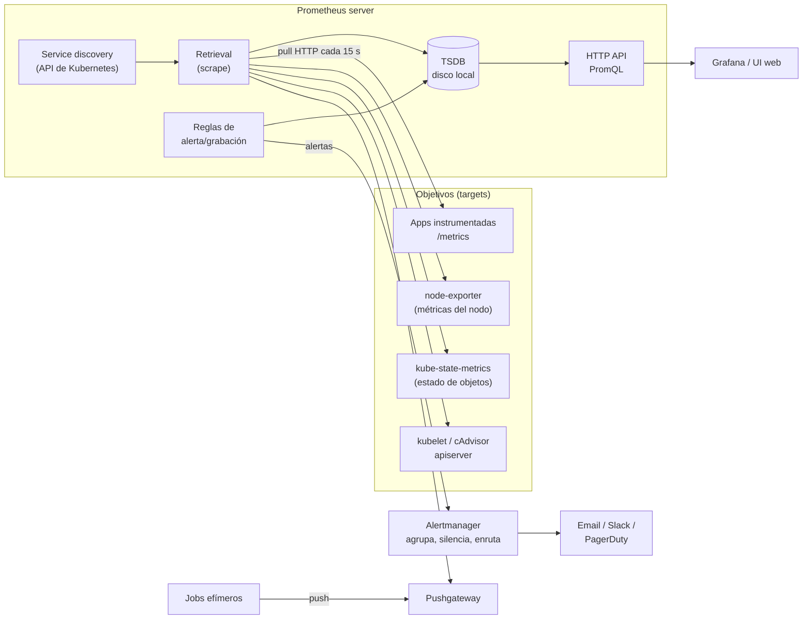
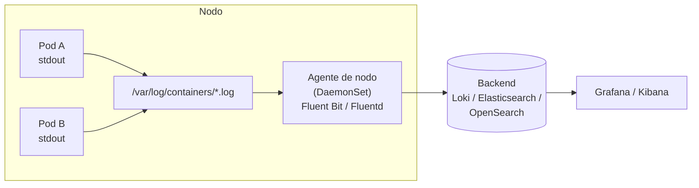

# Módulo 11 — Observabilidad: métricas, logs, trazas y costos

> **Dominio KCNA:** Cloud Native Architecture (12%) → competencia *Observability*
> **Tiempo estimado:** 2 h 30 min · **Prerrequisitos:** Deployments, Services, DaemonSets, Helm básico, `kubectl top` (módulo 10)
> **Lecciones equivalentes de KodeKloud:** "Observability Fundamentals", "Prometheus", "Prometheus Architecture", "Node Exporter", "Prometheus Configuration", "Metric Types", "PromQL", "Container and Kubernetes Monitoring", "Grafana", "Logging", "Tracing", "Cost Management"

## Objetivos

Al terminar podrás:

- Diferenciar *monitoring* de *observability* y explicar las señales: logs, métricas, trazas (y perfiles/eventos).
- Definir SLI, SLO, SLA y error budget, y calcularlos con un ejemplo.
- Describir la arquitectura de Prometheus (pull, exporters, TSDB, service discovery, Alertmanager, Pushgateway) y sus tipos de métricas.
- Escribir consultas PromQL básicas (`rate`, `sum by`, selectores) sobre métricas reales de Kubernetes.
- Situar cada herramienta: cAdvisor, kube-state-metrics, node-exporter, metrics-server, Grafana, Fluent Bit/Fluentd, Loki, OpenTelemetry, Jaeger, OpenCost.
- Aplicar ideas básicas de FinOps: right-sizing comparando `requests` con el uso real.

## Conceptos

### 1. Monitoring vs observability

- **Monitoring** (monitoreo): vigilar indicadores **conocidos de antemano** y alertar cuando cruzan un umbral. Responde "¿está pasando X?" (¿CPU > 90%?, ¿la web responde?).
- **Observability** (observabilidad): capacidad de entender el estado interno de un sistema a partir de las señales que emite, incluso ante problemas **que no anticipaste**. Responde "¿por qué está pasando esto?".

Analogía: el tablero de un auto (luces de aceite, temperatura) es monitoreo. El escáner del mecánico, que lee todo lo que registra la computadora del motor para averiguar por qué tironea, es observabilidad. Con microservicios, una petición cruza decenas de servicios y los fallos son combinaciones imprevistas: el tablero ya no basta.

### 2. Las señales (pilares) de la observabilidad

| Señal | Qué es | Ejemplo | Herramientas típicas |
|---|---|---|---|
| **Logs** | Registros de eventos discretos, con marca de tiempo, en texto o JSON | `2026-10-23 ERROR pago rechazado id=123` | Fluent Bit, Fluentd, Loki, Elasticsearch/OpenSearch |
| **Métricas** (*metrics*) | Valores numéricos agregados a lo largo del tiempo (series temporales) | `http_requests_total{code="500"} 42` | Prometheus, Grafana, Thanos, Cortex/Mimir |
| **Trazas** (*traces*) | El recorrido de **una** petición a través de varios servicios, dividido en *spans* | checkout → pagos (120 ms) → inventario (30 ms) | OpenTelemetry, Jaeger, Zipkin, Tempo |
| **Perfiles** (*profiles*) | Dónde gasta CPU/memoria el código (funciones) | Flame graph de un servicio lento | Pyroscope, Parca |
| **Eventos** | Cambios de estado significativos | Eventos de Kubernetes (`kubectl get events`), despliegues | API de Kubernetes, exportadores de eventos |

Las métricas te dicen **que** algo va mal (barato, ideal para alertas), las trazas **dónde** (qué servicio de la cadena) y los logs **por qué** (el detalle). Las herramientas modernas las enlazan: de un pico en una gráfica saltas a las trazas de ese minuto y de ahí a los logs de ese pod.

### 3. SLI, SLO, SLA y error budget

| Término | Qué es | Ejemplo |
|---|---|---|
| **SLI** (*Service Level Indicator*) | Una medida concreta de la calidad del servicio | % de peticiones HTTP respondidas con éxito en < 300 ms |
| **SLO** (*Service Level Objective*) | El objetivo interno para ese SLI en una ventana de tiempo | SLI ≥ 99,9% cada 30 días |
| **SLA** (*Service Level Agreement*) | Contrato con el cliente, con consecuencias (penalizaciones) si no se cumple | 99,5% mensual o se devuelve el 10% de la factura |
| **Error budget** | Lo que te puedes permitir fallar: `100% − SLO` | 0,1% de 30 días ≈ **43 minutos** de indisponibilidad al mes |

El SLO suele ser **más estricto** que el SLA (margen de seguridad). El **error budget** es la herramienta de negociación del SRE: si queda presupuesto, se puede desplegar más rápido y experimentar; si se agotó, se congelan los cambios y se prioriza la fiabilidad.

Cálculo rápido: 99% → 7,2 h/mes · 99,9% → 43,2 min/mes · 99,99% → 4,3 min/mes.

### 4. Prometheus

**Prometheus** es el sistema de monitoreo y base de datos de series temporales de referencia en cloud native. Fue el **segundo proyecto graduado** de la CNCF (2018), después de Kubernetes. Está pensado para métricas (no para logs ni trazas) y para fiabilidad: cada servidor es autónomo.



| Pieza | Función |
|---|---|
| **Modelo pull** | Prometheus **va a buscar** (*scrape*) las métricas por HTTP a cada target (normalmente `/metrics`). Si un target no responde, `up` = 0: el propio fallo es una señal |
| **Exporters** | Traducen métricas de algo que no habla Prometheus: **node-exporter** (Linux), blackbox (sondas HTTP/TCP), MySQL, Redis... |
| **TSDB** | Base de datos de series temporales en disco local. Para retención larga o alta disponibilidad se usan Thanos, Cortex/Mimir |
| **Service discovery** | Descubre targets automáticamente (Kubernetes, nubes, DNS, archivos) en vez de listarlos a mano |
| **Pushgateway** | Para trabajos **de vida corta** (batch) que terminan antes de ser scrapeados: empujan sus métricas y Prometheus las recoge de ahí |
| **Alertmanager** | Recibe las alertas que generan las reglas, las **deduplica, agrupa, silencia** y las **enruta** a canales de notificación |
| **PromQL** | Lenguaje de consulta |

**Configuración** (`prometheus.yml`), simplificada:

```yaml
global:
  scrape_interval: 15s          # cada cuánto se scrapea
scrape_configs:
  - job_name: prometheus        # el propio servidor
    static_configs:
      - targets: ["localhost:9090"]
  - job_name: kubernetes-pods   # descubrimiento automático de pods
    kubernetes_sd_configs:
      - role: pod
    relabel_configs:            # solo los pods anotados con prometheus.io/scrape: "true"
      - source_labels: [__meta_kubernetes_pod_annotation_prometheus_io_scrape]
        action: keep
        regex: "true"
```

Las anotaciones `prometheus.io/scrape|port|path` son una **convención** que implementa esta configuración (la del chart que usarás), no una API de Kubernetes. En instalaciones con el **Prometheus Operator** (chart `kube-prometheus-stack`) se usan CRDs: `ServiceMonitor`, `PodMonitor` y `PrometheusRule`.

### 5. Formato y tipos de métricas

Una métrica es un **nombre** + **labels** (dimensiones) + **valor**. Cada combinación única de labels es una **serie temporal**.

```text
# HELP http_requests_total Peticiones HTTP atendidas.
# TYPE http_requests_total counter
http_requests_total{method="GET", code="200"} 1027
http_requests_total{method="GET", code="500"} 3
```

| Tipo | Comportamiento | Ejemplo | Cómo se consulta |
|---|---|---|---|
| **Counter** | Solo sube (o vuelve a 0 al reiniciar) | Peticiones totales, errores, segundos de CPU | Con `rate()`/`increase()`, nunca el valor crudo |
| **Gauge** | Sube y baja | Memoria en uso, temperatura, pods en cola | Valor directo, `avg`, `max` |
| **Histogram** | Cuenta observaciones en **buckets** configurables; expone `_bucket`, `_sum`, `_count` | Latencia de peticiones | `histogram_quantile(0.95, ...)` en el servidor |
| **Summary** | Calcula **cuantiles en el cliente**; expone `{quantile="0.95"}`, `_sum`, `_count` | Latencia (cuando no necesitas agregar entre instancias) | Directo; no se puede agregar entre pods |

Ojo con la **cardinalidad**: un label con valores ilimitados (ID de usuario, URL completa) multiplica las series y puede tumbar Prometheus.

### 6. PromQL básico

| Concepto | Ejemplo | Significado |
|---|---|---|
| Selector instantáneo | `up` | Último valor de cada serie llamada `up` |
| Filtro por label | `up{job="kubernetes-pods"}` | `=`, `!=`, `=~` (regex), `!~` |
| Regex | `kube_pod_status_phase{namespace=~"lab-.*"}` | Todos los namespaces de labs |
| Rango | `container_cpu_usage_seconds_total[2m]` | Todas las muestras de los últimos 2 min (*range vector*) |
| `rate()` | `rate(http_requests_total[5m])` | Incremento **por segundo**, promedio en 5 min (para counters) |
| `increase()` | `increase(http_requests_total[1h])` | Cuánto subió en 1 hora |
| Agregación | `sum by (namespace) (...)` | Suma agrupando por namespace (`avg`, `max`, `min`, `count`, `topk`) |
| Aritmética | `node_memory_MemAvailable_bytes / node_memory_MemTotal_bytes * 100` | % de memoria libre |
| Comparación | `up == 0` | Filtra las series que cumplen (targets caídos) |
| Cuantil | `histogram_quantile(0.95, sum by (le) (rate(http_request_duration_seconds_bucket[5m])))` | Latencia p95 |

### 7. Monitorear contenedores y Kubernetes

| Fuente | Qué mide | Dónde corre | Lo usa |
|---|---|---|---|
| **cAdvisor** | CPU, memoria, red y disco **por contenedor** (`container_*`) | Integrado en el **kubelet** | Prometheus (job `kubernetes-nodes-cadvisor`) |
| **kube-state-metrics** | **Estado de los objetos** de la API: réplicas deseadas/disponibles, fase de pods, reinicios, requests (`kube_*`) | Deployment | Prometheus |
| **node-exporter** | Métricas del **sistema operativo** del nodo: CPU, memoria, disco, red, load (`node_*`) | **DaemonSet** (un pod por nodo) | Prometheus |
| **metrics-server** | Solo CPU/memoria **actual** de pods y nodos, en memoria, sin historial | Deployment, expone la **Metrics API** | `kubectl top`, **HPA**, VPA |
| Componentes del control plane | Métricas propias en `/metrics` (apiserver, scheduler, etcd...) | Control plane | Prometheus |

> **metrics-server ≠ Prometheus**: metrics-server es un agregador ligero para el autoescalado y `kubectl top`; no guarda historia, no tiene lenguaje de consultas ni alertas. Prometheus es una plataforma de monitoreo completa. Pueden (y suelen) convivir.

### 8. Grafana

**Grafana** (de Grafana Labs, no es un proyecto CNCF) es la herramienta de **visualización** más usada: dashboards con gráficas sobre muchas **fuentes de datos** (Prometheus, Loki, Tempo, Jaeger, Elasticsearch, bases SQL...), variables, alertas y paneles compartidos. Hay miles de dashboards comunitarios listos para importar (p. ej. "Node Exporter Full"). Prometheus tiene una UI web sencilla para consultas; Grafana es donde se construyen los tableros para el día a día.

### 9. Logging en Kubernetes

- Las aplicaciones deben escribir sus logs en **stdout/stderr** (Twelve-Factor). El runtime los guarda en archivos del nodo (`/var/log/pods/...`, enlazados en `/var/log/containers/`) y el kubelet los rota. `kubectl logs` lee esos archivos.
- Si el pod se borra o el nodo muere, esos logs desaparecen. Kubernetes **no trae** logging a nivel de clúster: hay que montarlo.



| Patrón | Cómo funciona | Cuándo |
|---|---|---|
| **Agente a nivel de nodo** (DaemonSet) | Un agente por nodo lee los archivos de logs de todos los contenedores y los envía al backend | El más común y recomendado |
| **Sidecar** | Un contenedor extra en el pod lee los logs de la app (p. ej. de un archivo) y los envía o los saca por stdout | Apps que escriben en archivos, formatos especiales |
| **Directo desde la app** | La app envía sus logs al backend con una librería | Casos concretos; acopla la app al backend |

- **Fluentd** (CNCF graduado) y **Fluent Bit** (su hermano ligero, escrito en C, ideal como agente de nodo): recogen, filtran, enriquecen (añaden labels de Kubernetes) y reenvían logs.
- **Loki** (Grafana Labs): almacena logs indexando **solo labels** (como Prometheus), no el texto completo: barato. Se consulta con LogQL desde Grafana.
- **EFK/ELK**: Elasticsearch (u OpenSearch) + Fluentd/Logstash + Kibana: indexado completo, búsquedas potentes, más costoso.

### 10. Tracing distribuido

- Una **traza** (*trace*) representa una petición de principio a fin; está formada por **spans** (cada operación: llamada HTTP, consulta SQL), con inicio, duración, atributos y relación padre-hijo.
- El **contexto** (trace ID) viaja entre servicios en cabeceras (estándar W3C `traceparent`): eso es la **propagación de contexto**.
- **OpenTelemetry (OTel)**: proyecto CNCF (fusión de OpenTracing y OpenCensus en 2019) que estandariza **cómo se generan y transportan** trazas, métricas y logs: APIs y SDKs por lenguaje, auto-instrumentación, el protocolo **OTLP** y el **OpenTelemetry Collector** (recibe, procesa y exporta a cualquier backend). **No almacena** datos: es neutral respecto al proveedor.
- **Jaeger** (CNCF graduado): backend y UI para almacenar y visualizar trazas (acepta OTLP). Alternativas: Zipkin, Grafana Tempo.
- Un **service mesh** (Istio, Linkerd) puede generar spans de red sin tocar el código, pero la propagación del contexto sigue necesitando que la app reenvíe las cabeceras.

### 11. Gestión de costos (FinOps)

- **FinOps** es la práctica (y cultura) de dar **responsabilidad financiera** a los equipos sobre su uso de la nube. La FinOps Foundation (también parte de la Linux Foundation) define tres fases: **Inform** (visibilidad: quién gasta qué), **Optimize** (reducir) y **Operate** (mejora continua).
- Modelos de precio en la nube: **on-demand** (pagas por uso, flexible, caro), **reservas/compromisos** (descuento por comprometer 1-3 años), **spot/preemptible** (muy barato, pero el proveedor puede quitarte la máquina: ideal para cargas tolerantes a fallos y batch).
- En Kubernetes, lo que "ocupa" un nodo son los **`requests`**, no el uso real. Pedir 1 CPU y usar 50m es pagar 20 veces de más: el scheduler reserva ese espacio y el Cluster Autoscaler añade nodos para cumplirlo.
- **Right-sizing**: ajustar `requests`/`limits` al uso observado (Prometheus, VPA en modo recomendación). Otras palancas: autoscaling (HPA, Cluster Autoscaler/Karpenter, escalar a cero), apagar entornos de desarrollo fuera de horario, nodos spot, limpiar volúmenes huérfanos.
- **Showback** (mostrar a cada equipo su costo) y **chargeback** (cobrárselo), usando **labels** y namespaces para asignar costos.
- **OpenCost**: proyecto CNCF que calcula el costo de cada namespace, Deployment, label o pod combinando las métricas del clúster con los precios del proveedor. Kubecost es un producto comercial construido sobre él.

## Comandos clave

| Comando | Qué hace |
|---|---|
| `helm repo add prometheus-community https://prometheus-community.github.io/helm-charts` | Añade el repositorio de charts de Prometheus |
| `helm install prometheus prometheus-community/prometheus -n lab-11 -f values.yaml` | Instala Prometheus con tus valores |
| `helm list -n lab-11` / `helm uninstall prometheus -n lab-11` | Ver / desinstalar la release |
| `kubectl port-forward -n lab-11 svc/prometheus-server 9090:80` | UI de Prometheus en http://localhost:9090 |
| `kubectl get --raw /api/v1/namespaces/<ns>/services/<svc>:<puerto>/proxy/<ruta>` | Llamar a un Service por el proxy del apiserver (sin port-forward) |
| `kubectl logs` / `kubectl get events` | Logs y eventos (la observabilidad "de serie" de Kubernetes) |
| `kubectl top pods --sort-by=cpu` | Uso actual según metrics-server |

## Laboratorio guiado

Instalarás un Prometheus ligero con Helm (sin Alertmanager ni Pushgateway, sin disco persistente), con **kube-state-metrics** y **node-exporter**, y harás tus primeras consultas PromQL sobre el propio clúster.

> Las imágenes del chart se precargan con `.\kcna.ps1 lab 11` porque los nodos de este clúster están detrás de un proxy y no salen a internet. En un clúster normal no hace falta. Helm sí descarga el chart desde Windows sin problema.

> **RAM:** este lab añade ~450 MiB al clúster. Al terminar ejecuta la limpieza (`.\kcna.ps1 reset 11`), que desinstala todo.

### 1. Preparar el lab

```powershell
cd C:\Users\80846\KubernetesLearning
.\kcna.ps1 lab 11
. .\kcna-env.ps1
```

```text
  OK  ya cargada: quay.io/prometheus/prometheus:v3.15.1
  OK  ya cargada: quay.io/prometheus-operator/prometheus-config-reloader:v0.94.2
  OK  ya cargada: quay.io/prometheus/node-exporter:v1.12.1
  OK  ya cargada: registry.k8s.io/kube-state-metrics/kube-state-metrics:v2.20.0
  OK  ya cargada: busybox:1.37
  OK  Namespace listo: lab-11
```

La primera vez verás `Descargando ...` en lugar de `ya cargada` (tarda unos minutos).

### 2. Añadir el repositorio del chart

```powershell
helm repo add prometheus-community https://prometheus-community.github.io/helm-charts
helm repo update prometheus-community
helm search repo prometheus-community/prometheus --versions | Select-Object -First 3
```

```text
NAME                              CHART VERSION   APP VERSION   DESCRIPTION
prometheus-community/prometheus   29.37.2         v3.15.1       Prometheus is a monitoring system and time seri...
prometheus-community/prometheus   29.37.1         v3.15.1       Prometheus is a monitoring system and time seri...
```

Qué observar: la versión del **chart** (29.37.2) es distinta de la versión de la **aplicación** (Prometheus v3.15.1). Fijamos la del chart para que el lab sea reproducible.

### 3. Revisar los valores y las imágenes

Abre `labs\11-observabilidad\prometheus-values.yaml`: desactiva `alertmanager` y `prometheus-pushgateway`, deja `kube-state-metrics` y `prometheus-node-exporter`, y quita el volumen persistente.

Para saber qué imágenes usa un chart antes de instalarlo (útil en este clúster sin internet), `kcna.ps1` renderiza el chart con `helm template` y carga lo que encuentra:

```powershell
.\kcna.ps1 chart-images prometheus prometheus-community/prometheus --version 29.37.2 -n lab-11 -f labs\11-observabilidad\prometheus-values.yaml
```

```text
  OK  ya cargada: quay.io/prometheus/node-exporter:v1.12.1
  OK  ya cargada: registry.k8s.io/kube-state-metrics/kube-state-metrics:v2.20.0
  OK  ya cargada: quay.io/prometheus-operator/prometheus-config-reloader:v0.94.2
  OK  ya cargada: quay.io/prometheus/prometheus:v3.15.1
```

Qué observar: son 4 componentes: el servidor, un *config reloader* (sidecar que recarga la configuración cuando cambia el ConfigMap), node-exporter y kube-state-metrics.

### 4. Instalar Prometheus

```powershell
helm install prometheus prometheus-community/prometheus --version 29.37.2 -n lab-11 -f labs\11-observabilidad\prometheus-values.yaml --wait --timeout 5m
```

```text
NAME: prometheus
NAMESPACE: lab-11
STATUS: deployed
REVISION: 1
...
The Prometheus server can be accessed via port 80 on the following DNS name from within your cluster:
prometheus-server.lab-11.svc.cluster.local
...
######   WARNING: Persistence is disabled!!! You will lose your data when   #####
######            the Server pod is terminated.                             #####
```

```powershell
k get pods -n lab-11 -o wide
```

```text
NAME                                             READY   STATUS    RESTARTS   AGE   IP             NODE
prometheus-kube-state-metrics-5b87f48847-nlhrx   1/1     Running   0          46s   10.244.1.105   kcna-worker2
prometheus-prometheus-node-exporter-426r2        1/1     Running   0          46s   10.89.4.2      kcna-worker
prometheus-prometheus-node-exporter-dwwjw        1/1     Running   0          46s   10.89.4.3      kcna-worker2
prometheus-prometheus-node-exporter-ftcd7        1/1     Running   0          46s   10.89.4.4      kcna-control-plane
prometheus-server-5f6f475b8c-tvxbh               2/2     Running   0          46s   10.244.1.106   kcna-worker2
```

Qué observar: node-exporter es un **DaemonSet** (uno por nodo, incluido el control-plane) y su IP es la **del nodo** (`hostNetwork`), porque mide el nodo, no el pod. El servidor tiene 2 contenedores: Prometheus + config reloader.

### 5. Abrir la UI con port-forward

```powershell
k port-forward -n lab-11 svc/prometheus-server 9090:80
```

Deja esa terminal abierta (o usa una segunda terminal para los siguientes comandos) y abre http://localhost:9090. Ve a **Status → Target health**:

```text
kubernetes-api-servers         1/1 up
kubernetes-nodes               3/3 up
kubernetes-nodes-cadvisor      3/3 up
kubernetes-pods                ... up
kubernetes-service-endpoints   7/7 up
prometheus                     1/1 up
```

Qué observar: nadie escribió esos targets a mano: los encontró el **service discovery** de Kubernetes. `kubernetes-service-endpoints` incluye kube-state-metrics y los 3 node-exporters (Services anotados); `kubernetes-nodes-cadvisor` son los cAdvisor de los 3 kubelets. En `kubernetes-pods` pueden aparecer pods de otros labs que tengan anotaciones de Prometheus.

### 6. Ver la configuración que generó el chart

```powershell
k get configmap prometheus-server -n lab-11 -o jsonpath='{.data.prometheus\.yml}' | Select-String -Pattern 'job_name|scrape_interval'
```

```text
  scrape_interval: 15s
- job_name: kubernetes-api-servers
- job_name: kubernetes-nodes
- job_name: kubernetes-nodes-cadvisor
- job_name: kubernetes-pods
- job_name: kubernetes-pods-slow
  scrape_interval: 5m
- job_name: kubernetes-service-endpoints
...
- job_name: prometheus
```

Qué observar: cada `job_name` es un bloque de `scrape_configs`. Busca en el YAML completo `__meta_kubernetes_pod_annotation_prometheus_io_scrape`: es la regla que hace que un pod con la anotación `prometheus.io/scrape: "true"` se scrapee (la usarás en el reto).

### 7. Mirar métricas "en crudo" de un exporter

Lo que Prometheus scrapea es texto plano. Puedes leerlo a través del proxy del apiserver, sin port-forward:

```powershell
k get --raw /api/v1/namespaces/lab-11/services/prometheus-prometheus-node-exporter:9100/proxy/metrics | Select-String -Pattern '^# TYPE node_load1|^node_load1 |^# TYPE node_cpu_seconds_total'
```

```text
# TYPE node_cpu_seconds_total counter
# TYPE node_load1 gauge
node_load1 10.02
```

Qué observar: el formato de exposición declara el **tipo**: `node_cpu_seconds_total` es un **counter** (segundos acumulados de CPU) y `node_load1` un **gauge**.

### 8. Consultas PromQL guiadas

En la UI, pestaña **Query**: escribe cada consulta, pulsa **Execute** y alterna entre **Table** y **Graph**. Tus números serán distintos.

**a) ¿Qué targets están arriba?**

```promql
count by (job) (up)
```

```text
{job="kubernetes-service-endpoints"}  7
{job="kubernetes-nodes"}              3
{job="kubernetes-nodes-cadvisor"}     3
{job="kubernetes-api-servers"}        1
{job="prometheus"}                    1
{job="kubernetes-pods"}               1
```

Prueba también `up == 0` (targets caídos: lo ideal es "Empty query result").

**b) CPU por pod (counter → `rate`)**

```promql
sum by (pod) (rate(container_cpu_usage_seconds_total{namespace="lab-11", container!=""}[2m]))
```

```text
{pod="prometheus-server-5f6f475b8c-tvxbh"}               0.075
{pod="prometheus-prometheus-node-exporter-dwwjw"}        0.012
{pod="prometheus-kube-state-metrics-5b87f48847-nlhrx"}   0.008
...
```

Qué observar: el resultado está en **núcleos** (0.075 = 75m). `container!=""` descarta la serie agregada del pod completo que también publica cAdvisor. Sin `rate()` verías segundos acumulados desde el arranque, que no dicen nada.

**c) Memoria por namespace (gauge)**

```promql
sum by (namespace) (container_memory_working_set_bytes{container!=""}) / 1024 / 1024
```

```text
{namespace="kube-system"}   1102.5
{namespace="lab-11"}         356.4
{namespace="traefik"}         35.1
...
```

Qué observar: MiB por namespace. Es la misma métrica (*working set*) que usa `kubectl top` y la que vigila el OOM killer.

**d) Estado de los pods (kube-state-metrics)**

```promql
sum by (phase) (kube_pod_status_phase)
```

```text
{phase="Running"}     56
{phase="Succeeded"}    3
{phase="Pending"}      0
{phase="Failed"}       0
{phase="Unknown"}      0
```

Qué observar: kube-state-metrics publica una serie por pod y fase con valor 1 o 0; sumando obtienes cuántos pods hay en cada fase en todo el clúster. Una alerta clásica: `sum(kube_pod_status_phase{phase="Pending"}) > 0` durante 10 minutos.

**e) Memoria disponible en los nodos (node-exporter)**

```promql
round(100 * node_memory_MemAvailable_bytes / node_memory_MemTotal_bytes)
```

```text
{node="kcna-control-plane", ...}   60
{node="kcna-worker", ...}          60
{node="kcna-worker2", ...}         60
```

Qué observar: los tres "nodos" dan lo mismo porque en kind son contenedores que comparten la misma máquina virtual de Podman. En un clúster real cada nodo sería distinto.

**f) FinOps: lo que pides vs lo que usas**

```promql
sum by (pod) (kube_pod_container_resource_requests{namespace="lab-11", resource="memory"}) / 1024 / 1024
```

```promql
sum by (pod) (container_memory_working_set_bytes{namespace="lab-11", container!=""}) / 1024 / 1024
```

```text
pod                             requests (MiB)   uso real (MiB)
prometheus-server-...                 256           ~330-400
prometheus-kube-state-metrics-...      32              ~24
prometheus-node-exporter-... (x3)      16              ~9
```

Qué observar: el servidor de Prometheus usa **más** memoria de la que pide (el scheduler podría meterlo en un nodo sin espacio real → riesgo de presión de memoria); node-exporter pide casi el doble de lo que usa (desperdicio, aunque pequeño). Esa comparación, hecha para todo el clúster, es la base del *right-sizing* y de herramientas como OpenCost o el VPA en modo recomendación.

### 9. (Opcional) Consultar la API de Prometheus sin navegador

La UI usa una API HTTP que también puedes llamar tú. Con el port-forward abierto:

```powershell
(Invoke-WebRequest -UseBasicParsing 'http://localhost:9090/api/v1/query?query=up').Content
```

O sin port-forward, por el proxy del apiserver (así lo hace `.\kcna.ps1 check 11`):

```powershell
$q = [uri]::EscapeDataString('count(up == 1)')
k get --raw "/api/v1/namespaces/lab-11/services/prometheus-server:80/proxy/api/v1/query?query=$q"
```

```text
{"status":"success","data":{"resultType":"vector","result":[{"metric":{},"value":[1792776200.216,"18"]}]}}
```

## Reto

La tienda del equipo de ventas ya expone métricas, pero nadie las ve. En `lab-11`:

1. Despliega `labs\11-observabilidad\02-tienda.yaml` y comprueba que la app sirve métricas en el puerto `8080`, ruta `/metrics.txt` (pista: `k exec -n lab-11 deploy/tienda -- wget -qO- localhost:8080/metrics.txt`).
2. Comprueba en **Status → Target health** que Prometheus **no** la está scrapeando.
3. Modifica el Deployment para que Prometheus la descubra con las anotaciones de la convención (`scrape`, `port` y `path`) **en los pods**, y escálalo a **2 réplicas**.
4. En la UI, calcula los pedidos por segundo por método de pago con `rate()` sobre `tienda_pedidos_total`, y el promedio de `tienda_carrito_items`.

```powershell
.\kcna.ps1 check 11
```

El check verifica: Prometheus en `lab-11`, kube-state-metrics y node-exporter scrapeados, `tienda` con 2 réplicas listas y las 3 anotaciones, 2 targets de `tienda` con `up == 1`, y que `tienda_pedidos_total` crece. Tras aplicar el cambio, espera ~1 minuto antes de verificar (descubrimiento + 2 scrapes).

<details><summary>Ver solución</summary>

Las anotaciones van en `spec.template.metadata` (los **pods**), no en el `metadata` del Deployment: el job `kubernetes-pods` mira las anotaciones de cada pod.

```yaml
spec:
  replicas: 2
  ...
  template:
    metadata:
      annotations:
        prometheus.io/scrape: "true"
        prometheus.io/port: "8080"
        prometheus.io/path: "/metrics.txt"
      labels:
        app: tienda
```

```powershell
k apply -f labs\11-observabilidad\02-tienda.yaml     # tras editar una copia o el propio archivo
k rollout status deployment/tienda -n lab-11
```

Consultas:

```promql
sum by (metodo) (rate(tienda_pedidos_total[1m]))
avg(tienda_carrito_items)
up{app="tienda"}
```

```text
{metodo="tarjeta"}    0.889
{metodo="efectivo"}   0.222
{}                    39.5
up{app="tienda", instance="10.244.2.122:8080", job="kubernetes-pods", namespace="lab-11", pod="tienda-856f956f9f-b2w7k", ...}  1
up{app="tienda", instance="10.244.1.111:8080", job="kubernetes-pods", namespace="lab-11", pod="tienda-856f956f9f-8szwz", ...}  1
```

Fíjate en que los labels del pod (`app`, `pod_template_hash`) y `namespace`, `pod`, `node` se añadieron solos a cada serie: lo hacen las reglas de *relabeling* del job.

```text
==> Verificando 11-observabilidad
  OK  Prometheus server corriendo en lab-11 (helm release 'prometheus', pod Ready)
  OK  kube-state-metrics y node-exporter estan siendo scrapeados (up == 1)
  OK  Deployment 'tienda' en lab-11 con 2 replicas listas
  OK  Los pods de 'tienda' tienen las anotaciones prometheus.io/scrape, port y path
  OK  Prometheus ve 2 targets de 'tienda' con up == 1 (job kubernetes-pods)
  OK  La metrica tienda_pedidos_total crece: sum(rate(...[1m])) > 0

  Lab completado: 6/6
```

</details>

## Preguntas tipo examen

**1.** What is the main difference between monitoring and observability?

- A. Monitoring uses logs only; observability uses metrics only
- B. Monitoring tracks known conditions; observability lets you understand internal state and investigate unknown problems from the system's outputs
- C. Observability is a Prometheus feature
- D. There is no difference

<details><summary>Respuesta</summary>

**B.** El monitoreo vigila condiciones previstas (umbrales); la observabilidad permite preguntar "por qué" a partir de logs, métricas y trazas, incluso ante fallos imprevistos.
</details>

**2.** Which data collection model does Prometheus primarily use?

- A. Agents push metrics to Prometheus over UDP
- B. Prometheus pulls (scrapes) metrics from targets over HTTP
- C. Prometheus reads metrics from etcd
- D. Prometheus tails log files on each node

<details><summary>Respuesta</summary>

**B.** Modelo *pull*: Prometheus scrapea el endpoint `/metrics` de cada target. El Pushgateway existe solo para trabajos de vida corta.
</details>

**3.** Which Prometheus component deduplicates, groups and routes alerts to receivers such as email or Slack?

- A. Pushgateway
- B. node-exporter
- C. Alertmanager
- D. kube-state-metrics

<details><summary>Respuesta</summary>

**C.** Prometheus evalúa las reglas y envía las alertas a Alertmanager, que las agrupa, silencia y enruta.
</details>

**4.** Which metric type should be used for a value that can go up and down, such as current memory usage?

- A. Counter
- B. Gauge
- C. Histogram
- D. Summary

<details><summary>Respuesta</summary>

**B.** Gauge. Un counter solo sube (o se reinicia a 0); histogram y summary describen distribuciones (p. ej. latencias).
</details>

**5.** Which PromQL function calculates the per-second average rate of increase of a counter over a time range?

- A. `sum()`
- B. `avg_over_time()`
- C. `rate()`
- D. `count()`

<details><summary>Respuesta</summary>

**C.** `rate(metric[5m])`. Siempre se aplica a counters, nunca a gauges.
</details>

**6.** What is the purpose of the Prometheus Pushgateway?

- A. To replace Alertmanager
- B. To let short-lived batch jobs expose metrics that Prometheus can scrape later
- C. To push metrics from Prometheus to Grafana
- D. To store metrics long-term

<details><summary>Respuesta</summary>

**B.** Un job que dura segundos podría terminar antes del siguiente scrape; empuja sus métricas al Pushgateway y Prometheus las recoge de ahí.
</details>

**7.** Which component exposes metrics about the state of Kubernetes objects, such as desired vs available replicas of a Deployment?

- A. cAdvisor
- B. node-exporter
- C. kube-state-metrics
- D. metrics-server

<details><summary>Respuesta</summary>

**C.** kube-state-metrics lee la API y publica el estado de los objetos (`kube_*`). cAdvisor da uso de recursos por contenedor, node-exporter métricas del SO del nodo y metrics-server solo CPU/memoria actuales para HPA y `kubectl top`.
</details>

**8.** Which statement about metrics-server is correct?

- A. It stores months of metrics history for dashboards
- B. It provides current CPU and memory usage through the Metrics API, used by `kubectl top` and the HPA
- C. It is required to run Prometheus
- D. It collects application logs

<details><summary>Respuesta</summary>

**B.** metrics-server es ligero y sin historial; no sustituye a Prometheus ni es necesario para él.
</details>

**9.** What is the recommended way for containerized applications to emit logs in Kubernetes?

- A. Write to a file inside the container's filesystem
- B. Write to stdout and stderr, and collect them with a node-level agent
- C. Send them to etcd
- D. Store them in a ConfigMap

<details><summary>Respuesta</summary>

**B.** stdout/stderr; el runtime los guarda en el nodo y un agente (DaemonSet como Fluent Bit) los envía a un backend central.
</details>

**10.** Which CNCF project provides vendor-neutral APIs, SDKs and a collector for generating and exporting traces, metrics and logs?

- A. Jaeger
- B. OpenTelemetry
- C. Fluentd
- D. Grafana

<details><summary>Respuesta</summary>

**B.** OpenTelemetry instrumenta y transporta la telemetría (OTLP, Collector); Jaeger es un backend para almacenar/visualizar trazas y Grafana visualiza.
</details>

**11.** A service has an SLO of 99.9% availability over 30 days. What is its approximate error budget?

- A. 4.3 minutes
- B. 43 minutes
- C. 7.2 hours
- D. 3.6 days

<details><summary>Respuesta</summary>

**B.** 0,1% de 30 días = 0,001 × 43.200 min ≈ 43 minutos.
</details>

**12.** In a FinOps context, what does right-sizing Kubernetes workloads mainly involve?

- A. Always setting requests equal to node capacity
- B. Adjusting resource requests and limits to match observed usage
- C. Removing all resource limits
- D. Using only on-demand instances

<details><summary>Respuesta</summary>

**B.** Los nodos se "llenan" según los `requests`; ajustarlos al uso real evita pagar capacidad reservada que no se usa. Herramientas: Prometheus, VPA (modo recomendación), OpenCost.
</details>

## Resumen para repasar

- Monitoring = condiciones conocidas; observability = entender lo imprevisto. Señales: logs (por qué), métricas (qué), trazas (dónde), + perfiles y eventos.
- SLI (medida) → SLO (objetivo interno) → SLA (contrato). Error budget = 100% − SLO (99,9% ≈ 43 min/mes).
- Prometheus: CNCF graduado, modelo **pull** por HTTP, TSDB local, service discovery, PromQL. Pushgateway = jobs efímeros. Alertmanager = agrupa/silencia/enruta alertas.
- Tipos: counter (solo sube → `rate`), gauge (sube y baja), histogram (buckets, cuantiles en servidor), summary (cuantiles en cliente).
- PromQL: selectores `{label="x"}`, `=~` regex, rangos `[5m]`, `rate()`, `sum by ()`, `topk`, `histogram_quantile`.
- cAdvisor (en el kubelet, contenedores) · kube-state-metrics (estado de objetos) · node-exporter (DaemonSet, SO del nodo) · metrics-server (Metrics API para HPA/top, sin historial, ≠ Prometheus).
- Grafana = dashboards sobre muchas fuentes. Logs: stdout → agente de nodo (Fluent Bit/Fluentd) → Loki/Elasticsearch. Kubernetes no trae logging de clúster.
- Trazas: trace = spans; OpenTelemetry (APIs/SDKs/Collector/OTLP, no almacena) + Jaeger (backend/UI).
- FinOps: Inform → Optimize → Operate; los nodos se llenan por `requests`; right-sizing, spot, autoscaling; OpenCost para costos por namespace/label.

## Limpieza

```powershell
.\kcna.ps1 reset 11
```

`reset 11` ejecuta primero `labs\11-observabilidad\reset.ps1`, que hace `helm uninstall prometheus -n lab-11` (así se borran también los ClusterRoles y ClusterRoleBindings que el chart crea fuera del namespace) y después borra el namespace. Si prefieres hacerlo a mano:

```powershell
helm uninstall prometheus -n lab-11
.\kcna.ps1 reset 11
```
