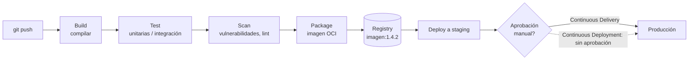
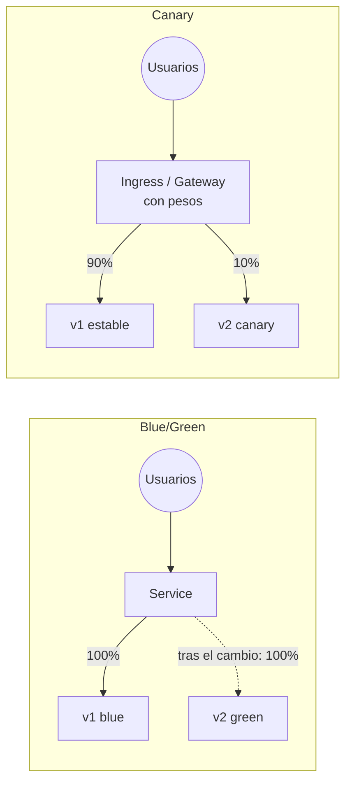
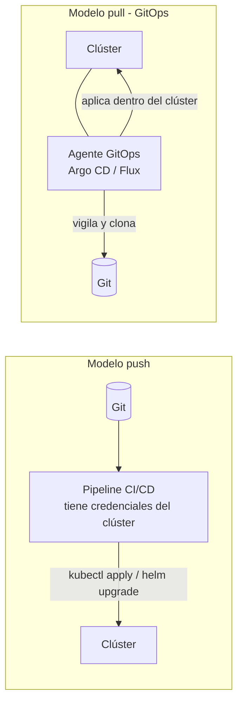
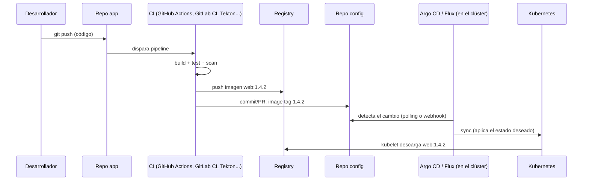
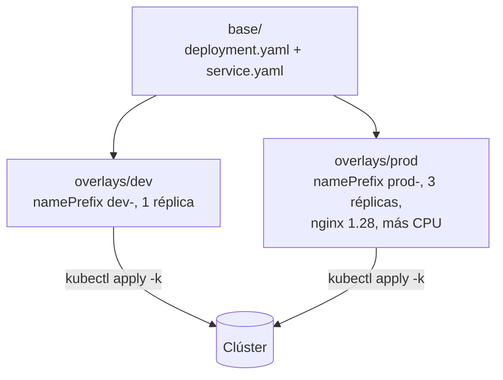
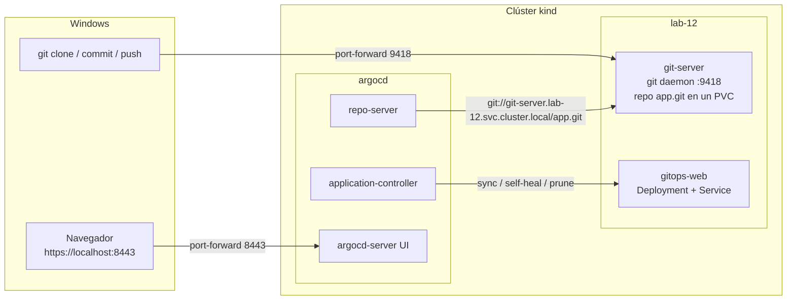

# Módulo 12 — Entrega de aplicaciones: CI/CD, GitOps, Helm y Kustomize

> **Dominio KCNA:** Cloud Native Application Delivery (16%) — competencia *Application Delivery* · **Tiempo:** 3-4 h (partes A y B: 1,5 h; parte C con Argo CD: 1,5 h) · **Prerrequisitos:** módulos 03 (Deployments y rolling updates) y 06 (Services)
>
> **Lecciones equivalentes de KodeKloud:** Application Delivery Fundamentals · GitOps · GitOps Principles · Push vs Pull-based Deployments · CI/CD with GitOps · Argo CD / Flux · CICD Pipeline Demo

## Objetivos

Al terminar podrás:

- Distinguir **integración continua**, **entrega continua** y **despliegue continuo**, y explicar por qué una imagen de contenedor debe ser un **artefacto inmutable**.
- Comparar las estrategias de despliegue (**recreate**, **rolling update**, **blue/green**, **canary**, **A/B testing**) y saber cuáles trae Kubernetes de serie.
- Enunciar los cuatro principios de **GitOps** de OpenGitOps y explicar la diferencia entre despliegue **push** y **pull**.
- Describir la arquitectura de **Argo CD** y **Flux**, y los conceptos de *sync*, *drift*, *self-heal* y *prune*.
- Empaquetar una app con **Helm** (install, upgrade, history, rollback) y adaptarla por entorno con **Kustomize** (base + overlays).
- Montar un flujo GitOps real en tu clúster: un commit en Git cambia lo que corre en Kubernetes, sin tocar `kubectl`.

## Conceptos

### 1. Del código al clúster: los fundamentos de la entrega

Piensa en una panadería industrial. La receta (el código) se prueba en pequeño cada vez que alguien la cambia, luego se hornea un lote sellado y etiquetado (la imagen), se guarda en el almacén (el registry) y finalmente se reparte a las tiendas (los clústeres). Si el lote sale malo, no se "arregla en la tienda": se retira y se reparte el lote anterior.

| Práctica | Qué automatiza | ¿Llega solo a producción? |
|---|---|---|
| **Continuous Integration (CI)** — integración continua | Cada cambio se integra en la rama principal varias veces al día y dispara *build* + pruebas automáticas | No. Su producto es un artefacto probado |
| **Continuous Delivery (CD)** — entrega continua | Todo cambio que pasa el pipeline queda **listo** para producción; se despliega automáticamente en entornos previos | No: el paso a producción requiere una **aprobación manual** (un clic) |
| **Continuous Deployment** — despliegue continuo | Igual que la anterior, pero **sin** aprobación manual | Sí: si pasa todas las pruebas, va directo a producción |

Truco para el examen: las dos "CD" se diferencian solo en el último paso. *Delivery* = listo para salir con un clic humano; *Deployment* = sale solo.

Un **pipeline** es la secuencia automatizada de etapas que recorre un cambio:



Ideas clave que el examen da por sabidas:

- **Artefacto inmutable — "build once, deploy many":** la imagen se construye **una sola vez** y es exactamente la misma la que pasa por dev, staging y producción. Lo que cambia entre entornos es la **configuración** (variables, ConfigMaps, Secrets, réplicas), nunca el binario. Si algo hay que corregir, se construye una imagen nueva con otro tag.
- **Tags con significado:** versión semántica (`1.4.2`) o el SHA del commit (`a1b2c3d`). `latest` es mutable (hoy apunta a una imagen, mañana a otra) y rompe la trazabilidad. Para inmutabilidad total se puede referenciar el **digest**: `nginx@sha256:...`.
- **Registry (registro de imágenes):** servidor que almacena y distribuye imágenes según la especificación **OCI Distribution**. Públicos: Docker Hub, GitHub Container Registry (ghcr.io), Quay.io. Gestionados en nube: Amazon ECR, Google Artifact Registry, Azure ACR. Autoalojado: **Harbor** (proyecto *graduated* de la CNCF, con escaneo de vulnerabilidades, firma y replicación). Hoy los registries OCI guardan también otros artefactos, como charts de Helm.
- **Configuración fuera del código:** la misma imagen se adapta a cada entorno con ConfigMaps/Secrets y con herramientas de plantillas (Helm, Kustomize), que verás más abajo.

### 2. Estrategias de despliegue

Cuando ya tienes la versión nueva, ¿cómo reemplazas la vieja?

| Estrategia | Cómo funciona | Corte de servicio | Coste extra | Rollback | ¿Nativo en Kubernetes? |
|---|---|---|---|---|---|
| **Recreate** | Apaga todas las réplicas viejas y luego arranca las nuevas | **Sí** | Ninguno | Lento (redeploy) | Sí: `strategy.type: Recreate` |
| **Rolling update** | Reemplaza pods de forma gradual, controlado por `maxSurge` y `maxUnavailable` | No | Mínimo (pods de más durante el cambio) | `kubectl rollout undo` | **Sí, es el valor por defecto** de un Deployment |
| **Blue/Green** | Dos entornos completos: *blue* (actual) y *green* (nuevo). Se prueba green y se cambia **todo** el tráfico de golpe (por ejemplo cambiando el selector del Service) | No | **Alto**: el doble de recursos un tiempo | Inmediato: volver el tráfico a blue | A mano (dos Deployments + cambiar el selector) o con herramientas |
| **Canary** | La versión nueva recibe primero un **porcentaje pequeño** del tráfico (5%, 25%, 50%...) mientras se vigilan métricas; si va bien, se sube hasta el 100% | No | Bajo | Rápido: se devuelve el tráfico a la estable | Aproximado con réplicas; preciso con Ingress/Gateway API/service mesh |
| **A/B testing** | Parecido al canary, pero el reparto se decide por **características del usuario** (cabecera, cookie, país, dispositivo) para comparar comportamiento de negocio | No | Bajo | Rápido | No: requiere enrutamiento por capa 7 |



Diferencia fina que a veces preguntan: el **canary** busca reducir el riesgo técnico de una versión nueva (¿falla?, ¿es más lenta?); el **A/B testing** busca una decisión de producto (¿qué variante convierte mejor?).

Para automatizar blue/green y canary con análisis de métricas existen controladores dedicados:

- **Argo Rollouts** (del proyecto Argo, CNCF): un CRD `Rollout` que sustituye al Deployment y añade pasos de canary/blue-green, pausas y análisis automático con Prometheus.
- **Flagger** (del proyecto Flux, CNCF): automatiza canary, A/B y blue/green apoyándose en un service mesh (Istio, Linkerd) o un Ingress/Gateway.
- La **Gateway API** permite repartir tráfico por pesos (`backendRefs` con `weight`) de forma estándar, y los service mesh (Istio, Linkerd) también lo hacen.

### 3. GitOps

**GitOps** es una forma de operar sistemas en la que **Git es la única fuente de verdad** del estado deseado y un **agente automático** se encarga de que el clúster coincida con lo que dice Git. Para cambiar producción no ejecutas comandos: haces un commit (normalmente vía *pull request*, con su revisión).

El grupo de trabajo **OpenGitOps** (proyecto de la CNCF) definió cuatro principios. Apréndelos con su nombre en inglés:

| Principio (OpenGitOps) | Qué significa | Qué te da |
|---|---|---|
| **Declarative** | El estado deseado del sistema se expresa de forma **declarativa** (el *qué*, no el *cómo*): manifiestos YAML, charts, kustomizations | Se puede revisar, comparar y reproducir |
| **Versioned and Immutable** | El estado deseado se guarda de forma que se **versiona**, es **inmutable** y conserva el **historial completo** (Git es el caso típico) | Auditoría (quién cambió qué y cuándo) y rollback con `git revert` |
| **Pulled Automatically** | Los agentes de software **extraen (pull)** automáticamente el estado deseado desde la fuente | No hay que dar credenciales del clúster a sistemas externos |
| **Continuously Reconciled** | Los agentes **observan continuamente** el estado real y **aplican** el estado deseado cuando difieren | Corrección automática del *drift* |

Vocabulario que vas a ver en las preguntas:

- **Desired state** (estado deseado): lo que está en Git. **Actual/live state** (estado real): lo que corre en el clúster.
- **Drift** (deriva): diferencia entre ambos, por ejemplo porque alguien hizo `kubectl edit` a mano.
- **Reconciliation** (reconciliación): el bucle *observar → comparar → actuar*. Es el mismo patrón de los controladores de Kubernetes, aplicado a Git.
- **Sync** (sincronizar): aplicar el estado de Git al clúster.

#### Push vs pull



| | **Push** | **Pull** (GitOps) |
|---|---|---|
| Quién aplica los cambios | El pipeline externo (Jenkins, GitHub Actions...) | Un agente que corre **dentro** del clúster |
| Credenciales del clúster | Guardadas en el sistema de CI (más superficie de ataque) | No salen del clúster; el agente solo necesita **leer** Git |
| Detección de drift | No: aplica y se olvida hasta el próximo pipeline | Sí: reconcilia continuamente |
| Firewall | El CI necesita llegar a la API del clúster | El clúster solo necesita salida hacia Git |
| Ejemplos | `kubectl apply` desde un job de CI | Argo CD, Flux |

### 4. CI/CD con GitOps: quién hace qué

En GitOps la responsabilidad se parte en dos, y lo habitual es tener **dos repositorios**:

- **Repo de la aplicación** (código fuente + Dockerfile). Su pipeline de **CI** compila, prueba, construye la imagen, la sube al registry y, como último paso, **actualiza el repo de configuración** con el nuevo tag (un commit o un *pull request*).
- **Repo de configuración** (manifiestos, charts, overlays por entorno). Lo vigila el agente de **CD** (Argo CD o Flux), que aplica cada cambio al clúster.



Detalles útiles:

- **Promoción entre entornos** = un PR en el repo de configuración (por ejemplo, copiar el tag de `overlays/staging` a `overlays/prod`). El historial de Git es el registro de cambios de producción.
- **Rollback** = `git revert` del commit problemático; el agente vuelve a sincronizar.
- Hay herramientas que automatizan la actualización del tag: **Argo CD Image Updater** y los controladores de *image automation* de Flux.
- El agente detecta cambios por **polling** (Argo CD revisa Git cada ~3 minutos por defecto) o al instante con un **webhook** de GitHub/GitLab.

### 5. Argo CD y Flux

Ambos son proyectos **graduated** de la CNCF (graduaron a finales de 2022) e implementan el modelo pull.

**Argo CD** — componentes (los verás como pods en el namespace `argocd`):

| Componente | Función |
|---|---|
| `argocd-server` | API + **interfaz web** + punto de entrada de la CLI `argocd` |
| `argocd-repo-server` | Clona los repos y **genera los manifiestos** (YAML plano, Helm, Kustomize, Jsonnet) |
| `argocd-application-controller` | El **controlador**: compara estado deseado vs real, calcula el estado de sync y salud, y sincroniza |
| `argocd-redis` | Caché |
| `argocd-dex-server` | SSO (OIDC, GitHub, LDAP...) |
| `argocd-applicationset-controller` | Genera muchas Applications a partir de plantillas (por clúster, por carpeta...) |
| `argocd-notifications-controller` | Avisos a Slack, correo, etc. |

Sus recursos personalizados (CRDs): **Application** (repo + ruta + revisión → clúster + namespace), **AppProject** (agrupa apps y limita a qué repos/destinos pueden ir) y **ApplicationSet**.

Estados que muestra Argo CD:

- **Sync status:** `Synced` (el clúster coincide con Git) u `OutOfSync` (hay diferencias).
- **Health status:** `Healthy`, `Progressing`, `Degraded`, `Suspended`, `Missing`.

Opciones de la política de sync:

| Opción | Efecto |
|---|---|
| Sync manual (por defecto) | Argo CD solo **avisa** de que está `OutOfSync`; alguien pulsa *Sync* |
| `automated` | Cuando cambia Git, aplica solo |
| `automated.selfHeal: true` | Si alguien cambia el **clúster** a mano (drift), lo revierte al estado de Git |
| `automated.prune: true` | Si un recurso desaparece de Git, lo **borra** del clúster (sin prune queda huérfano) |

**Flux** — es un conjunto de controladores independientes (el *GitOps Toolkit*), cada uno con sus CRDs:

| Controlador | CRDs principales | Función |
|---|---|---|
| source-controller | `GitRepository`, `HelmRepository`, `OCIRepository`, `Bucket` | Descarga las fuentes |
| kustomize-controller | `Kustomization` (CRD de Flux, no confundir con `kustomization.yaml`) | Aplica manifiestos/overlays y reconcilia |
| helm-controller | `HelmRelease` | Instala y actualiza charts de Helm de forma declarativa |
| notification-controller | `Provider`, `Alert`, `Receiver` | Notificaciones salientes y webhooks entrantes |
| image-reflector / image-automation | `ImageRepository`, `ImagePolicy`, `ImageUpdateAutomation` | Detectan imágenes nuevas y hacen commit del nuevo tag |

| | **Argo CD** | **Flux** |
|---|---|---|
| Interfaz | **UI web integrada** muy completa | Sin UI propia (CLI `flux`; UIs de terceros) |
| Unidad de despliegue | `Application` | `Kustomization` / `HelmRelease` |
| Helm | Renderiza el chart (`helm template`) y aplica el resultado | Usa la librería de Helm: los releases aparecen en `helm list` |
| Multi-clúster | Una instancia central gestiona muchos clústeres | Normalmente una instancia por clúster |
| Despliegue progresivo | Argo Rollouts | Flagger |

### 6. Empaquetado: Helm y Kustomize

Escribir YAML para cada entorno a mano no escala. Hay dos enfoques principales:

**Helm** — "el gestor de paquetes de Kubernetes" (proyecto *graduated* de la CNCF).

| Término | Qué es |
|---|---|
| **Chart** | El paquete: `Chart.yaml` (nombre, `version` del chart, `appVersion`), `values.yaml` (valores por defecto) y `templates/` (manifiestos con plantillas Go: `{{ .Values.replicaCount }}`) |
| **Values** | Parámetros que personalizan el chart: `-f mis-values.yaml` o `--set clave=valor` |
| **Release** | Una **instalación concreta** de un chart en un clúster, con nombre propio. El mismo chart puede instalarse varias veces con nombres distintos |
| **Revision** | Cada install/upgrade/rollback crea una revisión numerada; Helm guarda el historial en **Secrets** del namespace del release |
| **Repository** | Servidor HTTP con un `index.yaml` y charts empaquetados (`.tgz`), o un registry **OCI**. Buscador público: **Artifact Hub** |

Dato histórico muy preguntado: **Helm 2** usaba un componente en el clúster llamado **Tiller**, con permisos amplios; **Helm 3 lo eliminó** y Helm pasó a ser solo un cliente que usa tus credenciales de kubeconfig. (Tu laboratorio tiene Helm 4; los comandos del curso son los mismos.)

**Kustomize** — personalización **sin plantillas** (proyecto de SIG CLI), **integrado en kubectl** (`kubectl apply -k`, `kubectl kustomize`).

- **Base:** los manifiestos comunes, YAML válido y completo.
- **Overlays:** uno por entorno (`dev`, `prod`...). Declaran solo las diferencias: `namePrefix`, `namespace`, `labels`, `replicas`, `images` (cambiar tag), `patches` (fragmentos que se fusionan), `configMapGenerator`/`secretGenerator` (generan ConfigMaps con un sufijo hash: si cambia el contenido cambia el nombre y los pods se reinician solos).



| | **Helm** | **Kustomize** |
|---|---|---|
| Enfoque | Plantillas + valores | YAML puro + capas de parches |
| Instalación | Binario `helm` aparte | Dentro de `kubectl` |
| Ciclo de vida | Releases con historial, `upgrade`, `rollback`, hooks | No tiene: aplica YAML y ya |
| Distribución | Charts en repos/registries; ideal para software de terceros | Carpetas en Git; ideal para tus propias apps |
| Curva | Hay que aprender la sintaxis de plantillas | Muy baja |

No son excluyentes: Argo CD y Flux soportan ambos, y Helm puede pasar su salida por Kustomize (*post-renderer*).

### 7. Herramientas de CI (nivel conceptual)

| Herramienta | Dónde se define | Rasgos |
|---|---|---|
| **GitHub Actions** | `.github/workflows/*.yml` en el repo | *Workflows* → *jobs* → *steps*; se ejecutan en *runners* (de GitHub o propios); enorme catálogo de *actions* reutilizables |
| **GitLab CI/CD** | `.gitlab-ci.yml` | *Stages* y *jobs*; *runners*; registry y entornos integrados en GitLab |
| **Jenkins** | `Jenkinsfile` (pipeline como código) | El veterano: servidor autoalojado, miles de plugins. Proyecto de la **CD Foundation** |
| **Tekton** | CRDs en el propio clúster: `Task`, `Pipeline`, `TaskRun`, `PipelineRun` | **Nativo de Kubernetes**: cada paso es un contenedor en un pod. Proyecto de la CD Foundation |

Otros nombres que pueden aparecer: **Spinnaker** (CD multinube, CD Foundation), **Argo Workflows** (motor de flujos en Kubernetes, CNCF) y **Jenkins X**.

Un ejemplo conceptual de CI que construye la imagen y actualiza el repo de configuración (no hace falta memorizar la sintaxis):

```yaml
# .github/workflows/ci.yml (ilustrativo)
on:
  push:
    branches: [main]
jobs:
  build:
    runs-on: ubuntu-latest
    steps:
      - uses: actions/checkout@v4
      - run: make test
      - run: docker build -t ghcr.io/miorg/web:${{ github.sha }} .
      - run: docker push ghcr.io/miorg/web:${{ github.sha }}
      # Último paso: commit del nuevo tag en el repo de configuración.
      # Desde ahí, Argo CD o Flux lo aplican al clúster (pull).
```

## Comandos clave

| Comando | Qué hace |
|---|---|
| `kubectl kustomize <dir>` | Renderiza un overlay/base sin aplicarlo |
| `kubectl apply -k <dir>` | Aplica una kustomization |
| `kubectl diff -k <dir>` | Muestra qué cambiaría en el clúster (necesita `diff` en el PATH) |
| `kubectl delete -k <dir>` | Borra lo que creó esa kustomization |
| `helm create <nombre>` | Genera el esqueleto de un chart |
| `helm template <release> <chart>` | Renderiza el chart a YAML sin instalar |
| `helm install <release> <chart> -n <ns> [-f values.yaml] [--set k=v]` | Instala un chart (crea la revisión 1) |
| `helm upgrade <release> <chart> -f values.yaml` | Actualiza un release (nueva revisión). `--install` lo instala si no existe |
| `helm list -n <ns>` | Lista releases |
| `helm history <release> -n <ns>` | Historial de revisiones |
| `helm rollback <release> <revisión> -n <ns>` | Vuelve a una revisión anterior (crea una revisión nueva) |
| `helm get values <release>` | Valores que se pasaron al release |
| `helm uninstall <release> -n <ns>` | Desinstala el release |
| `helm repo add <nombre> <url>` / `helm repo update` / `helm search repo <texto>` | Gestionar repositorios de charts |
| `kubectl get applications -n argocd` | Applications de Argo CD con su estado de sync y salud |
| `kubectl annotate application <app> -n argocd argocd.argoproj.io/refresh=normal --overwrite` | Fuerza a Argo CD a releer Git ya (sin esperar al polling) |
| `kubectl port-forward -n argocd svc/argocd-server 8443:443` | Acceso a la UI de Argo CD en https://localhost:8443 |

## Laboratorio guiado

El lab tiene tres partes. **A (Kustomize)** y **B (Helm)** son ligeras. **C (GitOps con Argo CD)** es opcional pero muy recomendable: instala Argo CD (unos 850 MB de imágenes y ~250 MB de RAM) y lo desinstala al final.

### 1. Preparar el lab

```powershell
.\kcna.ps1 lab 12
. .\kcna-env.ps1
cd labs\12-application-delivery-gitops
```

```text
  OK  ya cargada: nginx:1.27-alpine
  OK  ya cargada: nginx:1.28-alpine
  OK  Namespace listo: lab-12
```

Qué observar: como en todo el curso, las imágenes se precargan en los nodos porque el clúster está detrás de un proxy corporativo; en un clúster normal no hace falta. Todos los comandos siguientes se ejecutan desde `labs\12-application-delivery-gitops`.

### Parte A — Kustomize: una base, dos entornos

### 2. Ver qué genera un overlay sin aplicarlo

Mira primero los archivos `kustomize\base\*` y `kustomize\overlays\dev\kustomization.yaml`. Luego:

```powershell
kubectl kustomize kustomize/overlays/dev
```

```text
apiVersion: v1
kind: Service
metadata:
  labels:
    app: web
    env: dev
  name: dev-web
  namespace: lab-12
...
kind: Deployment
...
  replicas: 1
  selector:
    matchLabels:
      app: web
      env: dev
```

Qué observar: el overlay no repite nada de la base; solo añade el prefijo `dev-`, el namespace y la etiqueta `env: dev`, que llega también a los **selectores** (`includeSelectors: true`), para que el Service de dev nunca envíe tráfico a pods de prod.

### 3. Aplicar dev y prod

```powershell
kubectl apply -k kustomize/overlays/dev
kubectl apply -k kustomize/overlays/prod
kubectl get deploy -n lab-12 -o custom-columns='NAME:.metadata.name,READY:.status.readyReplicas,IMAGE:.spec.template.spec.containers[0].image,ENV:.metadata.labels.env'
```

```text
service/dev-web created
deployment.apps/dev-web created
service/prod-web created
deployment.apps/prod-web created
NAME       READY   IMAGE               ENV
dev-web    1       nginx:1.27-alpine   dev
prod-web   3       nginx:1.28-alpine   prod
```

Qué observar: **la misma base** produce dos despliegues distintos. Prod cambia réplicas (`replicas:`), versión de imagen (`images:`) y recursos (un *patch* en `recursos-patch.yaml`).

### 4. Comprobar que los Services no se mezclan

```powershell
kubectl get endpointslices -n lab-12
```

```text
NAME             ADDRESSTYPE   PORTS   ENDPOINTS                                AGE
dev-web-gh59k    IPv4          80      10.244.2.141                             18s
prod-web-vgm74   IPv4          80      10.244.2.142,10.244.1.119,10.244.2.143   13s
```

Qué observar: `dev-web` tiene 1 endpoint y `prod-web` 3. Sin la etiqueta `env` en los selectores, ambos Services seleccionarían los 4 pods (todos tienen `app: web`).

### 5. Detectar drift a mano con `kubectl diff`

Simula que alguien escala prod "a mano" y compáralo con lo declarado:

```powershell
kubectl scale deploy prod-web -n lab-12 --replicas=5
$env:Path += ';C:\Program Files\Git\usr\bin'   # kubectl diff necesita un programa "diff"; Git para Windows lo trae
kubectl diff -k kustomize/overlays/prod
```

```text
-  replicas: 5
+  replicas: 3
```

Ahora reconcilia tú mismo:

```powershell
kubectl apply -k kustomize/overlays/prod
```

Qué observar: acabas de hacer a mano lo que un agente GitOps hace solo y continuamente: **comparar** el estado declarado con el real y **corregir** la diferencia. Guárdate esta idea para la parte C.

### Parte B — Helm: chart propio, upgrade y rollback

### 6. Explorar y renderizar el chart

El chart está en `helm\saludo` (escrito a mano, más simple que el que genera `helm create`): `Chart.yaml`, `values.yaml` y `templates/` con un ConfigMap (la página HTML), un Deployment y un Service.

```powershell
helm template saludo ./helm/saludo | Select-Object -First 16
```

```text
---
# Source: saludo/templates/configmap.yaml
apiVersion: v1
kind: ConfigMap
metadata:
  name: saludo-html
  labels:
    app.kubernetes.io/name: saludo
    app.kubernetes.io/instance: saludo
...
data:
  index.html: |
    <h1>Hola desde Helm (v1)</h1>
```

Qué observar: `helm template` muestra el YAML final **sin tocar el clúster**. `{{ .Release.Name }}` se convirtió en `saludo` y `{{ .Values.mensaje }}` en el texto de `values.yaml`. Es también lo que hace Argo CD por dentro con los charts.

### 7. Instalar el release

```powershell
helm install saludo ./helm/saludo -n lab-12
helm list -n lab-12
```

```text
NAME: saludo
NAMESPACE: lab-12
STATUS: deployed
REVISION: 1
...
NAME    NAMESPACE  REVISION  UPDATED   STATUS    CHART         APP VERSION
saludo  lab-12     1         ...       deployed  saludo-0.1.0  1.27
```

Ábrelo en el navegador (deja la terminal abierta y usa otra para seguir; `Ctrl+C` para cortar):

```powershell
kubectl port-forward -n lab-12 svc/saludo 8090:80
```

http://localhost:8090 muestra *Hola desde Helm (v1)* y la revisión 1.

### 8. Upgrade cambiando values

`helm\values-v2.yaml` solo contiene lo que cambia: 2 réplicas, `nginx:1.28-alpine` y otro mensaje.

```powershell
helm upgrade saludo ./helm/saludo -n lab-12 -f helm/values-v2.yaml
helm get values saludo -n lab-12
kubectl get deploy saludo -n lab-12 -o custom-columns='NAME:.metadata.name,REPLICAS:.spec.replicas,IMAGE:.spec.template.spec.containers[0].image'
```

```text
Release "saludo" has been upgraded. Happy Helming!
...
REVISION: 2
USER-SUPPLIED VALUES:
image:
  tag: 1.28-alpine
mensaje: Hola desde Helm (v2)
replicaCount: 2
NAME     REPLICAS   IMAGE
saludo   2          nginx:1.28-alpine
```

Qué observar: recarga el navegador (si cortaste el port-forward, vuelve a lanzarlo): ahora dice *v2*. El Deployment hizo un **rolling update** porque cambió la plantilla del pod (la imagen y la anotación `checksum/html`, que es un hash del ConfigMap).

### 9. Historial: dónde guarda Helm las revisiones

```powershell
helm history saludo -n lab-12
kubectl get secrets -n lab-12 -l owner=helm
```

```text
REVISION  UPDATED   STATUS      CHART         APP VERSION  DESCRIPTION
1         ...       superseded  saludo-0.1.0  1.27         Install complete
2         ...       deployed    saludo-0.1.0  1.27         Upgrade complete
NAME                           TYPE                 DATA   AGE
sh.helm.release.v1.saludo.v1   helm.sh/release.v1   1      20s
sh.helm.release.v1.saludo.v2   helm.sh/release.v1   1      16s
```

Qué observar: cada revisión es un **Secret** en el namespace del release. No hay ningún componente de Helm corriendo en el clúster (en Helm 2 existía Tiller).

### 10. Rollback

```powershell
helm rollback saludo 1 -n lab-12
helm history saludo -n lab-12
```

```text
Rollback was a success! Happy Helming!
REVISION  UPDATED   STATUS      CHART         APP VERSION  DESCRIPTION
1         ...       superseded  saludo-0.1.0  1.27         Install complete
2         ...       superseded  saludo-0.1.0  1.27         Upgrade complete
3         ...       deployed    saludo-0.1.0  1.27         Rollback to 1
```

Qué observar: el rollback **no borra** la revisión 2: crea una **revisión 3** con el contenido de la 1. El historial siempre avanza (igual que un `git revert`).

### Parte C (opcional) — GitOps con Argo CD

Hay un obstáculo propio de tu laboratorio: los pods no salen a internet, así que Argo CD **no puede clonar GitHub**. La solución es montar un **servidor Git dentro del clúster** (`git daemon`, protocolo `git://`, puerto 9418) en `lab-12`. Argo CD lo lee por la URL interna del Service y tú haces `push` desde Windows a través de un port-forward:



### 11. Instalar Argo CD

```powershell
.\gitops\install-argocd.ps1
```

```text
==> Descargando manifiesto de Argo CD v3.5.5
==> Imagenes de Argo CD v3.5.5 :
    ghcr.io/dexidp/dex:v2.45.1
    public.ecr.aws/docker/library/redis:8.2.3-alpine
    quay.io/argoproj/argocd:v3.5.5
==> Aplicando el manifiesto en el namespace argocd
==> Esperando a que los componentes esten listos (1-3 min)
NAME                                                READY   STATUS    RESTARTS      AGE
argocd-application-controller-0                     1/1     Running   0             56s
argocd-applicationset-controller-64c96797b4-ln2x2   1/1     Running   0             57s
argocd-dex-server-67558cdf7b-g97cg                  1/1     Running   2 (39s ago)   57s
argocd-notifications-controller-6d569459c5-r7jlw    1/1     Running   0             57s
argocd-redis-76df66d54c-mvgvd                       1/1     Running   0             57s
argocd-repo-server-599774445d-gbt8m                 1/1     Running   0             57s
argocd-server-58676654c-hkz8x                       1/1     Running   0             56s
```

Qué observar: el script usa el **manifiesto oficial** con la versión fijada (en un clúster con internet bastaría con `kubectl create namespace argocd` + `kubectl apply -n argocd --server-side -f https://raw.githubusercontent.com/argoproj/argo-cd/v3.5.5/manifests/install.yaml`). Además hace dos ajustes para tu lab: precarga las imágenes y cambia `imagePullPolicy: Always` por `IfNotPresent` (con `Always` el kubelet intentaría descargar y fallaría con `ImagePullBackOff`). Que dex se reinicie un par de veces al arrancar es normal. La primera vez tarda más por la descarga (~850 MB).

### 12. Crear el servidor Git con el repo inicial

```powershell
kubectl apply -k gitops
kubectl rollout status deploy/git-server -n lab-12
kubectl logs deploy/git-server -n lab-12 -c init-repo
```

```text
configmap/git-seed-fdm2t5hb7f created
service/git-server created
persistentvolumeclaim/git-data created
deployment.apps/git-server created
deployment "git-server" successfully rolled out
Initialized empty Git repository in /srv/git/app.git/
...
[main (root-commit) ...] Commit inicial: gitops-web con 2 replicas
 3 files changed, 45 insertions(+)
To /srv/git/app.git
 * [new branch]      main -> main
Repo creado
```

Qué observar: un **initContainer** crea el repo `app.git` y hace el primer commit con los archivos de `gitops\repo\` (que Kustomize empaquetó en el ConfigMap `git-seed` con `configMapGenerator`). El repo vive en un PVC. La imagen del servidor es la propia de Argo CD, que ya trae `git` completo.

### 13. Crear la Application

Lee `gitops\application.yaml`: origen `git://git-server.lab-12.svc.cluster.local/app.git` (rama `main`, raíz del repo), destino namespace `lab-12`, sync automático con `prune` y `selfHeal`.

```powershell
kubectl apply -f gitops/application.yaml
kubectl get applications -n argocd
kubectl get deploy,svc -n lab-12 -l app=gitops-web
```

```text
application.argoproj.io/gitops-demo created
NAME          SYNC STATUS   HEALTH STATUS
gitops-demo   Synced        Healthy
NAME                         READY   UP-TO-DATE   AVAILABLE   AGE
deployment.apps/gitops-web   2/2     2            2           20s
NAME                 TYPE        CLUSTER-IP      EXTERNAL-IP   PORT(S)   AGE
service/gitops-web   ClusterIP   10.96.254.155   <none>        80/TCP    20s
```

Si justo después ves las columnas vacías, espera unos segundos: Argo CD está clonando y comparando. Qué observar: **no ejecutaste `kubectl apply` sobre `gitops-web`**; lo creó Argo CD leyendo Git.

### 14. Entrar a la UI de Argo CD

En otra terminal (déjala abierta):

```powershell
kubectl port-forward -n argocd svc/argocd-server 8443:443
```

Abre https://localhost:8443 y acepta el aviso del certificado (es autofirmado). Usuario: `admin`. La contraseña inicial la genera Argo CD al instalarse y la guarda, en base64, en el Secret `argocd-initial-admin-secret`. Para verla en PowerShell:

```powershell
$b64 = kubectl -n argocd get secret argocd-initial-admin-secret -o jsonpath='{.data.password}'
[Text.Encoding]::UTF8.GetString([Convert]::FromBase64String($b64))
```

Es la contraseña de tu Argo CD de pruebas local: no la reutilices ni la copies en tus apuntes. En una instalación real se cambia tras el primer acceso (o se usa SSO) y se borra ese Secret.

Qué observar en la UI: la app `gitops-demo` con su árbol de recursos (Deployment → ReplicaSet → Pods, Service → EndpointSlice), el commit sincronizado y los botones *Refresh*, *Sync* y *History and rollback*.

### 15. Drift: cambia el clúster a mano y mira cómo Argo CD lo deshace

En una terminal deja mirando el Deployment:

```powershell
kubectl get deploy gitops-web -n lab-12 -w
```

Y en otra provoca dos cambios "no autorizados":

```powershell
kubectl scale deploy gitops-web -n lab-12 --replicas=5
kubectl delete svc gitops-web -n lab-12
kubectl get svc gitops-web -n lab-12
```

```text
NAME         READY   UP-TO-DATE   AVAILABLE   AGE
gitops-web   2/5     5            2           74s
gitops-web   2/2     2            2           80s
...
NAME         TYPE        CLUSTER-IP     EXTERNAL-IP   PORT(S)   AGE
gitops-web   ClusterIP   10.96.63.124   <none>        80/TCP    6s
```

Qué observar: en segundos las réplicas vuelven a 2 y el Service reaparece (con otra ClusterIP: es un objeto nuevo). Eso es **selfHeal**: el estado deseado está en Git y el agente reconcilia continuamente. Los eventos lo cuentan:

```powershell
kubectl get events -n argocd --field-selector involvedObject.name=gitops-demo --sort-by=.lastTimestamp -o custom-columns='REASON:.reason,MESSAGE:.message'
```

```text
ResourceUpdated      Updated sync status: Synced -> OutOfSync
OperationStarted     Initiated automated sync to '876dd25b...'
OperationCompleted   Partial sync operation to 876dd25b... succeeded
ResourceUpdated      Updated sync status: OutOfSync -> Synced
```

### 16. El cambio correcto: un commit

Abre el acceso al servidor Git en otra terminal (déjala abierta):

```powershell
kubectl port-forward -n lab-12 svc/git-server 9418:9418
```

Clona, cambia la imagen, haz commit y push:

```powershell
cd $env:TEMP
git clone git://localhost/app.git kcna-gitops
cd kcna-gitops
git config sendpack.sideband false
# Si git nunca se configuró en este equipo, define tu identidad (solo para este clon):
# git config user.name "Tu Nombre"; git config user.email "tu@correo"
(Get-Content deployment.yaml) -replace 'nginx:1.27-alpine', 'nginx:1.28-alpine' | Set-Content deployment.yaml
git commit -am "Sube gitops-web a nginx 1.28"
git push
```

```text
Cloning into 'kcna-gitops'...
[main b527c14] Sube gitops-web a nginx 1.28
 1 file changed, 1 insertion(+), 1 deletion(-)
To git://localhost/app.git
   876dd25..b527c14  main -> main
```

> `git config sendpack.sideband false` evita un cuelgue conocido de Git para Windows al hacer `push` por el protocolo `git://`. Solo hace falta en este clon.

Argo CD revisa Git cada ~3 minutos (en la prueba tardó 91 s). Para no esperar, fuerza un *refresh* (en la UI, botón **Refresh**; en el mundo real lo haría un webhook del servidor Git):

```powershell
kubectl annotate application gitops-demo -n argocd argocd.argoproj.io/refresh=normal --overwrite
kubectl get application gitops-demo -n argocd -o wide
kubectl get deploy gitops-web -n lab-12 -o jsonpath='{.spec.template.spec.containers[0].image}'
```

```text
NAME          SYNC STATUS   HEALTH STATUS   REVISION                                   PROJECT
gitops-demo   Synced        Progressing     b527c146f70c5b0c766b64207ff8f2f4e39a6e32   default
nginx:1.28-alpine
```

Qué observar: la columna `REVISION` es el SHA de **tu** commit. `Progressing` dura lo que tarda el rolling update; luego pasa a `Healthy`. Volver atrás sería un `git revert` + push. Vuelve a la carpeta del lab antes de seguir: `cd C:\Users\80846\KubernetesLearning\labs\12-application-delivery-gitops`.

### 17. (Opcional) Prune

Si en el reto añades un archivo al repo y luego haces `git rm` de él + commit + push, verás que Argo CD **borra** ese recurso del clúster, porque la Application tiene `prune: true`. Sin `prune`, el recurso quedaría huérfano y la app aparecería `OutOfSync`.

## Reto

Tres partes en el namespace `lab-12`. La C solo se evalúa si Argo CD está instalado.

**A. Kustomize.** Crea un overlay nuevo `kustomize\overlays\qa` que reutilice la base y genere en `lab-12`:
- un Deployment llamado `qa-web` con **2 réplicas** y la imagen **`nginx:1.28-alpine`**;
- la etiqueta `env=qa` en los pods **y** en el selector del Service `qa-web`.

**B. Helm.** Con el chart `helm\saludo`:
- instala un release llamado **`tienda`** con el mensaje `Tienda v1` (sin editar `values.yaml`);
- haz un upgrade a **3 réplicas** conservando el mensaje;
- vuelve a la **revisión 1** con un rollback.

**C. GitOps (si instalaste Argo CD).** Solo mediante **commits** al repo `git://localhost/app.git` (nada de `kubectl scale/apply` sobre la app):
- deja `gitops-web` con **3 réplicas**;
- añade al repo un ConfigMap llamado **`gitops-config`** con la clave `entorno: lab`, y que sea Argo CD quien lo cree.

Verifica:

```powershell
.\kcna.ps1 check 12
```

<details><summary>Ver solución</summary>

**A.** Crea `kustomize\overlays\qa\kustomization.yaml` (con tu editor o así):

```powershell
New-Item -ItemType Directory kustomize\overlays\qa
@'
apiVersion: kustomize.config.k8s.io/v1beta1
kind: Kustomization
namespace: lab-12
namePrefix: qa-
resources:
  - ../../base
labels:
  - pairs:
      env: qa
    includeSelectors: true
replicas:
  - name: web
    count: 2
images:
  - name: nginx
    newTag: 1.28-alpine
'@ | Set-Content kustomize\overlays\qa\kustomization.yaml
kubectl apply -k kustomize/overlays/qa
```

Fíjate en que `replicas` e `images` se refieren al nombre **de la base** (`web`, `nginx`), no al nombre final con prefijo.

**B.**

```powershell
helm install tienda ./helm/saludo -n lab-12 --set mensaje="Tienda v1"
helm upgrade tienda ./helm/saludo -n lab-12 --reuse-values --set replicaCount=3
helm rollback tienda 1 -n lab-12
helm history tienda -n lab-12
```

Sin `--reuse-values` el upgrade volvería al mensaje por defecto de `values.yaml`. Tras el rollback, la revisión 3 dice `Rollback to 1` y el Deployment vuelve a 1 réplica.

**C.** Con el port-forward a `svc/git-server` abierto, en tu clon (`$env:TEMP\kcna-gitops`):

```powershell
(Get-Content deployment.yaml) -replace 'replicas: 2', 'replicas: 3' | Set-Content deployment.yaml
@'
apiVersion: v1
kind: ConfigMap
metadata:
  name: gitops-config
data:
  entorno: lab
'@ | Set-Content configmap.yaml
git add .
git commit -m "Reto: 3 replicas y ConfigMap gitops-config"
git push
kubectl annotate application gitops-demo -n argocd argocd.argoproj.io/refresh=normal --overwrite
```

Si intentas hacer trampa con `kubectl scale --replicas=3`, el selfHeal lo devuelve a 2: el único camino es Git.

</details>

## Preguntas tipo examen

**1.** Which OpenGitOps principle requires that the desired state is stored in a way that enforces immutability and retains a complete version history?

- A. Declarative
- B. Versioned and Immutable
- C. Pulled Automatically
- D. Continuously Reconciled

<details><summary>Respuesta</summary>

**B.** "Versioned and Immutable" habla de cómo se **guarda** el estado deseado (historial completo, inmutable: Git). *Declarative* es sobre cómo se **expresa**; *Pulled Automatically* sobre cómo llega al agente; *Continuously Reconciled* sobre el bucle que corrige el drift.

</details>

**2.** In a pull-based GitOps deployment model, which component applies changes to the Kubernetes cluster?

- A. The CI server, using a kubeconfig stored as a pipeline secret
- B. The developer, running `kubectl apply` after merging
- C. An agent running inside the cluster that watches the Git repository
- D. The container registry, through an image webhook

<details><summary>Respuesta</summary>

**C.** En el modelo pull un agente **dentro** del clúster (Argo CD, Flux) vigila Git y aplica los cambios. La opción A describe el modelo **push**, que obliga a guardar credenciales del clúster en el CI.

</details>

**3.** What is the main difference between continuous delivery and continuous deployment?

- A. Continuous delivery does not run automated tests
- B. In continuous deployment every change that passes the pipeline is released to production automatically, without a manual approval
- C. Continuous deployment only applies to virtual machines
- D. Continuous delivery builds a new container image for each environment

<details><summary>Respuesta</summary>

**B.** Las dos dejan el cambio listo para producción; la entrega continua (*delivery*) exige un paso humano para salir a producción, el despliegue continuo (*deployment*) no. La D además viola el principio de artefacto inmutable ("build once, deploy many").

</details>

**4.** A team runs two identical production environments and switches 100% of the traffic from the old version to the new one at once, keeping the old environment ready for an instant rollback. Which strategy is this?

- A. Canary
- B. Rolling update
- C. Recreate
- D. Blue/green

<details><summary>Respuesta</summary>

**D.** Blue/green: dos entornos completos y un cambio de tráfico total e instantáneo. Su coste es tener el doble de recursos durante la transición.

</details>

**5.** Which deployment strategy releases a new version to a small percentage of users first and increases that percentage gradually while monitoring metrics?

- A. Canary
- B. Blue/green
- C. Recreate
- D. Shadow

<details><summary>Respuesta</summary>

**A.** Canary. Herramientas como Argo Rollouts o Flagger lo automatizan y pueden revertir solas si las métricas empeoran.

</details>

**6.** What is the default update strategy of a Kubernetes Deployment?

- A. Recreate
- B. Blue/green
- C. RollingUpdate
- D. OnDelete

<details><summary>Respuesta</summary>

**C.** `RollingUpdate` (con `maxSurge` y `maxUnavailable` al 25% por defecto). `Recreate` es la otra opción del Deployment. `OnDelete` existe en StatefulSets y DaemonSets, no en Deployments. Blue/green no es un tipo nativo.

</details>

**7.** Which tool customizes Kubernetes YAML without templates, using bases and overlays, and is built into kubectl?

- A. Helm
- B. Kustomize
- C. Jsonnet
- D. Tekton

<details><summary>Respuesta</summary>

**B.** Kustomize: `kubectl apply -k`. Helm sí usa plantillas (Go templates) y es un binario aparte.

</details>

**8.** In Helm, what is a release?

- A. A packaged chart stored in a repository
- B. The `values.yaml` file of a chart
- C. A specific instance of a chart installed in a cluster, with its own name and revision history
- D. A tagged commit in the chart's Git repository

<details><summary>Respuesta</summary>

**C.** El chart es el paquete; el release es una instalación con nombre de ese chart. Puedes tener varios releases del mismo chart (como `saludo` y `tienda` en el lab).

</details>

**9.** A Helm upgrade introduced a bug. Which command returns the release to a previous working revision?

- A. `helm revert`
- B. `kubectl rollout undo release/<name>`
- C. `helm rollback <release> <revision>`
- D. `helm uninstall --keep-history`

<details><summary>Respuesta</summary>

**C.** `helm rollback`. Crea una revisión **nueva** con el contenido de la elegida; puedes verlo con `helm history`.

</details>

**10.** An Argo CD Application has automated sync with `selfHeal: true`. An operator manually scales the Deployment from 2 to 5 replicas with kubectl. What happens?

- A. Argo CD updates the Git repository to 5 replicas
- B. Argo CD detects the drift and restores 2 replicas, as defined in Git
- C. Nothing, because automated sync only reacts to Git changes
- D. Argo CD deletes the Application

<details><summary>Respuesta</summary>

**B.** Es justo lo que hiciste en el paso 15. Sin `selfHeal`, la opción C sería correcta: la app quedaría `OutOfSync` pero nadie la corregiría hasta el siguiente cambio en Git. Argo CD nunca escribe en Git por su cuenta.

</details>

**11.** Which two CNCF graduated projects are GitOps continuous delivery tools?

- A. Jenkins and Tekton
- B. Helm and Kustomize
- C. Argo CD and Flux
- D. Prometheus and Fluentd

<details><summary>Respuesta</summary>

**C.** Argo (Argo CD) y Flux. Jenkins y Tekton son de la CD Foundation y se usan sobre todo para CI; Helm y Kustomize son empaquetado/plantillas; Prometheus y Fluentd son observabilidad.

</details>

**12.** Which CI/CD framework is Kubernetes-native and defines pipelines with custom resources such as `Task` and `PipelineRun`, running every step as a container?

- A. Tekton
- B. Jenkins
- C. Spinnaker
- D. GitHub Actions

<details><summary>Respuesta</summary>

**A.** Tekton: sus pipelines son CRDs y cada *step* corre como un contenedor dentro de un pod en el propio clúster.

</details>

## Resumen para repasar

- **CI** = integrar y probar en cada cambio. **Continuous Delivery** = siempre listo, producción con aprobación manual. **Continuous Deployment** = producción automática.
- **Build once, deploy many:** la misma imagen inmutable (tag de versión o SHA, nunca `latest`) recorre todos los entornos; cambia solo la configuración. Las imágenes viven en un **registry** (Harbor es el de la CNCF).
- Estrategias: **Recreate** (con corte), **RollingUpdate** (por defecto en Deployments), **Blue/Green** (dos entornos, cambio total, rollback instantáneo, doble coste), **Canary** (porcentaje creciente), **A/B** (por atributos del usuario). Argo Rollouts y Flagger las automatizan.
- **GitOps (OpenGitOps):** Declarative · Versioned and Immutable · Pulled Automatically · Continuously Reconciled. Git es la fuente de verdad.
- **Pull vs push:** en pull el agente está dentro del clúster, no hay credenciales del clúster en el CI y se corrige el drift.
- **CI/CD con GitOps:** el CI construye la imagen y actualiza el repo de configuración; el agente de CD (Argo CD / Flux) la aplica. Rollback = `git revert`.
- **Argo CD:** `Application` (repo + ruta → clúster + namespace), estados `Synced/OutOfSync` y `Healthy/Progressing/Degraded`; `automated`, `selfHeal` (revierte cambios manuales), `prune` (borra lo que sale de Git); UI web integrada. **Flux:** GitOps Toolkit (source, kustomize, helm, notification, image controllers), sin UI propia.
- **Helm:** chart (Chart.yaml + values.yaml + templates) → release → revisiones guardadas en Secrets; `install/upgrade/rollback/history/template`; Helm 3 eliminó **Tiller**.
- **Kustomize:** sin plantillas, integrado en kubectl (`-k`), base + overlays, `namePrefix`, `labels`, `replicas`, `images`, `patches`, generadores con sufijo hash.
- CI conceptual: **GitHub Actions** (`.github/workflows`), **GitLab CI** (`.gitlab-ci.yml`), **Jenkins** (`Jenkinsfile`), **Tekton** (CRDs nativos de Kubernetes).

## Limpieza

```powershell
cd C:\Users\80846\KubernetesLearning
.\kcna.ps1 reset 12
Remove-Item -Recurse -Force $env:TEMP\kcna-gitops   # tu clon local del repo GitOps, si lo creaste
```

`reset 12` ejecuta `reset.ps1`, que **desinstala Argo CD** (Applications, namespace `argocd`, CRDs y ClusterRoles/Bindings con la etiqueta `app.kubernetes.io/part-of=argocd`), y después borra el namespace `lab-12` (con el servidor Git y su PVC). Si solo quieres quitar Argo CD y conservar el resto del lab:

```powershell
.\labs\12-application-delivery-gitops\gitops\uninstall-argocd.ps1
```

Las imágenes de Argo CD siguen cargadas en los nodos, así que reinstalarlo después (`install-argocd.ps1`) tarda solo un par de minutos.
